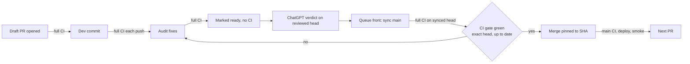
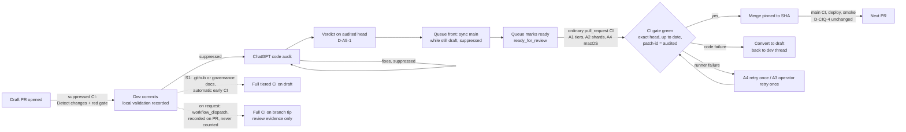
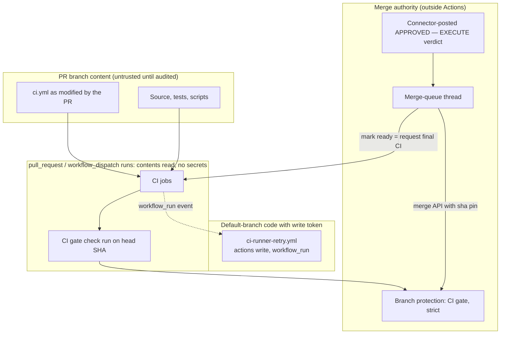

# CIQ-A5 — Draft / final validation split

**Status:** architecture and implementation proposal only (Regan's CIQ-A5 brief, 2026-11-17). Docs-only draft PR. No workflow, script, branch protection, merge-queue or production change is made or authorised by this document. Each implementation package in §10 needs its own thread, independent review and merge verdict.

**Builds on, does not rewrite:** CIQ-1 (`docs/ciq-1-merge-queue-throughput.md`, owner decisions D-CIQ-1..6), CIQ-A1 gate tiers (#143, merged), CIQ-A2 database shards (#150, merged), CIQ-A3 queue procedure (#152, open), CIQ-A4 selective macOS and bounded runner retry (#156, open). Those PRs belong to the CIQ-FAST thread; this document only names the seams where A5 touches them (§7).

**Principle:** build freely, audit independently, validate once when ready, merge safely.

---

## 0. Summary

**Recommendation: Option C in its simplest form, "A-final".** Keep the ordinary `pull_request` CI workflow as the single source of the required `CI gate`, and change *when* it does real work:

1. **Draft pushes run a suppressed CI.** On a draft PR, `ci.yml` still starts, runs the cheap `Detect changes` job (classifier self-tests, migration-order check, documentation credential scan) and then the `CI gate` job **fails** with an explicit "not validated: draft" verdict. Static, unit, build, the three database jobs and the desktop matrix do not start. Nothing is skipped into a green gate: GitHub counts a skipped required job as passing, so the gate always runs and fails closed.
2. **Final-head validation is triggered by the merge-queue thread marking the PR ready for review** at the front of the queue, after it has synced `main` into the branch. `ready_for_review` is added to the `pull_request` trigger types (today it is not one, measured in §1.3), so the run is an ordinary `pull_request` run on GitHub's merge ref for the exact final head: CIQ-A1 tiers, CIQ-A2 shards, CIQ-A4 selective macOS and the STAB-01 migration-order check all apply unchanged.
3. **Early CI stays available** two ways (recommended scope **S1**, D-A5-3): automatically only for drafts that change `.github/**` or a CI/approval governance document (§4.4); and **on request**, by a recorded manual `workflow_dispatch` of CI on the branch, which is expected before the code audit for authentication, RBAC, RLS, tenant-isolation, migration and critical-fix work and may be required by ChatGPT. Widening the automatic scope to migrations or security keywords is an explicit owner choice (S2/S3, §9.3), not part of this recommendation. Early CI is supplementary, is never counted as the final run, and never replaces final-head validation.
4. **Merge authority does not move.** It still comes only from a provenance-checked `APPROVED — EXECUTE: MERGE` verdict, a green `CI gate` on the exact up-to-date final head, and the merge API call pinned to that SHA (CIQ-A3). Triggering CI confers nothing, so no privileged dispatcher is needed.

**Why not Option B (trusted queue dispatcher):** the probe on this PR (§1.4) shows that a `workflow_dispatch` run of `ci.yml` on a PR branch attaches a green `CI gate` check run to the PR head commit, which GitHub links to the PR, **and branch protection still reports the PR `blocked`**. Minutes later, on the same PR and settings, an ordinary `pull_request` run's green gate made it `clean`. So a dispatched run, as this repository is configured, does **not** satisfy the required check, and B as specified cannot produce final-head validation without either a `pull_request` event or a privileged commit-status write (rejected below). Even if it could, a dispatched run is a different event: the A1 tier and A4 macOS decision both force `full` for non-`pull_request` events, the migration-order check is `pull_request`-only, the credential scan falls back to scanning every document, and the CIQ-A4 retry workflow ignores dispatched runs. Making B as cheap and as safe as A means rewriting A1/A4 logic and adding a privileged workflow (`actions: write`) for no security gain, because CI itself holds no privilege. B is kept as the early-CI and recovery path only.

**Measured effect on recent history (§9):** 79 merged PRs, 306 PR CI runs, 3.87 runs per PR. 200 runs (2.53 per PR) were development-stage runs that A5 would suppress; 106 (1.34 per PR) were final-candidate runs the queue still needs. With the recommended early-CI scope (S1: CI and governance changes only) A5 avoids 146 of the 200 development-stage full runs (73%, target 70%), 150 database jobs and about 1,400 Linux runner-minutes over these 2.5 days, and changes final-head verification not at all. Only 3 of 200 development-stage runs failed, so the risk of failures surfacing later is measured as low.

**Owner decisions needed (§11):** D-A5-1 verdict timing relative to final CI (changes the approval procedure, so Regan's own approval), D-A5-2 PRs stay draft until the queue marks them ready, D-A5-3 automatic early-CI scope (S1 recommended), D-A5-4 a red `CI gate` on draft heads is acceptable, D-A5-5 rollout order and measurement window.

---

## 1. Repository evidence

### 1.1 Settings (measured 2026-11-17 18:42 UTC, read-only REST)

| Setting | Value |
|---|---|
| Owner type | User (personal account): GitHub's native merge queue is not available (org-owned repositories only) |
| Visibility | public (GitHub-hosted runner minutes are free for public repositories) |
| `main` protection | classic rule; `required_status_checks.strict: true`; required check `CI gate` with `app_id 15368` (GitHub Actions); `enforce_admins: true`; no required reviews, no signatures, no linear history, force pushes and deletions off |
| Rulesets | none |
| Auto-merge / update-branch button | off / off |
| Merge methods | merge, squash and rebase all allowed |

Consequence: **any** GitHub Actions job named exactly `CI gate`, from any workflow file and any event, on the PR head commit, is a candidate for the required check. A reusable-workflow call (`nightly.yml`, `release-validation.yml`) produces `Full CI suite / CI gate`, which does not match.

### 1.2 Workflows that run on pull requests today

| Workflow | Trigger on PRs | Gating | Notes |
|---|---|---|---|
| `ci.yml` | `pull_request` (default types: `opened`, `synchronize`, `reopened`), plus push to `main`/`release/**`, `v*` tags, `workflow_dispatch`, `workflow_call`, weekly schedule | `CI gate` is the only required check | `permissions: contents: read`; PR concurrency group cancels superseded runs |
| `visual.yml` | `pull_request` on UI paths | non-gating | out of scope |
| `e2e.yml` | `pull_request` on API/contract paths | non-gating | out of scope |
| `nightly.yml` | `pull_request` on its own files (self-validation), schedule, dispatch | non-gating | calls `ci.yml` |
| `release-validation.yml` | `pull_request` on its own files, `v*` tags, dispatch | non-gating | calls `ci.yml`; must stay untouched by A5 |
| `ci-runner-retry.yml` (#156, open) | `workflow_run` of CI, `pull_request` and `push` runs only | non-gating, `actions: write` | runs default-branch code only |

### 1.3 Draft PRs today

- Opening a draft PR runs the full tiered CI, exactly as for a ready PR. Every push to a draft runs it again (the PR concurrency group cancels a superseded run, not a completed one).
- **Marking a PR ready does not start CI**: `ready_for_review` is not a default `pull_request` type. Measured on this PR: marked ready at 18:44:32 UTC, no `pull_request` run was created (§1.4, step 3).
- GitHub refuses to merge a draft PR whatever its checks say. The queue's "ready and merge" verdict line (protocol, merge-queue §3) is how drafts reach `main` today: the queue marks them ready, then merges.
- In the replay window (§9), 65 of 79 merged PRs were opened as drafts and later marked ready; 212 of their 306 CI runs (69%) ran while the PR was a draft.

### 1.4 Probe: can a manually dispatched CI run satisfy the required check? (this PR, measured)

The brief asks not to assume it. The probe used this PR's own branch, so no other branch or workflow was touched:

| Step | Action (UTC) | Observed |
|---|---|---|
| 1 | Pushed head `72452af` whose commit message contains `[skip ci]`; opened the PR as a draft (18:43) | No workflow run for the branch. Only Vercel's status. `mergeable_state: blocked` (required check never created) |
| 2 | — | A required check that was never created blocks the merge: **missing = blocked**, not green |
| 3 | Marked ready for review (18:44:32) | Still no CI run (`ready_for_review` is not a default type). `mergeable_state: blocked` |
| 4 | `workflow_dispatch` of `ci.yml` on the branch (18:44:43) | Run `44151131987`, event `workflow_dispatch`, `head_sha 72452af`, and GitHub associated it with the PR (`pull_requests: [157]`). Gate tier and desktop tier both `full` (non-PR event), so the macOS leg was scheduled |
| 5 | Run finished 19:00:53 | Every Linux and Windows job green; **macOS was never allocated** ("The job was not acquired by Runner of type hosted even after multiple attempts", cancelled at 15 min). `CI gate` failed. The PR's subscription received the `check_run.completed` failure for PR 157: GitHub treats the dispatched gate as this PR's check. Meanwhile `main` advanced: `mergeable_state: behind` |
| 6 | Merged `main` into the branch with a `[skip ci]` merge commit, head `8628ae7` (19:01) | No automatic run. Up to date with `main`. `mergeable_state: blocked` |
| 7 | Second `workflow_dispatch` (19:01:30), run `44154105031` | All jobs green including macOS; `CI gate` **success** at 19:06:07, check run on `8628ae7`, `pull_requests: [157]`, app `github-actions` |
| 8 | Read the PR four times over the next minute (head still `8628ae7`, still up to date, no reviews required, both Vercel statuses green) | **`mergeable_state: blocked`** |
| 9 | Pushed the proposal commit `17c281a` (no skip instruction), 19:07:47 | Ordinary `pull_request` run `44155244633` (synchronize), gate tier `full` (governance document), desktop skipped; `CI gate` success at 19:15:54. Head up to date with `main`. **`mergeable_state: clean`** (read three times, 19:16:33 to 19:16:53) |
| 10 | Converted back to draft (19:17:02) | `draft: true`. GitHub still reports `mergeable_state: clean` for a draft, but refuses to merge any draft |

**Conclusion (measured, one sample):**

1. A required check that is **never created** blocks the merge (steps 1, 3, 6). A `[skip ci]` head cannot slip through.
2. Marking a PR ready **does not start CI** today (step 3).
3. A `workflow_dispatch` run's green `CI gate` on the exact, up-to-date PR head **did not satisfy** branch protection (step 8), although GitHub associated the run with the PR. A `pull_request` run's green `CI gate` on the next head **did** (step 9). GitHub does not document the mechanism; the observed behaviour is consistent with required checks being evaluated against check suites triggered by the PR's own events. A5A repeats this as an automated e2e test, because Option B's viability, and the safety argument that an early dispatched run can never stand in for final validation (T5, T9), rest on it.
4. A dispatched run still forces every desktop platform: the first dispatch lost 15 minutes waiting for a macOS runner that never came (step 5), the CIQ-A4 problem live, and the A4 retry workflow would not have retried it because it handles only `pull_request` and `push` runs.

What the probe did *not* show: when two `pull_request` `CI gate` check runs exist on the same commit, branch protection uses the newest. This is consistent with every failed-job re-run in this repository turning a blocked PR mergeable (merge-queue §5, macOS stalls), but the reverse direction (a newer failing gate after an older green one) is inferred, not measured, and A5 is designed not to depend on it (§4.3, rule 4).

---

## 2. Lifecycle: current versus proposed

### 2.1 Current

### 2.2 Proposed

### 2.3 Trust boundaries

The important property: **nothing in the untrusted or unprivileged zones can produce merge authority.** A PR can make its own CI greener (pre-existing risk, §6 T1), but merge still needs the verdict, which binds the reviewed patch, and the queue's patch-id check. A5 adds no new privileged workflow.

---

## 3. Options evaluated

### 3.1 Option A — draft-state filtering

`ci.yml` reads `github.event.pull_request.draft`. Drafts get the suppressed run; non-drafts get ordinary CI; `ready_for_review` is added as a trigger type.

- **Fabricated green risk:** GitHub has no `on:` filter for draft state, so the workflow always starts and the filtering must be job-level. If the `CI gate` job itself were skipped by an `if:`, GitHub would report the required check as passing. A5 therefore keeps `CI gate` on `if: always()` and has `ci-gate.sh` fail on mode `suppressed`. That is the only fail-closed shape: skipped is green, never-created is blocked, failed is red.
- **`ready_for_review` sufficiency:** sufficient as the trigger, but only if marking ready is reserved for the queue. If a development thread marks a PR ready early, the cost is one extra full run per early mark (no safety impact). D-A5-2 makes "stay draft until the queue marks ready" the rule; the replay measures how often PRs were marked ready early today.

### 3.2 Option B — controlled queue dispatch

A trusted workflow on `main` (or the queue thread through the API) dispatches `ci.yml` for the exact PR branch after sync.

- **Required check: not satisfied** (§1.4, steps 7 and 8). The green dispatched gate landed on the exact, up-to-date head and was linked to the PR, yet the PR stayed `blocked`. Making B work would need the dispatcher to write a commit status or check run named `CI gate` itself, which needs `statuses: write` or `checks: write` and would let a workflow, rather than the checks themselves, declare the gate green: exactly the fabricated-green risk the brief forbids. Rejected.
- **And even if it were:** the run is not a `pull_request` run. It tests the head, not GitHub's merge ref (equivalent only because `strict: true` forces the head to contain `main`). A1's `docs`/`client` tiers and A4's macOS selection both fall back to `full` for non-PR events, so every final run would build all three desktop platforms, including macOS: the opposite of A4. The STAB-01 migration-order step is skipped (it is `pull_request`-only), a silent regression. The A4 retry workflow ignores dispatched runs. A dispatcher workflow needs `actions: write`, input validation of PR number and SHA, and protection against dispatching on a moved ref: new privileged code for no security benefit, since CI holds no privilege anyway.
- `repository_dispatch` only runs workflows from the default branch, so it cannot run the PR's own `ci.yml` on the PR head and does not attach to the PR head commit without extra checkout logic and a commit-status write: rejected.
- `pull_request_target` and `workflow_run` running PR code with a write token: rejected (brief §4, classic "pwn request").

### 3.3 Option C — hybrid

A for draft suppression and final validation; B's mechanism (`workflow_dispatch`) only for explicit early CI and for operator recovery. **Recommended**, with the trigger for final validation being the queue's ready-for-review (A), not a dispatcher (B).

### 3.4 Comparison

| | A: draft filter + ready trigger | B: queue dispatch | C (recommended): A + dispatch for early CI only |
|---|---|---|---|
| Credential exposure | none new; `contents: read` | new `actions: write` dispatcher, or queue-thread API calls | none new |
| Branch protection compatibility | unchanged; the required check stays the `pull_request` `CI gate` (probe: `clean`) | **not satisfied** (probe: green dispatched gate, PR `blocked`) | unchanged |
| Required-check behaviour | draft: red gate (never skipped); final: real gate on head | dispatched gate visible on head but not counted | as A; an early dispatched gate is evidence for reviewers only and is never counted by GitHub or the queue |
| Draft and same-repo branches | yes; all PR branches are same-repo here | yes (dispatch needs a branch ref) | yes |
| Merge refs and head SHAs | final run tests the merge ref; check attaches to head | tests head only; migration-order check lost | as A |
| A1/A2/A4 reuse | complete | A1 tiers and A4 macOS lost unless rewritten | complete |
| Workflow-run reduction | all draft full runs except S1 PRs (§9) | same, but each final run costs more (full tier + macOS) | as A, plus a few early runs |
| Operational complexity | one mode output, one gate rule, one trigger type | dispatcher workflow, SHA race handling, A1/A4 rework | as A, plus a documented manual dispatch |
| Rollback | revert one PR; draft runs return to full CI | revert dispatcher and queue procedure | revert one PR |

---

## 4. Recommended design

### 4.1 Run mode, decided once in `Detect changes`

A new script (`.github/scripts/ci-run-mode.sh`, self-tested like the A1 classifiers) prints `run_mode` from the event, never from PR text:

| Event | Draft | S1 path changed (§4.4) | `run_mode` | Jobs that run |
|---|---|---|---|---|
| `pull_request` `opened`/`synchronize`/`reopened`/`ready_for_review` | false | any | `final` | today's tiered CI, unchanged |
| `pull_request` same actions | true | yes (S1 list) | `early` | today's tiered CI, unchanged; gate passes or fails on results |
| `pull_request` same actions | true | no | `suppressed` | Detect changes only; gate fails "not validated: draft" |
| `pull_request`, draft field missing or not a boolean | — | — | `final` | fail closed to full validation |
| `workflow_dispatch` | — | — | `manual` | full tier, as today |
| `push`, `schedule`, `workflow_call`, tags | — | — | unchanged | as today |
| run-mode script error, missing output, unreadable or empty diff, unsafe path | — | — | `final` (or `early` on a draft) | fail closed to running everything: **an error never selects `suppressed`** |

`suppressed` is the only mode that removes jobs, and it is printed only on the single positive path: `pull_request` event, `draft` is the boolean `true`, the changed-file list was established, every path classified, and none matched S1. In every mode, including `suppressed`, `Detect changes` keeps all of its current steps: the classifier and gate self-tests, the STAB-01 migration-order check and the documentation credential scan.

Run-mode is independent of the A1 gate tier and the A4 desktop/macOS decision: those still decide *which* jobs a validating run needs.

### 4.2 Gate rule

`ci-gate.sh` gains one input, `RUN_MODE`:

- `suppressed`: exit 1 with `::error title=Not validated (draft)::…`, after confirming `Detect changes` succeeded (a failed credential scan is reported as that failure, not as "draft").
- anything else, including empty or unknown: today's rules exactly. An unknown mode is treated as validating, so a missing output can never turn a skip into a pass.

The suppressed gate is **red, not pending and not green**. That is deliberate (D-A5-4): pending would keep a check "in progress" forever and is indistinguishable from a stuck runner; green is forbidden; red with a specific title is honest and is superseded by the final run.

### 4.3 Final-head validation (merge-queue §5, step 3 refined)

1. Re-read the PR head, its draft state, `main`, and the verdict (A3's `verdict-status.sh`).
2. Sync `main` into the branch **while it is still a draft**, so the sync push runs only the suppressed CI. Conflict: halt that PR (unchanged).
3. Check `git patch-id --stable` of the PR's own changes against the audited head (unchanged rule, "Approval follows content"). Mismatch: back to the dev thread for re-audit.
4. **Mark ready.** This creates a `ready_for_review` run on the exact synced head. Record its run id. Only a `CI gate` check run that (a) belongs to a run whose `head_sha` equals the final head, (b) was created *after* the ready-for-review event, and (c) has conclusion `success` on its latest attempt counts. A green gate from an earlier early or manual run on the same SHA is never used as the final result, even though GitHub might accept it.
5. Merge with the SHA pin (A3). If `main` moved: convert back to draft, go to step 2. (Converting to draft is not a trigger type, so it starts nothing.)

Duplicate or stale requests: marking an already-ready PR ready again is a no-op on GitHub (no event), and a new push cancels the superseded PR run through the existing concurrency group. A stale `workflow_dispatch` run keeps its own concurrency group and attaches only to the SHA it started on, so it can never stand in for a later head.

### 4.4 Early CI

**Automatic (D-A5-3).** A draft runs mode `early` when any changed path is under `.github/**` or is an A1 governance document that defines CI or approval rules (`CLAUDE.md`, `AGENTS.md`, `SECURITY.md`, `docs/agent-*`, `docs/merge-queue*`, `docs/active-workstreams*`). CI and workflow changes can only be validated by running CI, and a PR that changes the gate should never sit unvalidated. The replay (§9.3) prices three wider scopes: adding migrations and privileged SQL (S2) or the A1 security keywords (S3) drops the reduction to 55% or 50%, because almost every module PR edits `tenancy.prisma` and `permissions.ts`. The script reads its list from one place shared with `classify-gate-tier.sh`, so widening it later is a one-line, reviewed change; a false positive only costs CI minutes, never safety.

**Expected on request** for authentication, RBAC, RLS and tenant-isolation changes, migration candidates and critical hotfixes: the development thread requests early CI at least once before asking for the code audit, and ChatGPT may require it as an audit condition.

**On request.** A development thread or reviewer who needs CI evidence on an ordinary draft (for example, ChatGPT asks for a database run local testing cannot reproduce) dispatches `ci.yml` on the branch (Actions → CI → Run workflow, or the API) and posts a PR comment `EARLY CI: <run url> for <sha>, reason: …`. That is auditable (the run records the actor; the comment records the reason) and needs no new trigger. It runs the full tier with all three desktop platforms, so it is reserved for genuine need.

Rejected: a `ci:early` label (needs the `labeled` trigger type, which would also fire on every `queue:*` label change and cancel in-progress final runs through the concurrency group), and PR title or body markers (not events; editable by anyone with write).

### 4.5 Verdict timing (D-A5-1)

The brief describes `CODE AUDIT PASS — CI PENDING` followed by an executable verdict *after* final CI. Two workable readings:

- **V1, verdict after final CI (brief literal).** The queue runs final CI, then waits for ChatGPT to post `APPROVED — EXECUTE: MERGE` on the green final head. Adds a ChatGPT round-trip to the serialized front of the queue for every PR: CIQ-FAST measured a median 36 min from CI completion to verdict, so the queue would idle about 36 min per PR.
- **V2, verdict before final CI (recommended; today's protocol).** ChatGPT posts the executable verdict on the audited draft head, with its `Ready and merge` line, once local validation evidence is recorded. The protocol already makes it conditional on the mandatory safeguard "`CI gate` independently verified green on the up-to-date final head" and on unchanged content (patch-id). CI binds the commit; the verdict binds the code; both must hold at merge. A final-CI code failure means a fix commit, which voids the verdict by the existing rule.

V2 needs no change to `docs/agent-task-protocol.md`. V1 changes the approval procedure and therefore needs Regan's own approval and a protocol PR. Either way `CODE AUDIT PASS — CI PENDING` is never execution approval.

### 4.6 Failure handling (Phase D)

| Final-CI result | Classified by | Action | Re-audit? |
|---|---|---|---|
| test, lint, type, build or DB failure | job logs, gate summary | convert to draft, return to dev thread; queue moves to next eligible PR (merge-queue §4) | yes if the fix changes behaviour (new commit always needs a fresh verdict) |
| runner never allocated (macOS) | A4 `runner-retry-decide.sh` | A4 retries once automatically; A3 allows one operator re-run per SHA; second failure: infra-failure report, PR keeps its slot | no (same SHA) |
| cancelled (superseded by push) | run conclusion | the newer run is the candidate; the older is ignored | per the push |
| run never created or stuck queued | no check run / `queued` after 15 min | treat as not validated. Re-marking ready is a no-op and a dispatch never counts, so the **merge-queue thread** converts the PR to draft and back to ready **once**, recorded in the delegated operation record; a second miss is reported to Regan and the PR keeps its slot | no |
| credential scan failure | Detect changes | stop; treat as a security incident per protocol | yes |

A failed candidate never stalls unrelated PRs: the queue already takes the first *eligible* PR.

---

## 5. Event and required-check compatibility matrix

| Event / transition | Today | Proposed | `CI gate` on head | Merge possible? |
|---|---|---|---|---|
| draft opened | full tiered CI | suppressed (or early) | red "not validated" (or real) | no: draft, and gate red |
| push to draft | full tiered CI | suppressed (or early) | red (or real) on the new SHA | no |
| draft marked ready | **no run** | `ready_for_review` → final | real result on head | only with verdict + green + up to date |
| push to ready PR | full tiered CI | final | real | as above |
| ready converted to draft | no run | no run | unchanged on that SHA | no: draft |
| reopened | full | final if ready, else suppressed | per mode | per mode |
| sync merge of `main` while draft | full | suppressed | red on new SHA | no |
| `[skip ci]` head commit | no run | no run | **missing → blocked** (probe) | no |
| `workflow_dispatch` on PR branch | full, all platforms | unchanged (`manual`) | real result on branch tip, but **does not satisfy** protection (probe) | no; never used as the queue's final evidence (§4.3) |
| re-run failed jobs | newer attempt | unchanged | latest attempt counts | per latest |
| push to `main`, tags, release branches, weekly, nightly, release validation | unchanged | unchanged | n/a | n/a |
| PR edits a workflow to skip the gate | gate may go green (T1) | unchanged risk | — | still needs verdict + patch-id |

---

## 6. Threat model

| # | Threat | Vector | Control | Residual |
|---|---|---|---|---|
| T1 | PR rewrites `ci.yml` or `ci-gate.sh` so its own gate passes | `pull_request` runs use the PR's workflow file (pre-existing, not introduced by A5) | `.github/**` is always full tier and governance; ChatGPT audits the diff; verdict + patch-id bind the reviewed workflow; A5 makes such PRs automatic early CI so reviewers see the real result | unchanged by A5; hardening option (a required workflow from `main`) is org-only on GitHub |
| T2 | Draft skip produces a green gate | job-level `if` skips `CI gate` | gate is `if: always()` and fails in `suppressed`; unit test asserts every mode's exit code; e2e probe asserts `mergeable_state: blocked` on a suppressed head | none known |
| T3 | Draft flag forged | event payload | `draft` comes from GitHub's event, not PR text; a missing/non-boolean value selects `final` | none |
| T4 | Author grants own merge authority | marking ready, labels, comments, dispatching CI | none of these confer authority; merge needs the connector verdict (provenance check), green final gate, SHA pin; only the queue thread merges | none new |
| T5 | Stale green reused for a new commit | early/manual run green on old SHA | checks attach to SHAs; strict up-to-date; §4.3 rule 4 requires a run created after ready-for-review on the exact final head | none |
| T6 | Duplicate dispatch / double ready causes accidental merge | repeated events | ready on a ready PR is a no-op; dispatch runs are evidence only; merge is a separate, SHA-pinned API call by one thread | none |
| T7 | Crash or missed event leaves a silent green | runner lost, workflow never triggered | never-created = blocked (probe); cancelled = failure; `ci-gate.sh` treats empty results as failure; queue requires an observed run id | none |
| T8 | Privileged code runs PR content | `pull_request_target`/`workflow_run` | not used by A5; A4's retry runs default-branch code only and never checks out PR code | as reviewed in #156 |
| T9 | Early-CI bypass of final validation | early green on a draft head treated as final | early never counts (§4.3); draft cannot merge | none |
| T10 | Late discovery: defects surface only at the queue front | fewer intermediate runs | local validation evidence required before audit; S1 paths keep automatic early CI; security, migration and critical-fix work requests early CI before audit (§4.4); nightly full suite on `main` unchanged | measured in §9.3; owner trade-off D-A5-3 |
| T11 | Credential pushed to a draft | suppressed mode | the documentation credential scan stays in `Detect changes` on every draft push | the repo is public: a push is exposure regardless; scan only detects |
| T12 | Token scope creep | new workflows | A5 adds no workflow and no permission; `ci.yml` stays `contents: read` | none |

---

## 7. Interaction with CIQ-A1 to A4

| Package | What it does | A5 touches | Compatibility | Regression coverage in A5B |
|---|---|---|---|---|
| A1 tiers (#143, merged) | `classify-gate-tier.sh`, tier-aware `ci-gate.sh`, credential gate | adds `RUN_MODE` to `ci-gate.sh`; reuses the A1 governance list for the S1 scope in §4.4 (source it, do not copy) | tiers apply unchanged in `early`/`final`; `suppressed` short-circuits before tiers | every existing `ci-gate.test.sh` case re-run with `RUN_MODE=final` and with empty mode; new cases for `suppressed` × every job result |
| A2 shards (#150, merged) | 3 shards + pooler + completeness | job `if:` gains `run_mode != 'suppressed'` | completeness job keeps its `always()` + tier condition plus mode | a suppressed run must show all four DB jobs skipped and the gate red |
| A3 queue (#152, open) | verdict detection, SHA-pinned merge, bounded operator retry | merge-queue §5 step 2–4 refinements (§4.3); `verdict-status.sh` should report "not validated (draft)" separately from a real failure | additive; A5C edits `docs/merge-queue.md` only after #152 merges, as a governance change needing Regan's own approval | `verdict-status.test.sh` fixture for a suppressed gate |
| A4 macOS (#156, open) | macOS only for native-affecting PRs; one retry of unallocated runners | desktop job `if:` gains mode condition | macOS decision unchanged in `early`/`final`; retry workflow sees suppressed runs as `failure` with no cancelled jobs → decides "not retried" (one ~10 s job per draft push; A5B may filter on the gate's error title to skip even that) | `runner-retry-decide.test.sh` fixture: suppressed run is never retried |
| Nightly / release validation | `workflow_call` of `ci.yml` | none | `workflow_call` keeps mode `manual`/full | `release-workflow-guard.test.sh` unchanged |

A5B must land **after** #156 so the two edits to the desktop job and `ci-gate.sh` do not conflict; it changes only conditions, not the A1/A4 logic.

---

## 8. Tests, acceptance and rollback

### 8.1 Automated tests (A5A and A5B)

Unit (shell self-tests run in `Detect changes`, like A1/A4): `ci-run-mode.test.sh` with fixture event payloads, and new `ci-gate.test.sh` cases.

End-to-end (A5A harness `scripts/ci-probe/` run by hand or by the A5D measurement job; throwaway probe PRs on branches the probing thread owns, closed afterwards, as CIQ-FAST did with #144–#149): each test opens or updates a PR, waits for the check runs, and asserts on run ids, check runs per SHA and `mergeable_state` read from the REST API.

| # | Brief criterion | Test | Type |
|---|---|---|---|
| 1 | draft PR does not launch full CI | open draft with a `client`-tier change; assert only `Detect changes` + `CI gate` jobs exist, gate `failure` with title "Not validated (draft)" | e2e |
| 2 | repeated draft pushes do not repeat full CI | three pushes; assert three suppressed runs, zero static/unit/build/DB/desktop jobs | e2e |
| 3 | draft cannot merge without checks | assert `mergeable_state` is `blocked` on suppressed head, and on a `[skip ci]` head (probe step 1 repeated) | e2e |
| 4 | audit-ready status confers nothing | ready PR with green gate but no verdict: `verdict-status.sh` reports `NOT COVERED`; queue procedure refuses | unit (A3 fixtures) |
| 5 | authorised request targets the intended SHA | mark ready; assert the new run's `head_sha` equals the PR head and the run was created after the event | e2e |
| 6 | forged trigger cannot start privileged activity | assert no A5 path runs with a write token; comment, label and title edits start no `ci.yml` run; `actionlint`-style check that `ci.yml` permissions stay `contents: read` | unit + e2e |
| 7 | gate on the correct final commit | after sync + ready, check run list for the final SHA has exactly one non-suppressed `CI gate` from the ready run | e2e |
| 8 | new commit invalidates validation | push after green; assert new SHA has a fresh run and the PR is `blocked` until it finishes | e2e |
| 9 | failed CI prevents merge | probe commit with a failing unit test, ready: gate `failure`, `mergeable_state: blocked` | e2e |
| 10 | retries respect A4 | `runner-retry-decide.test.sh` fixtures: suppressed run → no retry; allocation failure → one retry; attempt 2 → none | unit |
| 11 | `main`, nightly, release intact | `ci-run-mode.test.sh`: push/schedule/workflow_call/tag never `suppressed`; first `main` run after A5B merges checked by the queue | unit + post-merge |
| 12 | security-sensitive early CI | draft touching `.github/`: mode `early`, full tiered jobs run. Draft touching only a `tenant` path: `suppressed` (S1), and a recorded dispatch runs full CI on its head whose gate never satisfies protection or the queue | e2e |
| 13 | sync conflict and content change trigger re-audit | A3 patch-id check fixture with a changed patch → `NOT COVERED` | unit |
| 14 | stale or duplicate requests cannot merge | double ready; dispatch on old SHA then push; assert old SHA's green gate is not on the new head and merge with `sha` pin of old SHA is refused (409) | e2e |
| 15 | crash or missed event cannot be green | gate with every upstream result empty or `cancelled` in every mode fails; never-created check = `blocked` | unit + e2e |

### 8.1a Pre-implementation acceptance gate (audit of `ea244db`, correction 3)

A5B may not merge, and A5C may not start, until A5A's automated probes show all of these on throwaway probe PRs, with run ids and SHAs posted on the A5A PR:

1. **Ready event:** marking a synced draft ready starts a `pull_request` run with action `ready_for_review`, whose checkout is the PR's merge ref (`refs/pull/<n>/merge`, first parent = current `main` tip, second parent = the final head), and whose completed `CI gate` check run sits on the exact final head SHA; the PR then reads `clean`.
2. **Early gate never counts:** on one probe PR, a recorded dispatch turns green on head X; then the PR is converted to draft and back to ready without a new commit. The queue procedure (§4.3 rule 4) selects only the post-ready `pull_request` gate, and before that run completes the PR reads `blocked`. Repeat with a new commit between the dispatch and the ready.
3. **Suppressed run keeps its checks:** a suppressed run executes every self-test, the migration-order check and the documentation credential scan; a probe commit adding an out-of-order migration and one adding a test credential pattern each fail `Detect changes` while the PR is a draft.
4. **Errors never suppress:** unit fixtures for a failed diff, an empty list, an unsafe path, a script error and a missing `draft` field each produce `early` or `final`, never `suppressed`; one e2e probe forces the diff failure (no merge commit available) and shows full jobs run.

### 8.2 Rollback

Each package is one revertible PR. Reverting A5B restores full CI on every draft push with no other change: the queue's final-head rule never relied on drafts being suppressed. There is no development-thread bypass. Marking ready stays with the merge-queue thread even for testing; a development thread that needs CI evidence uses a recorded early dispatch, which never counts as the final run (§1.4, §4.3). Operational recovery (a final run never created or stuck) is the merge-queue thread's single, logged draft-and-ready cycle in §4.6, then Regan. If the suppressed gate ever misbehaves (for example, shows green), the queue halts per merge-queue §6 and A5B is reverted through the queue.

---

## 9. Historical replay

### 9.1 Method

- **Source:** GitHub REST API, read-only, 2026-11-17 18:45 UTC. Every `ci.yml` run created from 2026-11-15 05:13 to 2026-11-17 18:37 UTC (452 runs: 371 `pull_request`, 79 `push`, 1 dispatch, 1 schedule) with every job of every attempt, and every PR merged from 2026-11-15 (79 PRs, #36 to #150) with its commits, changed files and `ready_for_review` timeline events.
- **Mapping:** a `pull_request` run belongs to a PR when its head branch matches and it started between the PR's creation and its merge: 306 runs. Runs for PRs not yet merged, closed probes and runs before 2026-11-15 are excluded, so per-PR counts for the oldest PRs are slightly low.
- **Final-candidate runs:** the latest run on each sync-merge head after the PR's last code commit (the queue's syncs), or on the merged head if there was no later sync. These are runs A5 keeps. **Dev-stage runs:** every other run. Under A5 they become suppressed runs (measured cost of `Detect changes` + `CI gate`: 0.34 runner-minutes each), except for PRs that get automatic early CI.
- **Minutes:** job wall-clock (`completed_at − started_at`) per runner OS. The repository is public, so hosted minutes are not billed; minutes here are capacity and macOS contention, not money.
- Scripts and per-PR data: `docs/evidence/ciq-a5/replay-fetch.py`, `docs/evidence/ciq-a5/replay.py`, `docs/evidence/ciq-a5/replay-prs.csv`.

### 9.2 Measured (what happened)

| Measure | Value |
|---|---|
| Merged PRs / PR CI runs | 79 / 306 |
| CI runs per PR | median 3, mean 3.87, max 12 |
| Commits per PR | median 4 (median 3 code commits); 136 sync-merge commits in total |
| PRs opened as draft / opened ready | 65 / 14 |
| Runs while the PR was a draft | 212 (69% of PR runs) |
| Final-candidate runs | 106 (1.34 per PR) |
| Dev-stage runs | 200 (2.53 per PR) |
| Dev-stage jobs | 1,546 jobs: 57 macOS (2 never got a runner), 208 database, 2,006 Linux min, 155 macOS min, 167 Windows min |
| Final-candidate jobs | 870 jobs: 32 macOS (4 never got a runner), 122 database, 1,286 Linux min, 134 macOS min, 102 Windows min |
| Failed dev-stage runs (conclusion `failure`) | 3 runs in 2 PRs; 0 failed final-candidate runs; 18 runs needed a re-run (mostly macOS allocation) |
| Successful PR run duration | median 7.0 min, p90 8.9 min (first attempts) |
| `push` runs on `main` | 79 runs, 74 macOS jobs (5 never got a runner): untouched by A5 and by A4 |

The defects that draft CI found were rare: 3 failing dev-stage runs out of 200. Local validation already catches most problems before push; most dev-stage runs re-confirmed green code.

### 9.3 Projected (A5 applied to the same history)

| Early-CI variant (D-A5-3) | PRs with automatic early CI | Dev-stage full runs avoided | % of dev-stage | % of all PR runs | Full runs per PR | macOS jobs avoided | DB jobs avoided | Linux / macOS / Windows min avoided | Failing runs that would move later |
|---|---|---|---|---|---|---|---|---|---|
| S0 request-only | 0 | 200 | 100% | 65% | 1.34 | 57 | 208 | 1,938\* / 155 / 167 | 3 |
| **S1 `.github/**` + governance docs (recommended)** | 17 | 146 | **73%** | 48% | 2.03 | 16 | 150 | 1,393\* / 37 / 47 | 2 |
| S2 S1 + migrations, privileged SQL, `docker/init` | 29 | 110 | 55% | 36% | 2.48 | 10 | 113 | 1,098\* / 22 / 27 | 2 |
| S3 S2 + security keywords (A1 list) | 33 | 101 | 50% | 33% | 2.59 | 7 | 103 | 991\* / 17 / 21 | 2 |

\* net of the suppressed runs' own cost (0.34 min each).

- **Target** (≥70% fewer automated draft-stage full runs): met by S0 and S1, missed by S2 and S3. S3 catches almost every module PR, because each new module edits `tenancy.prisma` and `permissions.ts`; that is why the keyword rule is the costliest. Migrations and auth changes still get early CI on request (§4.4), and the Mac session's migration rehearsal is unchanged.
- **macOS:** A5's macOS saving overlaps with A4 (#156), which already removes macOS from most non-native PRs; the two are not additive. The largest remaining macOS demand is `main` pushes, which neither A4 nor A5 changes.
- **Final validation is not reduced:** 1.34 final-candidate runs per PR stays, because those are the queue's own sync runs. A5 removes development churn, not final verification.
- **Merge-queue completion time:** unchanged with D-A5-1 V2, because the queue already runs one CI per synced head at the front (median 7.0 min). With V1, add the ChatGPT round-trip at the front: CIQ-FAST measured a median 36 min from reviewed-head CI to verdict.
- **Late-failure risk:** measured low (3 of 200 dev runs failed, 0 final runs failed). Under A5 such a failure appears at the queue front instead, costs one extra final run and a return to draft, and does not block other PRs (merge-queue §4).
- **Not modelled:** behaviour changes (developers pushing more often once drafts are cheap), early-CI requests (unknown rate; each is one full run with all three desktop platforms), and the PRs that would be marked ready early despite D-A5-2 (3 of 79 had dev-stage runs after being marked ready).

---

## 10. Implementation packages

| Package | Scope | Depends on | Owner gate |
|---|---|---|---|
| **CIQ-A5A** | `ci-run-mode.sh` + tests; `ci-gate.sh` `RUN_MODE` input + tests; e2e probe harness under `scripts/ci-probe/` (read-only API calls and throwaway PRs) | #156 merged (avoids `ci-gate.sh` conflict) | ChatGPT audit + merge verdict; touches CI governance (full tier) |
| **CIQ-A5B** | `ci.yml`: `ready_for_review` trigger type, `run_mode` output, job conditions, gate input; `docs/ci.md` section; early-CI dispatch note | A5A, and every §8.1a probe passed | ChatGPT audit; e2e evidence from probe PRs 1–3, 5, 7–9, 12, 14, 15 before merge |
| **CIQ-A5C** | `docs/merge-queue.md` §5 refinement (§4.3), `verdict-status.sh` "not validated (draft)" state, protocol wording for D-A5-1/D-A5-2 | A5B merged, #152 merged | Regan's own approval (approval-model documents) |
| **CIQ-A5D** | measurement: runs per PR, suppressed vs final, macOS and DB jobs, late failures; compare against §9 after 2 weeks or 40 merges; rollback drill (revert on a probe branch) | A5B live | report only |

A5A and A5B can be one PR if the reviewer prefers; A5C must stay separate because it changes approval-model documents.

---

## 11. Decisions for Regan

| ID | Question | Options | Recommendation |
|---|---|---|---|
| **D-A5-1** | When may ChatGPT post the executable merge verdict? | V1: after final CI is green (adds ~36 min per PR at the queue front). V2: on the audited head before final CI, conditional on the existing mandatory green-final-gate safeguard (today's protocol) | **V2.** CI binds the commit, the verdict binds the code; both still required. V1 changes the approval procedure and needs Regan's own approval |
| **D-A5-2** | Who marks a PR ready? | merge-queue thread only, at the front, after sync / anyone when audit passes | **Merge-queue thread only**, with no development-thread exception, even for testing. Development threads that need CI evidence use a recorded early dispatch, which never counts (§4.4, §8.2) |
| **D-A5-3** | Automatic early-CI scope (§4.4)? | S0 request-only / **S1** `.github/**` + governance docs / S2 S1 + migrations and privileged SQL / S3 S2 + A1 security keywords | **Yes, scope S1** (`.github/**` and governance documents): measured 73% reduction of draft-stage full runs. Wider scopes S2 (plus migrations, 55%) and S3 (plus security keywords, 50%) miss the 70% target because nearly every module PR touches `tenancy.prisma` and `permissions.ts`; those PRs get early CI on request instead (§4.4, §9.3) |
| **D-A5-4** | Accept a red `CI gate` with title "Not validated (draft)" on every draft head? | yes / no (the only alternatives are green, forbidden, or no CI at all, which also drops the credential scan) | **Yes** |
| **D-A5-5** | Rollout | A5A+A5B, then A5C, then 2-week A5D measurement / all at once | **Sequential**, after #152 and #156 merge |

Not decisions (already settled and unchanged): `CI gate` stays the only required check; branch protection, D-CIQ-4 post-merge waits, the delegated approval model, and no paid runners.

---

## 12. Limits of this proposal

- The probe ran once, on one PR; A5A repeats it as automated e2e tests before A5B merges.
- "Newest `CI gate` check run wins" is inferred from re-run behaviour, not measured in both directions; the design does not depend on it (§4.3 rule 4).
- "A dispatched gate does not satisfy the required check" is one observation on one PR, and GitHub does not document it. The design is safe either way: if a dispatched gate did count, §4.3 rule 4 still stops the queue using it, and a draft cannot be merged.
- The replay infers draft periods from `ready_for_review` timeline events and assumes PRs would have stayed draft until the queue front. It does not model behaviour changes (for example, developers batching pushes differently once drafts are cheap).
- Runner minutes are wall-clock job durations from the Actions API, not billed minutes (public repository: hosted runners are free); "cost" here means runner capacity and macOS contention, not money.
