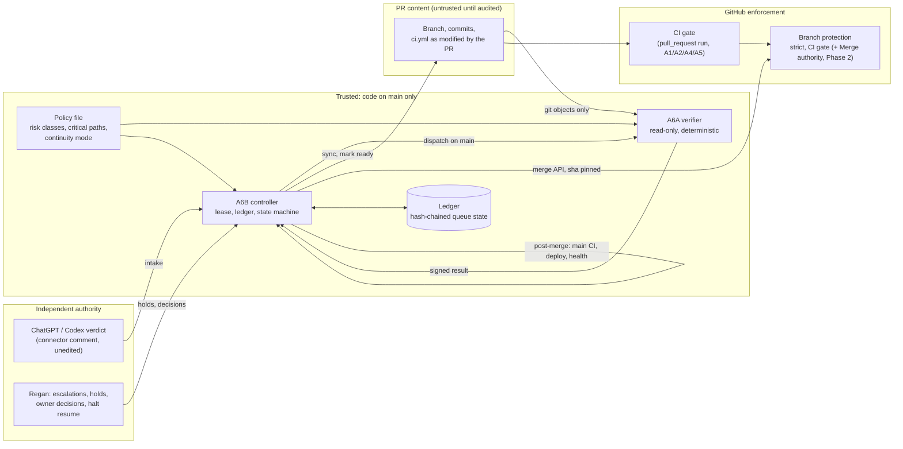
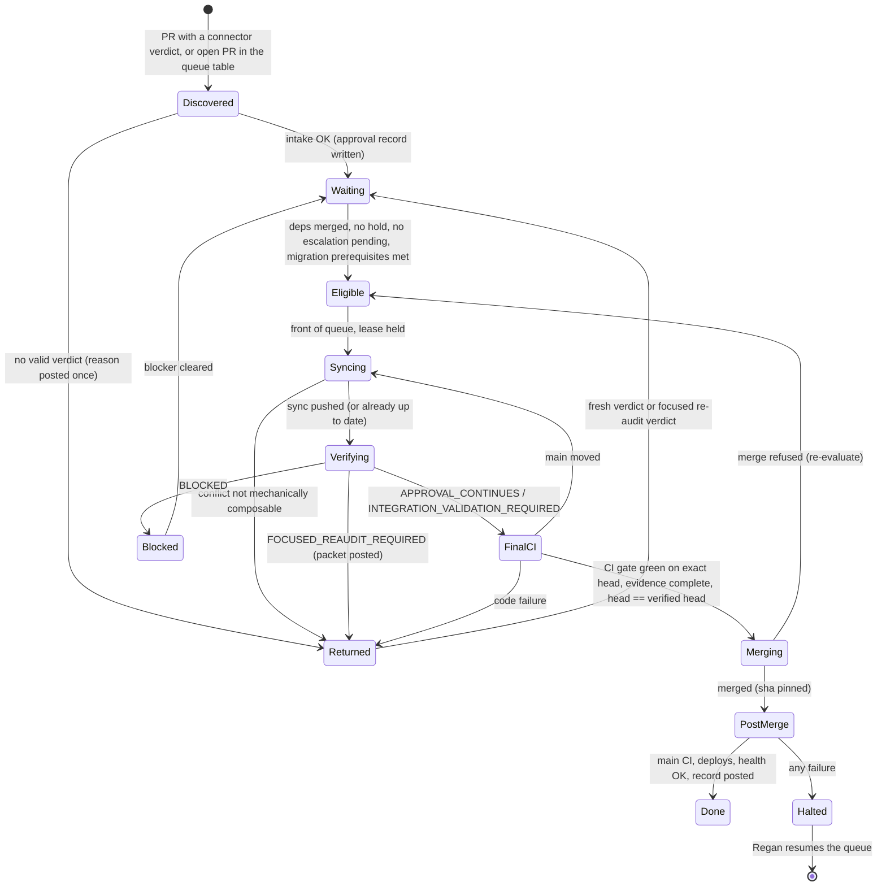

# CIQ-A6 — Risk-based CI and autonomous merge governance

**Status:** architecture and implementation plan only (Regan's CIQ-A6 brief, 2026-11-18). Docs-only draft PR. No workflow, script, branch protection, merge, label, production or approval-model change is made or authorised by this document. Every implementation package in §15 needs its own thread, independent review and merge verdict, and the packages that change the approval model need Regan's own approval.

**Builds on, does not rewrite:** CIQ-1 (`docs/ciq-1-merge-queue-throughput.md`, D-CIQ-1..6), CIQ-A1 gate tiers (#143), CIQ-A2 database shards (#150), CIQ-A3 queue procedure and verdict detection (#152, #158), CIQ-A4 selective macOS and bounded runner retry (#156), CIQ-A5 draft/final validation split (#157, D-A5-1..5). All of them are merged. This document names the seams where A6 touches them (§13).

**Owner decisions (2026-11-18 15:46 UTC):** D-A6-1 to D-A6-12 accepted as written (§16), under the revision 2 safeguards. Enforcement stays off; credentials and branch protection still need Regan's own action when the time comes.

**Revision 2 (2026-11-18, Regan's design review, conditional architecture approval for further development only, not merge or activation authority):** shadow mode now needs at least two weeks **and** at least 40 representative decisions with zero unexplained false approvals (§14.3); unattended merges are gated on a measured proof that the ledger compare-and-swap really gives the concurrency protection assumed in §7.3 (§7.3a, new package A6P); and §4.6, §11 and §18 state plainly that the prototype results do not show the real verifier, lease or controller is safe. Next step: build the read-only verifier and run it in shadow mode only.

**Principle:** audit once, carry the approval forward when the code is provably the same, and send only the part that really changed back to an auditor.

---

## 0. Summary

**The problem, measured.** In the 35 PRs merged with a connector merge verdict between 2026-11-17 06:47 and 2026-11-18 04:53 UTC, ChatGPT posted **47** `APPROVED — EXECUTE: MERGE` comments: **12 were repeats**, and 8 of those 12 belong to just three PRs (#119, #120, #124). On the evening of 2026-11-17 the queue stopped at 21:33 UTC with those three PRs waiting only for fresh verdicts. The usable verdicts arrived between 03:47 and 03:52 UTC, **more than six hours later**. Then merging #124 created new conflicts, and two more verdicts and two owner approvals were needed before #119, #120 and #122 could land. Replaying the actual commits (§11) shows that **none of the approved implementations had changed**:

- #124's approval was rejected because the `git patch-id` rule hashes context lines, and a neighbouring merge (#130) moved them. The PR's own added and removed lines, and the file it produced, were byte-identical.
- #119 and #120 had genuine textual conflicts in `app.tsx`, `index.ts` and `registry.ts`, but every resolution was the mechanical union of both sides (for example `scheduling: schedulingOverride, settings: settingsOverride` in one signature). ChatGPT itself concluded each time that nothing substantive had changed.
- #122's stacked delta over #119 was line-for-line identical after #119 squash-merged.
- 6 of the 12 repeats were reposts for the same head within minutes (two SHAs labelled "head", a hedged "Ready and merge" line), not content questions.

**Recommendation.** Build three trusted pieces, all owned by code on `main`, none of which a PR or a Claude thread can change for itself:

1. **A6A, the approval continuity verifier.** A read-only, deterministic check that runs from `main` in GitHub Actions. It compares a synced candidate with the audited content by *reproducing* the sync: it replays the approved delta onto current `main` with `git merge-tree` and requires the candidate to be exactly that result (**L0**). Where git reports a conflict, it accepts only a resolution that equals a token-level three-way composition of both sides (**L2**), outside critical paths. It returns `APPROVAL_CONTINUES`, `INTEGRATION_VALIDATION_REQUIRED`, `FOCUSED_REAUDIT_REQUIRED` or `BLOCKED`, and for a re-audit it hands the auditor only the residual delta. The first two keep the original approval with no ChatGPT conversation. A prototype (`docs/evidence/ciq-a6/`) classifies all 9 real sync steps of #119, #120, #122 and #124 as approval-retaining, flags #123's genuine post-verdict edits for re-audit, agrees with today's rule on all 29 PRs where the patch-id matched, and passes 10 of 10 synthetic attack and composition scenarios. That is evidence for the algorithm, not proof that the real verifier, lease or controller is safe (§4.6).
2. **A6B, a single queue controller.** A level-triggered reconciler with persistent, hash-chained state, a compare-and-swap lease with a fencing token, idempotent operation IDs, bounded retries and SHA-pinned merges. It discovers approved PRs, respects holds and dependencies, syncs at the front, calls the verifier, triggers final CI through the CIQ-A5 ready-for-review path, merges, verifies `main` CI, deploy and health, and moves to the next eligible PR. It runs in two phases: first as deterministic scripts driven by the existing merge-queue thread, then (owner decision D-A6-4) as an Actions workflow using a dedicated GitHub App, with a required `Merge authority` check that only that App can write.
3. **A6C, risk classes in a policy file on `main`.** Routine, Elevated and Critical, computed from the changed paths and never lowered by the PR or by an auditor. Each class sets minimum evidence that the controller verifies from the job results, not from the PR's own tier output. Critical changes never inherit an approval across anything but an exact reproducible merge with no overlapping files.

**A6D** then narrows escalation to genuine exceptions: changed behaviour, a non-mechanical resolution, new risk, missing or contradictory evidence, unresolved findings, or exceeded scope. Repeated approvals of unchanged code become a protocol violation rather than a routine step.

**What does not change:** `CI gate` stays the only required CI check, branch protection keeps `strict: true` and is not weakened, D-CIQ-4 post-merge waits stay, a merge verdict never covers a migration, and every escalation in `docs/agent-task-protocol.md` stays with Regan.

**Projected effect (§12):** on the replayed PRs, 11 repeat approval requests (9 connector verdicts and 2 owner approvals) and 11 coordinator relays go to zero, and roughly 6 h 20 min of approval waiting per PR goes to about 2 minutes of verification. Across all 35 PRs, the 12 repeat verdicts would have become one focused re-audit (#123, whose content did change). Queue throughput while running stays bounded by CI and deploy time (about 3 to 5 PRs an hour), but the queue no longer stops for hours waiting on people.

**Owner decisions (§16):** D-A6-1 to D-A6-12. The four that matter most: adopt approval continuity in place of the exact-head/patch-id rule (D-A6-1), accept token-level composition as mechanical outside critical paths (D-A6-2), let the controller write mechanical resolution commits itself (D-A6-3), and the Phase 2 hosting with a dedicated GitHub App and a second required check (D-A6-4, a credential and branch-protection change, so Regan's alone).

---

## 1. Repository evidence

### 1.1 Settings (measured 2026-11-18 04:50 UTC, read-only REST)

| Setting | Value | Consequence for A6 |
|---|---|---|
| Owner type | `User` (public repository) | Native GitHub merge queue is not available (§10). Branch protection cannot restrict who may push or merge (that option exists only for organisation repositories). |
| Branch protection on `main` | classic rule, `strict: true`, required check `CI gate` pinned to app 15368 (GitHub Actions), `enforce_admins: true`, no required reviews | Anyone whose token can merge can merge once `CI gate` is green. Today that includes every agent, because all of them act through the owner's account. |
| Rulesets | none | — |
| Merge methods | merge commits and squash allowed; auto-merge off; "update branch" suggestion off | The controller merges through the API with a `sha` pin, as CIQ-A3 does. |
| Agent identity | all agents post through the owner's account; the app tag tells them apart (`chatgpt-codex-connector`, `claude`, none for Regan's web comments) | The connector slug proves the integration, not the session (owner risk acceptance, 2026-11-17). |
| Workflows | `ci.yml` (`pull_request`, push to `main`, dispatch, call, schedule), `ci-runner-retry.yml` (`workflow_run`, `actions: write`), `e2e.yml`, `nightly.yml`, `release-validation.yml`, `visual.yml` | CI holds no write privilege. Only the A4 retry workflow has a write token, and it runs from `main`. |

Measured facts reused from CIQ-A5 (#157, §1.4): a `workflow_dispatch` run's green `CI gate` on an up-to-date PR head does **not** satisfy the required check here, while a `pull_request` run's does. Marking a PR ready does not start CI today. A5 adds `ready_for_review` to the trigger types (D-A5-2: only the queue marks PRs ready).

### 1.2 How approvals are checked today

`docs/agent-task-protocol.md` "Approval follows content": after a sync merge from `main`, the approval holds only if the sync had no conflicts, `git patch-id --stable` of the approved delta equals that of the candidate delta, and `CI gate` passes on the final head. Otherwise a fresh ChatGPT audit and verdict are required. `scripts/merge-queue/verdict-status.sh` (CIQ-A3, #158) finds valid verdicts and reports `exact head`, `same patch-id` or `NOT COVERED`.

This rule is safe, but it is wrong in both directions for what we need:

- **False alarms.** `git patch-id` hashes the diff *including context lines*. When `main` changes a line next to the PR's change, the patch-id changes although the PR's own change has not. That is exactly what happened to #124 (§11.2).
- **No room for mechanical conflicts.** Any conflict, however trivial, voids the approval. Shared shell files (`app.tsx`, `shell/registry.ts`, `index.ts`) are edited by nearly every Zone PR, so conflicts there are routine.
- **No delta for the auditor.** A re-audit request carries the whole PR again, so ChatGPT re-reviews 21 to 35 files to confirm that one line was composed correctly.

### 1.3 Where the time went (the evening of 2026-11-17)

From the merge-queue thread and the PR timelines (all times UTC):

| Time | Event |
|---|---|
| 13:42 | #119 and #124 receive valid `APPROVED — EXECUTE: MERGE` verdicts (heads `fd35003`, `0f953c2`). #120's follows at 16:40 (`74b3788`). |
| 21:08 | #130 merges and touches `app.tsx`. |
| 21:21–21:24 | #124 is synced cleanly (`0aba1b0`). #119 and #120 conflict, and their threads resolve the conflicts (`421757d`, `a2a8b50`). CI is green on all three by 21:28. |
| 21:33 | The queue reports that 124, 119 and 120 "need fresh approvals" and pauses. |
| 03:45–03:52 | Six connector verdicts on the three PRs. Three are rejected by the parser (two labelled heads, or a hedged ready line). Regan asks ChatGPT to repost. |
| 03:50–04:12 | #124 is synced again (`main` had moved five commits during the wait), CI runs again, and it merges. |
| 04:14–04:19 | #119 now conflicts with #124 and is resolved (`b7af043`). ChatGPT posts a post-sync audit "CI PENDING", then a verdict. It merges at 04:21. |
| 04:22–04:53 | #120 conflicts with #119 and is resolved (`916462e`). #122 is retargeted and synced twice. Both merge on Regan's own approval (04:47 relay), without a connector verdict on their final heads. |

Under the current rule the queue cannot progress overnight without people, and the owner, whose role is escalations, ended up approving routine merges directly to unblock it.

---

## 2. Why repeat approvals happen: a taxonomy

| Cause | Seen in | Today | A6 |
|---|---|---|---|
| **C1 Context drift**: `main` changes lines next to the PR's hunks | #124 (`0f953c2` → `0aba1b0`) | patch-id differs, so fresh verdict | L0 reproducible merge: the candidate tree equals the replay of the approved delta. Approval continues (with integration validation, because the files are shared). |
| **C2 Mechanical conflict**: both sides add to the same list, signature, export block or union type | #119 (`index.ts`, then `app.tsx`), #120 (`app.tsx`, `registry.ts`) | conflict, so fresh audit and verdict | L2 token-level composition outside critical paths: approval continues with integration validation. The controller can even write the resolution itself (D-A6-3). |
| **C3 Stacked PR retarget**: the parent squash-merges, and the child's base changes | #122 | no approval exists for the child's delta alone, so a verdict after the retarget | The approval names its base (the parent's audited head), and the verifier replays the delta from that base (§4.4). |
| **C4 Verdict format rejection**: two SHAs after the word "head", or a hedged "Ready and merge" | same-head reposts on #119 (×2), #120, #124, #139, #156; heading-form rejection on #135 | repost | Structured verdict block v2 (§4.2), checked immediately with a machine-readable reason, so a bad verdict costs one quick repost at worst. Continuity removes most re-verdicts, so far fewer verdicts are written at all. |
| **C5 Main drift while waiting**: the wait itself lets `main` move, which forces another sync and CI run | #124 (`2ae0a42`), #119 (`b7af043`), #120 (`916462e`) | another sync, CI and often another verdict | With no wait for verdicts, the queue syncs once at the front. Main still moves between merges, but the verifier handles that in about 2 minutes. |
| **C6 Genuine change**: new commits after the verdict | #123 (3 verdict heads), #120 (`0c1af6d`, `74b3788` during audit) | fresh verdict | `FOCUSED_REAUDIT_REQUIRED`, with the residual delta only. |

C1 to C5 are what the brief calls "harmless SHA movement". Only C6 is new engineering risk.

---

## 3. Architecture



The two properties that hold everywhere:

1. **Nothing in the untrusted zone can produce merge authority.** A PR can change its own CI (pre-existing risk, A5 §6 T1), but it cannot change the verifier, the policy or the controller that judge it, because those always run from `main`.
2. **Authority flows only from an independent verdict or Regan.** The verifier never *grants* an approval. It decides whether an existing one still covers the candidate. Anything it cannot establish is `FOCUSED_REAUDIT_REQUIRED` or `BLOCKED`.

---

## 4. A6A — Approval continuity engine

### 4.1 Inputs

| Input | Source | Trusted because |
|---|---|---|
| Verdict comment | `GET /repos/{o}/{r}/issues/comments/{id}` | connector app slug, `updated_at == created_at`, body hash recorded at intake (§5) |
| Approval record | parsed from the verdict at intake, stored in the ledger | derived only from the verdict and git objects; recomputed and compared on every use |
| Candidate head and `main` tip | REST and `git fetch` | git object IDs are content hashes |
| Git objects | `git fetch` of `main`, the approved head and the candidate (no checkout, no PR code run) | reading objects executes nothing |
| Policy | `.github/merge-governance/policy.json` **at the `main` commit the verifier runs from** | a PR's copy is never read |
| Holds and owner decisions | labels, connector comments, Regan's own comments (no app tag) | asymmetric trust (§5.3): anything restrictive is honoured from any source |
| Migration state | migration verdicts and the Mac session's apply records on the PR; optional production schema version (D-A6-9) | §7.6 |

### 4.2 The approval record

The connector verdict stays the root of authority. To make the record precise without making it fragile, A6 proposes **verdict format v2** (D-A6-5): the existing first line, plus one fenced block that the verifier parses strictly. Prose outside the block is ignored by the machine and kept for people.

````text
APPROVED — EXECUTE: MERGE

```approval
pr: 124
head: 0f953c20c328827395559c1cc4eaae4226b6fde3
base: 06405a563f93fb722c101732597ac166c7fe3423
ready: true
class: elevated
restrictions: no-migration, flag-off:COMMUNICATIONS_CONNECT_ENABLED
owner-decisions: https://github.com/reganwagteveld/business-OS/pull/124#issuecomment-6948352670
```

(free-text audit summary for people)
````

Rules: exactly one block; keys from a fixed list; `head` and `base` full 40-hex SHAs; `ready` the literal `true` or `false`; `class` may raise but never lower the computed class (§6). `base` is optional (default: `git merge-base head main` at intake) and **required** for a stacked PR, where it names the parent's audited head. Version 1 verdicts (today's format, parsed by `verdict-status.sh`) remain valid. A v1 verdict carries no `class`, and its base is the merge-base at intake.

At intake the controller writes an **approval record** to the ledger:

```json
{
  "approval_id": "sha256(comment_id || body_sha256)",
  "pr": 124, "comment_id": 6949769531, "comment_created_at": "2026-11-17T13:42:56Z",
  "body_sha256": "…", "app_slug": "chatgpt-codex-connector", "format": "v1",
  "approved_head": "0f953c2…", "approved_base": "06405a5…", "approved_tree": "…",
  "delta": { "files": ["…name-status…"], "patch_id_stable": "dc0d5cc7…", "changed_lines_sha256": "…",
             "blobs": {"path": ["base blob", "head blob"]} },
  "class_at_approval": "elevated", "ready": true,
  "restrictions": ["no-migration"], "owner_decisions": ["…url…"],
  "intake_verifier": {"run_id": 0, "main_sha": "…", "verifier_blob": "…"}
}
```

The record is a cache of facts that can be derived again, never an authority on its own: every evaluation re-reads the comment (still unedited, same body hash) and recomputes the delta from git objects. Any difference is `BLOCKED: approval record mismatch`.

### 4.3 Algorithm

Notation: `A` approved head, `B` approved base, `M` current `main` tip, `C` candidate head.

```text
0. Preconditions (any failure → BLOCKED):
   - the verdict passes provenance (§5.1) and still matches its record; no hold applies;
   - C contains M (git merge-base --is-ancestor M C): the candidate is up to date;
   - C's PR is the PR the verdict names, and A is an ancestor of C, or B..A is a
     recorded stacked delta whose parent has merged;
   - policy and verifier code are read from M (or from the verifier's own pinned main commit).

1. Reproduce the sync (L0):
   T = git merge-tree --write-tree --merge-base=B  M  A
   if T merged cleanly and tree(C) == T:
        overlap = files(B..A) ∩ files(B..M)          # main changed PR files since the audit
        if overlap is empty:                       → APPROVAL_CONTINUES
        elif overlap ∩ critical paths is empty:     → INTEGRATION_VALIDATION_REQUIRED
        else:                                       → FOCUSED_REAUDIT_REQUIRED (packet: B..M on the overlap)

2. Otherwise compare C with T file by file:
   for each path where tree(C) and T differ:
     - path not conflicted in step 1          → residual ("edit outside any conflict")
     - path conflicted:
         R = token-level diff3(base=B:path, ours=M:path, theirs=A:path)
         if both sides edit the same tokens     → residual
         if C:path ∉ R (R allows both orders of two insertions at the same point)
                                                → residual ("not the composition of both sides")
         if path is critical                    → residual ("composition in a critical path")
         otherwise                              → composed
   - the candidate's file set must equal T's file set (no added, deleted or renamed extras)

3. Decide:
   residual non-empty                           → FOCUSED_REAUDIT_REQUIRED (packet: residual only)
   composed regions > policy.max_composed (6)   → FOCUSED_REAUDIT_REQUIRED
   otherwise                                    → INTEGRATION_VALIDATION_REQUIRED (L2)

4. Overlays (each can only make the result stricter):
   - risk class (§6) computed from files(B..A) ∪ resolved files; class rules apply;
   - migrations: any migration or privileged SQL file in B..A or the resolution
       → BLOCKED until the migration prerequisites hold (§7.6); a migration file that differs
         from the one in the migration verdict → FOCUSED_REAUDIT_REQUIRED;
   - dependencies: package.json, pnpm-lock.yaml, Cargo.* differing from T → FOCUSED_REAUDIT_REQUIRED;
   - contracts: packages/contracts snapshot differing from T, or a contracts change on main
       (B..M) when the PR uses contracts → INTEGRATION_VALIDATION_REQUIRED at least;
   - approval restrictions that are machine-checkable (no-migration, no-privileged,
       paths-only:<glob>) evaluated on the candidate's delta;
   - open findings: an unresolved connector CHANGES REQUIRED newer than the verdict → BLOCKED.
```

Why this shape:

- **L0 is a proof, not a heuristic.** If the candidate's tree is exactly what git's own three-way merge of the approved delta onto current `main` produces, the candidate contains the approved change, `main`'s changes and nothing else. No commit history, message or SHA matters, so this works after any number of syncs. It also catches an "evil merge" that hides extra edits inside a merge commit.
- **L2 is narrow on purpose.** It accepts only a resolution that equals what a finer-grained merge would have produced automatically. That covers the routine cases: two Zones appended to the same list, signature, union type or export block. It refuses anything where both sides edited the same tokens, anything that drops either side's change, anything with extra edits, and any composition in a critical file. Its result is never `APPROVAL_CONTINUES`: a composition always needs integration validation, because CI is what proves that the two changes work together.
- **The re-audit packet is minimal.** For `FOCUSED_REAUDIT_REQUIRED` the verifier publishes the residual hunks, the conflicted base/ours/theirs excerpts, and links to the original audit. ChatGPT reviews a few lines, not 35 files.

`INTEGRATION_VALIDATION_REQUIRED` means the approval continues **if and only if** the extra evidence in §6 passes on the exact candidate. For Routine and Elevated classes that is the required `CI gate` run, plus a supplementary full-tier CI run dispatched on the candidate SHA, plus the golden-path E2E. It never needs a person.

### 4.4 Stacked PRs

An approval for a child PR names `base:` = the parent's audited head. After the parent merges (squash or merge commit), the verifier replays the child's delta `B..A` onto `main` with `--merge-base=B`. Replayed on #122 (`f2309a1` with base `fd35003`) after #119's squash-merge, the result is L0: the merged tree equals the candidate `972134e`. If the parent's final merged content differs from its audited head (as #119's did, through its own approved composition), that difference arrives through `main`, and the child's replay shows whether it interacts. Here it did not.

### 4.5 Determinism and resource bounds

- Pure function of (verdict body, git objects, policy blob, verifier version). The result record includes all input hashes, so anyone can re-run it and get the same output.
- Fixed tool versions: git ≥ 2.40 (`merge-tree --write-tree --merge-base`; the Ubuntu 24.04 runner image ships a newer git), Python standard library only, no network beyond the GitHub API and `git fetch`.
- Bounds: at most 64 composition alternatives per file, a file-size cap (1 MiB per conflicted file; larger files are a residual), a 10-minute job timeout. Exceeding any bound gives `FOCUSED_REAUDIT_REQUIRED`, never a pass.
- `BLOCKED` covers everything that is not about content: stale candidate, provenance failure, hold, missing migration prerequisite, verifier error, or unreadable input. A verifier crash is `BLOCKED: verifier error`, never a default.

### 4.6 Prototype and what it showed

`docs/evidence/ciq-a6/continuity-prototype.py` implements steps 1 to 3 with a prototype critical-path list (no provenance, policy file or overlays). `continuity-prototype.test.sh` builds a throwaway repository and checks 10 scenarios: clean sync (continues), an unchanged PR with a new head (continues), Settings/Scheduling composition (integration), a resolution that drops Scheduling (re-audit), a permission change hidden in a sync (re-audit), a migration added after approval (re-audit), a stale candidate (blocked), overlapping permission edits (re-audit), a stacked child after its parent's squash (continues), and a stacked child that drops `main` content (re-audit). All 10 pass. The real-history results are in §11.

**What the prototype does not show.** These results (9 historical sync steps, 35 replayed PRs, 10 synthetic scenarios) are encouraging evidence for the algorithm's shape. They do **not** show that the real verifier, the lease mechanism or the controller is safe. The prototype has no provenance check, policy file, overlays, result signing or run-provenance check; the synthetic cases were written by the same author as the classifier; and the lease and controller do not exist yet. Each needs its own implementation, adversarial testing (§14) and independent audit before it is relied on, and nothing in this document treats the prototype as evidence for merge authority.

---

## 5. Trust model and approval laundering

### 5.1 Who may do what

| Actor | May | May not |
|---|---|---|
| ChatGPT / Codex via `chatgpt-codex-connector` | post audits, verdicts (v1/v2), holds and owner-decision records; audit focused re-audit packets | merge; post through any other app; edit a verdict (an edited verdict is void) |
| Regan | everything escalated; holds and releases; halt resume; policy changes; branch protection; credentials | — (his web comments carry no app tag; approvals for escalations are his own fresh messages, as today) |
| Verifier (A6A, workflow on `main`) | read git objects and the GitHub API; publish a result artifact (Phase 1); post the `Merge authority` check through the App (Phase 2) | write to branches; read secrets other than (Phase 2) the App key in a `main`-only environment; run PR code |
| Controller (A6B) | sync branches at the front of the queue, write mechanical resolutions (D-A6-3), mark ready, dispatch CI and the verifier, merge with a SHA pin, label, write the ledger and the queue table | approve; override a verifier result; merge without `CI gate` and (Phase 2) `Merge authority`; resume after a halt; touch migrations or production |
| Claude development threads | build, test and fix their PR; request a focused re-audit | merge; sync for the queue's sake; edit labels or the ledger; certify equivalence (their comments carry the `claude` tag, which the verifier ignores as approval) |
| PR content (incl. its `ci.yml`) | make its own CI run | influence the verifier, the policy or the controller (all run from `main`) |

### 5.2 Threats and controls

| # | Threat | Control | Test (§14) |
|---|---|---|---|
| T1 | A PR edits the verifier, policy or controller so that it approves itself | The verifier runs only as a `workflow_dispatch` on `main` (or from a pinned `main` commit). The controller accepts a result only from a run whose `path` is the verifier workflow, `event` is `workflow_dispatch`, `head_branch` is `main`, and `head_sha` is the `main` tip or an ancestor with the same verifier blob. Changes to these files are Critical and need Regan's own approval (approval-model documents). | 12 |
| T2 | A PR's workflow posts a fake "continuity passed" check or comment | The controller never reads results by name. It reads the artifact of the run it dispatched, by run ID, with the T1 checks. In Phase 2 the required `Merge authority` check is pinned to the dedicated App's ID, whose key exists only in a `main`-only environment. | 11, 12 |
| T3 | Forged, edited or replayed verdict | Provenance check (slug, unedited, names this PR); body hash recorded at intake and re-checked on every use; `approval_id` bound to comment ID and body hash; a verdict for another PR or head is not reused. | 11 |
| T4 | Claude or another app posts a verdict-shaped comment | Only `chatgpt-codex-connector` counts; `claude` and untagged comments are not verdicts (Regan's own approvals for escalations are handled exactly as today). | 11 |
| T5 | Extra content smuggled into a sync merge ("evil merge") | L0 needs tree equality with the reproduced merge; L2 needs every differing file to be a conflicted file whose content equals a composition. | 5, 6 |
| T6 | A manipulated stacked base shrinks the delta under review | The base comes only from the verdict (`base:`) or the merge-base at intake, and is stored in the record. A child's base must be its parent's audited head. | 13 |
| T7 | A push after verification | Merge API `sha` pin, plus branch protection `strict`. A refusal goes back to step 1 of the state machine, never to a blind retry. | 8 |
| T8 | Two controllers race | Ledger lease with compare-and-swap and a fencing token checked immediately before every write and merge (§7.3). | 10 |
| T9 | Duplicate or replayed webhook events | The level-triggered reconciler acts on current state, not event payloads; operation IDs make each side effect happen once. | 9 |
| T10 | Labels used to fake eligibility | Labels are informational and rebuilt from the ledger. Holds are honoured from any source (fail safe); releases only from Regan or the connector. | 14 |
| T11 | A PR makes its own CI greener (A5 §6 T1) | Unchanged pre-existing risk. Changes to `.github/**` are Critical; continuity guarantees that the PR's CI changes are exactly the audited ones; Elevated and Critical evidence is checked from job conclusions, not from the PR's tier output (§6.3). | 7 |
| T12 | Verifier bug yields a false `APPROVAL_CONTINUES` | Shadow mode first (§15, A6A-2: two weeks or 40 decisions comparing verifier output with the actual audits); property tests and fuzzing; the composition path never yields `APPROVAL_CONTINUES`; final CI still required. | 1–6 |
| T13 | Semantic conflict without textual overlap (a renamed function on `main`) | The required CI on the merged candidate (unchanged). Shared-file overlap triggers integration validation. Cross-file semantic breakage that tests miss is residual risk, the same as today. | 3 |
| T14 | Admin-level token misuse (every agent acts through the owner account, which is an admin) | Out of A6's reach in a user-owned repository; mitigated by policy, enforce_admins and the Phase 2 App separation. Recorded in §17. | — |

### 5.3 Asymmetric trust

Inputs that make the queue **more conservative** (a hold, a halt request, a higher risk class, a CHANGES REQUIRED, a detected failure) are accepted from any source, including a Claude thread or a label, because forging one only costs time. Inputs that **grant** (a verdict, a hold release, a halt resume, a lower class, an owner decision) are accepted only from their documented source with provenance. This is how A6 can automate freely without a new way to launder approval.

---

## 6. A6C — Risk classes and release policy

### 6.1 Classes

The class is computed by the policy on `main` from the union of the approved delta's paths and any resolved paths, and is the **maximum** over those paths. A verdict's `class:` may raise it, never lower it. A PR cannot change the class of its own content, because its copy of the policy is never read.

| Class | Paths (initial policy; the A1 classifier's lists reused where they exist) |
|---|---|
| **Routine** | A1 `docs`-tier documents (ordinary `docs/**` prose and images, not governance); A1 `client`-tier files that are not shared shell or navigation (Zone pages, components and their tests under `packages/app/src/zones/**`, `packages/ui/src/**` primitives, `apps/web/src/**` pages) |
| **Elevated** | shared application infrastructure (`packages/app/src/app.tsx`, `shell/**`, `index.ts`, `api/http.ts`, `api/client.ts`); API routes and server modules (`apps/api/src/**` outside Critical); `packages/contracts/**`; finance integrity logic (`modules/finance/**`, invoice numbering, totals, payments, reconciliation); cross-Zone workflows (`modules/workflows/**`, workflow links); search indexing; CORS and route registries; test infrastructure (`tests/**`, `tooling/e2e/**`) |
| **Critical** | authentication, sessions, admission, invitations, membership and ownership; tenancy, RLS, `withTenant`/`TenantDb`, `*.prisma`, `apps/api/prisma/migrations/**`, `apps/api/prisma/privileged/**`; permissions and RBAC; `.github/**`; `scripts/merge-queue/**`, `.github/merge-governance/**`; governance documents (A1 `is_governance_doc` list, including `CLAUDE.md` and `docs/agent-*`); deploy and build configuration (`vercel.json`, `next.config.*`, Tauri configuration and capabilities, CSP); dependencies (`package.json`, `pnpm-lock.yaml`, `Cargo.*`); `ops/**`; external effects (email sending, cron, workers, billing, provider adapters and their enable flags) |

Fail closed: a path matched by no rule is Elevated; a path the classifier cannot parse is Critical.

### 6.2 Release matrix

| | Routine | Elevated | Critical |
|---|---|---|---|
| **Audit** | ChatGPT audit and merge verdict (unchanged) | ChatGPT audit and merge verdict | ChatGPT audit and merge verdict; Regan's own approval wherever the protocol escalates (auth/RLS with open risk, activation, deploy config, credentials, external effects, approval-model documents) |
| **Early CI before audit (A5)** | not required | on request | required for auth, RBAC, RLS, tenant isolation and migrations (A5 §4.4); automatic for `.github/**` and governance (A5 S1) |
| **Final CI (required `CI gate`)** | the A1 tier computed for the PR (docs or client allowed) | **full tier verified from job conclusions**: Static, Unit, Build and all Database shards must have *run and succeeded*; a skipped Database job is missing evidence | full tier verified; plus `tests/isolation` and pooler suites present in the run (A2 completeness job) |
| **Continuity: L0, no shared files** | continues | continues | continues |
| **Continuity: L0, shared files** | integration validation | integration validation | focused re-audit if any shared file is critical, else integration validation |
| **Continuity: L2 composition** | integration validation | integration validation | focused re-audit (never composed) |
| **Integration validation evidence** | supplementary full-tier CI dispatched on the candidate SHA (all three desktop platforms), plus golden-path E2E on that SHA | as Routine | (not applicable: Critical compositions always go to re-audit) |
| **Migration** | not allowed (a migration file makes the PR Critical) | not allowed | own `APPROVED — EXECUTE: MIGRATION`, preflight, verified recovery branch and apply record first (protocol "Production migrations"); the merge only after it |
| **Deployment gates** | `main` CI on the merge commit; both Vercel production deployments READY; `GET /api/v1/health` returns `status: ok` | as Routine plus the PR's named smoke check | as Elevated plus the signed-in checks named in the audit; activation and external effects only after Regan's recorded approval |
| **Stop conditions** | failed required check (pass over, back to the thread); main CI, deploy or health failure (halt) | as Routine, plus missing full-tier evidence (blocked, no retry beyond A3/A4) | as Elevated, plus any migration or checksum mismatch, unexpected pending migration, failed recovery branch or ambiguous target (halt and report, protocol) |

### 6.3 "Never skip tests the change needs"

The classes add evidence; they never remove any. The final `CI gate` is still computed by `ci.yml` exactly as A1/A2/A4/A5 decide. For Elevated and Critical, the controller additionally reads the jobs of the run that produced the gate and requires the listed jobs to have conclusion `success` (not `skipped`). If the PR's tier skipped one of them, the controller dispatches a full-tier run on the same SHA as supplementary evidence. A PR that edits `ci.yml` to drop jobs is Critical and carries early CI and an audit of exactly that edit.

### 6.4 Protection of the policy

`.github/merge-governance/policy.json` holds the class rules, the critical-path list, `max_composed`, the evidence lists per class and the continuity mode (`off` | `shadow` | `enforce`). It is Critical, so it changes only through an audited PR with Regan's own approval (approval-model change). The verifier records the policy blob hash in every result.

---

## 7. A6B — Autonomous queue controller

### 7.1 State machine



`Halted` is global: nothing leaves `Eligible` until Regan resumes (today's rule, unchanged, D-A6-10). `Returned`, `Blocked` and `Waiting` PRs keep their priority slot and never stop other PRs (merge-queue §4).

### 7.2 Selection

At each step the controller takes the first eligible PR by: security fixes, then dependency order (declared `depends-on:` in the verdict block or a stacked base), then approval time. One PR at a time is in `Syncing`..`PostMerge` (D-CIQ-4 unchanged). While PR *k* is in `FinalCI` or `PostMerge`, the controller may run intake and verification *without a sync* for PR *k+1*, so that a likely focused re-audit is requested early.

### 7.3 Persistent state, lease and idempotency

- **Ledger.** An append-only, hash-chained JSON log on a dedicated branch `merge-queue-ledger` (each commit adds `events/<seq>.json` with `prev_hash`). It holds approval records, verifier results, operation intents and outcomes, holds, halts and the lease. Issue #95 and the `queue:*` labels are rebuilt from it as a mirror. The branch gets a protection rule with no force pushes and no deletion (a branch-protection change, D-A6-7). In a user-owned repository the rule cannot restrict who pushes, so the hash chain makes tampering evident rather than impossible, and every decision is recomputed from GitHub and git anyway.
- **Lease.** `lease.json` with holder, run ID and expiry (10 minutes, renewed every step). It is acquired by updating the ledger ref with an expected old SHA (`PATCH /git/refs/heads/merge-queue-ledger`, `force: false`): only one writer can win. The winning ledger commit SHA is the **fencing token**. Before every side effect (push, mark ready, merge) the controller re-reads the ref, and if the token is no longer the tip of its own chain it aborts without acting. **This compare-and-swap property is an assumption until proven (§7.3a); no unattended merge is allowed before that proof passes.**
- **Operation IDs.** `op = sha256(pr, approval_id, step, input_head, main_sha)`. The controller writes `intent(op)` before acting and `outcome(op)` after. On restart, an intent without an outcome is reconciled by reading GitHub: for a merge, is the PR merged, and is `merge_commit_sha` a child of the recorded `main`? For a sync, does the branch head have the recorded `main` as a parent? It is never re-executed blindly.
- **Level-triggered.** Events (`pull_request`, `workflow_run` for CI, `issue_comment`, push to `main`) only wake the controller, and a 5-minute schedule is the fallback. Each wake recomputes the full state from the ledger and GitHub, so a duplicate, missing or reordered event cannot cause a duplicate action.
- **Bounded retries.** GitHub API 5xx/429: 3 tries with exponential backoff, then `Blocked: infrastructure` for that PR. Verifier job failure: 1 retry, then blocked. CI runner failures: the A4 automatic retry and the A3 single operator re-run, unchanged. Merge refused: back to eligibility, never a retry of the same call. Sync push rejected: re-read and retry once.

### 7.3a Proof required before unattended merges (package A6P)

GitHub documents `PATCH /repos/{o}/{r}/git/refs/{ref}` with `force: false` as refusing a non-fast-forward update, but it does not document behaviour under concurrent writers, and §7.3 depends on exactly that. Before any unattended merge (Phase 1 enforce or Phase 2), a dedicated probe package (A6P) must show, on a throwaway ref in this repository and with the result posted on the PR:

1. **Lost update is impossible.** N concurrent writers (at least 2, 5 and 20, repeated at least 200 rounds each, from separate processes and from two separate Actions runners) each read tip `T` and try `T → own child`. Pass: in every round exactly one update succeeds, every other one gets a rejection (422 or 409), and the final tip's history contains exactly the winners' commits with no gap.
2. **Stale writers lose.** A writer that read `T`, paused while another advanced the ref, then writes with `T` as parent, is rejected every time.
3. **Rejections are distinguishable.** Retryable errors (5xx, 429, timeouts) are told apart from "you lost". After a timeout, the writer re-reads the ref before deciding, and the probe shows that a timed-out-but-applied update is detected (no double write and no phantom ownership).
4. **Fencing works end to end.** A simulated controller holding a lease that has expired, and been taken over, is stopped by the fencing check before a merge call, in every one of at least 100 injected races. Its merge call is also pinned with `sha`, so even a missed fence cannot merge a different head.
5. **Read-after-write.** After a successful update, a read of the ref (REST and `git ls-remote`) from another client returns the new tip, within a measured bound. That bound sets the fencing re-read wait.

If any criterion fails, the ledger lease is not used for merge authority. The fallbacks are: Actions `concurrency` (one run at a time, measured in the same probe) plus a SHA-pinned merge as the only guard, with merges staying attended; or the Phase 2 required check, where GitHub itself enforces the gate. The probe results and any fallback choice go to independent audit and to Regan before D-A6-1 enforcement.

### 7.4 Sync and mechanical resolution

At the front: if `C` does not contain `M`, the controller merges `main` into the branch (never a rebase or force-push). If git reports conflicts, the controller runs the verifier's composition step on the conflicted files. Only if every conflicted file has a **unique** token-level composition (no two-order ambiguity), and none is critical, does the controller commit that composition as the merge commit, with message `Merge main into <branch> (mechanical composition, CIQ-A6)` (D-A6-3). It never writes `[skip ci]` and never adds a commit beyond the merge. Otherwise it leaves the branch untouched, posts the conflict packet and returns the PR to its development thread. The verifier then judges the controller's own commit like any other, so the controller cannot certify itself.

### 7.5 Final CI and merge

1. With CIQ-A5 in force: sync while the PR is still a draft (suppressed CI), run the verifier, then mark ready. The `ready_for_review` `pull_request` run is the final run. Without A5: the sync push's `pull_request` run is the final run.
2. Wait for completion. A wake comes from `workflow_run`; the result is read from the check runs, never from the event.
3. Require: `CI gate` success on the latest attempt **on the exact verified head**, created after the ready-for-review (A5 §4.3 rule 4); class evidence (§6.3) present; integration-validation runs (if any) green on the same SHA; the head still equals the verified head; `main` unchanged since verification.
4. Merge with `sha` = verified head, method squash, with an explicit commit message (lesson from #157: no `[skip ci]` ever reaches `main`).
5. Post-merge: confirm that a `main` CI run exists for the merge commit (missing run = halt) and succeeds; confirm both Vercel production deployments are READY for the merge SHA; check `GET /api/v1/health` returns `status: ok`, plus the PR's named smoke check. Post the delegated operation record (protocol format, extended with the verifier result and run ID). Any failure halts the queue. No automatic revert: a revert is prepared as a PR and goes through the normal path, or Regan decides.

### 7.6 Migrations

A PR with a migration or privileged SQL file is Critical and `BLOCKED` until all of these hold, each verifiable without production access:

- an `APPROVED — EXECUTE: MIGRATION` connector verdict naming each file, posted before the apply;
- the Mac session's apply record on the PR (protocol "Production migrations" steps 1 to 6), and Regan's approval for any privileged SQL;
- the candidate's migration file blobs equal the blobs named in the migration verdict (a checksum match: the merged file is the applied file);
- optionally (D-A6-9), `GET /api/v1/health` reports the latest applied migration name, so the controller can confirm the production schema version independently before merging.

The controller never runs a migration, never reads production `_prisma_migrations`, and never merges a migration PR that lacks the apply record (acceptance test 6).

### 7.7 Hosting: two phases

| | Phase 1 (A6B-1): scripted controller, existing identity | Phase 2 (A6B-2): Actions controller with a dedicated GitHub App |
|---|---|---|
| Runs | `scripts/merge-queue/controller/*` (from a checkout of `main`), driven by the merge-queue thread on wakes and a schedule | `.github/workflows/merge-queue-controller.yml` on `main`, triggered by `workflow_run`, `issue_comment`, `push` to `main`, a 5-minute schedule and dispatch; `concurrency: merge-queue-controller` (no cancel) |
| Identity | the merge-queue thread's existing GitHub access | a GitHub App installed only on this repository (`contents`, `pull_requests`, `checks`, `issues`, `actions`: write; no administration, secrets or deployments), key in environment `merge-queue` restricted to `main` |
| Why the App | — | Events created with `GITHUB_TOKEN` do not start workflows, so a sync push or a ready-for-review by `GITHUB_TOKEN` would not trigger CI. App tokens do. |
| Merge enforcement | `CI gate` plus the procedure; the verifier's run is linked in every operation record, so deviations are visible after the fact | `CI gate` **and** a second required check `Merge authority` pinned to the App, posted only by the controller after the verifier passes on that exact SHA. GitHub then refuses any merge, by anyone, that the verifier did not clear. |
| Owner gates | approval-model documents (Regan's own approval) | plus credential creation and a branch-protection change (Regan's alone) |
| Removes from people | every repeat verdict for unchanged code; dev-thread syncs | plus the merge-queue thread's routine operation |

Phase 1 delivers almost all of the throughput, because the delay is in approvals, not in clicking merge. Phase 2 adds GitHub-enforced separation, so that no Claude thread is in the merge path at all.

---

## 8. GitHub controller and permissions design

| Component | Trigger | Token and permissions | Writes |
|---|---|---|---|
| `approval-continuity.yml` (A6A-2) | `workflow_dispatch` on `main` only, inputs `pr`, `verdict_comment_id`, `candidate_sha`; a job-level guard fails the run unless `github.ref == 'refs/heads/main'` | `GITHUB_TOKEN` with `contents: read`, `pull-requests: read`, `issues: read`, `actions: read`, `checks: read` | artifact `continuity-result.json` (inputs, hashes, result, packet) and a job summary. Phase 2 adds one job, in environment `merge-authority`, that posts `Merge authority` via the App |
| `ci.yml` | unchanged; A5 adds `ready_for_review` | `contents: read` | `CI gate` check run |
| Integration validation | `workflow_dispatch` of `ci.yml` on the PR branch at the candidate SHA (full tier, three desktop platforms) and of `e2e.yml` | dispatching needs `actions: write` (the controller) | none (evidence only; the run is linked in the record) |
| `ci-runner-retry.yml` | unchanged (A4); it ignores dispatched runs, so integration-validation runs get only the A3 single operator re-run | `actions: write` | re-runs |
| Controller, Phase 1 | merge-queue thread | the thread's existing access | branch syncs, ready, merge, labels, ledger, #95, records |
| Controller, Phase 2 | §7.7 | App installation token from environment `merge-queue` (`main` only) | as Phase 1, plus `Merge authority` check |
| Ledger branch | written only by the controller | — | protection: no force push, no deletion |

Rejected: `pull_request_target` for the verifier (it adds a write-capable event that sees PR metadata, and the brief needs read-only evaluation; dispatch is enough); storing the ledger in comments (editable, unordered); a label as the trigger for integration CI (A5 §4.4: label events cancel in-progress runs through the PR concurrency group); a commit status written by the controller instead of a check from the App (any token with `statuses: write`, including a PR workflow's, could write one).

---

## 9. A6D — Exception-only escalation

| Condition | Detected by | Goes to | What is sent |
|---|---|---|---|
| Reviewed behaviour changes (new commits that change the delta) | verifier residual outside conflicts | ChatGPT, focused re-audit | residual hunks, original audit link, class |
| A conflict resolution changes approved logic | verifier: overlapping token edits, dropped side, non-composition, or a critical file | ChatGPT, focused re-audit | base/ours/theirs excerpts and the resolution |
| New security or compatibility risk (critical shared files changed on `main`, contracts change on `main` the PR depends on) | overlay rules | ChatGPT, focused re-audit | `B..M` on the overlapping files |
| Required evidence missing or contradictory | controller evidence check | the PR's thread (fix CI) or ChatGPT (if the audit's evidence is contradicted) | the missing job or run |
| Unresolved audit finding | newer CHANGES REQUIRED than the verdict | the PR's thread | the finding link |
| Approval scope exceeded (new files, new class, restriction violated) | verifier | ChatGPT, focused re-audit | the out-of-scope paths |
| Business-owner decision, unaccepted production risk, reserved production operation (privileged SQL, branch deletion, activation, credentials, deploy config, external effects, branch protection) | class rules and the protocol's escalation list | Regan, once, in one place (the queue's report) | the decision needed and its link |
| Global halt (main CI, deploy or health failure; migration mismatch) | controller post-merge checks | Regan | the failure and the halted state |

Everything else proceeds without a person. Repeated approval requests for unchanged code are prohibited: the controller never asks for a verdict when the verifier returned `APPROVAL_CONTINUES` or `INTEGRATION_VALIDATION_REQUIRED`, and the protocol says so (§13).

Focused re-audit verdicts use the same v2 block with `head:` = the candidate and a `continues: <approval_id>` key. ChatGPT reviews only the packet, and the new record keeps the chain back to the original audit.

---

## 10. Native GitHub merge queue

**Availability (verified 2026-11-18):** the repository is owned by a personal account (`owner.type: User`). GitHub's merge queue is offered for public repositories owned by organisations, and for private repositories owned by organisations on Enterprise Cloud (GitHub documentation, "Managing a merge queue"). It is not offered for personal-account repositories, and this repository has no rulesets. CIQ-1 §4.C reached the same conclusion. It cannot be enabled here without transferring the repository to an organisation.

**Even after a transfer it would not replace A6:** it validates temporary `gh-readonly-queue/main/pr-*` branches through a `merge_group` event, which `ci.yml` does not handle today. It merges as soon as the group's checks pass, with no hook to wait for the Vercel deploy and health check (D-CIQ-4). It has no concept of approval continuity, so the verifier would still be needed as a required check on `merge_group`. And a transfer touches the Vercel and Neon integrations, the connector installations and every link. The transfer also brings real benefits: push restrictions, team-based app permissions and native queueing. That is an owner decision (D-A6-11). **Recommendation: not now; A6B is the supported fallback, and the verifier is written so that a later `merge_group` trigger can reuse it unchanged.**

---

## 11. Replay of real repository activity

Method: GitHub REST (read-only) for timelines, comments and runs, and `git` for the commits, measured 2026-11-18 04:30–05:00 UTC. Prototype commands and data in `docs/evidence/ciq-a6/`. "Connector posts" counts `chatgpt-codex-connector` comments whose first non-empty line is `APPROVED — EXECUTE: MERGE`, or post-sync audits, after the PR's first valid merge verdict.

### 11.1 Classifier results on every sync step

| PR | Approved → candidate | Today's rule | Prototype result | Level | What ChatGPT concluded |
|---|---|---|---|---|---|
| #124 | `0f953c2` → `0aba1b0` | patch-id `dc0d5cc7` ≠ `f4267f1f`, fresh verdict | INTEGRATION_VALIDATION_REQUIRED | L0, shared `app.tsx`, `index.ts` | "filename set and all actual added/deleted patch lines match exactly" |
| #124 | `0aba1b0` → `2ae0a42` | same patch-id | APPROVAL_CONTINUES | L0 | (used 03:47 verdict) |
| #119 | `fd35003` → `421757d` | conflict, fresh verdict | INTEGRATION_VALIDATION_REQUIRED | L2 composition in `index.ts` | "no changed implementation content" |
| #119 | `421757d` → `b7af043` | conflict, fresh verdict | INTEGRATION_VALIDATION_REQUIRED | L2 composition in `app.tsx` | "non-substantive composition … both clients and both Zones are retained" |
| #119 | `fd35003` → `b7af043` (original approval, direct) | — | INTEGRATION_VALIDATION_REQUIRED | L2 in `app.tsx` and `index.ts` | — |
| #120 | `74b3788` → `a2a8b50` | conflict, fresh verdict | INTEGRATION_VALIDATION_REQUIRED | L2 in `app.tsx` | "no changed implementation content" |
| #120 | `a2a8b50` → `916462e` | conflict, fresh verdict (none posted; merged on Regan's approval) | INTEGRATION_VALIDATION_REQUIRED | L2 in `app.tsx`, `registry.ts` | — |
| #120 | `74b3788` → `916462e` (original approval, direct) | — | INTEGRATION_VALIDATION_REQUIRED | L2 | — |
| #122 | `f2309a1` (base `fd35003`) → `972134e` (then `1fb5882` after #120) | no approval for the stacked delta; verdict needed after retarget (merged on Regan's approval at `1fb5882`) | INTEGRATION_VALIDATION_REQUIRED | L0 replay of the stacked delta, shared `app.tsx` | "verify its effective delta before merge" |

Every step classified as approval-retaining (prototype, not the verifier: see §4.6 for what this does not show), matching ChatGPT's own conclusion each time. Where the two differ, the prototype is the stricter: it asks for integration evidence on the composed or shared files, where today only the ordinary final CI ran.

### 11.2 All 35 PRs merged with a connector verdict (first verdict versus final merged head)

| Outcome | PRs | Prototype on the same pair |
|---|---|---|
| Final head = first verdict's head | 2 (#110, #142) | — |
| Patch-id unchanged (today's rule kept the approval) | 29 | 21 APPROVAL_CONTINUES, 8 INTEGRATION_VALIDATION_REQUIRED (`main` had touched a PR file); no disagreement |
| Patch-id changed (today's rule required a fresh verdict) | 4 | #119, #120, #124: INTEGRATION_VALIDATION_REQUIRED; **#123: FOCUSED_REAUDIT_REQUIRED** (real edits after the verdict: three later ops-record commits) |

So the prototype never relaxed a case where content had changed, and it removed every false alarm. The 8 integration-validation outcomes among the 29 add one dispatched CI run and the E2E each (runner minutes, no people). D-A6-2 lets Regan narrow that to code files only.

### 11.3 Cost of the loop on #119, #120, #122 and #124

| | #124 | #119 | #120 | #122 | Total |
|---|---|---|---|---|---|
| Connector posts after the first valid verdict | 2 (03:45 rejected, 03:47 repost) | 5 (03:45, 03:48, 03:52; audit 04:17; verdict 04:19) | 2 (03:45 rejected, 03:47) | 0 (sequencing hold only) | **9** |
| Owner approvals to unblock routine merges | 0 | 0 | 1 (04:47) | 1 (04:47) | **2** |
| Same-head reposts (format or wording, not content) | 1 | 2 | 1 | — | 4 |
| Coordinator relays to the merge-queue thread about these PRs (21:23–04:47) | | | | | **11** |
| `ci.yml` runs (all heads) | 3 | 3 | 5 | 4 | **15** |
| Sync merge commits | 2 | 2 | 2 | 2 | 8 |
| Approval wait after green post-sync CI | 6 h 22 min (21:25 → 03:47) | 6 h 25 min (21:27 → 03:52), then 1 min | 6 h 19 min (21:28 → 03:47), then 6 min (owner) | 19 min (owner) | — |
| First valid approval → merge | 14 h 30 min | 14 h 39 min | 12 h 08 min | — (no verdict) | — |

Under A6 (verifier plus controller, same history):

| | Measured | A6 projected | How |
|---|---|---|---|
| Repeat approval requests (connector posts and owner approvals) | 11 | **0** | every step is L0 or L2 (§11.1) |
| Coordinator relays | 11 | **0** | the controller reads verdicts and verifier results itself |
| Approval wait per synced PR | about 6 h 20 min | **≈ 2 min** (verifier run) | no verdict needed |
| `ci.yml` runs | 15 | **≈ 12** with A6 alone; **≈ 6** with A5 + A6 | with no overnight wait, `main` does not drift five commits, so #124's `2ae0a42` run and one of #119's two conflict runs disappear; A5 suppresses the development-stage runs (#120's three audit-iteration runs, the first run of each PR). Modelled, not measured. |
| Supplementary integration runs | 0 | 4 to 6 | one dispatched full-tier CI and E2E per integration-validation step (runner minutes only) |
| When the four would have merged | 04:12–04:53 | ≈ 21:30–22:45 on 2026-11-17 | one cycle of about 12–18 min each from 21:28 (§12), assuming the queue front was free; it was (the queue was idle) |

---

## 12. Baseline versus projected merge throughput

Baseline figures are measured (CIQ-FAST, 2026-11-17, and §11). Projections are modelled from those measurements and are labelled as such.

| Measure | Baseline (measured) | A6 projected (modelled) |
|---|---|---|
| Merge verdicts per merged PR (35 PRs) | 47 / 35 = 1.34 | ≈ 1.03 (36: one each, plus #123's focused re-audit) |
| PRs needing more than one verdict | 6 of 35 (17%); 6 of the 12 extra verdicts were same-head reposts | 1 of 35 (#123) |
| Last valid verdict → merge, median | 39 min (CIQ-FAST) | ≈ 15 min: sync, verifier (≈ 2 min), final CI (A2 full ≈ 4–8 min), merge |
| Approval wait after a sync with unchanged content | 1 min to 6 h 25 min; overnight it stops the queue | ≈ 2 min, around the clock |
| Merge-to-merge while the queue runs | 13.2 min median | 12–18 min (unchanged in kind: bounded by final CI, `main` CI and deploy; D-CIQ-4 kept) |
| PRs merged per hour while the queue runs | ≈ 3 | ≈ 3–5 |
| Hours per day the queue can run | while people relay verdicts | 24 (Phase 2), or whenever the merge-queue thread is awake (Phase 1) |
| Coordinator and owner hand-offs per synced PR | ≈ 3 (11 relays and 2 owner approvals for 4 PRs) | 0 routine; only §9 exceptions |
| CI runs per PR | 3.87 (A5 replay) | ≈ 1.6 with A5 + A6 (A5's 2.03 with S1, less the runs caused by waiting) |

The honest headline: A6 does not make an individual merge much faster. It removes the hours-long stalls between merges, and the human relaying, that dominate elapsed time today. Queue-cycle speed comes from A1, A2, A4 and A5, which are merged or decided.

---

## 13. Proposed changes to existing documents and workflows

These are proposals for the implementation packages (§15); none is made by this PR.

### 13.1 `docs/agent-task-protocol.md`, "Approval follows content" (replace the section)

> An approval covers the reviewed content once. After a sync merge from `main`, a conflict resolution or a retarget, the **approval continuity verifier** decides whether the approval still covers the candidate (`docs/ciq-a6-autonomous-merge-governance.md` §4). Its result is read only from its own run on `main`:
>
> - `APPROVAL_CONTINUES` or `INTEGRATION_VALIDATION_REQUIRED` (with the class evidence green on the exact candidate): the approval continues. **Do not ask ChatGPT or Regan for another verdict.**
> - `FOCUSED_REAUDIT_REQUIRED`: ask ChatGPT for a focused re-audit of the published packet only.
> - `BLOCKED`: do not merge; resolve the named blocker.
>
> The verifier never grants an approval and never covers a migration, privileged SQL, activation or any other escalated operation. If the verifier is unavailable, the previous rule applies: exact head, or the same `git patch-id --stable` with a conflict-free sync, otherwise a fresh verdict.

Also: add "verdict format v2" to the verdict table; add the asymmetric-trust paragraph (§5.3) to "Provenance"; in "PR submission standard", replace "New commits, a conflict resolution or any unexpected change after sign-off send the PR back for re-audit" with "…are judged by the continuity verifier; only its `FOCUSED_REAUDIT_REQUIRED` sends the PR back".

### 13.2 `docs/merge-queue.md`

- §1 Roles: add the controller (Phase 1 scripts driven by the merge-queue thread; Phase 2 the Actions controller), and say that development threads never sync to obtain an approval.
- §3: eligibility condition 2 becomes "a valid approval, and a verifier result of APPROVAL_CONTINUES or INTEGRATION_VALIDATION_REQUIRED (with evidence) for the current head". "Detecting existing approvals" keeps `verdict-status.sh` as the intake step.
- §5: steps 1 to 6 become the state machine of §7 (sync, verifier, mechanical resolution, final CI via A5, evidence, merge, post-merge), with the lease and the ledger.
- §6 Halt: unchanged list, plus "verifier or controller integrity failure (ledger hash mismatch, lease conflict, result from an unexpected run)".
- §7 Visibility: #95 and labels are rebuilt from the ledger.
- §9 Reporting: add verifier outcomes per PR, focused re-audits requested, integration runs.

### 13.3 `CLAUDE.md`

The "One merge queue" bullet gains: "Approval continuity is decided by the verifier on `main`; never request a repeat verdict for content the verifier says is unchanged." The approval guardrail is otherwise unchanged.

### 13.4 Workflows and scripts (new; existing ones unchanged except where noted)

| File | Package | Change |
|---|---|---|
| `.github/merge-governance/policy.json` | A6A-1 | new: classes, critical paths, evidence, `continuity_mode` |
| `scripts/merge-governance/continuity/` | A6A-1 | new: verifier library, CLI, tests (from the prototype) |
| `.github/workflows/approval-continuity.yml` | A6A-2 | new: dispatch on `main`, read-only |
| `scripts/merge-queue/verdict-status.sh` | A6A-2 | add v2 block parsing; v1 unchanged |
| `scripts/merge-queue/controller/` | A6B-1 | new: state machine, ledger, lease, evidence checks |
| `.github/workflows/merge-queue-controller.yml` | A6B-2 | new (Phase 2) |
| `ci.yml` | none | unchanged by A6 (A5 adds `ready_for_review`) |
| Branch protection | A6B-2 | add required `Merge authority` pinned to the App (Regan) |

---

## 14. Acceptance tests and failure injection

### 14.1 The fifteen acceptance tests

Levels: **U** = verifier unit tests on synthetic repositories (as in the prototype test); **S** = controller simulation against a fake GitHub (an in-memory API with event injection and a clock); **E** = end-to-end on throwaway probe PRs in this repository (as A5 did), read-only except for the probe branches.

| # | Test | Level | Pass condition | Prototype status |
|---|---|---|---|---|
| 1 | Clean `main` sync keeps the approval | U, E | `APPROVAL_CONTINUES`; no verdict requested; merge after CI | passes (U) |
| 2 | Unchanged PR, new head: no new ChatGPT verdict | U, S | same `approval_id` reused; zero verdict requests in the ledger | passes (U) |
| 3 | Settings/Scheduling-style composition keeps both | U, E | `INTEGRATION_VALIDATION_REQUIRED`; both sides' tokens present; integration runs green | passes (U, and real #119/#120) |
| 4 | Substantive conflict → focused re-audit | U | `FOCUSED_REAUDIT_REQUIRED` with a packet of only the residual | passes (U) |
| 5 | Changed permission or RLS rule cannot inherit | U | any non-identical change to a critical path → re-audit, including composition | passes (U) |
| 6 | Unapproved migration cannot reach production through a merge | U, S | migration file → Critical and `BLOCKED` without migration verdict and apply record; blob mismatch → re-audit | U: re-audit on an added migration; S pending |
| 7 | Failed or missing required CI gate blocks merging | S, E | no merge call without a `CI gate` success on the exact head; missing Database job for Elevated = blocked | S/E pending |
| 8 | Stale final SHA cannot merge | U, S, E | stale candidate `BLOCKED`; merge API with `sha` refuses a moved head; refusal → re-evaluate | U passes; E covered by CIQ-A3 behaviour |
| 9 | Duplicated queue event → no duplicate execution | S | the same event injected 5 times → one intent and one outcome per operation | pending |
| 10 | Two workers cannot both hold merge authority | S | two controllers start together → one lease; the loser aborts before any write; a stale fencing token aborts a merge | pending |
| 11 | Forged, edited or untrusted approval rejected | U, E | `claude`-tagged, untagged, edited, wrong-PR, two-head and body-hash-mismatch verdicts all fail intake | partly covered by `verdict-status.test.sh` |
| 12 | A PR cannot make the verifier approve itself | E | a probe PR that edits the verifier, the policy and adds a workflow posting a fake result: the verifier from `main` still judges it, the controller ignores the fake result (wrong run, event or path), and the PR is Critical | U: verifier reads only git objects; E pending |
| 13 | Production health failure stops further releases | S | an injected health 500 after merge → `Halted`; no further `Syncing` until resumed by Regan | pending |
| 14 | An approved but blocked PR does not hold unrelated work | S | PR A blocked on a migration, PR B eligible → B merges; A keeps its slot | pending |
| 15 | Restart recovery keeps audit history and approvals | S | kill the controller at every state boundary (§14.2) → on restart the ledger chain verifies, intents reconcile, approvals are reused, nothing runs twice | pending |

### 14.2 Failure injection plan (controller simulation)

Each is run at every state boundary in §7.1:

- process killed before and after `intent` and before and after the side effect;
- the same webhook delivered twice, out of order, or never (only the schedule wakes the controller);
- lease expiry during a merge; a second controller starting mid-step;
- GitHub 5xx, 429 and timeouts on each call; merge API 405 (not mergeable) and 409 (head moved);
- CI cancelled, superseded by a push, stuck queued, or a macOS runner never allocated (A4 path);
- verifier job failure, missing artifact, or an artifact from a run on a non-`main` ref;
- a verdict edited after intake (body hash mismatch); a verdict deleted;
- labels flipped by another actor; a hold added mid-merge (honoured before merge, never after);
- `main` advancing during final CI; a `[skip ci]` merge message (must not happen; detection test: a `main` push with no CI run halts);
- Vercel deployment error on either project; health 500; health slow beyond the timeout;
- a ledger commit rewritten (hash chain break) → halt.

### 14.3 Shadow mode (before enforcement)

A6A-2 runs the read-only verifier on every sync, posting results only to the job summary and the shadow log, while the current rule (exact head or same patch-id, otherwise a fresh verdict) still governs every merge. The verifier has no effect on any merge in shadow mode.

Shadow mode ends only when **all** of these hold:

1. **Duration and volume: at least two weeks and at least 40 decisions.** Both, not either. A short period that happens to contain 40 easy cases is not enough.
2. **Representative decisions.** The 40 must include at least: 10 syncs where `main` changed files the PR also changes; 5 real textual conflicts (L2 candidates); 5 Elevated or Critical PRs; 2 stacked PRs; 2 PRs with commits added after the verdict (true re-audit cases). If real traffic does not supply a category, the shortfall is filled with recorded probe PRs or historical replays, labelled as such, and shadow mode continues until each category is met.
3. **Zero unexplained false approvals.** Every `APPROVAL_CONTINUES` and `INTEGRATION_VALIDATION_REQUIRED` is compared with what the independent audit concluded for the same candidate. Any case where the verifier would have carried an approval but the audit found a substantive change is a **false approval**. One unexplained false approval resets the count and blocks enforcement until the cause is fixed, re-audited and shadow mode restarts.
4. **Every stricter result explained.** Every `FOCUSED_REAUDIT_REQUIRED` and `BLOCKED` traces to a real difference or a documented, accepted conservative rule.
5. **Zero unexplained verifier errors**, and the adversarial tests in §14.1 (11 and 12 included) pass against the real verifier.
6. **Independent audit** of the shadow report by ChatGPT, then Regan's own approval of D-A6-1 enforcement.

The shadow report lists every decision with its inputs hash, the verifier result, the audit's conclusion and the category, so the comparison can be re-run.

---

## 15. Implementation packages

| Package | Scope | Class | Depends on | Owner gate |
|---|---|---|---|---|
| **A6A-1** Verifier core | `scripts/merge-governance/continuity/` (from the prototype, with provenance, overlays, record, packet), `.github/merge-governance/policy.json` in `shadow` mode, unit and property tests; no workflow | Critical (governance) | — | ChatGPT audit; Regan's own approval (policy is an approval-model input) |
| **A6A-2** Verifier workflow, shadow | `approval-continuity.yml` (read-only dispatch on `main`), v2 parsing in `verdict-status.sh`, shadow reporting; probe PRs for tests 11, 12 | Critical (`.github`) | A6A-1 | ChatGPT audit; Regan's own approval |
| **A6C-1** Classes and evidence | class computation in the policy; evidence checker reading job conclusions; integration-validation dispatch helper | Critical | A6A-1 | ChatGPT audit; Regan's own approval |
| **A6D-1** Protocol | §13.1–13.3 document changes, enforcement switch `continuity_mode: enforce` | Critical (approval model) | shadow exit criteria met (§14.3) | Regan's own approval |
| **A6P** Concurrency proof | throwaway-ref probe of the ledger compare-and-swap, stale-writer, timeout and fencing criteria in §7.3a, plus Actions `concurrency` measurements; results posted on the PR | Critical (merge authority) | A6A-1 | ChatGPT audit of the results; Regan sees them before any unattended merge |
| **A6B-1** Controller, Phase 1 | `scripts/merge-queue/controller/` (state machine, ledger, lease, operation IDs, sync and mechanical resolution, A5 ready flow, post-merge checks), simulation tests 6–10 and 13–15, ledger branch and its protection | Critical | A6A-2, A6C-1, A6P passed, A5A/A5B merged | ChatGPT audit; Regan's own approval; branch protection for the ledger branch (Regan); attended merges only until A6P passes and D-A6-1 enforcement is approved |
| **A6B-2** Controller, Phase 2 | `merge-queue-controller.yml`, GitHub App and environments, `Merge authority` required check | Critical (credentials, branch protection) | A6B-1 stable for 2 weeks | Regan alone (D-A6-4) |
| **A6M** Measurement | per-PR verdict count, verifier outcomes, waits, CI runs, hand-offs, compared with §12 after 2 weeks or 40 merges; rollback drill | report only | A6D-1 live | — |

A6A-1 and A6A-2 can be one PR if the reviewer prefers. A6D-1 must stay separate (approval-model documents). Recommended order: **A6A-1 → A6A-2 (shadow only) ‖ A6C-1 ‖ A6P** → shadow exit (§14.3) and A6P passed → A6D-1 + A6B-1 → A6M → A6B-2 (optional). The verifier is built and run in shadow mode first; no package before A6D-1 changes how any PR is approved or merged.

---

## 16. Owner decisions

**Recorded 2026-11-18 15:46 UTC: Regan accepted D-A6-1 to D-A6-12 as written below** ("Accept all as written", his own message in the Claude project thread for this work). The acceptance is bound by his earlier safeguards in revision 2, which stay in force:
- enforcement (D-A6-1) only after shadow mode meets every §14.3 exit criterion: at least two weeks **and** 40 representative decisions, with zero unexplained false approvals;
- no unattended merge before the A6P concurrency proof passes (§7.3a);
- the prototype is not safety evidence (§4.6).

**What the acceptance does not do.** It accepts the plan; it executes nothing. Continuity enforcement stays **off** (no package is built yet, and the policy mode starts as `shadow`). D-A6-4 accepts the Phase 2 plan only: creating the GitHub App, any new credential, environment protection and every branch-protection change (including D-A6-7's ledger rule) each still need Regan's own typed action at that time. D-A6-9 (health schema version) and every package in §15 still need their own audit and merge verdict. Approval-model packages still need Regan's own approval of the actual diff.

| ID | Question | Options | Recommendation (accepted 2026-11-18) |
|---|---|---|---|
| **D-A6-1** | Replace "same patch-id, conflict-free" with the continuity verifier's result as the rule for carrying an approval forward? | yes, after shadow mode / no | **Yes, only after shadow mode meets every §14.3 exit criterion (two weeks and 40 representative decisions, zero unexplained false approvals) and A6P passes** (§7.3a). It changes the approval model, so it needs your own approval. |
| **D-A6-2** | Accept token-level composition (L2) outside critical paths as mechanical, with integration evidence instead of a re-audit? Integration validation also for clean syncs that touch shared files? | L2 yes, overlap rule as proposed / L2 yes, overlap rule only for code files / L2 no (any conflict → focused re-audit) | **L2 yes; overlap rule for code files only** (docs overlaps keep `APPROVAL_CONTINUES`), with `max_composed = 6`. Even "L2 no" would have cut the replayed re-audits to small packets. |
| **D-A6-3** | May the controller write mechanical resolution merge commits itself? | yes, when the composition is unique and non-critical / no, always return to the dev thread | **Yes.** The verifier then judges that commit like any other. |
| **D-A6-4** | Hosting | Phase 1 only / Phase 1 then Phase 2 (dedicated GitHub App, `main`-only environment, required `Merge authority` check) | **Phase 1 now; Phase 2 after two stable weeks.** Phase 2 creates a credential and changes branch protection, so it is yours alone. No paid service is involved. |
| **D-A6-5** | Verdict format v2 (fenced `approval` block), with v1 still accepted | yes / no | **Yes.** It removes the "head" wording rejections (4 of the replayed repeats). It is also a request to ChatGPT to use the block. |
| **D-A6-6** | Risk classes and initial path lists (§6.1), and that ChatGPT may raise but never lower a class | accept / amend | **Accept**, with the policy file changeable only with your approval. |
| **D-A6-7** | Ledger on a dedicated branch with a no-force-push, no-deletion protection rule | yes / ledger in issue comments | **Yes** (a branch-protection addition; it does not touch `main`'s rule). |
| **D-A6-8** | Stacked PR approvals scoped to the parent's audited head (`base:`) | yes / no (approve only after retarget) | **Yes** (#122's case). |
| **D-A6-9** | Optional: `GET /api/v1/health` reports the latest applied migration name, so the controller can confirm production schema state without database access | yes, as its own Elevated PR / no | **Yes, later**; it is low-risk information but a product change, so its own PR and audit. |
| **D-A6-10** | Halt resume | stays owner-only / auto-resume after an infrastructure-only `main` failure that passed on its one retry | **Stays owner-only for now**; revisit with A6M data. |
| **D-A6-11** | Move the repository to an organisation to unlock the native merge queue and push restrictions | yes / not now | **Not now** (§10). |
| **D-A6-12** | Rollout | as §15 / all at once | **As §15**, with shadow mode first. |

Not decisions (settled and unchanged): `CI gate` remains required; `strict` up-to-date remains; D-CIQ-4 post-merge waits; merge verdicts never cover migrations; every escalation in the protocol stays with Regan; no paid runners or services.

---

## 17. Rollback plan

- **Verifier:** set `continuity_mode` to `off` in the policy (an audited one-line PR). The controller and the queue thread then fall back to the previous rule (exact head, or the same patch-id with a conflict-free sync, otherwise a fresh verdict). That rule stays documented in the protocol as the fallback, so no document has to be restored in an emergency. `shadow` keeps the measurements running without effect.
- **Controller Phase 1:** stop invoking the scripts. The merge-queue thread follows the manual procedure in `docs/merge-queue.md` (kept as an appendix). Ledger state stays readable, and approvals recorded there remain links to the original verdicts.
- **Controller Phase 2:** disable the workflow, and Regan removes `Merge authority` from the required checks (branch protection, his action). Revoking the App's installation removes all its access at once.
- **Bad merge already on `main`:** the normal halt, a revert PR through the usual path, and the protocol's production rules. A6 adds no automatic revert.
- **Drill:** A6M includes one rollback drill on a probe branch (mode `off` → manual procedure → mode `enforce`), recorded in the measurement report.

---

## 18. Limits and unresolved technical questions

- **Prototype, not the verifier.** The prototype omits provenance, the policy file, the overlays and result signing. Its critical-path list is a sample, and its synthetic tests were written by the same author. Its results do not show that the real verifier, the lease or the controller is safe; those need implementation, adversarial testing and independent audit (§4.6, §14).
- **Concurrency assumption.** The ledger lease relies on compare-and-swap semantics of `PATCH /git/refs` that GitHub does not document under concurrency. Unattended merges wait for the A6P proof (§7.3a).
- **Composition is syntactic.** L2 proves that the resolution equals a token-level merge of both sides. It does not prove that the result is semantically right. That is why it always requires integration evidence, never applies to critical paths, and stops at 6 composed regions. Semantic conflicts without textual overlap remain covered only by tests, exactly as today.
- **Same-account identity.** Every agent acts through the owner's account, which is an admin. In a user-owned repository, GitHub cannot stop a misbehaving agent from changing branch protection or merging when `CI gate` is green. Phase 2's App check narrows that only for merges. Full separation needs an organisation (D-A6-11).
- **GitHub behaviours assumed, to be probed in A6A-2 / A6B-1:** that a ready-for-review and a sync push made with an App installation token start `pull_request` workflows (documented for App tokens, unlike `GITHUB_TOKEN`); that a check run pinned to an App ID in classic protection cannot be satisfied by `github-actions`; that `PATCH /git/refs` with `force: false` gives compare-and-swap semantics under concurrency (proof required by A6P, §7.3a, before any unattended merge). The design fails closed if any of them is false (no merge), but Phase 2 would not work as described.
- **Production schema state** cannot be verified from Actions without D-A6-9. Until then the controller relies on the Mac session's apply record and on blob equality of the migration files.
- **The connector slug proves the integration, not the session** (owner risk acceptance, 2026-11-17). A6 does not change that.
- **Replay scope:** 35 merged PRs over about 22 hours and four detailed cases. The CI-run projections in §11.3 and §12 are modelled; A6M measures the real effect.
