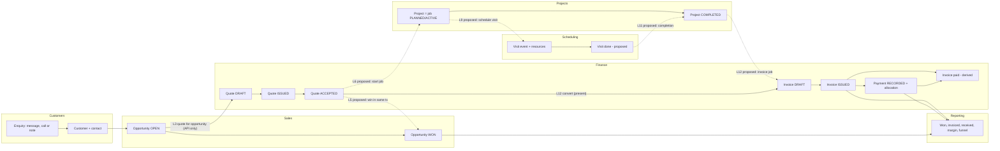

# W1: Cross-Zone workflow mapping (enquiry to cash)

> **Status: proposal, documentation only.** Nothing in this document is implemented by this PR. It adds no
> migration, no route, no contract, no event infrastructure and changes no Zone source file. Every "proposed"
> endpoint, column, event or rule below is a design for review; every "present" statement is backed by a file
> on `main` at `b2f308b` (2026-11-16).

## Contents

0. [Summary](#0-summary)
1. [Preflight and scope](#1-preflight-and-scope)
2. [Current-state inventory](#2-current-state-inventory)
3. [The core chain: verified links](#3-the-core-chain-verified-links)
4. [Target workflows and diagrams](#4-target-workflows-and-diagrams)
5. [Lifecycles and status transitions](#5-lifecycles-and-status-transitions)
6. [Source of truth per entity](#6-source-of-truth-per-entity)
7. [Gap register with owning Zone](#7-gap-register-with-owning-zone)
8. [Contract proposals (API and domain events)](#8-contract-proposals-api-and-domain-events)
9. [Transactions, concurrency and idempotency](#9-transactions-concurrency-and-idempotency)
10. [Access, tenant isolation and sensitive data](#10-access-tenant-isolation-and-sensitive-data)
11. [UX handoff expectations](#11-ux-handoff-expectations)
12. [Failure and rollback cases](#12-failure-and-rollback-cases)
13. [Dependency-ordered implementation sequence](#13-dependency-ordered-implementation-sequence)
14. [Acceptance tests per end-to-end workflow](#14-acceptance-tests-per-end-to-end-workflow)
15. [Owner decisions](#15-owner-decisions)
16. [Relationship to other workstreams](#16-relationship-to-other-workstreams)

---

## 0. Summary

Pixa OS already has most of the *records* a trade or service business needs for enquiry-to-cash: customers and
contacts, opportunities, quotes, projects and tasks, calendar events with resources, invoices, payments and
allocations, expenses, and reporting. What it mostly lacks are the **handoffs between them**.

Verified on `main` (§3):

- **Quote → invoice → payment is connected and solid.** Conversion copies lines and keeps provenance
  (`source_quote_id`), payments allocate to invoices in one unit of work, settlement is derived, and all of it
  is idempotent and concurrency-safe (ADR 0007).
- **Opportunity → quote and project → quote/invoice/expense exist in the API but not in the UI.** The finance
  document and expense contracts accept `opportunityId` and `projectId`, and the database enforces them with
  composite tenant keys, but no finance form lets a person set them and no project screen shows them.
- **Missing entirely:** opportunity ↔ project, quote acceptance ↔ opportunity outcome, project ↔ scheduling,
  a "work completed" record on a visit, "invoice this job", project margin reporting, and cross-Zone entries on
  the customer timeline.
- **One rule gap:** a finance document may link a project that belongs to a *different* customer
  (`checkLinks` checks only that the project exists and is active, `apps/api/src/modules/finance/server/documents.ts:158-162`).
- **One structural constraint:** a document's `project_id` and `opportunity_id` are **frozen once it is
  issued** (database guard). A project created *after* a quote was issued can never be linked from that quote
  without a reviewed migration. This shapes the "start a job from an accepted quote" design (§8.2, W1-D3).

Recommendation: deliver the chain in **eight small PRs** (§13), UI-only links first (no schema), then the
two schema links (project source, event ↔ project), then orchestration, completion and invoicing, then
reporting and timeline. Cross-Zone actions run as **synchronous calls between public module APIs inside one
tenant transaction**, the same pattern Finance already uses for its C2-C reminder boundary. No event bus is
proposed for this work; a transactional outbox is only proposed as the integration point for N1 notifications.

Owner decisions needed: 12 (§15). The four that block the most work are W1-D1 (who orchestrates), W1-D3 (how a
project remembers its quote), W1-D5 (what "work completed" means) and FD-P3 (quote invoicing limits).

---

## 1. Preflight and scope

| Check | Result |
|---|---|
| Base | `main` at `b2f308b` (People P3-A, #68), fetched 2026-11-16 ~12:00 UTC |
| Agent pack | `docs/agent-context.md`, `docs/active-workstreams.md`, `docs/agent-task-protocol.md` are **not on `main`**; read from draft PR #78 (`claude/project-thread-ibvyn8`, head `a8e460c`). W1 is listed there as a docs-only lane, "No edits to Zone implementations". |
| Open PRs checked (titles and changed files) | #78 agent pack (docs), #77 F8 banking (`docs/finance-banking-f8.md` only), #76 A2-B (29 files: membership, invitations, privileged SQL, migration `20261203000000`), #75 GS1 (`docs/global-search-gs1.md` only), #53 coordinator tooling, #48 stale docs. No open PR touches Sales, Projects, Scheduling, Finance documents/payments or Reporting source code. The "R2-V2 dashboard" PR mentioned in the brief is **not open** on GitHub at the time of writing. |
| Collision | None. This PR adds one new file, `docs/cross-zone-workflows-w1.md`. |
| Method | Read Prisma schemas (`apps/api/prisma/schema/*.prisma`), route tree (`apps/api/src/app/api/v1/b/[slug]/**`), module public APIs (`apps/api/src/modules/*/index.ts`), the relevant service functions, the permission registry and client Zone screens (`packages/app/src/zones/**`). No code was run against any database. |

**In scope:** Customers, Sales, Projects, Scheduling, Finance, People, Communications, Reporting, for a trade or
service SMB (an electrician, cleaner, landscaper, IT services firm, agency): *enquiry → opportunity → quote →
approval → job → scheduling and resources → work completion → invoice → payment → reporting*.

**Out of scope and owned elsewhere:** bank feeds and reconciliation (F8, #77), global search (GS1, #75),
membership lifecycle (A2-B, #76), settings architecture (A3), notifications (N1), design system (UI V2),
dashboard composition (R2). §16 lists what W1 expects from each.

---

## 2. Current-state inventory

### 2.1 Per Zone

| Zone | Records (`main`) | Statuses | Outgoing links (composite tenant FKs) | Permission keys | Notes for workflows |
|---|---|---|---|---|---|
| **Customers** | `customers`, `contacts`, `activities` (timeline) | archived / active | contact → customer; activity → customer, contact, conversation, message | `customers:read/write/delete`, `activity:read/write/read_restricted` | No lead or prospect status: a customer row is the only "who". System timeline entries exist only for customer/contact changes and recorded messages (`recordSystemActivity`, `recordMessageActivity`). |
| **Sales** | `sales_pipelines`, `sales_stages`, `opportunities`, `opportunity_outcomes` | `OPEN`, `WON`, `LOST` (+ reopen; outcome history kept) | opportunity → customer?, contact?, pipeline, stage, owner membership | `sales:read/write/manage` | `winOpportunity` only closes the row and writes an outcome and audit entry; it triggers nothing in other Zones. |
| **Projects** | `projects`, `project_tasks` | Project `PLANNED`, `ACTIVE`, `ON_HOLD`, `COMPLETED`, `CANCELLED` (any-to-any); Task `TODO`, `IN_PROGRESS`, `BLOCKED`, `DONE` | project → customer?, owner membership; task → project, assignee membership | `projects:read/create/update/archive/manage_tasks` | `docs/projects-data-model.md` §8 already reserves a nullable `source_opportunity_id` for later. Customer names are shown only to `customers:read` holders (`Viewer`). |
| **Scheduling** | `scheduling_calendars`, `scheduling_events`, `scheduling_resources`, `scheduling_event_resources` | Event `SCHEDULED`, `CANCELLED` (+ archived); Resource `ACTIVE`, `INACTIVE`, `ARCHIVED` | event → calendar, customer?; assignment → event, resource | `scheduling:read/create/update/cancel/manage_calendars/manage_resources` | No project or task link. No "completed" or "in progress" event status. PERSON resources are standalone (S2 §9, D-S2-1). Scheduling navigation is still off (D-S2-8). |
| **Finance** | `finance_documents` (QUOTE, INVOICE, CREDIT_NOTE), lines, payments, allocations, credit applications, expenses, recurring templates/runs, reminders, PDFs, catalog | Quote `DRAFT → ISSUED → ACCEPTED/DECLINED/EXPIRED`, any issued → `VOID`; Invoice `DRAFT → ISSUED → VOID`; Payment `RECORDED → REVERSED` | document → customer, contact?, **opportunity?**, **project?**, source quote?, credited invoice?; expense → **project?**, customer?; recurring template → project? | `finance:*` (12 keys); separate from every other Zone (FD-P1) | Settlement (`unpaid/partially_paid/paid`) is derived, never stored. `project_id` and `opportunity_id` are **frozen after issue** (`finance_guard_document`, `mutable_after_issue`, migration `20261115000000_finance`). |
| **People** | employees, departments, locations, leave types/policies | employee lifecycle | employee → user (optional), department, location, manager | `people:read/read_sensitive/manage/configure` | `people-boundaries.test.ts` forbids other Zones reading People tables or carrying `employeeId`. No timesheets, rates or skills. |
| **Communications** | conversations, messages, mailbox connections, sync jobs, erasure/retention | — | message → customer timeline (activity) | `communications:*` | Nothing is sent yet (C2-C outbound not built). Finance reminders already define the outbox boundary to C2-C (`finance/server/reminder-outbox.ts`). |
| **Reporting** | `reporting_saved_views`, metric registry, R2 dashboards | — | none (reads through owning Zone functions) | `reporting:read/save/share/manage` + each metric's source read key | Live metrics: invoiced amount, invoices issued, credited, payments received, receivables outstanding/overdue, won value/count, new customers. **Planned only**: expenses, tasks completed, events scheduled, headcount, messages. No project margin and no funnel metric. |

### 2.2 Cross-Zone mechanisms that already exist

| Mechanism | Where | Reuse for workflows |
|---|---|---|
| One tenant transaction per request | `tenantRoute` → `withTenant` (`apps/api/src/core/db/with-tenant.ts`) | A cross-Zone action that calls two module functions with the same `db` commits or rolls back together. |
| Public module APIs, no deep imports | `apps/api/src/modules/README.md`, `pnpm boundaries` | Orchestration must call `@/modules/<zone>` exports only. Reporting already does this (`reporting/server/sources.ts`). |
| Composite tenant FKs + forced RLS | every tenant table | Any new link column follows the same `(business_id, x_id)` pattern. |
| Optimistic `version` on every mutable record | Sales, Projects, Scheduling, Finance | Each record in a multi-record action is checked against its own version. |
| Idempotency keys | Finance creates, convert, payments (`idempotency_key` + `request_hash`) | Not present on Sales, Projects or Scheduling creates; orchestration endpoints need their own (§9.3). |
| Audit log in the same unit of work | `recordAudit` everywhere | Every handoff writes one audit row per changed record. |
| In-transaction cross-module contract | Finance ↔ C2-C reminder outbox (enqueue / confirm / record state) | The model for W1's handoff calls and for N1's future outbox. |
| Customer-scoped lists | `GET customers/:id/projects`; finance lists filter by `customerId`, `projectId`; customer detail embeds `CustomerFinance` for `finance:read` holders | The customer page is the only cross-Zone hub today. |

---

## 3. The core chain: verified links

Legend: **Present** = API, data and UI. **API only** = the database and contract support it, but no screen sets
or shows it. **Missing** = no data link or behaviour on `main`.

| # | Hop | State | Evidence on `main` | Gap id |
|---|---|---|---|---|
| L1 | Enquiry (contact / message) → customer | **Present** | Contacts, customers, message → activity timeline (`customers.prisma` Activity; `recordMessageActivity`) | — |
| L2 | Enquiry → opportunity | **Present (manual)** | `POST sales/opportunities` takes `customerId`/`contactId`; no "create opportunity from this conversation" action | G12 |
| L3 | Opportunity → quote | **API only** | `QuoteInput.opportunityId` (`packages/contracts/src/finance.ts:205`), FK `finance_documents_opportunity_fkey`, `checkLinks` enforces same customer. `document-form.tsx` has no opportunity field; Sales screens show no quotes. | G1, G2 |
| L4 | Quote → approval (customer accepts) | **Present (recorded by staff)** | `POST finance/quotes/:id/accept` → `transitionQuote` (ISSUED → ACCEPTED). No customer-facing acceptance. | G14 |
| L5 | Quote accepted ↔ opportunity won | **Missing** | `transitionQuote` touches only the document; `winOpportunity` touches only the opportunity. `docs/finance-data-model.md` §8: automatic conversion is FD-P4. | G5 |
| L6 | Opportunity / quote → project (job) | **Missing** | `Project` has no source column (`projects.prisma`); `projects-data-model.md` §8 reserves `source_opportunity_id`. A quote can point at an *existing* project only while DRAFT; after issue `project_id` is frozen. | G4 |
| L7 | Project → quote / invoice / expense | **API only** | `projectId` on documents, expenses and recurring templates (FKs + `@@index([businessId, projectId])`); list filters `?projectId=`. No project screen shows finance; no finance form sets a project. | G1, G2 |
| L8 | Finance document project ↔ customer consistency | **Missing rule** | `checkLinks` (`finance/server/documents.ts:158-162`) checks project exists and is active, not that `project.customerId` matches the document customer. | G3 |
| L9 | Project / task → scheduled visit | **Missing** | `SchedulingEvent` has `customerId` only (`scheduling.prisma`). | G6 |
| L10 | Visit → resources (people, vans, equipment) | **Present (standalone)** | S2 resources + atomic assignment + ordered-lock conflict prevention (ADR 0008). PERSON not linked to People. | G13 |
| L11 | Work completion | **Partial** | Project `COMPLETED` (stamps `completed_at`), task `DONE`. Events have no completed state; no completion note, sign-off or time recorded. | G7 |
| L12 | Completed job → invoice | **Partial** | `POST finance/quotes/:id/convert` (ISSUED or ACCEPTED, copies lines, keeps `projectId`/`opportunityId`, `source_quote_id`; never issues). No "invoice this project", no invoiced-vs-quoted view (FD-P3 open). | G8 |
| L13 | Invoice → payment | **Present** | `recordPayment` with optional allocations in one unit of work, Idempotency-Key required; `allocatePayment`, reversals; derived settlement; reminders (jobs off). | — (bank side is F8) |
| L14 | Payment → reconciliation | **Out of W1** | F8 (#77) proposes bank import and matching against these payments. | — |
| L15 | Chain → reporting | **Partial** | Won value, invoiced, received, receivables metrics live. Project recorded-cost margin is *specified* (`finance-data-model.md` §9) but **not implemented** (no metric in `reporting/server/registry.ts`). No quote-to-cash funnel, no job metrics. | G10 |
| L16 | Chain → customer timeline | **Missing** | No Sales, Finance, Projects or Scheduling code calls `recordSystemActivity`. The customer page shows projects and finance as separate panels. | G11 |

Acceptance criterion check: the quote → job → invoice → payment chain is mapped above (L4–L13) with each hop
verified as present, API-only or missing.

---

## 4. Target workflows and diagrams

### 4.1 W-A: Enquiry to cash (primary, trade/service job)



Solid arrows exist on `main`; dotted arrows are proposals.

### 4.2 W-B: Small job without a quote (call-out, repair)

`Customer → (optional opportunity) → Project → Visit → Completion → Invoice (from project, no source quote) → Payment`.
Uses G4 (project without a source), G6, G7, G8 (`invoice-from-project` with lines entered or from the catalog).

### 4.3 W-C: Deposit and progress billing

`Quote ACCEPTED → Invoice 1 (deposit, part of quote) → … → Invoice n (balance)`. One quote may already produce
several invoices (`docs/finance-data-model.md` §4.1). Needs FD-P3 (cap at quote total or warn) and an
invoiced-vs-quoted figure per quote and per project (G8).

### 4.4 W-D: Recurring service (maintenance contract)

`Customer → Project (contract) → Recurring invoice template (projectId, present) → Scheduled visits (G6, recurrence not built in Scheduling)`.
Recurring generation exists (F6-1) but its jobs are **switched off**; W1 does not change that.

### 4.5 W-E: Lost or cancelled work

`Opportunity LOST` (outcome kept) / `Quote DECLINED or EXPIRED` / `Project CANCELLED` / `Visit CANCELLED` / `Invoice VOID` or credit note.
§12 lists how each propagates (it mostly should **not** propagate automatically).

---

## 5. Lifecycles and status transitions

Present transitions are on `main`. **Proposed** rows are W1 designs.

| Step | Record | Transition | Who (permission) | Cross-Zone effect today | Proposed effect |
|---|---|---|---|---|---|
| 1 | Customer / contact | create | `customers:write` | — | — |
| 2 | Opportunity | create (OPEN) | `sales:write` | — | — |
| 3 | Quote | create DRAFT with `opportunityId` | `finance:write` | FK + same-customer check | UI prefill from opportunity (G1/G2) |
| 4 | Quote | DRAFT → ISSUED | `finance:issue` | number, seal, snapshot | Optional: move opportunity to a "Quoted" stage (W1-D4, default off) |
| 5 | Quote | ISSUED → ACCEPTED | `finance:issue` | none | Offer "Mark opportunity won" and "Start job" in the same action (G5, G4; W1-D2) |
| 6 | Opportunity | OPEN → WON | `sales:write` | outcome row, audit | If linked quotes exist, show them; never auto-accept a quote |
| 7 | Project | create (PLANNED) | `projects:create` | — | `source` recorded (G4) |
| 8 | Visit | create SCHEDULED on calendar with resources | `scheduling:create` | resource conflicts enforced | `projectId`, `taskId?` (G6) |
| 9 | Visit | **proposed** SCHEDULED → COMPLETED | `scheduling:update` | — | completion time and note; may close a task (G7, W1-D5) |
| 10 | Project | → COMPLETED | `projects:update` | stamps `completed_at` | Prompt "Invoice this job" for `finance:write` holders (G8) |
| 11 | Invoice | create DRAFT (convert or from project) | `finance:write` | lines copied, provenance kept | from-project draft (G8) |
| 12 | Invoice | DRAFT → ISSUED | `finance:issue` | number, PDF, reminders eligible | — |
| 13 | Payment | RECORDED + allocations | `finance:payments` | settlement derived | timeline entry (G11) |
| 14 | Reporting | — | `reporting:read` + source keys | live finance/sales metrics | margin and funnel metrics (G10) |

Rules that hold throughout:

- A transition in one Zone **never silently changes** a record in another. A cross-Zone change happens only as
  an explicit, named action the person confirmed (one click can cover several records, but the confirmation
  says which).
- Reversals do not cascade (§12). Reopening an opportunity does not un-accept a quote; voiding an invoice does
  not reopen a project.

---

## 6. Source of truth per entity

| Fact | Owner (single source) | Others hold | Never |
|---|---|---|---|
| Who the customer is, name, address, tax id | Customers | ids only; Finance snapshots bill-to **at issue** (legal record) | copies of names in Sales, Projects, Scheduling |
| Contact person | Customers | ids | — |
| Sales intent, expected value, probability, stage, win/loss | Sales (`opportunities`, `opportunity_outcomes`) | Finance documents may reference the id | Finance never edits opportunity amounts (`finance-data-model.md` §8) |
| Price offered and commercial terms | Finance (issued quote, sealed) | Opportunity `amount` is an estimate, not the price | Projects storing a price or budget copy (proposal: show the quote total via Finance) |
| Customer approval | Finance (quote `ACCEPTED` + `status_changed_at/by`) | Sales outcome may follow | — |
| The job / work package | Projects (`projects`, `project_tasks`) | Scheduling and Finance reference `project_id` | — |
| When and where work happens, who/what is booked | Scheduling (events, assignments) | Projects shows visits by id | Projects storing dates of visits |
| Person identity and employment | People | Scheduling PERSON resource (name only, standalone today) | Scheduling reading People tables (boundary test) |
| Work done (completion) | **Proposed:** Scheduling for each visit, Projects for the job (W1-D5) | — | Finance inferring completion |
| Amount billed, tax, numbers | Finance (issued invoices, credit notes) | — | — |
| Cash received and its allocation | Finance (payments, allocations) | F8 matches bank lines to these | bank data creating payments without a person (F8 C.7) |
| Metrics | Reporting computes from each owning Zone's reporting functions | — | stored copies of business numbers |
| Interaction history | Customers activity timeline | each Zone writes a summary entry (proposed G11) | financial amounts on the timeline for viewers without `finance:read` |

---

## 7. Gap register with owning Zone

| Id | Gap | Owning Zone | Schema change? | Depends on | PR (§13) |
|---|---|---|---|---|---|
| G1 | Finance forms cannot set `opportunityId` / `projectId` on quotes, invoices, expenses (API supports it) | Finance (client) | No | — | WF-1 |
| G2 | Opportunity and project screens do not show their quotes, invoices, expenses (lists already filter by `projectId`; need `opportunityId` filter) | Finance (embedded panel, like `CustomerFinance`) hosted by Sales and Projects | No (additive list filter) | G1 | WF-1 |
| G3 | Project ↔ document customer mismatch allowed | Finance (service rule in `checkLinks`) | No | W1-D6 | WF-1 |
| G4 | Project has no source (opportunity / quote); accepted quote cannot start a job | Projects | **Yes**: `source_opportunity_id` (reserved in projects §8) + quote link per W1-D3 | W1-D1, W1-D3 | WF-2 |
| G5 | Quote acceptance and opportunity outcome are unrelated | Orchestration (W1-D1) calling Finance + Sales public APIs | No | W1-D2 | WF-3 |
| G6 | Visits cannot reference a project or task | Scheduling | **Yes**: `project_id`, `task_id?` on `scheduling_events` | — | WF-4 |
| G7 | No completion record for a visit | Scheduling (+ Projects for task close) | **Yes** if W1-D5 = event status | W1-D5 | WF-5 |
| G8 | No "invoice this job"; no invoiced-vs-quoted figure | Finance | No (reads), possibly no | FD-P3, G4 | WF-6 |
| G9 | Bank-side payment matching | Finance F8 (#77) | per F8 | F8 decisions | not W1 |
| G10 | No project margin metric, no funnel, projects/scheduling metrics only planned | Reporting + Finance/Sales/Projects reporting reads | No | G4, G6 | WF-7 |
| G11 | Customer timeline has no Sales/Finance/Projects/Scheduling entries | Customers (activity) + each Zone writes | No (new activity `type` values) | W1-D8 | WF-8 |
| G12 | No "opportunity from enquiry/conversation" action; no lead concept | Sales (+ Communications UI entry point) | No for the action; Yes if a lead entity (W1-D9) | W1-D9 | WF-8 or later |
| G13 | PERSON resource not linked to employee; no labour cost or time | People (S2 §9 path) | Yes (People-owned) | People lane | later |
| G14 | Customer cannot accept a quote themselves (portal / link) | Finance + Communications (C2-C) | Yes | C2-C, security review | later |
| G15 | Notifying the next person at a handoff | N1 | per N1 | N1 | not W1 |
| G16 | Per-business workflow defaults (auto-start job, default calendar for jobs) | A3 settings | per A3 | A3 | not W1 |

---

## 8. Contract proposals (API and domain events)

All paths are under `/api/v1/b/:slug/`. All are **proposals**. Contracts would be added to `packages/contracts`
additively; no existing request or response changes shape.

### 8.1 Additive read filters (WF-1)

| Endpoint | Change | Permission |
|---|---|---|
| `GET finance/quotes`, `finance/invoices` | add `opportunityId` filter (`projectId` exists) | `finance:read` |
| `GET finance/expenses` | `projectId` filter exists (contract `finance-expenses.ts`) | `finance:read` |
| `GET finance/projects/:projectId/summary` | per currency: quoted (issued+accepted, not void), invoiced net, credited, received (allocated), outstanding, recorded expenses net. Read-only, derived. | `finance:read` |
| `GET scheduling/events?projectId=` | after WF-4 | `scheduling:read` |

### 8.2 Project source (WF-2)

Options for remembering which quote started a job (W1-D3):

| Option | Shape | Pros | Cons |
|---|---|---|---|
| **A (recommended)** | `projects.source_opportunity_id` (FK, reserved) **and** `projects.source_quote_id` (composite FK to `finance_documents(business_id, id, kind)` with kind pinned to QUOTE) | One row, simple queries; FK guarantees tenant and kind | Projects table references a Finance table; the id is visible to `projects:read` holders (the quote's *content* stays behind `finance:read`) |
| B | A link table `work_links(business_id, from_type, from_id, to_type, to_id)` owned by an orchestration module | Generic, no Zone column changes | Polymorphic, no real FKs (tenant safety by code only); against the repo's composite-FK rule |
| C | Migration adding `project_id` to `mutable_after_issue` for quotes | Quote → project link stays on Finance side | Weakens the sealed-document guarantee; changes an ADR 0007 invariant |

Proposed endpoint:

```
POST projects/from-quote            Idempotency-Key required
{ quoteId, name?, ownerUserId?, startDate?, dueDate?, markOpportunityWon?: boolean, opportunityVersion?: number }
→ 201 { project, opportunity? }    200 on replay
```

- Requires `projects:create` **and** `finance:read` (to read the quote) **and**, if `markOpportunityWon`,
  `sales:write`. Checked server-side, each key separately (§10).
- The quote must be `ACCEPTED` (or `ISSUED` if W1-D2 allows) and not void; its customer becomes the project's
  customer; name defaults to the quote number plus customer display name **only if** the caller holds
  `customers:read`, otherwise the quote number.
- One quote may start **at most one** project (unique `(business_id, source_quote_id)` where not null),
  W1-D10.
- `POST projects/from-opportunity` is the same without a quote (for W-B jobs from a won opportunity).

### 8.3 Accept quote and win opportunity (WF-3)

```
POST finance/quotes/:id/accept      (existing route, additive body field)
{ version, alsoWinOpportunity?: { opportunityId, version } }
```

Or, if W1-D1 picks an orchestration module, `POST workflows/quotes/:id/accept`. Either way: one transaction,
`finance:issue` and `sales:write` both required when `alsoWinOpportunity` is present, opportunity must be the
quote's `opportunityId` and `OPEN`. If the opportunity is already WON, the quote is still accepted and the
response says `opportunity: already_won` (not an error).

### 8.4 Visits for a job (WF-4, WF-5)

- `scheduling_events.project_id` (nullable, composite FK to `projects`), `task_id` (nullable, composite FK
  `(business_id, project_id, task_id)` so a task must belong to the same project).
- Same customer rule as G3: if both event and project have a customer they must match.
- `POST scheduling/events` and `PATCH` accept `projectId`, `taskId`; linking needs `projects:read` in addition to
  the scheduling key; the response embeds `project: { id, name } | null` only for `projects:read` holders
  (as Projects does with customer names).
- W1-D5 option (recommended): new event status `COMPLETED` with `completed_at`, `completed_by_id`, optional
  `completion_note` (≤ 2000 chars). `POST scheduling/events/:id/complete { version, note?, completeTask?: boolean }`.
  `completeTask` moves the linked task to `DONE` in the same transaction (needs `projects:manage_tasks`).
  A completed event keeps blocking availability for its interval (history), cannot be cancelled, and can be
  reopened only by `scheduling:update` with a reason.

### 8.5 Invoice a job (WF-6)

```
POST finance/projects/:projectId/invoice-draft     Idempotency-Key required
{ source: 'quote', quoteId, portion?: { percent } | { amount } }   // deposit / progress / balance
| { source: 'blank', lines?: LineInput[] }                          // W-B jobs without a quote
→ 201 { document }  (DRAFT invoice, projectId set, sourceQuoteId when from a quote)
```

- Reuses `convertQuote` / `createInvoice` internals; never issues. `finance:write`.
- Returns `invoicedOfQuote: { quoted, invoicedNet, remaining }` per currency so the UI can warn
  (FD-P3: warn vs block).
- `portion` is a single line "Deposit 30% of Q-0042" or a scaled copy of lines (W1-D11).

### 8.6 Domain events (proposal, no infrastructure)

W1 does **not** propose an event bus. Every handoff above is a synchronous call. These event names are proposed
as a **shared vocabulary**, used today as audit action names (most already exist) and later as the payload of a
transactional outbox owned by N1 (notifications) if Regan approves one.

| Event | Producer | Exists as audit action? | Payload (ids and structured facts only) |
|---|---|---|---|
| `sales.opportunity.won` / `lost` / `reopened` | Sales | yes | opportunityId, stageId, currency, amount |
| `finance.document.issued` (quote/invoice) | Finance | yes (`finance.document.*`) | documentId, kind, number, customerId, projectId?, opportunityId? |
| `finance.quote.accepted` / `declined` / `expired` | Finance | yes (`finance.document.<action>`) | documentId, opportunityId? |
| `projects.project.created_from_quote` | Projects | **new** | projectId, quoteId?, opportunityId? |
| `projects.project.status_changed` | Projects | yes | projectId, from, to |
| `scheduling.event.completed` | Scheduling | **new** | eventId, projectId?, taskId? |
| `finance.payment.recorded` / `reversed` | Finance | yes | paymentId, customerId, currency, amount, invoiceIds |

Payload rules: no names, titles, descriptions, addresses, notes, loss reasons, message content or amounts
in notifications to people who lack the source Zone's read key (§10).

---

## 9. Transactions, concurrency and idempotency

### 9.1 One request, one transaction

Each cross-Zone action is one `tenantRoute` request, so one `withTenant` transaction. The orchestrating code calls
the owning Zone's **public** function for each record with the same `db`. Either every record changes or none.
No two-phase commit, no saga, no background job.

### 9.2 Lock order

Cross-Zone actions lock in a fixed global order to avoid deadlocks with existing single-Zone lock protocols:

1. Customer rows are never locked (read only).
2. **Sales** opportunity (conditional `updateMany` on version/status).
3. **Finance** documents, in id order (ADR 0007 order, unchanged).
4. **Projects** project (`FOR SHARE` / conditional update), then tasks.
5. **Scheduling** per ADR 0008 (calendar, then resources in id order, then event).

Finance-internal order (`finance-data-model.md` §6.3, ADR 0007) and Scheduling order (ADR 0008) are kept
intact; W1 only fixes the order *between* Zones. Each proposed PR must add a two-session concurrency test for its
action.

### 9.3 Versions and idempotency

- Every record a multi-record action changes is named with its `version`; a mismatch on any of them aborts the
  whole action with `409 stale` and a `record` field saying which (`opportunity`, `quote`, `project`, `task`,
  `event`).
- Every **create** in an orchestration endpoint requires `Idempotency-Key` and stores `request_hash`, reusing
  Finance's pattern (advisory lock on the key + partial unique index). Replays return the original result with
  200; a different body with the same key is `409 idempotency_conflict`.
- Uniqueness backstops: one project per source quote (W1-D10); one active completion per event (status column).
- Pure state transitions (accept, win, complete) are idempotent by state: repeating with a stale version is a 409,
  never a second effect.

---

## 10. Access, tenant isolation and sensitive data

- **Each Zone's key is checked separately.** `tenantRoute` gates a route on one permission key today
  (`apps/api/src/app/api/_lib/routes.ts`); further keys are checked in the handler, as Projects already does for
  `customers:read`. Orchestration routes need every key (`all-of`) checked server-side before any write, plus conditional keys for optional parts
  (`markOpportunityWon` → `sales:write`). The UI hides options the person lacks, but the server decides.
- **Finance stays separate (FD-P1).** Project owners, assignees and resource holders gain no finance access.
  A project's finance panel and `GET finance/projects/:id/summary` require `finance:read`. A `projects:read`
  holder may see that a source quote *exists* (an id) but not its number, amount or lines.
- **Names follow the Projects `Viewer` pattern.** Customer names only with `customers:read`; project names on a
  visit only with `projects:read`; quote numbers only with `finance:read`.
- **People boundary.** No proposal reads People tables. Labour and person links wait for the People-owned path
  (S2 §9).
- **Tenant isolation.** Every new column is a composite `(business_id, x_id)` FK under forced RLS; new link rules
  (same customer) are service checks with clear errors. `tests/isolation` must cover every new FK with a
  cross-tenant insert attempt.
- **Timeline (G11).** Finance entries on the customer timeline carry type and ids; the activity read path must
  drop or redact `finance.*` entries for viewers without `finance:read` (amounts and numbers never appear for
  them). Restricted notes rules are unchanged.
- **Audit.** Ids and structured facts only, never names, notes, completion notes or loss reasons.
- **Erasure (E1, FD-L4).** New links are ids; nothing in W1 copies personal data. Completion notes are free text
  and fall under the same retention and erasure rules as activity notes (E1 must list them when built).

---

## 11. UX handoff expectations

Principle: at every step the person sees **what comes next and where it lives**, with one primary action. The
UI V2 design system decides visuals; this section only fixes behaviour.

| From | Primary next action shown | Shown to | After the action |
|---|---|---|---|
| Customer / conversation | "New opportunity" (prefilled customer, contact) | `sales:write` | Opens the opportunity |
| Opportunity | "Create quote" (prefilled customer, contact, opportunity, currency) | `finance:write` | Opens the draft quote; opportunity shows "Quotes" panel |
| Quote ISSUED | "Mark accepted" (existing) with checkboxes "Mark opportunity won", "Start a job" | `finance:issue` (+ keys for extras) | Confirmation lists every record changed; links to the new project |
| Project | "Schedule visit" (prefilled customer, project, default calendar) | `scheduling:create` | Visit appears in the project's "Visits" panel |
| Visit | "Mark complete" (+ "also complete task") | `scheduling:update` | Project shows progress; when all visits done, suggest completing the project |
| Project COMPLETED | "Invoice this job" with invoiced-vs-quoted figure | `finance:write` | Opens the draft invoice; project finance panel updates |
| Invoice ISSUED | "Record payment" (existing) | `finance:payments` | Settlement chip updates on invoice, project and customer |

Cross-cutting:

- **Back-links everywhere:** each record shows its upstream and downstream records as chips (opportunity ↔ quote
  ↔ project ↔ visits ↔ invoices ↔ payments), filtered by the viewer's keys.
- **No dead ends:** if the viewer lacks the key for the next step, show who can do it ("A finance user can
  invoice this job"), not a disabled button with no explanation.
- **Unsaved changes** follow the existing `confirmDiscard` pattern when navigating across Zones.
- Scheduling navigation is still off (D-S2-8); W-A UX assumes it is on by WF-4.

---

## 12. Failure and rollback cases

| Case | Expected behaviour |
|---|---|
| Accept + win: opportunity changed by someone else meanwhile | Whole action 409 `stale` (record: opportunity); quote **not** accepted. UI reloads both. |
| Accept + win: opportunity already WON | Quote accepted; response `opportunity: already_won`; no second outcome row. |
| Accept + win: opportunity LOST | 409 `opportunity_not_open`; nothing changes. Person must reopen it in Sales first. |
| Start job from quote twice (double click, retry) | Idempotency key replays the first project; a different key hits the unique source-quote index → 409 `job_exists` with the existing project id. |
| Quote voided after a job was started | Project stays; project shows "source quote void". No cascade. |
| Opportunity reopened after win | Quote and project unchanged; project shows source opportunity "reopened". |
| Project CANCELLED with scheduled visits | Visits untouched; UI offers "cancel N upcoming visits" as a separate confirmed action. |
| Project archived | Existing rule: read-only; new visits and invoices cannot newly link it (`archived_reference`). |
| Visit cancelled after completion | Refused (`409 completed`); reopen first. |
| Resource conflict when scheduling a job visit | Existing S2 behaviour: 409 with conflicts unless the overlap is accepted on purpose. |
| Invoice from project exceeds quote total | FD-P3: warn (default) or block. Never silently. |
| Invoice voided | Allocations must be reversed first (existing rule). Project and visits unchanged. Credit note path unchanged. |
| Payment reversed | Existing: allocations reversed first in one unit of work; settlement re-derives; timeline entry "payment reversed". |
| Customer archived mid-workflow | Existing records keep links; new links refused (`archived_reference`); converting an issued quote still allowed (existing). |
| Member removed | Existing: owners/assignees cleared with version bump; in-flight cross-Zone actions naming that member fail on FK and roll back entirely. |
| Partial failure inside an orchestration call | Impossible by design: one transaction. Tests must assert no partial rows after an injected failure in the second Zone call. |

---

## 13. Dependency-ordered implementation sequence

Each is one thread, one branch, one draft PR, audited before merge. Stamps for migrations are chosen at the
time, sorting after everything on `main` and in open PRs.

| Order | PR | Scope | Owning Zone(s) | Schema | Blocked by |
|---|---|---|---|---|---|
| 1 | **WF-1** Link existing records | Opportunity and project pickers on quote/invoice/expense forms; "Quotes & invoices" panel on opportunity and project (embedded Finance component, `finance:read` only); `opportunityId` list filter; `GET finance/projects/:id/summary`; G3 same-customer rule | Finance (owner), Sales/Projects host the panel | None | W1-D6 |
| 2 | **WF-2** Job source | `projects.source_opportunity_id` (+ `source_quote_id` per W1-D3); `POST projects/from-quote`, `from-opportunity`; multi-key route helper | Projects | Yes (additive, nullable) | W1-D1, W1-D3, W1-D10 |
| 3 | **WF-3** Accept and win | Accept quote with optional opportunity win in one transaction; "Start a job" option wired to WF-2 | Orchestration per W1-D1 (Finance + Sales public APIs) | None | WF-2, W1-D2 |
| 4 | **WF-4** Visits for jobs | `scheduling_events.project_id`, `task_id`; filters; project "Visits" panel; schedule-from-project | Scheduling (schema), Projects (panel) | Yes | D-S2-8 nav on |
| 5 | **WF-5** Completion | Event `COMPLETED` (per W1-D5), complete endpoint, optional task close | Scheduling, Projects | Yes | WF-4, W1-D5 |
| 6 | **WF-6** Invoice the job | `invoice-draft` from project (quote portion or blank), invoiced-vs-quoted | Finance | None expected | WF-2, FD-P3, W1-D11 |
| 7 | **WF-7** Reporting | Project recorded-cost margin (as specified in `finance-data-model.md` §9), quote-to-cash funnel (won → quoted → accepted → invoiced → paid, per currency), promote `projects.tasks_completed`, `scheduling.events_scheduled`, add `scheduling.visits_completed` | Reporting + source Zones' reporting reads | None | WF-1..6 for data; R2 for dashboards |
| 8 | **WF-8** Timeline and intake | Cross-Zone system activities with redaction (G11); "New opportunity from conversation" (G12) | Customers/Activity, Sales, Communications UI | None (new activity types) | W1-D8, W1-D9 |

WF-1 and WF-4 have no dependency on each other and can run in parallel. WF-7 can start once WF-1 lands for the
margin metric alone.

---

## 14. Acceptance tests per end-to-end workflow

Each proposed PR carries its own unit, integration and isolation tests. These are the **end-to-end** scenarios
the chain must pass once the relevant PRs have merged (API-level integration tests against a real database, two
businesses, roles OWNER / MANAGER / MEMBER).

**AT-A (enquiry to cash, W-A)**
1. Record a message for a contact → customer timeline shows it.
2. Create opportunity from the customer; create a quote from the opportunity → quote has `opportunityId`, same customer.
3. Issue, then accept with "win" and "start job" → one transaction: quote ACCEPTED, opportunity WON with one outcome row, project with `source_quote_id`, all audit rows present.
4. Schedule two visits from the project with a PERSON and EQUIPMENT resource → events carry `projectId`; a third overlapping visit for the same resource is refused.
5. Complete both visits (one with `completeTask`) → task DONE; project offered completion; mark project COMPLETED.
6. Invoice the job from the quote → draft invoice with `projectId`, `sourceQuoteId`, lines equal to quote; invoiced-vs-quoted = 100%.
7. Issue, record a part payment and the balance → invoice `paid`; project summary: quoted = invoiced = received.
8. Reporting: won value, invoiced, received, project margin and funnel show the same amounts per currency.

**AT-B (job without quote, W-B)**: project from customer → visit → complete → `invoice-draft` blank with catalog lines → issue → pay. Margin includes linked expenses.

**AT-C (deposit and progress, W-C)**: accepted quote 1000 → deposit 30% invoice → progress 50% → balance; invoiced-vs-quoted reaches 100%; a further invoice warns (or is refused, per FD-P3).

**AT-D (recurring, W-D)**: recurring template with `projectId` generates a draft via manual "generate now" (jobs remain off) → draft carries the project → appears in project summary.

**AT-E (failure and concurrency)**
- Two sessions accept the same quote with win → one succeeds, the other 409; exactly one outcome row.
- Start job from quote with the same key twice → one project; with two keys → 409 `job_exists`.
- Inject a failure in the Sales call during accept+win → quote still ISSUED, no audit rows.
- Lost opportunity → accept+win refused, nothing changed.

**AT-F (access and isolation)**
- MEMBER (no finance keys) opens a project → no finance panel, summary endpoint 403, no quote number shown.
- Project linked to customer X cannot be linked on a document for customer Y (G3) → 400 `project_customer_mismatch`.
- Business B cannot link business A's project, quote or event by id (FK + RLS) → 400/404, never 500.
- Timeline: a viewer without `finance:read` sees no finance amounts or numbers.
- Reporting: margin metric refused without `finance:read` and `projects:read`.

---

## 15. Owner decisions

| Id | Question | Options | Recommendation |
|---|---|---|---|
| **W1-D1** | Where does cross-Zone orchestration code live? | (a) the Zone that starts the action calls the other Zone's public API (Finance calls Sales); (b) a thin `workflows` module that only composes public APIs and owns no tables | **(b)**: keeps Zone modules free of each other's imports, gives one place for lock order and multi-key checks; it owns routes like `workflows/quotes/:id/accept`. |
| **W1-D2** | Can a job start from an ISSUED (not yet accepted) quote? | ACCEPTED only / ISSUED or ACCEPTED | ACCEPTED only; for urgent work, accept first (one click). |
| **W1-D3** | How does a project remember its quote? | §8.2 A / B / C | **A**: `source_quote_id` + `source_opportunity_id` on projects with composite FKs. |
| **W1-D4** | Should issuing a quote move the opportunity's stage? | never / optional per business (A3) | Never by default; optional setting later via A3. |
| **W1-D5** | What records "work completed"? | (a) event status COMPLETED; (b) task DONE only; (c) a separate job-report record | **(a)** with optional task close; (c) later if sign-offs or photos are needed. |
| **W1-D6** | Must a document's project belong to the document's customer? | require match / allow internal projects (no customer) / allow any | Require match when the project has a customer; allow projects with no customer. |
| **W1-D7** | Opportunity WON without a quote: offer "Start job"? | yes / no | Yes (`from-opportunity`), for W-B. |
| **W1-D8** | Should finance events appear on the customer timeline? | no / yes with redaction / yes only for finance users | Yes, type and link only; amounts and numbers only for `finance:read`. |
| **W1-D9** | Lead / enquiry concept | none (customer + opportunity) / customer `lifecycle` (prospect, active) / separate lead entity | Defer: use customer + opportunity; revisit with C2 inbound. |
| **W1-D10** | How many jobs per quote? | one / many | One (unique); a second job is a manual project. |
| **W1-D11** | Deposit / progress invoice shape | single summary line / scaled copy of quote lines | Single summary line referencing the quote (simpler tax rounding); scaled copy later. |
| **W1-D12** | Is a project the "job" for trade businesses, or is a separate Job entity needed? | project = job / new entity | Project = job for now; industry wording via labels, not a new table. |
| FD-P3 (existing) | Quote conversion limits | — | Unchanged recommendation in `finance-data-model.md` §14: any issued/accepted quote, no cap, show invoiced-vs-quoted (WF-6 adds the figure). |
| FD-P4 (existing) | Automatic opportunity → document conversion | — | Superseded by WF-3's explicit, confirmed action; nothing automatic. |

---

## 16. Relationship to other workstreams

| Workstream | What W1 assumes / leaves to it | Duplication avoided |
|---|---|---|
| **F8** banking (#77) | Payments are recorded by people today; F8 proposes bank import and matching to those payments. W1 stops at "payment recorded". | No bank, match or reconciliation design here. |
| **GS1** search (#75) | Back-link chips (§11) are navigation; finding records across Zones is GS1. | No search index or palette proposal. |
| **R2** dashboards (merged #62) | WF-7 adds metrics through the R1 registry; dashboards compose them. | No dashboard layout proposal. |
| **A2 / A2-B** (#70, #76) | Member removal clears owners/assignees (existing); orchestration routes reuse role → key mapping unchanged. | No RBAC change; multi-key checks use existing keys only. |
| **A3** settings | Per-business workflow defaults (W1-D4, default job calendar, invoice portion defaults) belong in A3's settings model. | No settings storage proposed here. |
| **N1** notifications | §8.6 event vocabulary is the proposed input to N1; any outbox is N1's to design and Regan's to approve. | No notification transport, table or job. |
| **UI V2** | §11 fixes behaviour only; visuals from the V2 spec. | No components or tokens. |
| **People P3** | Leave could later block PERSON resource availability once the People link (G13) exists. | No People tables read. |

### Tests

Not applicable: this PR adds one Markdown file. No code, contract, migration or configuration changes, so
typecheck, lint, boundaries, unit, integration and isolation suites are unaffected. CI runs as usual.
