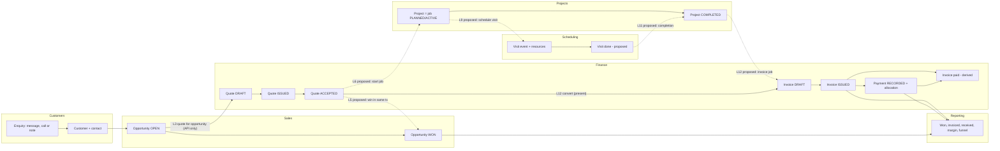

# W1: Cross-Zone workflow mapping (enquiry to cash)

> **Status: proposal, documentation only.** Nothing in this document is implemented by this PR. It adds no
> migration, no route, no contract, no event infrastructure and changes no Zone source file. Every "proposed"
> endpoint, column, event or rule below is a design for review; every "present" statement is backed by a file
> on `main` at `b2f308b` (2026-11-16).

> **Revision 2 (2026-11-16)** after the independent architecture audit on #79: customer/project invariants and
> reassignment policy (§6.1), exact quote billing totals and over-quote confirmation (§8.6), lock order checked
> against the current code with a deadlock analysis (§9.2), `source_quote_id` constraint design and Prisma
> feasibility (§8.2), finance-id redaction in generic reads (§10), new decision W1-D13.
> **Revision 3:** summary corrected (WF-1 carries additive schema), `workflows` owns only the `workflow_requests`
> infrastructure table (WF-2), over-quote checks split into draft and issue bases with serialisation of draft
> creates and edits (§8.6).

## Contents

0. [Summary](#0-summary)
1. [Preflight and scope](#1-preflight-and-scope)
2. [Current-state inventory](#2-current-state-inventory)
3. [The core chain: verified links](#3-the-core-chain-verified-links)
4. [Target workflows and diagrams](#4-target-workflows-and-diagrams)
5. [Lifecycles and status transitions](#5-lifecycles-and-status-transitions)
6. [Source of truth per entity](#6-source-of-truth-per-entity)
7. [Gap register with owning Zone](#7-gap-register-with-owning-zone)
8. [Contract proposals (API and domain events)](#8-contract-proposals-api-and-domain-events)
9. [Transactions, concurrency and idempotency](#9-transactions-concurrency-and-idempotency)
10. [Access, tenant isolation and sensitive data](#10-access-tenant-isolation-and-sensitive-data)
11. [UX handoff expectations](#11-ux-handoff-expectations)
12. [Failure and rollback cases](#12-failure-and-rollback-cases)
13. [Dependency-ordered implementation sequence](#13-dependency-ordered-implementation-sequence)
14. [Acceptance tests per end-to-end workflow](#14-acceptance-tests-per-end-to-end-workflow)
15. [Owner decisions](#15-owner-decisions)
16. [Relationship to other workstreams](#16-relationship-to-other-workstreams)

---

## 0. Summary

Pixa OS already has most of the *records* a trade or service business needs for enquiry-to-cash: customers and
contacts, opportunities, quotes, projects and tasks, calendar events with resources, invoices, payments and
allocations, expenses, and reporting. What it mostly lacks are the **handoffs between them**.

Verified on `main` (§3):

- **Quote → invoice → payment is connected and solid.** Conversion copies lines and keeps provenance
  (`source_quote_id`), payments allocate to invoices in one unit of work, settlement is derived, and all of it
  is idempotent and concurrency-safe (ADR 0007).
- **Opportunity → quote and project → quote/invoice/expense exist in the API but not in the UI.** The finance
  document and expense contracts accept `opportunityId` and `projectId`, and the database enforces them with
  composite tenant keys, but no finance form lets a person set them and no project screen shows them.
- **Missing entirely:** opportunity ↔ project, quote acceptance ↔ opportunity outcome, project ↔ scheduling,
  a "work completed" record on a visit, "invoice this job", project margin reporting, and cross-Zone entries on
  the customer timeline.
- **One rule gap:** a finance document may link a project that belongs to a *different* customer
  (`checkLinks` checks only that the project exists and is active, `apps/api/src/modules/finance/server/documents.ts:158-162`).
- **One structural constraint:** a document's `project_id` and `opportunity_id` are **frozen once it is
  issued** (database guard). A project created *after* a quote was issued can never be linked from that quote
  without a reviewed migration. This shapes the "start a job from an accepted quote" design (§8.2, W1-D3).

Recommendation: deliver the chain in **eight small PRs** (§13). WF-1 adds the missing link pickers and finance
panels plus the customer-consistency keys and FKs of §6.1 (additive schema). WF-2 adds the project source links
and the orchestration module's `workflow_requests` table; WF-4 the event ↔ project link; then completion,
invoicing, reporting and timeline. Most of these PRs carry an additive migration; none is in this PR. Cross-Zone actions run as **synchronous calls between public module APIs inside one
tenant transaction**, the same pattern Finance already uses for its C2-C reminder boundary. No event bus is
proposed for this work; a transactional outbox is only proposed as the integration point for N1 notifications.

Owner decisions needed: 13 (§15). The four that block the most work are W1-D1 (who orchestrates), W1-D3 (how a
project remembers its quote), W1-D5 (what "work completed" means) and FD-P3 (quote invoicing limits).

---

## 1. Preflight and scope

| Check | Result |
|---|---|
| Base | `main` at `b2f308b` (People P3-A, #68), fetched 2026-11-16 ~12:00 UTC |
| Agent pack | `docs/agent-context.md`, `docs/active-workstreams.md`, `docs/agent-task-protocol.md` are **not on `main`**; read from draft PR #78 (`claude/project-thread-ibvyn8`, head `a8e460c`). W1 is listed there as a docs-only lane, "No edits to Zone implementations". |
| Open PRs checked (titles and changed files) | #78 agent pack (docs), #77 F8 banking (`docs/finance-banking-f8.md` only), #76 A2-B (29 files: membership, invitations, privileged SQL, migration `20261203000000`), #75 GS1 (`docs/global-search-gs1.md` only), #53 coordinator tooling, #48 stale docs. No open PR touches Sales, Projects, Scheduling, Finance documents/payments or Reporting source code. The "R2-V2 dashboard" PR mentioned in the brief is **not open** on GitHub at the time of writing. |
| Collision | None. This PR adds one new file, `docs/cross-zone-workflows-w1.md`. |
| Method | Read Prisma schemas (`apps/api/prisma/schema/*.prisma`), route tree (`apps/api/src/app/api/v1/b/[slug]/**`), module public APIs (`apps/api/src/modules/*/index.ts`), the relevant service functions, the permission registry and client Zone screens (`packages/app/src/zones/**`). No code was run against any database. |

**In scope:** Customers, Sales, Projects, Scheduling, Finance, People, Communications, Reporting, for a trade or
service SMB (an electrician, cleaner, landscaper, IT services firm, agency): *enquiry → opportunity → quote →
approval → job → scheduling and resources → work completion → invoice → payment → reporting*.

**Out of scope and owned elsewhere:** bank feeds and reconciliation (F8, #77), global search (GS1, #75),
membership lifecycle (A2-B, #76), settings architecture (A3), notifications (N1), design system (UI V2),
dashboard composition (R2). §16 lists what W1 expects from each.

---

## 2. Current-state inventory

### 2.1 Per Zone

| Zone | Records (`main`) | Statuses | Outgoing links (composite tenant FKs) | Permission keys | Notes for workflows |
|---|---|---|---|---|---|
| **Customers** | `customers`, `contacts`, `activities` (timeline) | archived / active | contact → customer; activity → customer, contact, conversation, message | `customers:read/write/delete`, `activity:read/write/read_restricted` | No lead or prospect status: a customer row is the only "who". System timeline entries exist only for customer/contact changes and recorded messages (`recordSystemActivity`, `recordMessageActivity`). |
| **Sales** | `sales_pipelines`, `sales_stages`, `opportunities`, `opportunity_outcomes` | `OPEN`, `WON`, `LOST` (+ reopen; outcome history kept) | opportunity → customer?, contact?, pipeline, stage, owner membership | `sales:read/write/manage` | `winOpportunity` only closes the row and writes an outcome and audit entry; it triggers nothing in other Zones. |
| **Projects** | `projects`, `project_tasks` | Project `PLANNED`, `ACTIVE`, `ON_HOLD`, `COMPLETED`, `CANCELLED` (any-to-any); Task `TODO`, `IN_PROGRESS`, `BLOCKED`, `DONE` | project → customer?, owner membership; task → project, assignee membership | `projects:read/create/update/archive/manage_tasks` | `docs/projects-data-model.md` §8 already reserves a nullable `source_opportunity_id` for later. Customer names are shown only to `customers:read` holders (`Viewer`). |
| **Scheduling** | `scheduling_calendars`, `scheduling_events`, `scheduling_resources`, `scheduling_event_resources` | Event `SCHEDULED`, `CANCELLED` (+ archived); Resource `ACTIVE`, `INACTIVE`, `ARCHIVED` | event → calendar, customer?; assignment → event, resource | `scheduling:read/create/update/cancel/manage_calendars/manage_resources` | No project or task link. No "completed" or "in progress" event status. PERSON resources are standalone (S2 §9, D-S2-1). Scheduling navigation is still off (D-S2-8). |
| **Finance** | `finance_documents` (QUOTE, INVOICE, CREDIT_NOTE), lines, payments, allocations, credit applications, expenses, recurring templates/runs, reminders, PDFs, catalog | Quote `DRAFT → ISSUED → ACCEPTED/DECLINED/EXPIRED`, any issued → `VOID`; Invoice `DRAFT → ISSUED → VOID`; Payment `RECORDED → REVERSED` | document → customer, contact?, **opportunity?**, **project?**, source quote?, credited invoice?; expense → **project?**, customer?; recurring template → project? | `finance:*` (12 keys); separate from every other Zone (FD-P1) | Settlement (`unpaid/partially_paid/paid`) is derived, never stored. `project_id` and `opportunity_id` are **frozen after issue** (`finance_guard_document`, `mutable_after_issue`, migration `20261115000000_finance`). |
| **People** | employees, departments, locations, leave types/policies | employee lifecycle | employee → user (optional), department, location, manager | `people:read/read_sensitive/manage/configure` | `people-boundaries.test.ts` forbids other Zones reading People tables or carrying `employeeId`. No timesheets, rates or skills. |
| **Communications** | conversations, messages, mailbox connections, sync jobs, erasure/retention | — | message → customer timeline (activity) | `communications:*` | Nothing is sent yet (C2-C outbound not built). Finance reminders already define the outbox boundary to C2-C (`finance/server/reminder-outbox.ts`). |
| **Reporting** | `reporting_saved_views`, metric registry, R2 dashboards | — | none (reads through owning Zone functions) | `reporting:read/save/share/manage` + each metric's source read key | Live metrics: invoiced amount, invoices issued, credited, payments received, receivables outstanding/overdue, won value/count, new customers. **Planned only**: expenses, tasks completed, events scheduled, headcount, messages. No project margin and no funnel metric. |

### 2.2 Cross-Zone mechanisms that already exist

| Mechanism | Where | Reuse for workflows |
|---|---|---|
| One tenant transaction per request | `tenantRoute` → `withTenant` (`apps/api/src/core/db/with-tenant.ts`) | A cross-Zone action that calls two module functions with the same `db` commits or rolls back together. |
| Public module APIs, no deep imports | `apps/api/src/modules/README.md`, `pnpm boundaries` | Orchestration must call `@/modules/<zone>` exports only. Reporting already does this (`reporting/server/sources.ts`). |
| Composite tenant FKs + forced RLS | every tenant table | Any new link column follows the same `(business_id, x_id)` pattern. |
| Optimistic `version` on every mutable record | Sales, Projects, Scheduling, Finance | Each record in a multi-record action is checked against its own version. |
| Idempotency keys | Finance creates, convert, payments (`idempotency_key` + `request_hash`) | Not present on Sales, Projects or Scheduling creates; orchestration endpoints need their own (§9.3). |
| Audit log in the same unit of work | `recordAudit` everywhere | Every handoff writes one audit row per changed record. |
| In-transaction cross-module contract | Finance ↔ C2-C reminder outbox (enqueue / confirm / record state) | The model for W1's handoff calls and for N1's future outbox. |
| Customer-scoped lists | `GET customers/:id/projects`; finance lists filter by `customerId`, `projectId`; customer detail embeds `CustomerFinance` for `finance:read` holders | The customer page is the only cross-Zone hub today. |

---

## 3. The core chain: verified links

Legend: **Present** = API, data and UI. **API only** = the database and contract support it, but no screen sets
or shows it. **Missing** = no data link or behaviour on `main`.

| # | Hop | State | Evidence on `main` | Gap id |
|---|---|---|---|---|
| L1 | Enquiry (contact / message) → customer | **Present** | Contacts, customers, message → activity timeline (`customers.prisma` Activity; `recordMessageActivity`) | — |
| L2 | Enquiry → opportunity | **Present (manual)** | `POST sales/opportunities` takes `customerId`/`contactId`; no "create opportunity from this conversation" action | G12 |
| L3 | Opportunity → quote | **API only** | `QuoteInput.opportunityId` (`packages/contracts/src/finance.ts:205`), FK `finance_documents_opportunity_fkey`, `checkLinks` enforces same customer. `document-form.tsx` has no opportunity field; Sales screens show no quotes. | G1, G2 |
| L4 | Quote → approval (customer accepts) | **Present (recorded by staff)** | `POST finance/quotes/:id/accept` → `transitionQuote` (ISSUED → ACCEPTED). No customer-facing acceptance. | G14 |
| L5 | Quote accepted ↔ opportunity won | **Missing** | `transitionQuote` touches only the document; `winOpportunity` touches only the opportunity. `docs/finance-data-model.md` §8: automatic conversion is FD-P4. | G5 |
| L6 | Opportunity / quote → project (job) | **Missing** | `Project` has no source column (`projects.prisma`); `projects-data-model.md` §8 reserves `source_opportunity_id`. A quote can point at an *existing* project only while DRAFT; after issue `project_id` is frozen. | G4 |
| L7 | Project → quote / invoice / expense | **API only** | `projectId` on documents, expenses and recurring templates (FKs + `@@index([businessId, projectId])`); list filters `?projectId=`. No project screen shows finance; no finance form sets a project. | G1, G2 |
| L8 | Finance document project ↔ customer consistency | **Missing rule** | `checkLinks` (`finance/server/documents.ts:158-162`) checks project exists and is active, not that `project.customerId` matches the document customer. | G3 |
| L9 | Project / task → scheduled visit | **Missing** | `SchedulingEvent` has `customerId` only (`scheduling.prisma`). | G6 |
| L10 | Visit → resources (people, vans, equipment) | **Present (standalone)** | S2 resources + atomic assignment + ordered-lock conflict prevention (ADR 0008). PERSON not linked to People. | G13 |
| L11 | Work completion | **Partial** | Project `COMPLETED` (stamps `completed_at`), task `DONE`. Events have no completed state; no completion note, sign-off or time recorded. | G7 |
| L12 | Completed job → invoice | **Partial** | `POST finance/quotes/:id/convert` (ISSUED or ACCEPTED, copies lines, keeps `projectId`/`opportunityId`, `source_quote_id`; never issues). No "invoice this project", no invoiced-vs-quoted view (FD-P3 open). | G8 |
| L13 | Invoice → payment | **Present** | `recordPayment` with optional allocations in one unit of work, Idempotency-Key required; `allocatePayment`, reversals; derived settlement; reminders (jobs off). | — (bank side is F8) |
| L14 | Payment → reconciliation | **Out of W1** | F8 (#77) proposes bank import and matching against these payments. | — |
| L15 | Chain → reporting | **Partial** | Won value, invoiced, received, receivables metrics live. Project recorded-cost margin is *specified* (`finance-data-model.md` §9) but **not implemented** (no metric in `reporting/server/registry.ts`). No quote-to-cash funnel, no job metrics. | G10 |
| L16 | Chain → customer timeline | **Missing** | No Sales, Finance, Projects or Scheduling code calls `recordSystemActivity`. The customer page shows projects and finance as separate panels. | G11 |

Acceptance criterion check: the quote → job → invoice → payment chain is mapped above (L4–L13) with each hop
verified as present, API-only or missing.

---

## 4. Target workflows and diagrams

### 4.1 W-A: Enquiry to cash (primary, trade/service job)



Solid arrows exist on `main`; dotted arrows are proposals.

### 4.2 W-B: Small job without a quote (call-out, repair)

`Customer → (optional opportunity) → Project → Visit → Completion → Invoice (from project, no source quote) → Payment`.
Uses G4 (project without a source), G6, G7, G8 (`invoice-from-project` with lines entered or from the catalog).

### 4.3 W-C: Deposit and progress billing

`Quote ACCEPTED → Invoice 1 (deposit, part of quote) → … → Invoice n (balance)`. One quote may already produce
several invoices (`docs/finance-data-model.md` §4.1). Needs FD-P3 (cap at quote total or warn) and an
invoiced-vs-quoted figure per quote and per project (G8).

### 4.4 W-D: Recurring service (maintenance contract)

`Customer → Project (contract) → Recurring invoice template (projectId, present) → Scheduled visits (G6, recurrence not built in Scheduling)`.
Recurring generation exists (F6-1) but its jobs are **switched off**; W1 does not change that.

### 4.5 W-E: Lost or cancelled work

`Opportunity LOST` (outcome kept) / `Quote DECLINED or EXPIRED` / `Project CANCELLED` / `Visit CANCELLED` / `Invoice VOID` or credit note.
§12 lists how each propagates (it mostly should **not** propagate automatically).

---

## 5. Lifecycles and status transitions

Present transitions are on `main`. **Proposed** rows are W1 designs.

| Step | Record | Transition | Who (permission) | Cross-Zone effect today | Proposed effect |
|---|---|---|---|---|---|
| 1 | Customer / contact | create | `customers:write` | — | — |
| 2 | Opportunity | create (OPEN) | `sales:write` | — | — |
| 3 | Quote | create DRAFT with `opportunityId` | `finance:write` | FK + same-customer check | UI prefill from opportunity (G1/G2) |
| 4 | Quote | DRAFT → ISSUED | `finance:issue` | number, seal, snapshot | Optional: move opportunity to a "Quoted" stage (W1-D4, default off) |
| 5 | Quote | ISSUED → ACCEPTED | `finance:issue` | none | Offer "Mark opportunity won" and "Start job" in the same action (G5, G4; W1-D2) |
| 6 | Opportunity | OPEN → WON | `sales:write` | outcome row, audit | If linked quotes exist, show them; never auto-accept a quote |
| 7 | Project | create (PLANNED) | `projects:create` | — | `source` recorded (G4) |
| 8 | Visit | create SCHEDULED on calendar with resources | `scheduling:create` | resource conflicts enforced | `projectId`, `taskId?` (G6) |
| 9 | Visit | **proposed** SCHEDULED → COMPLETED | `scheduling:update` | — | completion time and note; may close a task (G7, W1-D5) |
| 10 | Project | → COMPLETED | `projects:update` | stamps `completed_at` | Prompt "Invoice this job" for `finance:write` holders (G8) |
| 11 | Invoice | create DRAFT (convert or from project) | `finance:write` | lines copied, provenance kept | from-project draft (G8) |
| 12 | Invoice | DRAFT → ISSUED | `finance:issue` | number, PDF, reminders eligible | — |
| 13 | Payment | RECORDED + allocations | `finance:payments` | settlement derived | timeline entry (G11) |
| 14 | Reporting | — | `reporting:read` + source keys | live finance/sales metrics | margin and funnel metrics (G10) |

Rules that hold throughout:

- A transition in one Zone **never silently changes** a record in another. A cross-Zone change happens only as
  an explicit, named action the person confirmed (one click can cover several records, but the confirmation
  says which).
- Reversals do not cascade (§12). Reopening an opportunity does not un-accept a quote; voiding an invoice does
  not reopen a project.

---

## 6. Source of truth per entity

| Fact | Owner (single source) | Others hold | Never |
|---|---|---|---|
| Who the customer is, name, address, tax id | Customers | ids only; Finance snapshots bill-to **at issue** (legal record) | copies of names in Sales, Projects, Scheduling |
| Contact person | Customers | ids | — |
| Sales intent, expected value, probability, stage, win/loss | Sales (`opportunities`, `opportunity_outcomes`) | Finance documents may reference the id | Finance never edits opportunity amounts (`finance-data-model.md` §8) |
| Price offered and commercial terms | Finance (issued quote, sealed) | Opportunity `amount` is an estimate, not the price | Projects storing a price or budget copy (proposal: show the quote total via Finance) |
| Customer approval | Finance (quote `ACCEPTED` + `status_changed_at/by`) | Sales outcome may follow | — |
| The job / work package | Projects (`projects`, `project_tasks`) | Scheduling and Finance reference `project_id` | — |
| When and where work happens, who/what is booked | Scheduling (events, assignments) | Projects shows visits by id | Projects storing dates of visits |
| Person identity and employment | People | Scheduling PERSON resource (name only, standalone today) | Scheduling reading People tables (boundary test) |
| Work done (completion) | **Proposed:** Scheduling for each visit, Projects for the job (W1-D5) | — | Finance inferring completion |
| Amount billed, tax, numbers | Finance (issued invoices, credit notes) | — | — |
| Cash received and its allocation | Finance (payments, allocations) | F8 matches bank lines to these | bank data creating payments without a person (F8 C.7) |
| Metrics | Reporting computes from each owning Zone's reporting functions | — | stored copies of business numbers |
| Interaction history | Customers activity timeline | each Zone writes a summary entry (proposed G11) | financial amounts on the timeline for viewers without `finance:read` |

### 6.1 Customer and project link invariants

Records linked to one job must belong to the same customer, and stay that way when someone edits the job or the
record later. Today every one of these customer fields is editable: `Project.customerId` (`updateProject`),
`SchedulingEvent.customerId` (`updateEvent`), finance drafts (`updateDraft`) and expenses. Issued documents are
frozen (`finance_guard_document`).

**Invariant I1.** For every row that links a project and has a customer, the project has **the same** customer.
Rows: finance documents (customer required), finance expenses (customer optional), recurring invoice templates
(customer required), scheduling events (customer optional, WF-4), projects' own source quote (§8.2).

**Policy (recommended for W1-D6):**

| Situation | Rule |
|---|---|
| Customer-owned project | A linked record with a customer must have the project's customer. A linked record **without** a customer (an internal expense, an internal visit) is allowed. |
| Customerless (internal) project | Only records **without** a customer may link it. A quote, invoice, credit note or recurring template cannot link a customerless project (they always have a customer). An expense or visit with a customer cannot either. |
| Customerless project acquires a customer | Allowed. Under the rule above it cannot hold records with a customer, so nothing can conflict. |
| Customer-owned project changes customer, or loses it | Refused while **any** linked row with a customer exists, in any status, including void documents and cancelled visits (`409 project_customer_locked`). Changing history to point at another customer would misstate issued records. To move the work, create a new project. |
| A linked record changes customer | Refused if it would break I1 (`400 project_customer_mismatch`). For drafts this is the same check as linking. |
| The project is archived | Existing rule: newly linking an archived project is refused (`archived_reference`); existing links stay. |

**Enforcement: database first, service for clear errors.** A composite FK that includes the customer makes
PostgreSQL enforce I1 on both sides:

- `projects` gets a new unique key `(business_id, id, customer_id)` (implied by the primary key, so it cannot fail).
- Each linking table gets FK `(business_id, project_id, customer_id)` → `projects(business_id, id, customer_id)`,
  `ON UPDATE NO ACTION`, alongside the existing `(business_id, project_id)` FK.
- With the default `MATCH SIMPLE`, the FK is skipped when `project_id` **or** `customer_id` is NULL. That gives
  exactly the policy above: a record without a customer may link any project (the plain FK still applies); a
  record with a customer needs a project row with that same customer, so it can never link a customerless project.
- An `UPDATE projects SET customer_id` that would orphan a referencing row fails (`23503`). That is the
  reassignment lock, with no trigger and no race: a referencing insert takes `FOR KEY SHARE` on the project row,
  and changing a column of a unique key turns the project update into a `FOR UPDATE` lock, so the two serialise.
  Ordinary project edits (name, status, dates) stay `FOR NO KEY UPDATE` and do not block linking.
- The services check first and return `400 project_customer_mismatch` / `409 project_customer_locked`; the FK
  violation is the backstop and is mapped to the same codes.

Feasibility: Prisma composite relations to a `@@unique` set with a shared nullable scalar are already used in
`finance.prisma`. Existing rows must satisfy the new FKs before they are added (`NOT VALID`, then `VALIDATE`).
Production holds no customer businesses yet (last recorded state), but WF-1 must still run a read-only count of
violating rows before its migration and stop if it is not zero.

**Ownership.** The FKs live on Finance and Scheduling tables, so they ship in those Zones' PRs (WF-1 for finance
documents, expenses and templates; WF-4 for events). The unique key on `projects` ships in WF-1 as a Projects-owned
part of the same migration. The Projects UI must handle `409 project_customer_locked` on edit.

---

## 7. Gap register with owning Zone

| Id | Gap | Owning Zone | Schema change? | Depends on | PR (§13) |
|---|---|---|---|---|---|
| G1 | Finance forms cannot set `opportunityId` / `projectId` on quotes, invoices, expenses (API supports it) | Finance (client) | No | — | WF-1 |
| G2 | Opportunity and project screens do not show their quotes, invoices, expenses (lists already filter by `projectId`; need `opportunityId` filter) | Finance (embedded panel, like `CustomerFinance`) hosted by Sales and Projects | No (additive list filter) | G1 | WF-1 |
| G3 | Project ↔ document customer mismatch allowed; project customer can change under linked records | Finance, Projects (I1, §6.1) | **Yes**: unique key on `projects`, composite FKs on finance tables | W1-D6 | WF-1 |
| G4 | Project has no source (opportunity / quote); accepted quote cannot start a job | Projects | **Yes**: `source_opportunity_id` (reserved in projects §8) + quote link per W1-D3 | W1-D1, W1-D3 | WF-2 |
| G5 | Quote acceptance and opportunity outcome are unrelated | Orchestration (W1-D1) calling Finance + Sales public APIs | No | W1-D2 | WF-3 |
| G6 | Visits cannot reference a project or task | Scheduling | **Yes**: `project_id`, `task_id?` on `scheduling_events` | — | WF-4 |
| G7 | No completion record for a visit | Scheduling (+ Projects for task close) | **Yes** if W1-D5 = event status | W1-D5 | WF-5 |
| G8 | No "invoice this job"; no invoiced-vs-quoted figure | Finance | No (reads), possibly no | FD-P3, G4 | WF-6 |
| G9 | Bank-side payment matching | Finance F8 (#77) | per F8 | F8 decisions | not W1 |
| G10 | No project margin metric, no funnel, projects/scheduling metrics only planned | Reporting + Finance/Sales/Projects reporting reads | No | G4, G6 | WF-7 |
| G11 | Customer timeline has no Sales/Finance/Projects/Scheduling entries | Customers (activity) + each Zone writes | No (new activity `type` values) | W1-D8 | WF-8 |
| G12 | No "opportunity from enquiry/conversation" action; no lead concept | Sales (+ Communications UI entry point) | No for the action; Yes if a lead entity (W1-D9) | W1-D9 | WF-8 or later |
| G13 | PERSON resource not linked to employee; no labour cost or time | People (S2 §9 path) | Yes (People-owned) | People lane | later |
| G14 | Customer cannot accept a quote themselves (portal / link) | Finance + Communications (C2-C) | Yes | C2-C, security review | later |
| G15 | Notifying the next person at a handoff | N1 | per N1 | N1 | not W1 |
| G16 | Per-business workflow defaults (auto-start job, default calendar for jobs) | A3 settings | per A3 | A3 | not W1 |

---

## 8. Contract proposals (API and domain events)

All paths are under `/api/v1/b/:slug/`. All are **proposals**. Contracts would be added to `packages/contracts`
additively; no existing request or response changes shape.

### 8.1 Additive read filters (WF-1)

| Endpoint | Change | Permission |
|---|---|---|
| `GET finance/quotes`, `finance/invoices` | add `opportunityId` filter (`projectId` exists) | `finance:read` |
| `GET finance/expenses` | `projectId` filter exists (contract `finance-expenses.ts`) | `finance:read` |
| `GET finance/projects/:projectId/summary` | per currency: quoted (issued+accepted, not void), invoiced net, credited, received (allocated), outstanding, recorded expenses net. Read-only, derived. | `finance:read` |
| `GET scheduling/events?projectId=` | after WF-4 | `scheduling:read` |

### 8.2 Project source (WF-2)

Options for remembering which quote started a job (W1-D3):

| Option | Shape | Pros | Cons |
|---|---|---|---|
| **A (recommended)** | `projects.source_opportunity_id` and `projects.source_quote_id` on the project, with database constraints (below) | One row, simple queries; tenant, kind, customer and uniqueness enforced by PostgreSQL | Projects table references a Finance table; the id must be redacted for people without `finance:read` (§10) |
| B | A link table `work_links(business_id, from_type, from_id, to_type, to_id)` owned by an orchestration module | Generic, no Zone column changes | Polymorphic, no real FKs (tenant safety by code only); against the repo's composite-FK rule |
| C | Migration adding `project_id` to `mutable_after_issue` for quotes | Quote → project link stays on Finance side | Weakens the sealed-document guarantee; changes an ADR 0007 invariant |

**Option A constraint design.** Each guarantee is listed with what enforces it. "DB" means PostgreSQL refuses the
row whatever the application does; "service" means a check with a clear error before the write.

| Guarantee | Enforced by | Shape |
|---|---|---|
| Same tenant | DB | Composite FK starting with `business_id` (as every tenant FK) |
| The source is a quote, not an invoice or credit note | DB | `source_quote_kind FinanceDocumentKind NOT NULL DEFAULT 'QUOTE'` + `CHECK (source_quote_kind = 'QUOTE')`, included in the FK. This is the existing `finance_documents.source_quote_kind` pattern (`finance.prisma`). |
| The project's customer is the quote's customer | DB | FK `(business_id, source_quote_id, source_quote_kind, customer_id)` → `finance_documents(business_id, id, kind, customer_id)`. Needs a new unique key `finance_documents_kind_customer_key (business_id, id, kind, customer_id)` (Finance-owned migration; it is implied by the primary key, so it cannot fail on existing rows). Plus `CHECK (source_quote_id IS NULL OR customer_id IS NOT NULL)`, because PostgreSQL's default `MATCH SIMPLE` skips the FK when any column is NULL. |
| One project per quote (W1-D10) | DB | `@@unique([businessId, sourceQuoteId])`. NULLs are distinct in PostgreSQL, so unlinked projects are unaffected; no partial index needed. |
| Provenance is immutable | DB | `source_quote_id`, `source_quote_kind` and `source_opportunity_id` are set at insert only. `projects` has a table-level `UPDATE` grant today (migration `20261114120000_projects`), so this needs a `BEFORE UPDATE` guard trigger refusing any change to these columns (switching Projects to column-level grants is a larger change and not proposed). The FK uses `ON UPDATE NO ACTION`, and the quote's `id`, `kind` and `customer_id` are already frozen by `finance_guard_document`. |
| The quote was ACCEPTED when the job started (W1-D2) | Service + DB | Service: quote locked and checked `ACCEPTED`, `400 quote_not_accepted` otherwise. DB backstop: a `BEFORE INSERT` trigger on `projects` reading the quote's status when `source_quote_id` is set. |
| Later quote lifecycle | Rule | A quote can later only become `VOID` (`transitionQuote` and `voidDocument`). Voiding does not touch the project; the project shows "source quote void" to `finance:read` holders. `ON DELETE NO ACTION` is moot: finance documents are never deleted. |
| Project customer can no longer drift from its quote | DB | The FK above includes `customer_id`, so `UPDATE projects SET customer_id = …` on a quote-sourced project fails (`23503`, mapped to `409 project_customer_locked`). |
| Opportunity link | DB + service | FK `(business_id, source_opportunity_id)` → `opportunities(business_id, id)`, immutable by the same trigger. Customer match is a service check **at creation only**: an opportunity's `customerId` stays editable in Sales and is provenance here, not an invariant. |

**Prisma feasibility (checked against `main`).** Prisma expresses composite FKs to any `@@unique` set and allows one
scalar (`customerId`) to appear in several relations: `FinanceDocument.sourceQuote` already shares `currencyCode`
and `customerId` with other relations. Prisma cannot express the CHECKs, the guard trigger or the insert trigger;
they go in the migration SQL, as for every other Zone. Tests must show each DB rule refusing a direct SQL write
that bypasses the service (the repo's mutation-check practice).

Proposed endpoint:

```
POST workflows/projects/from-quote        Idempotency-Key required
{ quoteId, quoteVersion, name?, ownerUserId?, startDate?, dueDate?,
  winOpportunity?: { opportunityId, version } }
→ 201 { project, opportunity? }          200 on replay
```

- Requires `projects:create` **and** `finance:read` **and**, if `winOpportunity`, `sales:write`. Each checked
  server-side (§10).
- The project's customer is the quote's customer. Name defaults to the quote number plus customer display name
  **only if** the caller holds `customers:read`, otherwise the quote number.
- `POST workflows/projects/from-opportunity` is the same without a quote (W-B jobs from a won opportunity).

### 8.3 Accept quote and win opportunity (WF-3)

```
POST finance/quotes/:id/accept      (existing route, additive body field)
{ version, alsoWinOpportunity?: { opportunityId, version } }
```

With W1-D1 = (b) this is `POST workflows/quotes/:id/accept` instead (same body). Either way: one transaction,
`finance:issue` and `sales:write` both required when `alsoWinOpportunity` is present, opportunity must be the
quote's `opportunityId` and `OPEN`. If the opportunity is already WON, the quote is still accepted and the
response says `opportunity: already_won` (not an error).

### 8.4 Visits for a job (WF-4, WF-5)

- `scheduling_events.project_id` (nullable, composite FK to `projects`), `task_id` (nullable, composite FK
  `(business_id, project_id, task_id)` so a task must belong to the same project).
- Invariant I1 (§6.1): an event with a customer may only link a project with the same customer; enforced by the
  composite FK `(business_id, project_id, customer_id)`. The service pre-fills the event's customer from the project.
- `POST scheduling/events` and `PATCH` accept `projectId`, `taskId`; linking needs `projects:read` in addition to
  the scheduling key; the response embeds `project: { id, name } | null` only for `projects:read` holders
  (as Projects does with customer names).
- W1-D5 option (recommended): new event status `COMPLETED` with `completed_at`, `completed_by_id`, optional
  `completion_note` (≤ 2000 chars). `POST scheduling/events/:id/complete { version, note?, completeTask?: boolean }`.
  `completeTask` moves the linked task to `DONE` in the same transaction (needs `projects:manage_tasks`).
  A completed event keeps blocking availability for its interval (history), cannot be cancelled, and can be
  reopened only by `scheduling:update` with a reason.

### 8.5 Invoice a job (WF-6)

```
POST workflows/projects/:projectId/invoice-draft     Idempotency-Key required
{ source: 'quote', quoteId, portion?: { percent } | { amount }, overQuote?: { basis: 'draft', remainingNet } }
| { source: 'blank', lines?: LineInput[] }                                   // W-B jobs without a quote
→ 201 { document, quoteBilling? }   (DRAFT invoice, projectId set, sourceQuoteId when from a quote)
```

- Reuses `convertQuote` / `createInvoice` internals; never issues. `finance:write` (+ `projects:read`).
- `quoteBilling` returns the figures in §8.6 so the UI can show "invoiced so far" before anything is issued.
- `portion` (W1-D11): a single summary line "Deposit 30% of Q-0042" **only when every line of the quote uses the
  same tax treatment** (one tax rate, or none). Otherwise the summary is split into one line per tax rate,
  proportional to each rate's net share, so tax on the deposit matches tax on the quote. Each line amount is
  rounded to the currency scale half away from zero (`roundTo`, `finance/server/money.ts`); the last line takes
  the rounding remainder so the lines sum exactly to the requested portion.

### 8.6 Quote billing totals ("invoiced against quote")

Precise definitions, all **per quote**, so one currency and one customer (both pinned by the existing
`finance_documents_source_quote_fkey`). Amounts are exact decimals already stored at the document's currency
scale; comparisons are exact, no rounding.

| Figure | Definition |
|---|---|
| `quotedNet` | the quote's `subtotal` (net of tax). Net, not gross, is the basis: tax rates may legitimately differ between quote and invoice (a rate change), and tax is not revenue (`finance-data-model.md` §9). |
| `quotedGross` | the quote's `total`, shown for information only. |
| `issuedNet` | Σ `subtotal` of invoices with `source_quote_id` = the quote and `status = ISSUED`. `VOID` invoices are excluded; a void invoice never counts. |
| `creditedNet` | Σ `subtotal` of credit notes with `status = ISSUED` whose `credited_invoice_id` is one of those invoices. Draft and void credit notes do not count. |
| `billedNet` | `issuedNet − creditedNet` |
| `draftNet` | Σ `subtotal` of `DRAFT` invoices from the quote. Shown separately ("in draft"), because drafts can be discarded. |
| `remainingNet` | `quotedNet − billedNet − draftNet` (may be negative) |
| payments | Not part of these figures. Being paid is settlement (F2), not billing. |

Invoices on the same project that were **not** converted from this quote (blank or from another quote) do not count
against it; they appear in the project summary (§8.1) instead.

**Over-quote rule (FD-P3 as recommended: no hard cap, explicit confirmation).**

Two checks, each with its own basis and its own confirmation field, so a figure confirmed for one is never reused
for the other:

| Check | When | Over quote if | Confirmation field must equal |
|---|---|---|---|
| Draft basis | creating a draft from the quote (convert, invoice-draft); **editing** a quote-sourced draft so its `subtotal` rises | `billedNet + draftNet(after the write) > quotedNet` | `overQuote: { basis: 'draft', remainingNet }` with `remainingNet = quotedNet − billedNet − draftNet(before the write)` |
| Issue basis | issuing an invoice that has a `source_quote_id` | `billedNet + thisNet > quotedNet` (`billedNet` counts issued invoices only, so it excludes this one, which is still a draft) | `overQuote: { basis: 'issue', remainingBilledNet }` with `remainingBilledNet = quotedNet − billedNet` |

- Missing confirmation: `409 over_quote_unconfirmed` with the current figures. A value that differs from the
  server's current figure: `409 over_quote_changed`. The confirmation is about **those** figures and that basis;
  it is never inferred from a generic action, and a draft-basis confirmation never satisfies the issue check.
- **Writes that lower the figures** (discarding a draft, editing a draft down, voiding an issued invoice, issuing a
  credit note against one) need no check. They can make a confirmation someone is about to send stale, which
  yields `over_quote_changed` and a re-confirm: safe, never a silent over-bill.
- **Re-issue** does not exist for invoices (`ISSUED → VOID` is final). Re-billing after a mistake is void (lowers
  `billedNet`) and a new draft from the quote (checked as above). A credit note lowers `billedNet` by its subtotal;
  a later invoice for the credited part is checked normally.

**Serialisation.** Every write that can **raise** `draftNet` or `billedNet` for a quote takes the transaction-scoped
advisory lock `hashtextextended('finance.quote_billing:' || quote_id, 0)` and computes the figures **after**
acquiring it (READ COMMITTED, so every earlier commit is visible):

| Write | Locks, in order (Finance class order, §9.2) |
|---|---|
| Create draft from quote | idempotency key lock → quote `FOR SHARE` → quote-billing lock → (invoice-draft only) project `FOR SHARE` → insert |
| Edit a quote-sourced draft (lines) | the draft `FOR NO KEY UPDATE` → quote `FOR SHARE` → quote-billing lock → lines |
| Issue a quote-sourced invoice | the invoice `FOR NO KEY UPDATE` → quote `FOR SHARE` → quote-billing lock → number series (trigger) |

So two concurrent draft creates, two draft edits, or a draft create racing an issue on the same quote run one after
the other: the second sees the first's committed figures and either passes or needs a confirmation of the new
figure. The lock is held to commit, so no write commits on totals that another committing write has changed.
Writes that only lower figures take no lock.

Deadlock: while waiting for the quote-billing lock, a writer holds at most its own document and the quote
`FOR SHARE` (which nobody upgrades). The holder then takes only its own lines, the series row or a project
`FOR SHARE`, none of which a waiter holds, so no cycle (§9.2).

**Repeat billing safeguards:** (1) the `Idempotency-Key` replays a retried create; (2) `quoteBilling.draftNet > 0`
shows "a draft from this quote already exists" with a link before another is created; (3) the confirmation rules
above catch a second full conversion at draft time and again at issue.

### 8.7 Domain events (proposal, no infrastructure)

W1 does **not** propose an event bus. Every handoff above is a synchronous call. These event names are proposed
as a **shared vocabulary**, used today as audit action names (most already exist) and later as the payload of a
transactional outbox owned by N1 (notifications) if Regan approves one.

| Event | Producer | Exists as audit action? | Payload (ids and structured facts only) |
|---|---|---|---|
| `sales.opportunity.won` / `lost` / `reopened` | Sales | yes | opportunityId, stageId, currency, amount |
| `finance.document.issued` (quote/invoice) | Finance | yes (`finance.document.*`) | documentId, kind, number, customerId, projectId?, opportunityId? |
| `finance.quote.accepted` / `declined` / `expired` | Finance | yes (`finance.document.<action>`) | documentId, opportunityId? |
| `projects.project.created_from_quote` | Projects | **new** | projectId, quoteId?, opportunityId? |
| `projects.project.status_changed` | Projects | yes | projectId, from, to |
| `scheduling.event.completed` | Scheduling | **new** | eventId, projectId?, taskId? |
| `finance.payment.recorded` / `reversed` | Finance | yes | paymentId, customerId, currency, amount, invoiceIds |

Payload rules: no names, titles, descriptions, addresses, notes, loss reasons, message content or amounts
in notifications to people who lack the source Zone's read key (§10).

---

## 9. Transactions, concurrency and idempotency

### 9.1 One request, one transaction

Each cross-Zone action is one `tenantRoute` request, so one `withTenant` transaction (READ COMMITTED). The
orchestrating code calls the owning Zone's **public** function for each record with the same `db`. Either every
record changes or none. No two-phase commit, no saga, no background job.

### 9.2 Lock order, checked against the current code

As in Finance (`finance-data-model.md` §6.3), lock order is about **liveness**: the invariants hold under any
order (they rest on row-level conditional writes, CHECKs and FKs), but a wrong order can deadlock (`40P01`,
whole transaction rolled back). The goal is that no proposed action can form a cycle with an existing path.

**Locks the existing paths take (verified on `main`):**

| Zone | Path | Locks, in order | Source |
|---|---|---|---|
| Finance | every document write | idempotency advisory lock (creates), documents `FOR NO KEY UPDATE` by id, referenced documents `FOR SHARE`, lines, number series (issue trigger) | `finance/server/shared.ts` (`lockDocuments`), `finance-data-model.md` §6.3 |
| Finance | payments, allocations | payment, then invoices by id | §6.3 table |
| Finance | draft create / edit linking a project or opportunity | no explicit lock; the FK check takes `FOR KEY SHARE` on the project / opportunity row at insert | `checkLinks` (plain read), Postgres FK |
| Sales | win / lose / edit / move | the opportunity row, by conditional `UPDATE … WHERE version/status` (implicit row lock) | `sales/server/opportunities.ts` |
| Projects | edit / archive project | the project row, by conditional `UPDATE` (implicit `FOR NO KEY UPDATE`) | `projects/server/projects.ts` |
| Projects | task create / edit / move / archive | project `FOR SHARE`, then (create, move) advisory `project_tasks.order:<project>`, then task(s) `FOR UPDATE` | `projects/server/tasks.ts` |
| Scheduling | event create / edit / cancel / archive | steps 0–6 of ADR 0008: default-calendar advisory, calendars `FOR SHARE` + advisory, resources `FOR SHARE` + advisory (by id), event `FOR UPDATE` with version re-check, then writes | ADR 0008 §1 |

Today no path locks rows of two Zones explicitly; the only cross-Zone locks are the implicit `FOR KEY SHARE`
from FK checks, which conflict with nothing except a `FOR UPDATE` (key change or delete) on the referenced row,
and no existing path does that to a project, opportunity or quote.

**Proposed global class order** (between Zones; each Zone keeps its own internal order):

1. Idempotency advisory lock of the request (Finance pattern).
2. **Finance** rows, in Finance's own order (payments, documents by id, referenced documents `FOR SHARE`); then
   the new quote-billing advisory lock (§8.6); the number series stays last (it is inside the issue trigger).
3. **Sales** opportunity.
4. **Projects**: project, then the task-order advisory lock, then tasks.
5. **Scheduling**: ADR 0008 steps 0–6.

Rule for a path that must *read* a later-class row before it knows which earlier-class rows to lock (for example,
completing a visit needs the event to find its task): read without a lock, lock in class order, then re-check the
later row's `version` under its lock (ADR 0008's own technique). A version change aborts with `409 stale`.

**Each proposed action:**

| Action | Locks, in order |
|---|---|
| Accept quote (+ win opportunity) | quote `FOR NO KEY UPDATE` → opportunity conditional `UPDATE` |
| Project from quote (+ win) | idempotency lock → quote `FOR NO KEY UPDATE` (held strong from the start, not `FOR SHARE`, so two concurrent requests never try to upgrade a shared lock) → opportunity `UPDATE` → project `INSERT` (FK `KEY SHARE` on quote and opportunity, already held) |
| Project customer change (I1) | project `UPDATE` (becomes `FOR UPDATE` because `customer_id` is in a unique key) → read linked rows without locks, only for the error message |
| Link a draft document / expense to a project | Finance locks → FK `KEY SHARE` on the project at write |
| Visit create / edit with a project | project `FOR SHARE` (new, before ADR 0008 step 0) → ADR 0008 steps 0–6 |
| Complete visit (+ close task) | read event (no lock) → project `FOR SHARE` → task `FOR UPDATE` → ADR 0008 step 5 event `FOR UPDATE` + version re-check → writes |
| Invoice draft from project | idempotency lock → quote `FOR SHARE` (referenced) → quote-billing advisory → project `FOR SHARE` → invoice `INSERT` |
| Edit a quote-sourced draft | draft `FOR NO KEY UPDATE` → quote `FOR SHARE` → quote-billing advisory → lines |
| Issue an invoice with a source quote | invoice `FOR NO KEY UPDATE` → quote `FOR SHARE` → quote-billing advisory → series (trigger) |

**Deadlock analysis of the pairs that share rows:**

| Pair | Why no cycle |
|---|---|
| Accept+win vs plain win of the same opportunity | Plain win holds only the opportunity. Accept+win holds the quote and waits for the opportunity. No path holds the opportunity and waits for a quote (W1 never auto-accepts a quote from Sales). |
| Two accept+win on different quotes of one opportunity | Each holds its own quote and waits on the opportunity; the second then sees `WON` and answers `already_won`. |
| Project from quote vs quote void | Both lock the quote first; one waits. If the void wins, the project request sees `VOID` and is refused. |
| Project customer change vs document draft linking it | Draft holds Finance locks and waits for `KEY SHARE` on the project; the customer change holds the project `FOR UPDATE` and takes **no** Finance lock. No cycle; after the change commits, the draft's FK check runs against the new customer and fails cleanly. |
| Project customer change vs visit linking it | Visit takes project `FOR SHARE` first (step before ADR 0008), so it simply waits for the change. |
| Project archive vs visit create / task change | All take the project first (`NO KEY UPDATE` vs `FOR SHARE`): queue, no cycle. Same as the existing task-vs-archive rule. |
| Complete visit vs task move | Both take the project `FOR SHARE`, then the task `FOR UPDATE`. Only the move takes the task-order advisory lock in between, so the two can only wait on the task row itself: no cycle. |
| Complete visit vs visit edit (retime) | Edit: project `FOR SHARE` → calendars → resources → event. Completion: project `FOR SHARE` → task → event. Shared locks on the project do not conflict; the only exclusive lock both want is the event, taken last by both. |
| Two issues, two draft creates/edits, or a create racing an issue, on one quote | Each holds at most its own document and the quote `FOR SHARE`, then queues on the quote-billing advisory lock; the holder then takes only its own lines, the series row or a project `FOR SHARE`. Same shape as Finance's existing "two issues in one series" row. |
| Invoice draft from project vs project archive | Draft takes the project `FOR SHARE` after Finance locks; archive takes only the project. No cycle. |

**Evidence each PR must add** (the Finance K4/K8 and Scheduling ADR 0008 practice): a deterministic two-session
test that reproduces `40P01` when the action is written in the wrong order, and a concurrency run of the right
order with no `40P01` and all invariants holding. W1 asserts nothing here as tested; it is the design to test.

### 9.3 Versions and idempotency

- Every record a multi-record action changes is named with its `version`; a mismatch on any of them aborts the
  whole action with `409 stale` and a `record` field saying which (`opportunity`, `quote`, `project`, `task`,
  `event`).
- Every **create** in an orchestration endpoint requires `Idempotency-Key` and stores `request_hash`, reusing
  Finance's pattern (advisory lock on the key + unique index). Replays return the original result with 200; a
  different body with the same key is `409 idempotency_conflict`. Where the created row is a project, the key and
  hash need a home: the recommended `workflow_requests` table owned by the orchestration module (W1-D13, shipped
  in WF-2). Finance-only creates (invoice drafts) keep using Finance's own key columns.
- Uniqueness backstops: one project per source quote (§8.2); one completion per event (status column).
- Pure state transitions (accept, win, complete) are idempotent by state: repeating with a stale version is a 409,
  never a second effect.

---

## 10. Access, tenant isolation and sensitive data

- **Each Zone's key is checked separately.** `tenantRoute` gates a route on one permission key today
  (`apps/api/src/app/api/_lib/routes.ts`); further keys are checked in the handler, as Projects already does for
  `customers:read`. Orchestration routes need every key (`all-of`) checked server-side before any write, plus conditional keys for optional parts
  (`markOpportunityWon` → `sales:write`). The UI hides options the person lacks, but the server decides.
- **Finance stays separate (FD-P1).** Project owners, assignees and resource holders gain no finance access.
  A project's finance panel, `GET finance/projects/:id/summary` and quote billing figures require `finance:read`.
- **No finance identifiers in generic reads.** The project response includes `sourceQuoteId` **only** for
  `finance:read` holders; for everyone else the field is absent (not `null`, not a boolean), so a project read
  does not reveal whether a quote exists. The same applies to project lists, the customer's project list, visit
  responses that embed a project, search results (GS1) and reporting drill-downs. Errors stay generic:
  `409 project_customer_locked` does not say which kind of record, how many, or their ids. Audit entries carry
  the quote id, but audit is readable only with `audit:read` (OWNER/ADMIN, who hold `finance:read` by default);
  if custom roles ever separate the two, audit reads must redact finance ids too.
- **Opportunity ids** on projects follow the same rule with `sales:read`.
- **Names follow the Projects `Viewer` pattern.** Customer names only with `customers:read`; project names on a
  visit only with `projects:read`; quote numbers only with `finance:read`.
- **People boundary.** No proposal reads People tables. Labour and person links wait for the People-owned path
  (S2 §9).
- **Tenant isolation.** Every new column is a composite `(business_id, x_id)` FK under forced RLS; new link rules
  (same customer, I1) are enforced by composite FKs, with service checks for clear errors. `tests/isolation` must cover every new FK with a
  cross-tenant insert attempt.
- **Timeline (G11).** Finance entries on the customer timeline carry type and ids; the activity read path must
  drop or redact `finance.*` entries for viewers without `finance:read` (amounts and numbers never appear for
  them). Restricted notes rules are unchanged.
- **Audit.** Ids and structured facts only, never names, notes, completion notes or loss reasons.
- **Erasure (E1, FD-L4).** New links are ids; nothing in W1 copies personal data. Completion notes are free text
  and fall under the same retention and erasure rules as activity notes (E1 must list them when built).

---

## 11. UX handoff expectations

Principle: at every step the person sees **what comes next and where it lives**, with one primary action. The
UI V2 design system decides visuals; this section only fixes behaviour.

| From | Primary next action shown | Shown to | After the action |
|---|---|---|---|
| Customer / conversation | "New opportunity" (prefilled customer, contact) | `sales:write` | Opens the opportunity |
| Opportunity | "Create quote" (prefilled customer, contact, opportunity, currency) | `finance:write` | Opens the draft quote; opportunity shows "Quotes" panel |
| Quote ISSUED | "Mark accepted" (existing) with checkboxes "Mark opportunity won", "Start a job" | `finance:issue` (+ keys for extras) | Confirmation lists every record changed; links to the new project |
| Project | "Schedule visit" (prefilled customer, project, default calendar) | `scheduling:create` | Visit appears in the project's "Visits" panel |
| Visit | "Mark complete" (+ "also complete task") | `scheduling:update` | Project shows progress; when all visits done, suggest completing the project |
| Project COMPLETED | "Invoice this job" with invoiced-vs-quoted figure | `finance:write` | Opens the draft invoice; project finance panel updates |
| Invoice ISSUED | "Record payment" (existing) | `finance:payments` | Settlement chip updates on invoice, project and customer |

Cross-cutting:

- **Back-links everywhere:** each record shows its upstream and downstream records as chips (opportunity ↔ quote
  ↔ project ↔ visits ↔ invoices ↔ payments), filtered by the viewer's keys.
- **No dead ends:** if the viewer lacks the key for the next step, show who can do it ("A finance user can
  invoice this job"), not a disabled button with no explanation.
- **Unsaved changes** follow the existing `confirmDiscard` pattern when navigating across Zones.
- Scheduling navigation is still off (D-S2-8); W-A UX assumes it is on by WF-4.

---

## 12. Failure and rollback cases

| Case | Expected behaviour |
|---|---|
| Accept + win: opportunity changed by someone else meanwhile | Whole action 409 `stale` (record: opportunity); quote **not** accepted. UI reloads both. |
| Accept + win: opportunity already WON | Quote accepted; response `opportunity: already_won`; no second outcome row. |
| Accept + win: opportunity LOST | 409 `opportunity_not_open`; nothing changes. Person must reopen it in Sales first. |
| Start job from quote twice (double click, retry) | Idempotency key replays the first project; a different key hits the unique source-quote index → 409 `job_exists` with the existing project id. |
| Quote voided after a job was started | Project stays; project shows "source quote void". No cascade. |
| Opportunity reopened after win | Quote and project unchanged; project shows source opportunity "reopened". |
| Project CANCELLED with scheduled visits | Visits untouched; UI offers "cancel N upcoming visits" as a separate confirmed action. |
| Project archived | Existing rule: read-only; new visits and invoices cannot newly link it (`archived_reference`). |
| Visit cancelled after completion | Refused (`409 completed`); reopen first. |
| Resource conflict when scheduling a job visit | Existing S2 behaviour: 409 with conflicts unless the overlap is accepted on purpose. |
| Invoice from project exceeds quote total | `409 over_quote_unconfirmed` with figures, unless the request confirms the exact current `remainingNet` (§8.6). Checked again at issue. |
| Someone issues another invoice from the quote between confirmation and issue | `409 over_quote_changed`; the person sees the new figures and confirms again. |
| Project customer changed while documents, expenses, visits or a source quote reference it | `409 project_customer_locked` (service), FK `23503` as backstop; nothing changes. |
| Customerless project linked from a quote, invoice or a visit with a customer | `400 project_customer_mismatch`; set the project's customer first. |
| Invoice voided | Allocations must be reversed first (existing rule). Project and visits unchanged. Credit note path unchanged. |
| Payment reversed | Existing: allocations reversed first in one unit of work; settlement re-derives; timeline entry "payment reversed". |
| Customer archived mid-workflow | Existing records keep links; new links refused (`archived_reference`); converting an issued quote still allowed (existing). |
| Member removed | Existing: owners/assignees cleared with version bump; in-flight cross-Zone actions naming that member fail on FK and roll back entirely. |
| Partial failure inside an orchestration call | Impossible by design: one transaction. Tests must assert no partial rows after an injected failure in the second Zone call. |

---

## 13. Dependency-ordered implementation sequence

Each is one thread, one branch, one draft PR, audited before merge. Stamps for migrations are chosen at the
time, sorting after everything on `main` and in open PRs.

| Order | PR | Scope | Owning Zone(s) | Schema | Blocked by |
|---|---|---|---|---|---|
| 1 | **WF-1** Link existing records | Opportunity and project pickers on quote/invoice/expense forms; "Quotes & invoices" panel on opportunity and project (embedded Finance component, `finance:read` only); `opportunityId` list filter; `GET finance/projects/:id/summary`; invariant I1 (§6.1) for finance documents, expenses and templates | Finance (owner), Projects (unique key, error handling), Sales/Projects host the panel | Yes (additive keys and FKs; pre-check for violating rows) | W1-D6 |
| 2 | **WF-2** Job source | `workflow_requests` (W1-D13); `projects.source_opportunity_id`, `source_quote_id`, `source_quote_kind` with the §8.2 constraints and guard triggers; Finance-owned unique key `(business_id, id, kind, customer_id)`; `from-quote`, `from-opportunity`; multi-key route helper; finance-id redaction in project reads | Projects (+ one Finance key) | Yes (additive, nullable) | W1-D1, W1-D3, W1-D10 |
| 3 | **WF-3** Accept and win | Accept quote with optional opportunity win in one transaction; "Start a job" option wired to WF-2 | Orchestration per W1-D1 (Finance + Sales public APIs) | None | WF-2, W1-D2 |
| 4 | **WF-4** Visits for jobs | `scheduling_events.project_id`, `task_id`, I1 FK; filters; project "Visits" panel; schedule-from-project | Scheduling (schema), Projects (panel) | Yes | D-S2-8 nav on |
| 5 | **WF-5** Completion | Event `COMPLETED` (per W1-D5), complete endpoint, optional task close | Scheduling, Projects | Yes | WF-4, W1-D5 |
| 6 | **WF-6** Invoice the job | `invoice-draft` from project (quote portion or blank), quote billing figures and over-quote confirmation at draft and issue (§8.6) | Finance | None expected (figures are derived) | WF-2, FD-P3, W1-D11 |
| 7 | **WF-7** Reporting | Project recorded-cost margin (as specified in `finance-data-model.md` §9), quote-to-cash funnel (won → quoted → accepted → invoiced → paid, per currency), promote `projects.tasks_completed`, `scheduling.events_scheduled`, add `scheduling.visits_completed` | Reporting + source Zones' reporting reads | None | WF-1..6 for data; R2 for dashboards |
| 8 | **WF-8** Timeline and intake | Cross-Zone system activities with redaction (G11); "New opportunity from conversation" (G12) | Customers/Activity, Sales, Communications UI | None (new activity types) | W1-D8, W1-D9 |

WF-1 and WF-4 have no dependency on each other and can run in parallel. WF-7 can start once WF-1 lands for the
margin metric alone.

---

## 14. Acceptance tests per end-to-end workflow

Each proposed PR carries its own unit, integration and isolation tests. These are the **end-to-end** scenarios
the chain must pass once the relevant PRs have merged (API-level integration tests against a real database, two
businesses, roles OWNER / MANAGER / MEMBER).

**AT-A (enquiry to cash, W-A)**
1. Record a message for a contact → customer timeline shows it.
2. Create opportunity from the customer; create a quote from the opportunity → quote has `opportunityId`, same customer.
3. Issue, then accept with "win" and "start job" → one transaction: quote ACCEPTED, opportunity WON with one outcome row, project with `source_quote_id`, all audit rows present.
4. Schedule two visits from the project with a PERSON and EQUIPMENT resource → events carry `projectId`; a third overlapping visit for the same resource is refused.
5. Complete both visits (one with `completeTask`) → task DONE; project offered completion; mark project COMPLETED.
6. Invoice the job from the quote → draft invoice with `projectId`, `sourceQuoteId`, lines equal to quote; invoiced-vs-quoted = 100%.
7. Issue, record a part payment and the balance → invoice `paid`; project summary: quoted = invoiced = received.
8. Reporting: won value, invoiced, received, project margin and funnel show the same amounts per currency.

**AT-B (job without quote, W-B)**: project from customer → visit → complete → `invoice-draft` blank with catalog lines → issue → pay. Margin includes linked expenses.

**AT-C (deposit and progress, W-C)**: accepted quote net 1000.00 (two tax rates) → deposit 30% creates one line per tax rate summing exactly to 300.00 → progress 50% → balance; `billedNet` reaches 1000.00. A further invoice is refused without confirmation, accepted with the exact draft-basis `remainingNet`, refused with a stale one, and refused again at issue until the issue-basis figure is confirmed. Two concurrent draft creates that together exceed the quote: the second needs a new confirmation. Voiding the progress invoice and crediting part of the deposit lower `billedNet` by exactly those subtotals. Two concurrent issues from the quote that together exceed it: one succeeds, the other gets `over_quote_changed`.

**AT-D (recurring, W-D)**: recurring template with `projectId` generates a draft via manual "generate now" (jobs remain off) → draft carries the project → appears in project summary.

**AT-E (failure and concurrency)**
- Two sessions accept the same quote with win → one succeeds, the other 409; exactly one outcome row.
- Deadlock tests per §9.2: each new action, written in reverse class order in a test harness, reproduces `40P01`; the shipped order under a concurrent mix (accept+win, from-quote, project customer change, draft linking, visit create/complete, task move) produces none.
- Start job from quote with the same key twice → one project; with two keys → 409 `job_exists`.
- Inject a failure in the Sales call during accept+win → quote still ISSUED, no audit rows.
- Lost opportunity → accept+win refused, nothing changed.

**AT-F (access and isolation)**
- MEMBER (no finance keys) opens a project → no finance panel, summary endpoint 403, no quote number shown.
- Project linked to customer X cannot be linked on a document, expense, template or visit for customer Y → 400 `project_customer_mismatch`; a direct SQL insert bypassing the service fails on the FK.
- Customerless project: a quote cannot link it; an expense without a customer can; then the project acquires a customer successfully.
- Project with any linked customer record (including a void invoice) cannot change or clear its customer → 409; direct SQL `UPDATE` fails on the FK.
- `projects:read` holder without `finance:read`: project, project list, customer-projects list and visit responses contain no `sourceQuoteId` key at all; the error for a locked customer change names no finance record.
- Source quote constraints by direct SQL: wrong kind (invoice id), other customer, second project for the same quote, update of `source_quote_id`, insert while the quote is ISSUED → each refused by the database.
- Business B cannot link business A's project, quote or event by id (FK + RLS) → 400/404, never 500.
- Timeline: a viewer without `finance:read` sees no finance amounts or numbers.
- Reporting: margin metric refused without `finance:read` and `projects:read`.

---

## 15. Owner decisions

| Id | Question | Options | Recommendation |
|---|---|---|---|
| **W1-D1** | Where does cross-Zone orchestration code live? | (a) the Zone that starts the action calls the other Zone's public API (Finance calls Sales); (b) a thin `workflows` module that composes Zone public APIs and owns **no business records** | **(b)**: keeps Zone modules free of each other's imports, gives one place for lock order and multi-key checks; it owns routes like `workflows/quotes/:id/accept` and one infrastructure table, `workflow_requests` (W1-D13), which is never a source of truth for business data. |
| **W1-D2** | Can a job start from an ISSUED (not yet accepted) quote? | ACCEPTED only / ISSUED or ACCEPTED | ACCEPTED only; for urgent work, accept first (one click). |
| **W1-D3** | How does a project remember its quote? | §8.2 A / B / C | **A**: `source_quote_id` + `source_opportunity_id` on projects with composite FKs. |
| **W1-D4** | Should issuing a quote move the opportunity's stage? | never / optional per business (A3) | Never by default; optional setting later via A3. |
| **W1-D5** | What records "work completed"? | (a) event status COMPLETED; (b) task DONE only; (c) a separate job-report record | **(a)** with optional task close; (c) later if sign-offs or photos are needed. |
| **W1-D6** | Customer consistency between a project and its linked records | §6.1 policy / require match only at link time / allow any | **§6.1 policy**: same customer, enforced by FK; customerless projects accept only records without a customer; customer locked once customer records link it. |
| **W1-D7** | Opportunity WON without a quote: offer "Start job"? | yes / no | Yes (`from-opportunity`), for W-B. |
| **W1-D8** | Should finance events appear on the customer timeline? | no / yes with redaction / yes only for finance users | Yes, type and link only; amounts and numbers only for `finance:read`. |
| **W1-D9** | Lead / enquiry concept | none (customer + opportunity) / customer `lifecycle` (prospect, active) / separate lead entity | Defer: use customer + opportunity; revisit with C2 inbound. |
| **W1-D10** | How many jobs per quote? | one / many | One (unique); a second job is a manual project. |
| **W1-D11** | Deposit / progress invoice shape | summary line(s) / scaled copy of quote lines | Summary line, split per tax rate when the quote has more than one (§8.5); scaled copy later. |
| **W1-D12** | Is a project the "job" for trade businesses, or is a separate Job entity needed? | project = job / new entity | Project = job for now; industry wording via labels, not a new table. |
| FD-P3 (existing) | Quote conversion limits | hard cap / warn / no check | No hard cap; over-quote needs an explicit confirmation of the exact current figures at draft and at issue (§8.6). Conversion stays allowed from ISSUED or ACCEPTED quotes. |
| **W1-D13** | Where idempotency keys of orchestration creates live | columns on the created row / `workflow_requests` table in the orchestration module | **`workflow_requests`**: tenant table with forced RLS; unique `(business_id, operation, idempotency_key)`; `request_hash`; a reference to the result (record type and id) for replay, read back through the owning Zone with the caller's permissions; inserted in the same transaction as the action, so a rolled-back action leaves no key; retained like the audit log (no purge until a retention decision); same key and hash replays, a different hash is `409 idempotency_conflict`; insert-only for `bos_app`. Its migration ships in **WF-2**, the first PR with an orchestration create. |
| FD-P4 (existing) | Automatic opportunity → document conversion | — | Superseded by WF-3's explicit, confirmed action; nothing automatic. |

---

## 16. Relationship to other workstreams

| Workstream | What W1 assumes / leaves to it | Duplication avoided |
|---|---|---|
| **F8** banking (#77) | Payments are recorded by people today; F8 proposes bank import and matching to those payments. W1 stops at "payment recorded". | No bank, match or reconciliation design here. |
| **GS1** search (#75) | Back-link chips (§11) are navigation; finding records across Zones is GS1. | No search index or palette proposal. |
| **R2** dashboards (merged #62) | WF-7 adds metrics through the R1 registry; dashboards compose them. | No dashboard layout proposal. |
| **A2 / A2-B** (#70, #76) | Member removal clears owners/assignees (existing); orchestration routes reuse role → key mapping unchanged. | No RBAC change; multi-key checks use existing keys only. |
| **A3** settings | Per-business workflow defaults (W1-D4, default job calendar, invoice portion defaults) belong in A3's settings model. | No settings storage proposed here. |
| **N1** notifications | §8.6 event vocabulary is the proposed input to N1; any outbox is N1's to design and Regan's to approve. | No notification transport, table or job. |
| **UI V2** | §11 fixes behaviour only; visuals from the V2 spec. | No components or tokens. |
| **People P3** | Leave could later block PERSON resource availability once the People link (G13) exists. | No People tables read. |

### Tests

Not applicable: this PR adds one Markdown file. No code, contract, migration or configuration changes, so
typecheck, lint, boundaries, unit, integration and isolation suites are unaffected. CI runs as usual.
