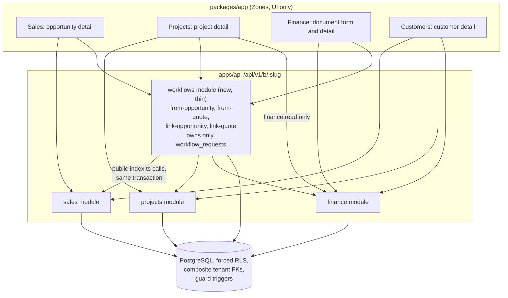
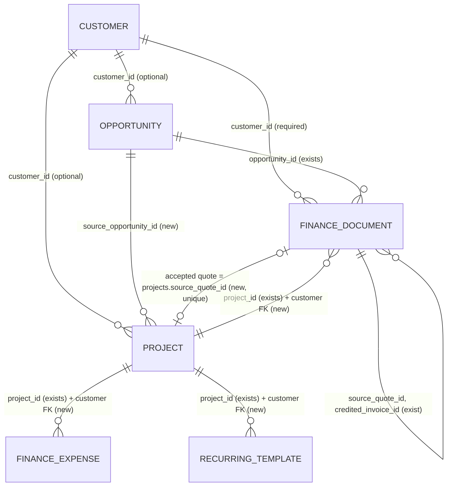

# WF-1: Connected Sales, Projects and Finance (architecture specification)

> **Version 1.0 (WF-1A), 2026-11-17. Status: proposed, documentation only.** This PR adds this file and nothing
> else: no migration, route, contract, client code or production action. Implementation (WF-1B, WF-1C, WF-1D) is
> **not authorised** until the ChatGPT architecture audit and Regan's explicit approval.
>
> **Version 1.1 (2026-11-17)** after the ChatGPT architecture audit on #102 (conditional pass at `219db4d`):
> H1 the source-quote trigger now locks the quote and its exact commit-order semantics are stated (§5.4, §6.10);
> M1 complete lock order and deadlock analysis including trigger- and FK-induced locks, exact preflight SQL
> (§6.10, §10.2); M2 duplicate guard reworded, deliberate repeat creation allowed (§6.2, D-WF1-15); M3 exact,
> disjoint project summary definitions (§6.6); opportunity status scope made explicit, new D-WF1-16 (§6.2);
> D-WF1-12 wording; PR #93 merged and #97 migration stamp noted (§10.1, §15).
> **Version 1.2 (2026-11-17)** after the focused re-audit (pass with build conditions at `b09b152`): fail-closed
> preflight with exact, tenant-visible counts (§10.2); correction path for the convert gap tested (T-48);
> decision ranges updated to D-WF1-07..16; real-PostgreSQL T-49/T-51/T-52 made entry conditions (§14).
>
> **Base:** `main` at `ccfcc93` (2026-11-17); `main` has since advanced to `4134636` (GS1-A, #93), which adds no
> migration and does not change any file this spec cites in Sales, Projects or Finance services. Every "verified" statement below cites a file on that commit.
> Statements marked **(proposal)**, **(recommendation)** or **(assumption)** are not facts about the code.
>
> **Builds on [W1](./cross-zone-workflows-w1.md)** (merged #79, decisions W1-D1..D13, FD-P3 and gates G-1..G-4
> accepted 2026-11-16). WF-1 takes the Sales/Projects/Finance part of W1, narrows it to the smallest set that
> connects the three Zones, and settles the questions W1 left open for implementation. Where WF-1 changes an
> accepted W1 rule it says so in §13 and asks for a decision; nothing in W1 is overridden silently.

## Contents

1. [Executive summary](#1-executive-summary)
2. [Owner decisions in force and how this design honours them](#2-owner-decisions-in-force-and-how-this-design-honours-them)
3. [Verified current-state inventory](#3-verified-current-state-inventory)
4. [Architecture](#4-architecture)
5. [Database relationships](#5-database-relationships)
6. [API and conversion contracts](#6-api-and-conversion-contracts)
7. [Authorisation matrix](#7-authorisation-matrix)
8. [Lifecycle and failure-state rules](#8-lifecycle-and-failure-state-rules)
9. [Security and integrity guarantees and how each is tested](#9-security-and-integrity-guarantees-and-how-each-is-tested)
10. [Migration and rollback approach](#10-migration-and-rollback-approach)
11. [UI interaction specification](#11-ui-interaction-specification)
12. [Test matrix](#12-test-matrix)
13. [Owner decision register](#13-owner-decision-register)
14. [Implementation sequence WF-1B, WF-1C, WF-1D](#14-implementation-sequence-wf-1b-wf-1c-wf-1d)
15. [Dependency and risk register](#15-dependency-and-risk-register)
16. [Relationship to W1 and other workstreams](#16-relationship-to-w1-and-other-workstreams)

---

## 1. Executive summary

**What exists.** Sales (opportunities), Projects (projects and tasks) and Finance (quotes, invoices, credit notes,
payments, expenses, catalog) are complete Zones on `main`. Finance documents already carry optional
`opportunity_id` and `project_id` columns with composite tenant FKs, and quote → invoice conversion is solid
(copies lines, keeps provenance, never issues, idempotent). What is missing is almost entirely **wiring**: no
screen sets or shows those links, a project has no link to an opportunity or an accepted quote, and the database
does not stop a document from linking another customer's project.

**Key recommendation: a hybrid of direct, typed foreign keys. No relationship table, no workflow engine.**

| Relationship | Where it lives | New? |
|---|---|---|
| Opportunity → quotes / invoices (1:N) | `finance_documents.opportunity_id` | exists; add a list filter and UI |
| Project → quotes / invoices / credit notes / expenses / recurring templates (1:N) | `project_id` on those Finance tables | exists; add customer-consistency FKs, a summary read and UI |
| Opportunity → projects (1:N) | `projects.source_opportunity_id` | **new column** |
| Accepted quote → project (1:1, a project has at most one) | `projects.source_quote_id` | **new column** |
| Everything → customer | existing `customer_id` columns, now tied together by composite FKs | **new constraints** |

Two new write endpoints create projects (`from-opportunity`, `from-quote`) and two link existing records
(`link-opportunity`, `link-quote`), all in the thin `workflows` module W1-D1 approved. "Create quote from
opportunity", "create quote from project" and "create draft invoice from project" need **no new endpoint**: they
are the existing Finance creates, prefilled by the UI and protected by new database constraints. One additive
read, `GET finance/projects/:projectId/summary`, gives finance-permitted users a per-currency project figure,
derived on read from the existing ledger. Nothing is copied, cached or stored twice.

**Why this is the simplest safe design.** Every link is a real composite FK under forced RLS, so tenant
isolation and customer consistency are enforced by PostgreSQL rather than by code alone (the repo's rule).
The many-to-many case the brief asks about does not occur: every relationship is one-to-many once Finance's
existing columns are counted (§4.3). A generic link table would lose real FKs (W1 §8.2 option B) and a workflow
engine has no job to do: every cross-Zone action is one synchronous request in one tenant transaction.

**Complexity (estimate, not measured).** Medium. One additive migration (two columns, five constraints, two
guard triggers, one infrastructure table), four write endpoints, one read endpoint, three additive list filters,
and UI panels on three existing detail screens. No change to issuance, numbering, payments, settlement or any
financial rule. The riskiest parts are the guard triggers and the lock order, both covered by mandatory real
PostgreSQL tests (W1 gates G-2..G-4).

**Owner decisions needed:** ten new ones, D-WF1-07 to D-WF1-16 (§13). Four amend accepted W1 details and are
flagged as such.

**Recommended next package:** WF-1B-1 (schema and Finance link rules), §14.

---

## 2. Owner decisions in force and how this design honours them

| Id | Decision (accepted) | How WF-1 honours it | Conflict? |
|---|---|---|---|
| D-WF1-01 | Projects can exist without opportunities | `source_opportunity_id` and `source_quote_id` are nullable; plain `POST projects` is unchanged | None |
| D-WF1-02 | Winning does not auto-create a project; explicit action, optional assisted creation | `winOpportunity` is untouched. After a win the UI *offers* "Create project" (§11.2); only `POST workflows/projects/from-opportunity` creates one | None |
| D-WF1-03 | Multiple quotes and invoices per project | `project_id` on Finance tables is N:1 to projects (already true). A project additionally has at most one *source* quote (§5.2) | None. See D-WF1-08 for the one limit: a second **already issued** quote cannot be attached later |
| D-WF1-04 | Quote changes never overwrite opportunity estimates | No Finance or workflow code writes `opportunities.amount`, `probability`, `currency_code` or stage. A quote created from an opportunity does not copy the amount into a line. Tested (§12, T-41) | None |
| D-WF1-05 | Project financial summaries only with Finance permissions | Summary endpoint requires `finance:read`; finance ids are **absent** from project responses for everyone else (§9, G-FIN) | None |
| D-WF1-06 | Conversions create drafts only; issuance, approval and audit unchanged | Every Finance create used by WF-1 inserts a `DRAFT` (guard trigger enforces it, `20261115000000_finance/migration.sql` FN010). No WF-1 path issues, accepts, voids or numbers a document | None. One additive convert rule (D-WF1-10) only sets `project_id` on the draft |

No technical or security conflict with D-WF1-01..06 was found.

---

## 3. Verified current-state inventory

Verified on `main` at `ccfcc93` by reading the files cited. "Reusable" means safe to call or copy unchanged.

### 3.1 Sales

| Topic | What exists | File |
|---|---|---|
| Records | `sales_pipelines`, `sales_stages`, `opportunities`, `opportunity_outcomes`; status `OPEN`/`WON`/`LOST`; `amount` (decimal, nullable), `currency_code`, `probability`, `expected_close_date`; optional `customer_id`, `contact_id`; `version`; `archived_at` | `apps/api/prisma/schema/sales.prisma` |
| Keys and FKs | `@@unique([businessId, id])`; composite FKs to customer, contact, pipeline, stage `(business_id, pipeline_id, stage_id)`, owner membership | same |
| Endpoints | CRUD, `win`, `lose`, `reopen`, `archive`, `restore`, `outcomes`; pipelines, stages, `summary` | `apps/api/src/app/api/v1/b/[slug]/sales/**/route.ts` |
| List filters | `status`, `archived`, `pipelineId`, `stageId`, **`customerId`**, `contactId`, `ownerUserId` | `sales/server/opportunities.ts:319` |
| Lifecycle | `close()` is a conditional `UPDATE … WHERE status='OPEN' AND archived_at IS NULL` plus an outcome row; win/lose take **no version** (state-guarded); edits use version; reopen keeps outcome history | `sales/server/opportunities.ts:222-281` |
| Authz | `sales:read`, `sales:write` (opportunities), `sales:manage` (pipelines). MEMBER has read and write | `access/server/permissions.ts:16-18, 120-121` |
| Audit | `sales.opportunity.{created,updated,stage_changed,assigned,won,lost,reopened,archived,restored}` | `opportunities.ts` |
| Cross-Zone today | `opportunities.financeDocuments` back-relation only. `winOpportunity` changes nothing outside Sales | `sales.prisma`, `opportunities.ts:241` |
| **Missing** | Any view of quotes, invoices or projects for an opportunity; any link to a project | — |
| **Reusable** | `getOpportunity`, `listOpportunities` (customer filter), the conditional-update style, the public module index | `apps/api/src/modules/sales/index.ts` |

### 3.2 Projects

| Topic | What exists | File |
|---|---|---|
| Records | `projects` (status `PLANNED`/`ACTIVE`/`ON_HOLD`/`COMPLETED`/`CANCELLED`, any-to-any; optional `customer_id`; `version`; `archived_at`) and `project_tasks` | `apps/api/prisma/schema/projects.prisma` |
| Keys | `@@unique([businessId, id])`; composite FKs to customer and owner membership; back-relations from finance documents, expenses, recurring templates | same |
| Reserved | `docs/projects-data-model.md` §8 reserves a nullable `source_opportunity_id` with a composite FK | `docs/projects-data-model.md:134-136` |
| Endpoints | CRUD, `archive`, `restore`, tasks (CRUD, move, archive, restore), `summary`, `customers/:id/projects` | `apps/api/src/app/api/v1/b/[slug]/projects/**`, `customers/[customerId]/projects` |
| Concurrency | `updateProject` reads, checks `version`, then a conditional `UPDATE … WHERE version AND archived_at IS NULL`; archive and restore are state-guarded without version | `projects/server/projects.ts:120-183` |
| Archive | Archived project is read-only (`409 archived`); tasks kept | same `:169` |
| Field-level read | `Viewer.canReadCustomers` (from `customers:read`) decides whether customer names are joined; setting or clearing a customer needs it | same `:24-35, 77-82, 140-144, 269` |
| Authz | `projects:read/create/update/archive/manage_tasks`. MEMBER has all but `archive` | `access/server/permissions.ts:21, 74, 117-121` |
| **Missing** | Any link to an opportunity or quote; any finance view; a guard on changing `customer_id` while customer-specific records link the project (W1 G3) | — |
| **Reusable** | `createProject` validation (customer active, member, dates), `Viewer` pattern for field-level redaction, audit names | `projects/index.ts` |

### 3.3 Finance

| Topic | What exists | File |
|---|---|---|
| Documents | `finance_documents` (QUOTE, INVOICE, CREDIT_NOTE), required `customer_id`, optional `opportunity_id`, `project_id`, `source_quote_id` (composite FK pins kind, currency and customer), `credited_invoice_id`, counters, idempotency columns | `apps/api/prisma/schema/finance.prisma:152-240` |
| Existing keys | `(business_id,id)`, `(business_id,id,kind)`, `finance_documents_link_key (business_id,id,kind,currency_code,customer_id)`, number uniques; indexes on `project_id`, `opportunity_id`, `source_quote_id` | same `:227-238` |
| Link checks | `checkLinks`: contact belongs to customer; opportunity active and, if it has a customer, the same customer; **project only checked for existence and archive, not customer** | `finance/server/documents.ts:136-163` |
| Creates | `createQuote`, `createInvoice` accept `opportunityId`, `projectId`; Idempotency-Key with advisory lock + `request_hash`; all go through `insertDraft` | same `:239-333` |
| Conversion | `convertQuote`: quote `ISSUED` or `ACCEPTED`; copies customer, contact, opportunity, **project**, currency, notes, lines; sets `source_quote_id`; never issues; does not lock the quote | same `:335-353` |
| Credit notes | copy the invoice's opportunity and project | same `:355-373` |
| Issuance and immutability | `finance_guard_document`: inserts only as `DRAFT`; after issue every column outside `mutable_after_issue` is frozen (FN001), including `project_id` and `opportunity_id`; transitions limited (FN002) | `prisma/migrations/20261116000000_finance_payments/migration.sql:87-230` |
| Sealed content | `finance_document_content` hashes `opportunityId` and `projectId` into `content_sha256` at issue | `prisma/migrations/20261115000000_finance/migration.sql:532-553` |
| Locks | `lockDocuments` = `FOR NO KEY UPDATE` ordered by id; transitions and voids lock first | `finance/server/shared.ts:43-50`, `documents.ts:107, 610-650` |
| Lists | filters `status`, `customerId`, **`projectId`**, `invoiceId`, dates, settlement, overdue, sort; **no `opportunityId`** | `documents.ts:375-453` |
| Expenses, templates | `finance_expenses.project_id` and `customer_id` optional; recurring templates `project_id` optional, `customer_id` required | `finance.prisma:398-457`, `finance-billing.prisma`, `finance/server/expenses.ts:310-337`, `recurring.ts` |
| Authz | 12 `finance:*` keys, separate from every other Zone (FD-P1). MANAGER: `read`, `write`, `expenses`, documents; OWNER/ADMIN also `issue`, `payments`, `manage`, etc.; MEMBER: none | `access/server/permissions.ts:22-38, 76-85, 113-121` |
| Audit | `finance.document.*` with structured facts only | `documents.ts:278-293`, `docs/finance-data-model.md` §10 |
| **Missing** | Opportunity list filter; project summary; customer-consistent project FK; any UI that sets or shows opportunity or project | `packages/app/src/zones/finance/document-form.tsx` (no such field) |
| **Reusable** | `createQuote`, `createInvoice`, `convertQuote` unchanged as the conversion engine; `settlementStateOf`; `CustomerFinance` panel pattern | `documents.ts`, `zones/finance/customer-finance.tsx` |

### 3.4 Shared infrastructure

| Topic | What exists | File |
|---|---|---|
| Customer identity | `customers`, `contacts`; archived customers cannot be newly linked (`archived_reference`), existing links stay | `customers.prisma`, `documents.ts:125`, `projects.ts:77` |
| Activity timeline | `activities` with registered `SYSTEM_ACTIVITY_TYPES` only for customer and contact events; `recordSystemActivity` writes in the caller's unit of work | `modules/activity/server/activities.ts:23-27, 147-161` |
| Tenant isolation | `tenantRoute` → `withTenant`; forced RLS on every tenant table; app role without `BYPASSRLS`; composite FKs `(business_id, x)` | `apps/api/src/app/api/_lib/routes.ts`, `docs/architecture.md` §7.3, ADR 0004 |
| Route authorisation | One `permission` per `tenantRoute`; further keys checked inside handlers (Projects does it for customers) | `_lib/routes.ts`, `projects.ts:269` |
| Version handling | Optimistic `version` on opportunities, projects, tasks, documents | Zone services above |
| Module boundaries | Routes and modules import other modules only through `index.ts` (`.dependency-cruiser.cjs:88-113`, `pnpm boundaries`) | — |
| Reporting | Registry metrics read Finance and Sales only; no project or opportunity-link metric; project margin specified but not built | `modules/reporting/server/registry.ts:64-183`, `docs/finance-data-model.md` §9 |
| Customer hub (UI) | Customer detail embeds `CustomerProjects` (projects) and `CustomerFinance` (finance:read); **no opportunities panel** | `zones/customers/customer-detail.tsx:196-204` |
| Tests | `apps/api/tests/integration/cross-zone.test.ts` (one customer through every Zone; cross-tenant link refusals; role refusals); per-Zone suites; `tests/isolation`; client tests in `packages/app/tests` | — |
| CI | Required check `CI gate`; migration-order check `.github/scripts/check-migration-order.sh`; PgBouncer and lock-order suites per Zone (`.github/workflows/ci.yml:173-214`) | — |

### 3.5 Gap summary (verified)

1. Finance links to opportunities and projects are API-only (no UI sets or shows them).
2. A document, expense or template may link a project of **another customer** (W1 G3 still open).
3. A project's customer can change while customer-specific Finance records link it.
4. No opportunity → project or quote → project relationship.
5. Once a quote is issued, its `project_id` is frozen **and sealed into its content hash**, so a project created
   or chosen after issue can never be recorded on the quote itself. This rules out "unfreeze the column"
   (W1 §8.2 option C): it would make `content_sha256` disagree with the stored content.
6. No per-project finance figure; no opportunity filter on Finance lists.
7. No cross-Zone timeline entries (W1 WF-8, out of WF-1 scope).

---

## 4. Architecture

### 4.1 Module view



- `workflows` (W1-D1) composes public functions of Sales, Projects and Finance inside the request's single
  `withTenant` transaction. It owns no business record, only `workflow_requests` (W1-D13).
- Zones keep their own rules. `workflows` never writes another Zone's table directly: the new Projects
  functions (`createProjectWithSource`, `setProjectOpportunity`, `setProjectSourceQuote`) live in `projects`.
- Finance reads a project row in two places it already reads projects (`checkLinks`) and one new one
  (`convertQuote`, D-WF1-10), always through the tenant db.

### 4.2 Data view



### 4.3 Cardinality: is there any many-to-many?

| Pair | Real-world need | Model | Verdict |
|---|---|---|---|
| Opportunity ↔ quote | Several quote versions or options per deal; a quote belongs to one deal | `finance_documents.opportunity_id` | 1:N |
| Opportunity ↔ project | A deal may produce phases (several projects); a project starts from at most one deal | `projects.source_opportunity_id` | 1:N |
| Quote ↔ project | A project may have several quotes (variations); a quote is delivered by one project (W1-D10) | `finance_documents.project_id` (linked while draft) **plus** `projects.source_quote_id` (accepted quote, linked after issue) | 1:N |
| Project ↔ invoice | Deposits, progress and final invoices per project; an invoice is for one project | `finance_documents.project_id` | 1:N |
| Opportunity ↔ invoice | Through quotes and projects; also directly | `finance_documents.opportunity_id` | 1:N |

None is many-to-many. A relationship table would only earn its place if one quote had to belong to several
projects, or one project to several opportunities. Neither is supported by an owner decision; W1-D10 says one
project per quote. **Recommendation: no relationship table.**

### 4.4 Options compared

| Criterion | A. Direct typed FKs (recommended, hybrid with existing columns) | B. Explicit relationship table `record_links(from_type, from_id, to_type, to_id)` | C. Typed join tables per pair (`project_quotes`, `project_opportunities`) |
|---|---|---|---|
| Tenant isolation | Composite FK per column; PostgreSQL refuses cross-business links | Polymorphic ids cannot carry FKs; tenant safety by code only (against the repo rule) | Composite FKs possible |
| Customer consistency | Composite FK including `customer_id` (§5.3) | Code only | Possible, but duplicates the rule on a second table |
| Fit with existing data | Reuses `opportunity_id` and `project_id` already on Finance tables | Second source of truth next to those columns | Second source of truth for draft-linked quotes |
| Sealed documents | Leaves issued documents untouched | Same | Same |
| Queries | One join per hop; indexes exist or are one new index | Generic, harder to index and to redact | Extra join per hop |
| Extensibility | A new link = a new nullable column + FK in the owning Zone's PR | Any pair, no migration | One table per pair |
| Complexity | Lowest | Low schema, high code and test cost | Medium |

Hybrid means: keep the existing Finance-side columns for links made while a document is a draft, and add two
Project-side columns for links that must be made after a quote is sealed or that are Projects' own provenance.
A generic **workflow engine** is not justified: every action in §6 is a single synchronous request; there are no
long-running steps, timers, compensations or user tasks to orchestrate (the same conclusion as W1 §8.7).

### 4.5 Financial status aggregation without a second ledger

All project and opportunity money figures are **derived on read** from `finance_documents`, allocations and
expenses, per currency, never converted, never stored (§6.6). Projects and Sales store no amount copied from
Finance. The opportunity's `amount` stays a Sales estimate (D-WF1-04); the quote total is shown beside it, not
written into it.

### 4.6 Shared activity history

- **In WF-1:** every relationship mutation writes an audit row in the same transaction (§9, G-AUD). Each linked
  record's detail page shows its related records (§11), which is the navigable history.
- **Not in WF-1:** cross-Zone entries on the customer timeline. That is W1 WF-8 with the redaction rule W1-D8
  already decided (finance entries carry type and link only for people without `finance:read`). WF-1 adds no
  activity type, so it cannot leak finance facts through the timeline.

---

## 5. Database relationships

All **(proposal)** for WF-1B-1. Names follow existing conventions. Every new constraint is created `NOT VALID`
and then `VALIDATE`d after a read-only production preflight (gate G-3).

### 5.1 `projects.source_opportunity_id` (new)

| Item | Shape | Enforced by |
|---|---|---|
| Column | `source_opportunity_id uuid NULL` | — |
| Same tenant | FK `(business_id, source_opportunity_id)` → `opportunities(business_id, id)`, `ON DELETE NO ACTION ON UPDATE NO ACTION`, name `projects_source_opportunity_fkey` | DB |
| Lookup | `@@index([businessId, sourceOpportunityId])` | DB |
| Customer match at link time | If both the project and the opportunity have a customer, they are equal (`400 opportunity_customer_mismatch`, the code Finance already uses) | Service |
| Editable | Set, change or clear by `link-opportunity` (D-WF1-07). Locked while the project has a source quote whose `opportunity_id` is not null (`409 opportunity_set_by_quote`) | Service + trigger (§5.4) |

Customer consistency with the opportunity is **provenance, not an invariant**: an opportunity's customer stays
editable in Sales (as W1 §8.2 already decided), so it is checked when the link is made, not forever.

### 5.2 `projects.source_quote_id` (new; W1-D3, option A)

| Item | Shape | Enforced by |
|---|---|---|
| Columns | `source_quote_id uuid NULL`, `source_quote_kind "FinanceDocumentKind" NOT NULL DEFAULT 'QUOTE'` with `CHECK (source_quote_kind = 'QUOTE')` | DB |
| New Finance key | `finance_documents_kind_customer_key UNIQUE (business_id, id, kind, customer_id)` (implied by the PK, cannot fail) | DB |
| Same tenant, kind and customer | FK `(business_id, source_quote_id, source_quote_kind, customer_id)` → `finance_documents(business_id, id, kind, customer_id)`, name `projects_source_quote_fkey` | DB |
| No customerless project with a quote | `CHECK (source_quote_id IS NULL OR customer_id IS NOT NULL)` (needed because `MATCH SIMPLE` skips the FK when `customer_id` is NULL) | DB |
| One project per quote (W1-D10) | `UNIQUE (business_id, source_quote_id)` | DB |
| Quote must be `ACCEPTED` when linked (W1-D2) | Service check under lock, trigger backstop (§5.4) | Service + DB |
| A quote drafted against another project cannot be attached elsewhere | Trigger: the quote's `project_id` is NULL or equals this project | DB |
| Set once (D-WF1-08) | Trigger: NULL → value allowed once (create or `link-quote`); value → anything else refused | DB |
| Customer cannot drift | The FK includes `customer_id`, so `UPDATE projects SET customer_id` on a quote-linked project fails `23503` → `409 project_customer_locked` | DB |

"The quotes of project P" is therefore `{ d : d.kind = QUOTE and d.project_id = P } ∪ { P.source_quote_id }`.
The trigger guarantees the two sets cannot name the same quote for two different projects.

### 5.3 Customer-consistency keys (W1 invariant I1, W1-D6)

Unchanged from W1 §6.1, scheduled in WF-1B-1:

- `projects_customer_key UNIQUE (business_id, id, customer_id)`.
- On `finance_documents`, `finance_expenses`, `finance_recurring_templates`: FK
  `(business_id, project_id, customer_id)` → `projects(business_id, id, customer_id)`, `ON UPDATE NO ACTION`,
  next to the existing `(business_id, project_id)` FK.
- Effect (`MATCH SIMPLE`): a record with a customer can only link a project with the same customer; a record
  without a customer (an internal expense) may link any project; a customer-owned project cannot change or lose its
  customer while any such record links it, in any status (W1-D6). Service checks give
  `400 project_customer_mismatch` and `409 project_customer_locked` first; the FK is the backstop.
- Issued documents are not touched: their `project_id` and `customer_id` are frozen by `finance_guard_document`,
  and adding an FK changes no row.

### 5.4 Guard trigger `projects_guard_links` (new, `SECURITY INVOKER`)

`BEFORE INSERT OR UPDATE OF source_quote_id, source_opportunity_id ON projects` (not `customer_id`, so an ordinary
customer edit never touches Finance rows; customer drift is caught by the FKs alone):

1. **Set once.** If `OLD.source_quote_id IS NOT NULL` and `NEW.source_quote_id IS DISTINCT FROM OLD.source_quote_id`
   → `RAISE` (`WF001`).
2. **Lock, then check (H1).** Only when `source_quote_id` becomes non-null (insert, or NULL → value):
   `SELECT kind, status, project_id, opportunity_id FROM finance_documents WHERE business_id = NEW.business_id
   AND id = NEW.source_quote_id FOR SHARE`. Refuse unless `kind = 'QUOTE'`, `status = 'ACCEPTED'` and
   (`project_id IS NULL` or `project_id = NEW.id`) (`WF002`, `WF003`).
3. **Opportunity agrees with the quote.** When either column changes and `NEW.source_quote_id` is not null: if the
   quote's `opportunity_id` is not null, `NEW.source_opportunity_id` must equal it (`WF004`). The quote's
   `opportunity_id` is frozen after issue (`finance_guard_document`), so this read needs no lock.

**Why the explicit `FOR SHARE`.** The composite FK alone takes only `FOR KEY SHARE` on the quote, which does
**not** conflict with the `FOR NO KEY UPDATE` that `lockDocuments` and every quote transition take
(`finance/server/shared.ts:43-50`). Without the explicit lock, a link could read `ACCEPTED` while a void is in
flight and commit after it. `FOR SHARE` does conflict with `FOR NO KEY UPDATE`.

**Exact semantics (what is guaranteed, and what is not).** At READ COMMITTED:

| Interleaving | Outcome |
|---|---|
| A void (or any transition) of the quote has **committed** before the link's `FOR SHARE` | The locking read waits if needed, then sees the latest committed row (PostgreSQL re-reads the newest version of a locked row): status `VOID` → link refused |
| The void holds the quote lock but has not committed | The link waits; after the void commits it sees `VOID` → refused; if the void rolls back it sees `ACCEPTED` → allowed |
| The link took `FOR SHARE` first | The void waits until the link commits or rolls back, then voids the quote. The project keeps its link and shows "source quote void" (§8). This is the defined lifecycle, not a race |

So the guarantee is: **a project's source quote was `ACCEPTED` at the moment the link committed, in commit order
with every quote transition.** It is not "the quote is still accepted now" (voids after association are allowed
by design). The same holds for direct SQL that bypasses the service, because the lock is inside the trigger.

**Liveness.** Service paths always lock the quote before the project (§6.10), so they cannot deadlock with each
other. A **direct SQL** link (no product path does this) locks the project row first and the quote second; racing a
`from-quote` request on the same quote it can form a cycle with the unique index on `source_quote_id`, which
PostgreSQL breaks with `40P01`. Both outcomes keep every invariant (one side rolls back); this is stated as tested
behaviour, not hidden (T-51).

It runs as `bos_app` under forced RLS (the Finance guard pattern, `20261115000000_finance/migration.sql:556-557`),
so it can only ever see the current tenant's rows. Prisma cannot express it; it lives in the migration SQL and is
proven by direct-SQL tests that bypass the service (§12).

### 5.5 `workflow_requests` (W1-D13)

Tenant table with forced RLS; columns `business_id`, `id`, `operation` (`project.from_opportunity`,
`project.from_quote`), `idempotency_key`, `request_hash`, `result_type`, `result_id`, `actor_user_id`,
`created_at`. `UNIQUE (business_id, operation, idempotency_key)`; `bos_app` gets `SELECT, INSERT` only.
Inserted in the action's transaction, so a rolled-back action leaves no key. Retention per D-WF1-12 (resolves
gate G-1).

### 5.6 What is deliberately not added

- No column on `opportunities` (Sales stays unaware of projects; the list filter in §6.5 reads projects).
- No change to `finance_guard_document`, `mutable_after_issue`, the content hash or any issued row.
- No stored totals, statuses or copies of names on projects or opportunities.

---

## 6. API and conversion contracts

All paths are under `/api/v1/b/:slug/`. All **(proposal)**. Contracts are added to `packages/contracts`
additively; no existing request or response changes shape except new optional response fields (§6.7).
Errors use the existing envelope and status mapping (`_lib/routes.ts`): `400` rule, `403` permission,
`404` not found or other business, `409` state.

### 6.1 Create quote from opportunity (and from project)

**No new endpoint.** The UI calls the existing `POST finance/quotes` (Idempotency-Key, as today) prefilled
from the opportunity: `customerId` (the opportunity's, if it has one), `contactId`, `opportunityId`,
`currencyCode`. From a project: `customerId` (the project's), `projectId`, and `opportunityId` if the project has
one.

| Concern | Rule |
|---|---|
| Validation | Existing `checkLinks`, plus I1 for `projectId` (§5.3). Opportunity without a customer: the person picks one; the opportunity is **not** updated (D-WF1-04). Customerless project: refused, `400 project_customer_mismatch` (a quote always has a customer) |
| Authorisation | `finance:write` (route) **plus** `sales:read` when `opportunityId` is set and `projects:read` when `projectId` is set (D-WF1-11, checked in the handler) |
| Lines | Empty draft, or catalog lines the person adds. The opportunity amount is never turned into a line (D-WF1-04) |
| Idempotency | Existing Finance Idempotency-Key replay (`documents.ts:239`) |
| Concurrency | Existing: FK `KEY SHARE` on opportunity and project at insert; an archive racing the create is caught by `checkLinks` or leaves an existing link (allowed) |
| Failure | Single insert; nothing to recover |

### 6.2 Create project from opportunity

```
POST workflows/projects/from-opportunity          Idempotency-Key required
{ opportunityId, existingProjectCount, name?, ownerUserId?, startDate?, dueDate?, status? }
→ 201 { project }        200 on replay with the same key and body
```

| Concern | Rule |
|---|---|
| Validation | Opportunity exists, is not archived (`409 archived_reference`) and is **OPEN or WON**. OPEN is a separate, permitted planning action (work can be planned before a deal closes); WON is the W1-D7 "Start job" case. **LOST is refused** (`409 opportunity_lost`; reopen it in Sales first) per recommended D-WF1-16. Name defaults to the opportunity title. Customer = the opportunity's (`createProject` rules: customer active) |
| Duplicate guard | `existingProjectCount` must equal the number of projects whose `source_opportunity_id` is this opportunity, counted under the lock below; otherwise `409 opportunity_projects_changed { count }`. This **prevents unconfirmed or stale duplicate creation** (double clicks, retries, a retry after the idempotency key's retention). It does **not** forbid deliberate repeats: a person who sees the new count and confirms it again creates another project, which is intended for phased work (D-WF1-03, D-WF1-15). It contributes to G-1 for this path |
| Authorisation | `projects:create` and `sales:read`; also `customers:read` when the opportunity has a customer (existing Projects rule) |
| Customer consistency | Copied, not chosen, so it matches by construction |
| Idempotency | `workflow_requests` (operation `project.from_opportunity`); same key + same hash → 200 with the original project re-read with the caller's current permissions; different hash → `409 idempotency_conflict` |
| Concurrency | Lock order: key advisory lock → advisory lock `workflows.opportunity_projects:<opportunityId>` → read opportunity → insert project (FK `KEY SHARE` on opportunity). Does not block Sales edits |
| Failure recovery | One transaction: project, `workflow_requests` row and audit rows commit together or not at all. Retry with the same key is safe |
| Audit | `projects.project.created` (existing) + `projects.project.created_from_opportunity { opportunityId }` |

### 6.3 Create project from accepted quote

```
POST workflows/projects/from-quote               Idempotency-Key required
{ quoteId, name?, ownerUserId?, startDate?, dueDate?, status? }
→ 201 { project }        200 on replay
```

| Concern | Rule |
|---|---|
| Validation | Quote `ACCEPTED` (`409 quote_not_accepted`, W1-D2). Quote's `project_id` must be NULL (`409 quote_has_project { projectId? }`); quote not already a source (`409 quote_has_project`, from the unique key). Customer = quote's customer and must be active (Projects rule, `409 archived_reference`). `source_opportunity_id` = quote's `opportunity_id` |
| Authorisation | `projects:create`, `finance:read`, `customers:read` (W1 §8.2). The response's `projectId` in a `quote_has_project` error is included only if the caller has `projects:read` |
| Idempotency | `workflow_requests` (operation `project.from_quote`) + the unique source-quote key as backstop |
| Concurrency | key lock → quote `FOR NO KEY UPDATE` (W1 §9.2: held strong so a concurrent void or a second create queues) → insert project (FK `KEY SHARE` on quote, customer, opportunity) |
| Failure | One transaction; a concurrent void makes this request see `VOID` and refuse |
| Name | Defaults to the quote number, plus the customer name only if the caller has `customers:read` (W1 §8.2) |
| Audit | `projects.project.created` + `projects.project.created_from_quote { quoteId, opportunityId }` |

### 6.4 Link an existing project to an opportunity; associate an accepted quote with a project

```
POST workflows/projects/:projectId/link-opportunity
{ version, opportunityId | null }                → 200 { project }

POST workflows/projects/:projectId/link-quote
{ version, quoteId }                              → 200 { project }
```

| Concern | `link-opportunity` | `link-quote` |
|---|---|---|
| Validation | Project not archived (`409 archived`); a newly linked opportunity exists, is not archived and is OPEN or WON (`409 opportunity_lost`, D-WF1-16); customers equal if both set; not locked by a source quote. Clearing (`null`) is always allowed unless locked | Project not archived and has a customer; quote `ACCEPTED`, same customer (`400 project_customer_mismatch`), its `project_id` NULL or this project; project has no source quote (`409 project_has_quote`); quote not a source elsewhere (`409 quote_has_project`) |
| Authorisation | `projects:update` + `sales:read` | `projects:update` + `finance:read` |
| Idempotent by state | Same value again → 200, no version bump, no audit | Same quote again → 200, no change |
| Concurrency | Conditional `UPDATE … WHERE version AND archived_at IS NULL` (Projects pattern) → `409 stale` | quote `FOR SHARE` (blocks a concurrent void) → project conditional `UPDATE` (takes `FOR UPDATE` because a unique-key column changes) → trigger re-takes quote `FOR SHARE` (already held) and re-checks status (§5.4, §6.10) |
| Side effects | Opportunity untouched | Quote untouched; `source_opportunity_id` set from the quote when the project has none, refused if it differs (`409 opportunity_mismatch`) |
| Audit | `projects.project.opportunity_linked { from, to }` | `projects.project.quote_linked { quoteId }` |

No "unlink quote" in WF-1 (D-WF1-09).

### 6.5 Create a draft invoice from eligible sources

| Source | Endpoint | Behaviour |
|---|---|---|
| Accepted or issued quote | existing `POST finance/quotes/:id/convert` | **Unchanged semantics** (eligible ISSUED or ACCEPTED, copies lines, keeps provenance, never issues, Idempotency-Key). One additive rule (D-WF1-10): if the quote's `project_id` is NULL and a project has it as `source_quote_id`, the draft's `project_id` is that project. Same customer by construction |
| Project (no quote, or extra work) | existing `POST finance/invoices` prefilled with the project's customer, `projectId`, and its `opportunityId` | Draft only; I1 enforced; customerless or archived project refused |
| Opportunity (rare: invoice without quote) | existing `POST finance/invoices` with `opportunityId` | as today |

Not in WF-1: deposit or percentage portions, invoiced-versus-quoted enforcement and confirmation (W1 §8.5, §8.6,
FD-P3). They stay with W1's invoice-the-job package (§16). WF-1 does not make over-billing easier than today: the
convert path is the existing one, and the project summary shows quoted versus invoiced so a person can see it.

### 6.6 Reads

| Endpoint | Change | Permission |
|---|---|---|
| `GET finance/quotes`, `GET finance/invoices`, `GET finance/credit-notes` | add `opportunityId` filter | `finance:read` + `sales:read` for that filter |
| `GET finance/projects/:projectId/summary` | **new.** Exact definitions in §6.6.1. Derived, read-only | `finance:read` + `projects:read`; project must exist in the business (404 otherwise) |
| `GET projects?sourceOpportunityId=` | **new filter** | `projects:read` + `sales:read` for that filter |
| `GET sales/opportunities?customerId=` | exists | `sales:read` |

#### 6.6.1 Project summary definitions (M3)

One row per currency that occurs in any set below; nothing is converted or added across currencies
(`finance-data-model.md` §9). All amounts are exact decimals already stored at the document's scale. Sets, for
project `P`:

| Set | Members |
|---|---|
| `Q(P)` quotes | the **deduplicated union** of quotes with `project_id = P` and the quote `P.source_quote_id` (a quote is counted once even if both apply; the trigger in §5.4 makes them agree) |
| `I(P)` invoices | invoices with `project_id = P` (after D-WF1-10 this includes drafts converted from the source quote) |
| `C(P)` credit notes | credit notes whose `credited_invoice_id` is in `I(P)` (they copy the invoice's project, but membership is defined by the credited invoice so it cannot drift) |
| `E(P)` expenses | expenses with `project_id = P` |

| Field | Definition | Notes |
|---|---|---|
| `quotedNet` | Σ `subtotal` of `Q(P)` with status `ISSUED` or `ACCEPTED` | `DRAFT`, `DECLINED`, `EXPIRED`, `VOID` excluded |
| `acceptedNet` | Σ `subtotal` of `Q(P)` with status `ACCEPTED` | subset of `quotedNet` |
| `invoicedNet`, `invoicedGross` | Σ `subtotal`, Σ `total` of `I(P)` with status `ISSUED` | `VOID` and drafts excluded |
| `creditedNet`, `creditedGross` | Σ `subtotal`, Σ `total` of `C(P)` with status `ISSUED` | |
| `billedNet` | `invoicedNet − creditedNet` | the revenue view (`finance-data-model.md` §9) |
| `paymentsAllocated` | Σ `allocated_total` of `ISSUED` invoices in `I(P)` | **payment allocations only**; labelled "Received" in the UI. Reversed allocations are already excluded from the counter |
| `creditApplied` | Σ `credit_applied_total` of `ISSUED` invoices in `I(P)` | credit notes applied to those invoices; not cash |
| `outstanding` | Σ (`total − allocated_total − credit_applied_total`) of `ISSUED` invoices in `I(P)` | the existing receivables formula (§18.4 F2); each credit is subtracted once, through `credit_applied_total` only |
| `unappliedCredit` | Σ (`total − credit_applied_total`) of `ISSUED` credit notes in `C(P)` | issued but not yet applied; shown, never subtracted from `outstanding` (Finance's existing rule) |
| `expensesNet` | Σ net amount of `RECORDED` expenses in `E(P)` | net of tax, as `finance-data-model.md` §9 |
| `counts` | number of documents per kind and status in `Q(P)`, `I(P)`, `C(P)`, including drafts | counts only for drafts; draft amounts are not totals |

`paymentsAllocated + creditApplied + outstanding = invoicedGross` for each currency, which T-49 asserts.

### 6.7 Response changes (additive)

`Project` gains two optional fields:

- `sourceOpportunityId` and `sourceOpportunity: { id, title, status } | null`: **present only** for callers with
  `sales:read`; otherwise the keys are absent (not null).
- `sourceQuoteId` and `sourceQuote: { id, number, status } | null`: **present only** with `finance:read`.

This extends the existing `Viewer` (`projects.ts:24`) with `canReadSales` and `canReadFinance`, decided once per
request from permission keys (`viewerOf`). Lists, `customers/:id/projects` and every project embed follow it.

### 6.8 Navigation contract

Navigation is client-side through existing Zone `onOpen` handlers with `confirmDiscard`. A related-record chip
is rendered only when the API returned the id to this viewer, so a chip never points at a record the viewer
cannot read. Opening a record the viewer can no longer read yields the existing 403/404 problem state.

### 6.9 Error codes (new, additive)

`opportunity_projects_changed`, `quote_not_accepted`, `quote_has_project`, `project_has_quote`,
`opportunity_set_by_quote`, `opportunity_mismatch`, `opportunity_lost`. Existing codes reused: `stale`, `archived`,
`archived_reference`, `project_customer_mismatch`, `project_customer_locked`, `opportunity_customer_mismatch`,
`idempotency_conflict`. No error names another Zone's record kind, count or id unless the caller can read it.

---

### 6.10 Lock order and deadlock analysis (M1)

As in W1 §9.2, lock order is about liveness: every invariant rests on FKs, CHECKs, the unique key and the trigger
lock, and holds in any order; a wrong order can only cost a `40P01` rollback. This section lists **every** lock each
path takes, including those PostgreSQL takes implicitly for FKs, unique keys and the trigger. It is the design to
test (T-51, T-52), not a claim that it has been tested.

**Lock facts used** (PostgreSQL row-lock modes): an FK check on insert or on update of FK columns takes
`FOR KEY SHARE` on the referenced row. An `UPDATE` that changes a column of any unique index takes `FOR UPDATE` on
the row, otherwise `FOR NO KEY UPDATE`. `FOR KEY SHARE` conflicts only with `FOR UPDATE`; `FOR SHARE` conflicts with
`FOR NO KEY UPDATE` and `FOR UPDATE`. `ON UPDATE NO ACTION` checks on the referenced side look for committed
referencing rows; uncommitted rows of another transaction are not visible to them. A locking read that waited
for a concurrent update re-reads the newest committed row version (READ COMMITTED).

**Paths after WF-1B** (`customer_id` is in `projects_customer_key`, `source_quote_id` in the unique source key):

| # | Path | Locks, in order |
|---|---|---|
| P1 | Finance draft create or edit that sets or keeps `project_id` (existing, plus I1 FK) | idempotency advisory lock (create) or document `FOR NO KEY UPDATE` (edit) → row write → FK checks: `FOR KEY SHARE` on customer, opportunity, project (`(business_id, project_id)` and `(business_id, project_id, customer_id)`) |
| P2 | Project customer change (`updateProject`) | project row `FOR UPDATE` (key column change) → referenced-side `NO ACTION` checks against documents, expenses, templates (committed rows only, no wait on uncommitted rows) → own FK check on the source quote `FOR KEY SHARE` when `source_quote_id` is set (fails `23503` because the quote's customer differs) |
| P3 | `link-quote` | quote `FOR SHARE` → project row `FOR UPDATE` → trigger: quote `FOR SHARE` (held) → FK `FOR KEY SHARE` on quote (compatible with own lock) → unique index entry for `source_quote_id` |
| P4 | `from-quote` | idempotency advisory lock → quote `FOR NO KEY UPDATE` → project `INSERT` → trigger: quote `FOR SHARE` (own lock, compatible) → FK `KEY SHARE` on quote, customer, opportunity → unique index entry |
| P5 | Quote accept, decline, expire, void (existing) | quote `FOR NO KEY UPDATE` (`lockDocuments`) → status update (no unique column changes) |
| P6 | `link-opportunity` | project row `FOR NO KEY UPDATE` (`source_opportunity_id` is in no unique index) → trigger reads the source quote's frozen `opportunity_id` (no lock) → FK `KEY SHARE` on opportunity |
| P7 | `from-opportunity` | idempotency advisory lock → advisory `workflows.opportunity_projects:<id>` → opportunity read (no lock) → project `INSERT` → FK `KEY SHARE` on opportunity and customer |
| P8 | Convert quote (existing, plus D-WF1-10 project lookup) | idempotency advisory lock → quote and project read (no lock) → invoice `INSERT` → FK `KEY SHARE` on quote, project (both FKs), customer |
| P9 | Direct SQL `UPDATE projects SET source_quote_id` (not a product path) | project row `FOR UPDATE` → trigger quote `FOR SHARE` |

Global class order for service paths (extends W1 §9.2): idempotency lock → **Finance rows** (quote) → Sales
(advisory or opportunity) → **Projects row** → FK `KEY SHARE` locks at write time.

**Pairs that share rows:**

| Pair | Analysis | Expected result |
|---|---|---|
| P2 customer change vs P1 draft linking the same project | P1 waits on the project (`KEY SHARE` vs P2's `FOR UPDATE`) and holds only its own document; P2 never waits on P1 (its `NO ACTION` check does not see P1's uncommitted row). If P2 commits first, P1's FK check re-reads the new project version and fails `23503` → `400 project_customer_mismatch`. If P1 commits first, P2 waits on P1's `KEY SHARE`, then its `NO ACTION` check sees P1's committed row and fails → `409 project_customer_locked` | No cycle, invariant holds either way |
| P2 vs P3 `link-quote` on the same project | P3 holds the quote `FOR SHARE` and wants the project `FOR UPDATE`; P2 holds the project and never touches the quote unless the project already has a source quote (then only `KEY SHARE`, compatible with `FOR SHARE`). Whoever gets the project first wins; the other sees `stale` (version) or the FK failure | No cycle |
| P2 vs P5 void of the project's source quote | P2's FK check takes `KEY SHARE` on the quote, compatible with P5's `FOR NO KEY UPDATE` | No wait; P2 fails on the FK anyway (customer locked) |
| P3 `link-quote` vs P5 void | Both lock the quote first (`FOR SHARE` vs `FOR NO KEY UPDATE` conflict); one queues. §5.4 table gives the outcomes | No cycle; link refused if the void commits first |
| P4 `from-quote` vs P5 void | Both take `FOR NO KEY UPDATE` on the quote first | No cycle; the later one sees the other's result |
| P3 vs P4 on the same quote | P3 `FOR SHARE` and P4 `FOR NO KEY UPDATE` conflict on the quote, taken first by both | No cycle; the later one hits the unique key → `409 quote_has_project` |
| P3 vs P3 on the same quote, different projects | Both hold `FOR SHARE` (compatible), each locks its own project, then the second waits on the first's unique index entry; the first holds nothing the second holds exclusively | No cycle; second gets `409 quote_has_project` |
| P8 convert vs P3 `link-quote` (D-WF1-10 lookup) | P8 reads without a lock; if P3 commits after P8's read, the draft is created without `project_id`. Accepted gap: the draft is editable and shows no project, so the person can set it; a retry with the same key replays that draft unchanged | No deadlock; a narrow, visible, correctable gap (T-48) |
| P9 direct SQL vs P4 `from-quote` on the same quote | P9 holds project `FOR UPDATE` + its unique index entry and waits for the quote (`FOR SHARE` vs P4's `FOR NO KEY UPDATE`); P4 holds the quote and may wait on P9's unique index entry | **Possible `40P01`**, broken by PostgreSQL; one side rolls back; invariants hold (T-51e). No product path does P9 |
| P6 vs P2 on the same project | Both update the project row; conditional `UPDATE` with `version` makes the loser `409 stale` | No cycle |
| P7 vs P7 on the same opportunity | Advisory lock serialises them; the second recounts and gets `409 opportunity_projects_changed` unless its count already includes the first | No cycle |

**Evidence each WF-1B PR must add** (gate G-2): for every row above a deterministic two-session test using
advisory-lock barriers to force the interleaving, asserting final rows, error codes, and the absence of `40P01` on
service-only pairs; and a reproduction harness that runs P3 with the project locked before the quote and shows
`40P01` against P4, proving the order matters.

## 7. Authorisation matrix

Server-side checks; the UI hides what the person cannot do but the server decides. "+" means all keys are
required (`all-of`). Default roles from `access/server/permissions.ts`.

| Action | Keys required | OWNER | ADMIN | MANAGER | MEMBER |
|---|---|---|---|---|---|
| Create quote from opportunity | `finance:write` + `sales:read` | yes | yes | yes | no |
| Create quote or invoice from project | `finance:write` + `projects:read` | yes | yes | yes | no |
| Convert quote to draft invoice | `finance:write` (unchanged) | yes | yes | yes | no |
| Create project from opportunity | `projects:create` + `sales:read` (+ `customers:read` if the opportunity has a customer) | yes | yes | yes | yes |
| Create project from accepted quote | `projects:create` + `finance:read` + `customers:read` | yes | yes | yes | no |
| Link project ↔ opportunity | `projects:update` + `sales:read` | yes | yes | yes | yes |
| Associate accepted quote with project | `projects:update` + `finance:read` | yes | yes | yes | no |
| Project financial summary, finance panel | `finance:read` + `projects:read` | yes | yes | yes | no |
| See `sourceQuote` on a project | `finance:read` | yes | yes | yes | no (field absent) |
| See `sourceOpportunity` on a project | `sales:read` | yes | yes | yes | yes |
| Opportunity's quotes and invoices panel | `sales:read` + `finance:read` | yes | yes | yes | no |
| Opportunity's projects panel | `sales:read` + `projects:read` | yes | yes | yes | yes |
| Customer's opportunities panel | `customers:read` + `sales:read` | yes | yes | yes | yes |
| Issue, accept, void (unchanged) | `finance:issue` | yes | yes | no | no |

No cross-Zone action grants a key: holding `projects:update` never lets a person see or create Finance data, and
holding `finance:write` never lets a person create a project. A route helper for `all-of` keys is added in
WF-1B (`tenantRoute({ permissions: [...] })`, W1 §10); it overlaps PR #93's edits to `_lib/routes.ts` (§15).

---

## 8. Lifecycle and failure-state rules

Principle (W1 §5): a transition in one Zone never silently changes a record in another. Links survive state
changes; only creation of a **new** link checks state.

| Event | Effect on linked records | New links |
|---|---|---|
| Opportunity WON | None (D-WF1-02). UI offers "Create project" | allowed |
| Opportunity LOST | None. Existing project links stay; project shows the opportunity as Lost | refused (`opportunity_lost`, D-WF1-16) until reopened |
| Opportunity reopened | None | allowed |
| Opportunity archived | Existing links stay and stay readable | refused (`archived_reference`) |
| Quote DECLINED / EXPIRED | None | cannot become a source quote |
| Quote VOID after it became a source quote | Project keeps `source_quote_id`; shows "Quote void" to finance readers; summary excludes it | — |
| Opportunity amount edited | Nothing in Finance or Projects changes; quote totals never write back (D-WF1-04) | — |
| Project status change (COMPLETED, CANCELLED…) | None in Finance or Sales | allowed |
| Project archived | Read-only (existing). Existing Finance links stay; issued documents unaffected | refused: draft link, `link-*`, from-project creates |
| Project restored | Links usable again | allowed |
| Project customer change | Refused while any customer-specific Finance record or a source quote links it (`409 project_customer_locked`) | — |
| Customer archived | Existing links stay; converting an issued quote still allowed (existing) | new project from quote refused (Projects rule) |
| Member removed | Existing behaviour (owners cleared); WF actions naming that member fail on FK and roll back | — |
| Invoice voided / credited | Summary recomputes on read | — |

| Failure | Behaviour |
|---|---|
| Any step of a workflow action fails (validation, FK, trigger, deadlock `40P01`, serialisation) | Whole transaction rolls back: no project, no `workflow_requests` row, no audit row. Client may retry with the same key |
| Network failure after commit | Retry with the same Idempotency-Key replays 200 with the same project |
| Retry after the key's retention | `from-quote`: `409 quote_has_project`; `from-opportunity`: `409 opportunity_projects_changed`. Never a silent duplicate |
| Stale version on link | `409 stale`; UI reloads the project |
| Source record became inaccessible (permission removed mid-flow) | The next request is re-authorised from the current role (every request); replays re-read the result with current permissions and omit fields the caller may no longer see |
| Cross-business id | `404`/`400` (FK + RLS), never `500`, never a row |

---

## 9. Security and integrity guarantees and how each is tested

Each guarantee names its enforcement and the test that proves it. "Direct SQL" tests connect as `bos_app` with
`app.business_id` set and bypass the services, as the Finance and Scheduling suites already do. Test ids refer to §12.

| Id | Guarantee | Enforced by | Proven by |
|---|---|---|---|
| G-TEN | No cross-business linking | Composite `(business_id, …)` FKs on every new column; forced RLS on `workflow_requests` | T-01..T-05: B's ids in every new field via API → 4xx and no row; direct SQL insert with B's ids → FK error; `tests/isolation` schema test lists every new FK and the RLS flags of `workflow_requests` |
| G-CUS | Customer consistency (I1) | Composite FKs incl. `customer_id` (§5.3), source-quote FK (§5.2), service checks | T-10..T-16: mismatch via API → 400; direct SQL → `23503`; customer change on locked project via API → 409, via SQL → `23503`; `MATCH SIMPLE` cases (null customer expense, customerless project) |
| G-FIN | No unauthorised Finance exposure (D-WF1-05, W1 gate G-4) | Route keys; `Viewer.canReadFinance` field omission; generic errors | T-20..T-26: MEMBER project get/list/customer-projects/replay responses have **no** `sourceQuote*` keys (assert key absence, not null); summary 403; quote-number default name not used; `link-quote` and `from-quote` 403; error bodies contain no quote id; response-size/timing not asserted (out of scope) |
| G-ESC | No privilege escalation through cross-Zone actions | `all-of` keys per route; Zone functions keep their own checks (customers:read for customer links) | T-27..T-30: role-by-endpoint matrix generated from §7, every cell asserted 2xx or 403 |
| G-TX | Transaction-safe creation | One `withTenant` transaction per request | T-31: fault injection after the project insert (test-only hook) → no project, no key row, no audit |
| G-IDEM | Safe retry and duplicate prevention | `workflow_requests` unique key; source-quote unique; `existingProjectCount` guard under advisory lock | T-32..T-35: same key twice → one project, 200; same key different body → 409; two keys concurrently from one quote → one 201, one 409; two concurrent from-opportunity with count 0 → one 201, one 409 |
| G-CONC | No deadlock, invariants under concurrency (W1 gate G-2) | Lock order §6.10 and W1 §9.2 | T-51, T-52 (deterministic two-session, below) and T-36..T-39: real PostgreSQL at READ COMMITTED, two sessions: wrong-order harness reproduces `40P01`; shipped order under a mix (from-quote vs void, link-quote vs void, project customer change vs draft link, from-opportunity × 2) produces none and every invariant holds |
| G-IMM | Immutable financial boundaries | `finance_guard_document` unchanged; no WF path updates an issued document; source-quote set-once trigger | T-40: every WF action leaves `content_sha256`, `version` and all columns of every issued document byte-identical (snapshot compare); direct SQL update of `source_quote_id` from one value to another → trigger error |
| G-EST | Opportunity estimates untouched (D-WF1-04) | No writer | T-41: create quote from opportunity, edit and issue it, convert it → opportunity row unchanged (all columns, version) |
| G-DRAFT | Conversions create drafts only (D-WF1-06) | Existing insert guard FN010 | T-42: every create path returns `DRAFT`, no number; direct SQL insert as ISSUED → FN010 |
| G-AUD | Auditable relationship mutations | `recordAudit` in the same transaction; ids and structured facts only | T-43: each action writes exactly the audit rows in §6, none on rollback or idempotent repeats; audit metadata has no names, titles or notes |
| G-ARC | Archived or inaccessible sources handled | Service checks; trigger for quote status | T-44..T-46: archived opportunity, archived project, void/declined quote → specific 409; existing links stay readable |
| G-TRG | DB rules hold without the service | Triggers (with the quote lock of §5.4) and CHECKs | T-47, T-51: direct SQL — wrong kind, other customer, second project per quote, draft or issued (not accepted) quote, quote drafted for another project, opportunity disagreeing with the source quote → each refused |

G-3 (production preflight) is a procedure, not a test: §10.

---

## 10. Migration and rollback approach

### 10.1 One migration, in WF-1B-1

Stamp chosen at implementation time, after every stamp on `main` (latest `20261205000000`) **and** in open PRs,
currently `20261206000000_search_indexes` in draft PR #97 (CI `check-migration-order`). Contents, in order:

1. `finance_documents_kind_customer_key` (unique, implied by PK).
2. `projects_customer_key` (unique, implied by PK).
3. `projects` columns `source_opportunity_id`, `source_quote_id`, `source_quote_kind` + CHECKs + index.
4. FKs `projects_source_opportunity_fkey`, `projects_source_quote_fkey`, unique `(business_id, source_quote_id)`.
5. I1 FKs on `finance_documents`, `finance_expenses`, `finance_recurring_templates`, each `NOT VALID` then
   `VALIDATE CONSTRAINT`.
6. `projects_guard_links` function and trigger.
7. `workflow_requests` table, RLS `ENABLE` + `FORCE`, policy, grants (`SELECT, INSERT` to `bos_app`).

No privileged SQL (`apps/api/prisma/privileged/`) is expected: grants follow the existing per-migration pattern.
If review finds one is needed, it is listed in the PR and applied with `db:privileged` per the protocol.

### 10.2 Production steps (Mac session, each needs Regan's own approval in that thread)

1. Read production `_prisma_migrations` read-only; confirm exactly this migration is pending, checksums match.
2. **Preflight (gate G-3), fail closed.** Read-only (`BEGIN TRANSACTION READ ONLY; … ROLLBACK;`). **Forced RLS
   also applies to the table owner**, so a role without `BYPASSRLS` that has no `app.business_id` set sees **no
   rows** and every count below would be a false zero. Requirements, each a stop condition:
   - **A tenant-visible method is confirmed first** from the Mac session: either a role whose row visibility over
     these tables is proven (for example `BYPASSRLS`, verified in `pg_roles`), or a per-business loop that sets
     `SET LOCAL app.business_id` for each business id. Which role can enumerate `businesses` is an **assumption to
     verify**, not known here (`docs/migration-readiness.md` §5 uses `bos_owner` for catalogue checks only).
   - **Visibility is proven with exact counts, not estimates.** For each table (`projects`, `finance_documents`,
     `finance_expenses`, `finance_recurring_templates`) the sum of per-business `count(*)` must equal an
     independently obtained exact total (`count(*)` under a role whose full visibility was proven above). `pg_stat_user_tables.n_live_tup` is approximate and is
     **not** acceptable evidence. If the two totals differ, stop.
   - **The empty case is explicit.** If production holds no business data in these tables (last recorded state),
     the record says "0 businesses with rows; totals 0 by exact count under <role>", not merely "queries returned 0".
   - Each I1 query below must return **0** for every business; **stop if any does not**, or if any visibility check
     fails or cannot be run.

   ```sql
   -- I1 on finance documents (customer always set): project customer must equal document customer.
   SELECT count(*) FROM finance_documents d JOIN projects p ON p.business_id = d.business_id AND p.id = d.project_id
    WHERE p.customer_id IS DISTINCT FROM d.customer_id;
   -- I1 on expenses: only rows WITH a customer are constrained (MATCH SIMPLE); customerless expenses stay valid.
   SELECT count(*) FROM finance_expenses e JOIN projects p ON p.business_id = e.business_id AND p.id = e.project_id
    WHERE e.customer_id IS NOT NULL AND p.customer_id IS DISTINCT FROM e.customer_id;
   -- I1 on recurring templates (customer always set).
   SELECT count(*) FROM finance_recurring_templates r JOIN projects p ON p.business_id = r.business_id AND p.id = r.project_id
    WHERE p.customer_id IS DISTINCT FROM r.customer_id;
   ```

   Also record (not a stop condition) the number of customerless expenses linked to projects, to confirm after
   migration that they are still present and unchanged. The two new unique keys are implied by primary keys and
   cannot fail; the new `projects` columns start NULL, so their FKs, CHECKs and unique key cannot fail either.
   The migration adds the I1 FKs `NOT VALID` and then `VALIDATE`s them in the same migration; validation runs the
   same check as above inside PostgreSQL's FK machinery (not subject to RLS) and fails the whole migration if a row
   appeared between preflight and apply, so the migration itself also fails closed.
3. Create and verify the `pre-wf1b-migration` Neon recovery branch; record it in `ops/neon/recovery-points.json`.
4. `prisma migrate deploy`; verify constraints exist and are validated (`pg_constraint.convalidated`), trigger
   present, RLS flags on `workflow_requests`.
5. Merge through the merge queue only afterwards (code never lands before its schema).

### 10.3 Rollback

- **Code rollback** (most likely): revert the WF-1B or WF-1C PR. The schema is additive and nullable; old code
  ignores the new columns. The I1 FKs stay and only refuse inconsistent links, which old code should not create
  either; if one did, it would get a `23503` mapped to a 4xx (acceptable, and itself a data-quality fix).
- **Schema rollback**: never by editing the applied migration. A new, reviewed forward migration drops the
  trigger, FKs, columns and table in reverse order. Dropping `projects.source_*` loses only links made since.
- **Disaster**: restore from the recovery branch, per the protocol, only with Regan's approval.

---

## 11. UI interaction specification

Principle: contextual actions on the record the person is already looking at, and a **Related** panel that
shows linked records with their status, so nobody has to switch Zones to know where things stand. No new
dashboard cards, no new top-level navigation. Every element is permission-gated with the same keys as §7,
and the server still decides.

### 11.1 Components and V2 alignment

- Build with what exists on `main` (`Panel`, badges, `Field`, the customer-picker pattern) and the V2-B1 tokens
  (merged, `docs/ui/pixa-design-system-v2-b1.md`). Use V2-B3..B5 components (`Menu`, `StatusBadge`,
  `DescriptionList`, `Combobox`, `ConfirmDialog`) where they have merged by the time WF-1C starts; otherwise use the
  current local components and leave the swap to the V2-D Zone PRs.
- One shared, Zone-neutral presentational component, `RelatedRecords` (title, rows of chip + status + optional
  amount, empty state, "view all" link), lives in `packages/app/src/zones` next to `zone-frame.tsx`. Each Zone
  supplies its own data loader, so no Zone imports another Zone's API client beyond what `CustomerFinance`
  already does. It follows V2-A §9.2 `Panel` + `StatusBadge` contracts so V2-D can re-skin it in place.
- No colour-only status; numbers right-aligned and tabular; amounts per currency, never summed across currencies.
- The V2-B2 visual identity thread changes tokens and brand, not these behaviours; no file overlap expected (§15).

### 11.2 Opportunity detail (Sales)

| Element | Behaviour | Gate |
|---|---|---|
| Action "Create quote" | Opens the Finance quote form in the Finance Zone, prefilled (customer, contact, opportunity, currency). If the opportunity has no customer the form asks for one. Unsaved-changes guard applies | `finance:write` + `sales:read` |
| Action "Create project" | Shown while the opportunity is OPEN or WON (D-WF1-16). Dialog: name (default title), owner, dates; shows "This opportunity already has N projects" when N > 0 and sends `existingProjectCount = N`; on `409 opportunity_projects_changed` it shows the new count and asks again | `projects:create` + `sales:read` (+ `customers:read`) |
| Action "Link existing project" | Project picker filtered to the opportunity's customer; calls `link-opportunity` | `projects:update` + `sales:read` |
| Assisted creation after a win | After "Mark won" succeeds, a non-blocking inline notice: "Won. Create a project for this work?" with **Create project** and **Not now**. Never automatic, never modal (D-WF1-02) | `projects:create` |
| Related: Quotes and invoices | List from `finance/quotes?opportunityId=` and `invoices?opportunityId=`: number, status, total per currency, settlement for invoices | `finance:read` |
| Related: Projects | From `projects?sourceOpportunityId=`: name, status, task progress | `projects:read` |
| Estimate vs quote | Shows the opportunity amount labelled "Estimate" and, for finance readers, the latest accepted quote's total labelled "Accepted quote". Never edits the estimate | as above |

### 11.3 Project detail (Projects)

| Element | Behaviour | Gate |
|---|---|---|
| Source chips in header | "From opportunity: <title> (Won)" and "Accepted quote: Q-0042 (Accepted/Void)", each opening the record | `sales:read` / `finance:read` |
| Action "Link opportunity" / "Change" / "Remove" | `link-opportunity`; disabled with an explanation when the source quote fixes it | `projects:update` + `sales:read` |
| Action "Associate accepted quote" | Picker of the customer's ACCEPTED quotes; `link-quote`; shown only while the project has no source quote and a customer | `projects:update` + `finance:read` |
| Panel "Finance" | Summary per currency (Quoted, Invoiced, Received, Outstanding, Expenses; "Received" is payment allocations only, applied and unapplied credit are shown on their own lines, §6.6.1) from the summary endpoint, then the list of the project's quotes, invoices and credit notes with status. Actions "Create quote", "Create invoice", and on an accepted quote row "Create invoice from quote" (convert) | `finance:read`; actions `finance:write` |
| Non-finance viewers | No panel, no placeholder, no "you need Finance access" text that reveals data exists. Only the generic rule from W1 §11 ("A finance user can invoice this work") on a COMPLETED project, which states no fact about this project's finances | — |
| Customer change | Handles `409 project_customer_locked` with a plain message ("This project's customer can't change because records for that customer are linked to it.") | — |

### 11.4 Finance document form and detail

| Element | Behaviour | Gate |
|---|---|---|
| Form: Opportunity field | Optional picker of the customer's open and won opportunities | `sales:read` |
| Form: Project field | Optional picker of the customer's active projects (customer-matched, so I1 errors are rare) | `projects:read` |
| Detail: Related chips | Opportunity, project (or "Source quote of project X"), source quote, converted invoices | per key |
| Accepted quote detail | Actions "Create project" (`from-quote`) and "Associate with project" (`link-quote`), hidden once associated | `projects:create` or `projects:update` + `finance:read` |

### 11.5 Customer detail

Add an **Opportunities** panel (existing `GET sales/opportunities?customerId=`) beside the existing Projects and
Finance panels, with status badges and links. No new summary endpoint.

### 11.6 In WF-1C versus later

| In WF-1C | Later (owner) |
|---|---|
| Pickers on Finance forms; Related panels on opportunity, project, quote/invoice; customer Opportunities panel; create and link actions in §11.2–11.4; assisted creation notice; project Finance panel with summary | Accept quote + win opportunity in one action (W1 WF-3); deposit and progress invoices, invoiced-versus-quoted confirmation (W1 WF-6, FD-P3); visits on projects (W1 WF-4/5); unified customer timeline (W1 WF-8); search integration of links (GS2); per-business workflow defaults (A3); project margin metric (W1 WF-7); V2-D re-skin |

### 11.7 UX tests (WF-1C)

Client tests in `packages/app/tests` (Testing Library, query by role and name, as the existing Zone tests do):
action visibility per role for each element above; MEMBER sees no Finance panel and the DOM contains no quote
number; prefilled forms carry the right ids; `409 opportunity_projects_changed` shows the new count and asks again;
`409 project_customer_locked` message; unsaved-changes guard on cross-Zone navigation; empty states; narrow
width layout of the Related panel. Screenshots at desktop light/dark and 390 px through the existing harness.

---

## 12. Test matrix

Level: **I** = API integration against real PostgreSQL with migrations and privileged SQL applied
(`apps/api/tests/integration`), **S** = direct SQL as `bos_app`, **C** = two-session concurrency at READ
COMMITTED, **U** = unit, **UI** = client test, **E2E** = WF-1D journey. Every row runs for two businesses and the
roles OWNER, MANAGER, MEMBER unless noted.

| Id | Scenario | Level | Package |
|---|---|---|---|
| T-01..05 | B's opportunity / project / quote / customer ids in every new field and filter → 4xx, no row; direct SQL → FK error; `workflow_requests` RLS forced and isolated | I, S | 1B |
| T-10..16 | I1: mismatch on document, expense, template create and draft edit; customerless project rules; customer change locked (incl. by a void invoice and by a source quote); `MATCH SIMPLE` null cases | I, S | 1B |
| T-20..26 | Finance redaction: project get, list, customer projects, idempotent replay, error bodies for MEMBER and for a custom principal with `projects:*` but no `finance:read` (unit-level principal) | I, U | 1B |
| T-27..30 | Role × endpoint matrix generated from §7 | I | 1B |
| T-31 | Fault injection mid-action → no partial rows | I | 1B |
| T-32..35 | Idempotency replay, conflict, concurrent duplicates, expired-key simulation (delete the key row in test) → 409, not duplicate | I, C | 1B |
| T-36..39 | Lock order: wrong-order `40P01` reproduction and shipped-order mix without deadlock | C | 1B |
| T-40 | Issued documents byte-identical after every WF action | I, S | 1B |
| T-41 | Opportunity unchanged by quote create, edit, issue, accept, convert | I | 1B |
| T-42 | Every create path yields DRAFT; FN010 on direct insert | I, S | 1B |
| T-43 | Audit rows exact; none on rollback or repeat; no free text | I | 1B |
| T-44..46 | Archived opportunity/project, void/declined/expired quote, archived customer | I | 1B |
| T-47 | Trigger and CHECK refusals by direct SQL (§9 G-TRG) | S | 1B |
| T-48 | Convert of a source quote puts the project on the draft (D-WF1-10); convert of a quote with `project_id` unchanged; the §6.10 P8-vs-P3 gap forced with a barrier: the draft is created without `project_id`, the person sets the project on the draft through the normal draft edit (I1 checked) and the summary then counts it (the correction path) | I | 1B |
| T-49 | Project summary per currency (§6.6.1): two currencies; a quote linked while draft **and** the same project's source quote linked after issue (counted once each, never twice); a quote that is both (dedup); void invoice; issued credit note applied and one unapplied; partial payment and a reversed payment; expense; discarded draft; void source quote; identity `paymentsAllocated + creditApplied + outstanding = invoicedGross` | I | 1B |
| T-51 | H1 race, direct SQL and service: (a) void commits first → link refused; (b) void holds lock, link waits, void commits → refused; (c) void rolls back → link allowed; (d) link first → void waits, then succeeds, link kept; (e) direct-SQL link vs `from-quote` on one quote → at most one link, any `40P01` rolls back cleanly; deterministic with advisory-lock barriers | C, S | 1B |
| T-52 | M1 pairs in §6.10, each as a deterministic two-session test: customer change vs draft link (both orders), customer change vs `link-quote`, customer change vs quote void, `link-quote` vs void, `from-quote` vs `link-quote`; assert final rows, error codes and no `40P01` on service paths. Explicitly verifies the referenced-side `NO ACTION` behaviour while a concurrent draft insert is uncommitted, and asserts each barrier actually produced the intended interleaving (lock-wait observed in `pg_locks`) so a test cannot pass by running serially. Until these pass, §6.10 is a hypothesis | C | 1B |
| T-53 | `MATCH SIMPLE`: an expense without a customer links a customer-owned project and a customerless project, before and after the migration; preflight queries return the expected rows on a seeded violating fixture | I, S | 1B |
| T-50 | Contracts: additive only (`pnpm contracts:check`), absent-key schema for redacted fields | U | 1B |
| T-60..69 | UI behaviours in §11.7 | UI | 1C |
| E-1 | Opportunity → quote (from opportunity) → issue → accept → project from quote → invoice from quote (draft has project) → issue → partial + final payment → project summary: quoted = invoiced = received; opportunity estimate unchanged | E2E (API + UI) | 1D |
| E-2 | Project without opportunity → quote from project → accept → associate is a no-op (already linked by draft) → invoice from project (blank) → summary | E2E | 1D |
| E-3 | Won opportunity → assisted "Create project" → link second, existing project → opportunity Related shows both | E2E | 1D |
| E-4 | Negative: MEMBER walks every screen and endpoint of E-1; cross-business ids; customer mismatch; stale versions | E2E | 1D |
| E-5 | Concurrency and retry: double-click create, network retry, concurrent void vs from-quote | E2E (API) | 1D |
| E-6 | Migration verification on a disposable Neon branch from a production-like snapshot: preflight counts, migrate, constraints validated, rollback migration rehearsal | Ops | 1D |
| E-7 | Regression: full unit, integration, isolation, client suites and `CI gate` green | CI | 1D |

---

## 13. Owner decision register

### 13.1 Inherited (accepted, binding)

D-WF1-01..06 (§2). From W1: W1-D1 (thin `workflows` module), W1-D2 (job only from ACCEPTED), W1-D3 (project-side
source columns, option A), W1-D6 (I1 policy), W1-D7 (offer "Start job" after a win; D-WF1-16 proposes also
allowing OPEN as a planning action), W1-D10 (one project per
quote), W1-D13 (`workflow_requests`), FD-P3 (over-quote confirmation, applies when W1's invoice package lands),
gates G-1..G-4.

### 13.2 New decisions (recommendation in bold)

| Id | Question | Options | Recommendation and why | Amends W1? |
|---|---|---|---|---|
| D-WF1-07 | Can a project's opportunity link be changed after it is set? | (a) immutable after insert (W1 §8.2); (b) **set, change or clear, audited**, locked only when a source quote fixes it | **(b)**: "link existing project" is a required action and mistakes must be correctable; it is Sales provenance, not a financial record | Yes: W1 §8.2 said `source_opportunity_id` is set at insert only |
| D-WF1-08 | How is an accepted quote associated with an existing project? | (a) **`projects.source_quote_id` set once from NULL by `link-quote`**, immutable afterwards, one per project; further quotes linked while draft (create quote from project); (b) a typed join table allowing several issued quotes per project; (c) unfreeze `finance_documents.project_id` | **(a)**: smallest change; (c) is unsafe because `project_id` is in the sealed content hash (§3.5); (b) adds a second source of truth for an edge case. **Intentional limitation:** a second, already issued quote that was not linked while it was a draft can never be attached to the project | Yes: W1 §8.2 said insert only |
| D-WF1-09 | Can a quote association be removed? | **no** / yes with `finance:issue` | **No in WF-1**: it is financial provenance; revisit if pilots need it | No |
| D-WF1-10 | Should converting a project's source quote put that project on the draft invoice? | **yes** / no | **Yes**: otherwise invoices from an associated quote lose the project; additive, draft-only, no change to eligibility or issuance | Extends Finance convert (additive) |
| D-WF1-11 | Should linking an opportunity or project on a Finance document also require `sales:read` / `projects:read`? | **yes** / no | **Yes**: defence in depth for future custom roles; no effect on today's default roles | No |
| D-WF1-12 | Gate G-1: `workflow_requests` retention | keep forever / **retention target 90 days**, with state guards making expired-key retries safe | **90-day target + state guards** (§6.2, §6.3, §8). No cleanup job exists or is proposed here, so rows physically remain beyond 90 days until a separately approved cleanup; this is a retention *policy*, not enforced retention. Safety never depends on deletion: an old key behaves like an expired one | Resolves G-1 as policy |
| D-WF1-13 | Scope of WF-1 relative to W1's sequence | **WF-1 = W1 WF-1 + WF-2 + the link half of WF-6**; accept+win (WF-3), portions and over-quote enforcement (WF-6), visits (WF-4/5), reporting (WF-7), timeline (WF-8) stay later; remaining W1 items are renumbered when next scheduled to avoid the WF-1 name clash | **As stated** | Re-plans W1 §13 |
| D-WF1-14 | Package split | one WF-1B PR / **WF-1B-1 (schema + Finance link rules + reads) then WF-1B-2 (workflows module + endpoints)**; WF-1C-1 / WF-1C-2 | **Split** (§14): one production migration, smaller audits | No |
| D-WF1-15 | Duplicate guard for project-from-opportunity | key only / **key + `existingProjectCount` confirmation** | **Key + count**: prevents unconfirmed or stale duplicates (including after key expiry) and gives the person a clear prompt. Deliberate repeat creation with the updated count is **explicitly allowed** (phased work) | No |
| D-WF1-16 | Which opportunity statuses allow creating or newly linking a project? | WON only (literal W1-D7) / **OPEN or WON** / any status | **OPEN or WON**: OPEN supports planning before a deal closes; WON is W1-D7. LOST is refused until reopened (a project for a lost deal is almost always a mistake). Existing links are never changed by a status change | Widens W1-D7's "after WON" offer to an OPEN planning action |

---

## 14. Implementation sequence WF-1B, WF-1C, WF-1D

Each item is one thread, one branch, one draft PR, ChatGPT audit, Regan's approval, merge queue.

| Order | Package | Scope | Depends on | Migration | Parallel with |
|---|---|---|---|---|---|
| 1 | **WF-1B-1** Schema and Finance link rules | §10.1 migration; I1 service checks (`project_customer_mismatch`, `project_customer_locked`) in Finance and Projects; D-WF1-11 key checks; `opportunityId` filters; `GET finance/projects/:id/summary`; convert rule D-WF1-10; `Viewer` finance/sales redaction; `all-of` route helper; tests T-01..16, 20..30, 40..42, 47..53 (T-49, T-51, T-52 on real PostgreSQL are entry conditions for the production migration approval) | WF-1A approval, D-WF1-07..16 | **Yes** (production approval) | WF-1C-1 |
| 2 | **WF-1B-2** Workflows module and endpoints | `apps/api/src/modules/workflows`, four `workflows/projects/*` routes, Projects functions, `sourceOpportunityId` filter, contracts; tests T-31..39, 43..46 | 1 merged (schema) | No | WF-1C-1 |
| 2′ | **WF-1C-1** Links on existing API | Finance form pickers, customer Opportunities panel, `RelatedRecords` component, opportunity quotes/invoices panel (filter from 1) | 1 for the opportunity filter only; pickers need nothing | No | 2 |
| 3 | **WF-1C-2** Workflow UI | Create/link actions, assisted creation, project Finance panel and source chips, quote actions; UI tests | 2 merged | No | — |
| 4 | **WF-1D** End-to-end validation | E-1..E-7; the API half (E-1, E-4, E-5 at API level) can start once 2 merges; UI half after 3 | 2 (API), 3 (UI) | No (E-6 is a rehearsal on a disposable branch) | API half with 3 |

Sequential by necessity: 1 → 2 → 3 (schema before code that uses it; code before UI that calls it). Production
migration of 1 happens before 1 merges. Estimated size (assumption, not measured): 1 ≈ 20–30 files and the
largest test addition; 2 ≈ 15–20 files; 2′ ≈ 8–12; 3 ≈ 12–18; 4 ≈ one new integration suite and one ops record.

---

## 15. Dependency and risk register

| Id | Item | Type | Impact | Mitigation |
|---|---|---|---|---|
| R-1 | **PR #93 (GS1-A) merged** as `4134636` after v1.0. It changed `apps/api/src/app/api/_lib/routes.ts` (new `maxWaitMs`, `available` options), `core/http/errors.ts`, the `index.ts` of finance, projects, sales and customers, and `packages/contracts` | Dependency | WF-1B builds on the merged versions, so no branch conflict remains; GS1 project search results must also omit any project link field for non-finance or non-sales users | WF-1B adds the `all-of` option to `tenantRoute` alongside GS1's options; GS1 search must reuse the `Viewer` redaction for any project field it later exposes (W1 §10) |
| R-2 | **PR #97** (GS1-A search index migration, draft, not applied) reserves `20261206000000_search_indexes` | Migration order | Stamp collision or order inversion | WF-1B-1's stamp must sort after `20261206000000` and every other open-PR stamp at implementation time; CI `check-migration-order` |
| R-3 | **V2-B2 visual identity** (draft docs PR #103) and V2-B3..B5, V2-D | UI overlap | V2-D will rework the same Sales, Projects and Finance screens | WF-1C keeps changes inside small panels and actions; `RelatedRecords` follows V2-A contracts; coordinate ordering with the V2-D Zone PRs (WF-1C first is recommended) |
| R-4 | I1 FKs reject existing production rows | Migration | Migration fails | Preflight (G-3), `NOT VALID` + `VALIDATE`, stop on non-zero |
| R-5 | Guard trigger reads `finance_documents` from a Projects trigger | Coupling | Hidden cross-Zone dependency in SQL | Documented here and in the migration; direct-SQL tests; SECURITY INVOKER only |
| R-6 | New lock paths deadlock with existing ones | Concurrency | `40P01` rollbacks | Lock order §6 + W1 §9.2; G-2 tests |
| R-7 | Finance leakage through a new response field or error | Security | D-WF1-05 breach | Absent-key tests, generic errors, role matrix (G-FIN, G-ESC) |
| R-8 | D-WF1-08 limitation (one source quote per project) proves too tight | Product | Users cannot attach a second issued quote | Workaround: create variation quotes from the project; option (b) remains possible later as an additive table |
| R-9 | Over-billing from a project before FD-P3 enforcement exists | Product/finance | Same exposure as today's convert | Summary shows quoted vs invoiced; FD-P3 package next in the W1 sequence |
| R-10 | Naming clash between W1's WF-1..8 and this WF-1 | Process | Confusion in threads | D-WF1-13 renumbering |
| R-11 | Merging `main` deploys production | Process | Code before schema | Protocol §"Production migrations": migrate first, merge after |
| D-1 | Depends on Regan's approval of this spec and D-WF1-07..16 | Dependency | Blocks WF-1B | — |
| D-2 | Depends on merge-queue capacity and the Mac session for the migration | Dependency | Timing | — |

---

## 16. Relationship to W1 and other workstreams

| Workstream | Relationship |
|---|---|
| **W1** (`docs/cross-zone-workflows-w1.md`) | WF-1 implements W1 §6.1 (I1), §8.1 (filters, summary) and §8.2 (project source) with amendments D-WF1-07/08/10. W1 WF-3, the portion and over-quote half of WF-6, WF-4, WF-5, WF-7 and WF-8 are unchanged and later. W1's lock order (§9.2) and gates G-1..G-4 apply; G-1 is resolved by D-WF1-12 |
| **GS1/GS2** search (#93 merged, #97 migration draft) | R-1, R-2. Search must apply the same field redaction for project links |
| **UI V2** (B1 merged; B2 proposal draft #103; B3–B5, C, D later) | R-3; WF-1C reuses V2 tokens and components where merged |
| **A3** settings | A per-business "offer project after win" or default status could move there later; WF-1 needs no setting |
| **N1** notifications | The new audit actions (`projects.project.created_from_*`, `*_linked`) can feed N1's vocabulary later; WF-1 sends nothing |
| **Reporting** | No metric changes; project margin is W1 WF-7 and can reuse the summary's definitions |
| **F8** banking | None |

### Documentation checks run for this PR

Recorded in the PR description: relative links and anchors resolve, Markdown tables have consistent column
counts, Mermaid blocks parse, no secrets or production identifiers, `git diff --check` clean, only this file
changed.
