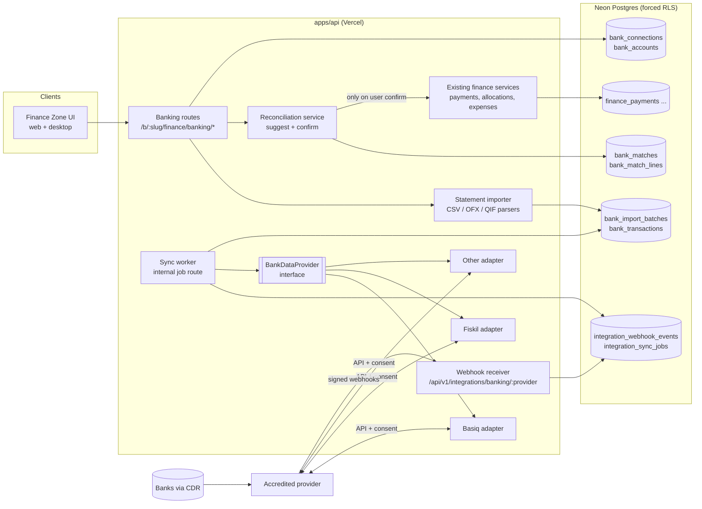
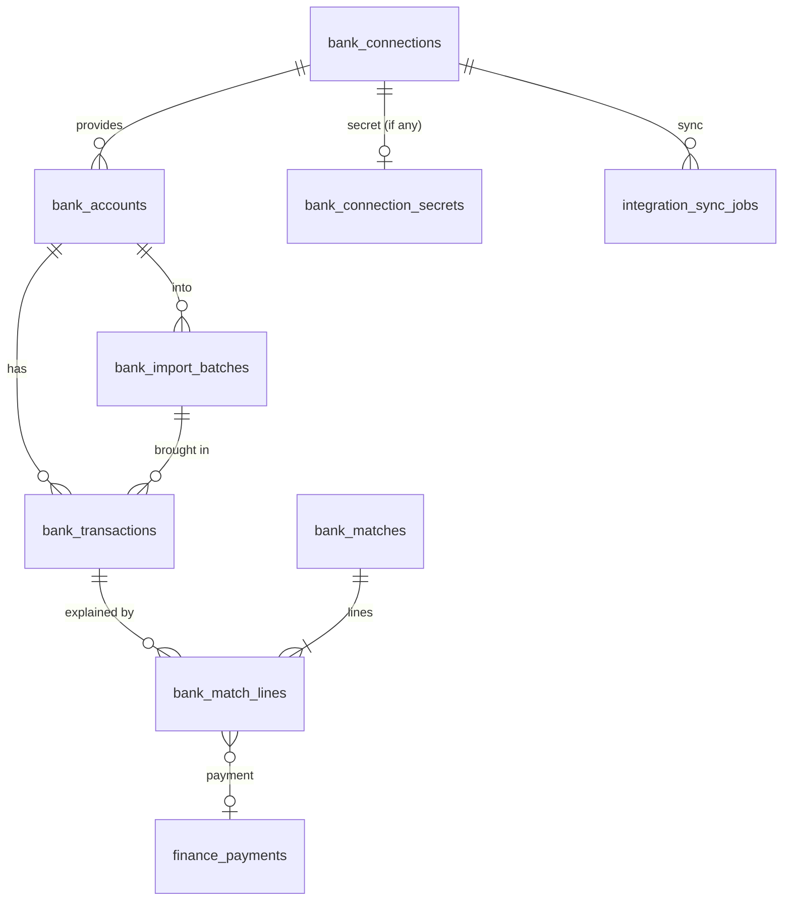

# Finance F8: Banking connectivity and reconciliation (research and architecture)

> **Status: proposal for review. Documentation only.** Nothing in this document is built. It adds no
> migration, no code, no provider account, no credential and no scheduled job. Implementation of any
> stage needs separate approval from the owner. Prices, provider terms and regulatory points were
> checked on **2026-11-16** and will drift; re-check them before any commercial or legal decision.
>
> Read with [finance-data-model.md](./finance-data-model.md) (F1–F3, especially §18.5, §19.14 and §19.15),
> [finance-billing-f6.md](./finance-billing-f6.md) (scheduler and system actor),
> [communications-c2.md](./communications-c2.md) (§7 credentials, §8 adapters, §9 sync jobs) and
> [communications-e1.md](./communications-e1.md) (retention, erasure, §13 open legal decisions).

## 0. Summary

1. **No free live bank feed exists that we can use in production.** Basiq and Fiskil both offer free
   sandboxes, but production access needs a commercial agreement. The lowest *published* live price is
   Basiq's A$0.50 per user per month. One of Basiq's two pricing pages adds a A$500 monthly minimum, and
   the other adds a platform fee and a 12-month minimum term (§A.3). A news report says Biza.io OpenFeed
   starts at 10 cents per consumer per month; we have not confirmed that it fits our case.
2. **Manual statement import (CSV, OFX, QIF) is the only option that costs nothing.** It needs no
   accreditation, no provider and no consent management. It gives most of the reconciliation value.
3. **The way we get CDR data decides our legal obligations, and needs professional advice before F8-D.**
   - As a **CDR representative** of an accredited provider, Pixa OS would hold CDR data under the
     privacy safeguards. Consents would be limited to 12 months. CDR representatives cannot take business
     consumer consents. Redundant data must be deleted or de-identified, which may conflict with the
     business's 5-year (ATO) or 7-year (ASIC) record keeping.
   - With a **business consumer disclosure consent**, an accredited provider discloses a business's data
     to a named non-accredited software provider. The secondary sources we read name accounting software
     as an intended recipient. Use and disclosure consents can last up to 7 years, but collection still
     renews every 12 months.
   - Which model applies, and what then governs the data in our hands, is the main question for a lawyer
     (§D.8).
4. **Recommended order: F8-A + F8-B (import), then F8-C (reconciliation), then F8-D (live feeds).** This
   is the order of the brief. The changes we recommend:
   - keep F8-A small and ship it in the same release as F8-B;
   - build the shared integrations foundation (webhook inbox, generalised sync jobs, scheduler activation)
     as its own stage before F8-D;
   - get legal advice and provider quotes while A–C are built (§F).
5. **Bank data never changes accounting records by itself.** A bank transaction is evidence. A user with
   the right permission confirms a match, and that creates links (and, if they choose, a payment through
   the existing F2/F3 services). Nothing creates, reverses or allocates a payment automatically. F8-E may
   only suggest matches and, with a separately approved narrow opt-in, link a bank line to an
   **existing** recorded payment. It never issues, voids or reverses anything (§C.7).

**Audit status (2026-11-16):** ChatGPT architecture audit gave a conditional pass for documentation only.
Its five clarifications are resolved in §B.5, §B.2.1, §B.12, §C.1/§C.9 and §C.7. The gates it set are
listed in §G. Nothing in this document authorises building a stage, signing with a provider, changing
hosting or enabling a scheduler.

---

## Preflight: what exists today (main at `6bc707e`, checked 2026-11-16)

| Area | What the repository has | What it means for F8 |
|---|---|---|
| Finance F1–F7 | All merged. Documents (quotes, invoices, credit notes), the payments ledger, allocations, credit applications, expenses, settlement projections, PDFs, recurring billing, reminders and the catalog. Migrations up to `20261130000000_finance_catalog`. Latest migration on main: `20261202000000_business_profile`. | F8 adds a new layer beside these. It does not change them. |
| Payments ledger | `finance_payments` has `direction` `RECEIVED`/`PAID`, `method` (`BANK_TRANSFER`, `CASH`, `CARD`, `CHEQUE`, `OTHER`), `reference`, `received_on`, and status `RECORDED → REVERSED`. Idempotency key plus request hash is required on `POST /payments`. Counters are kept by triggers. There is no DELETE. (finance-data-model §2.6, §18.3, §19.4) | A confirmed bank match **links to** a payment or creates one through the existing service. A bank transaction id is a natural idempotency key. |
| Invoices | Derived settlement state, `allocated_total + credit_applied_total ≤ total` (CHECK), one live allocation per pair, and up to 50 invoices per allocation call. | Covers "several invoices paid together" and "partial payment" with no change. |
| Expenses and suppliers | Expenses use `DRAFT → RECORDED → VOID` and are settled by `PAID` payments through `finance_expense_allocations`. The **supplier is free text** (`supplier_name`, FD-P5 open). There is **no supplier entity**. | Matching withdrawals can only use free-text payee similarity until FD-P5 is decided. |
| Refunds | **Not modelled** (FD-A2 for customers, FD-A8 for suppliers; §19.14 says a refund must not be recorded as an opposite-direction payment). | A bank line that is a refund cannot be "matched" to an accounting record yet. It can only be marked as explained (§C.5). |
| Currency | `businesses.currency` (char 3), `country_code`, `time_zone`. Every finance record has its own currency and scale. There is no conversion (FD-A3). | Bank accounts have their own currency. Matching never crosses currencies. |
| Tenancy | Forced RLS with `tenant_isolation` on every table, composite `(business_id, …)` FKs, `ON DELETE RESTRICT` for finance, and `withTenant` units of work (READ COMMITTED, 5 s). | Every F8 table follows the same pattern. |
| Permissions | `finance:read`, `write`, `issue`, `payments`, `expenses`, `manage`, `billing`, `catalog`, and the `documents_*` keys. Code checks keys, never roles. | F8 adds 2–3 keys (§D.2). |
| Audit | `recordAudit` in the same unit of work, with ids and structured facts only. `recordSystemAudit` is allowed only for `communications.system.*` and `finance.system.*` (database policy). | Background sync can audit as `finance.system.bank.*` with no policy change. |
| Idempotency | Payments: key plus canonical-request hash, a transaction advisory lock and a unique index. Transitions depend on state. | Same pattern for imports (file hash) and match confirmations. |
| Integrations | The **only** provider integration is C2 mail: OAuth with PKCE, `core/crypto/secret-box.ts` (AES-256-GCM, AAD bound to business, row and field, key rotation), a refresh lease with fencing, `mail_sync_jobs` (lease, heartbeat, backoff), normalised `ProviderError`. **No webhook receiver exists anywhere.** There is no generic integrations framework. | F8-D should take these patterns out into a shared `core/integrations` layer instead of copying them (§F). |
| Scheduler | Internal job routes exist (`internal/jobs/finance-billing`, `finance-reminders`, `communications-retention`), guarded by `CRON_SECRET` and **deliberately off**: no `CRON_SECRET`, and `vercel.json` has no cron entries. "No scheduler without approval" (architecture §9). | Live sync needs a scheduler. That is a separate activation decision. |
| Internal reconciliation | `GET /finance/reconciliation` checks that the internal counters agree. finance-data-model §18.5 says plainly that it is **not** bank reconciliation. | F8-C is the first bank reconciliation. Its naming must keep the two apart. |
| Hosting | Vercel `iad1` and Neon `aws-us-east-1` (ADR 0002). | All bank data would be **stored in the USA**. This is relevant to CDR Privacy Safeguard 8 and APP 8 (§D.8). |
| Retention | Finance uses `ON DELETE RESTRICT`. The "7-year baseline is a product policy, not a legal statement" (finance-data-model header). E1 decisions D-E1-5 (no blanket 7 years) and §13 (durations open). | Bank data retention must be set per source and obligation, not by a blanket rule (§D.7). |
| Open PRs (2026-11-16) | #68 People P3-A, #66 Neon housekeeping (draft), #53 coordinator, #48 docs. None touches Finance or banking. | No conflicts. |

**Dependencies we will not assume are done:** the supplier entity (FD-P5), refunds (FD-A2/FD-A8),
multi-currency (FD-A3), a general ledger (FD-A5), file storage (FD-P6), scheduler activation, and
outbound email (C2-C).

---

## Part A: Banking provider research (Australia)

### A.1 Ways to reach bank data

| Pathway | What it is | Can Pixa OS use it? |
|---|---|---|
| **Unrestricted CDR accreditation (ADR)** | We would collect CDR data from banks directly. This needs an ACCC application, an independent information security assurance report (ASAE 3150 against Schedule 2 of the CDR Rules), insurance, internal and external dispute resolution, and conformance with the Consumer Data Standards. One law firm estimates A$50k–250k and 4–9 months [S6]. A vendor says assessment takes 3–6 months [S7]. Neither estimate is sourced to the ACCC. | Not realistic at our stage. It only makes sense at much larger scale. |
| **Sponsored accreditation** | We would be accredited through a sponsor (an unrestricted ADR), using self-assessment and attestation instead of the assurance report [S7]. Basiq says approval takes 1–3 months and re-attestation every two years [S2]. | Possible later. It still means becoming an accredited person. |
| **CDR representative** | A written arrangement with an unrestricted principal. We would not be accredited. We would apply the privacy safeguards and Schedule 2 security as if we were the principal, adopt the principal's CDR policy, and delete or de-identify data when the principal directs. A representative **cannot** seek business consumer consents or consents longer than 12 months [S5][S8]. Basiq says this can start in about a week [S2]. | Fastest route to live data. The business-consumer limit and the deletion duty are the catches (§D.8). |
| **Business consumer disclosure consent (BCDC)** | An accredited person, with a business consumer statement, discloses a business's CDR data to a named person who need not be accredited. Bookkeepers, consultants and software providers are given as examples, and accounting software is named as an intended use [S8][S9]. Use and disclosure consents can last up to 7 years. Collection consent still renews at most every 12 months [S8][S9][S10]. Available from late 2023 (sources disagree: 28 Nov or 1 Dec 2023) [S8][S9]. | **Probably the best fit for SMB accounting.** Which providers offer it to platforms like ours is unverified (§A.2). |
| **Trusted adviser disclosure** | Disclosure to set classes of advisers (for example accountants and registered tax agents) [S6][S7]. | Not for a software platform. It may help when a business shares data with its accountant. |
| **Accounting platform feeds** (Xero, MYOB and others) | Banks provide feeds to named accounting software. CommBank lists Xero and MYOB for NetBank, and Xero, MYOB, Reckon, BGL and Class Super for CommBiz, all "provided and managed by CBA" [S11]. Bendigo uses Xero forms, MYOB BankLink forms and SISS for QuickBooks [S12]. Wiise uses SISS Data Services for 12 banks, day-old data delivered once a day [S13]. Xero's own page now says connections grant "read-only access under the Consumer Data Right framework" [S14]. | No published path for a new platform to receive direct feeds. Reading data back out of Xero would make Xero a dependency, which goes against our goal, and its terms were not verified. **Not recommended.** |
| **Credential sharing / screen scraping** | The user hands over their online banking login. BankStatements.com.au (Experian Open Data Solutions) "relies on you providing your online banking credentials" [S15]. CommBank tells customers to switch away from screen-scraping software [S11]. In August 2024 the government asked Treasury to advise on "a full and formal ban" [S16][S17]. We could not confirm whether a ban has since been made. | **Rejected.** Security risk, likely to be banned, and it breaks bank terms. |
| **Manual statement import** | The user downloads CSV, OFX or QIF from internet banking and uploads it. | **Yes, free, and the first stage.** See §A.4. |

### A.2 Providers

All checked 2026-11-16. "Not stated" means the pages we read did not say. It does not mean the provider
lacks the feature. Pricing marked **unverified** has not been confirmed by the provider in writing.

| | **Basiq** | **Fiskil** | **Biza.io OpenFeed** | **Frollo** | **Adatree (Fat Zebra)** |
|---|---|---|---|---|---|
| CDR status | Unrestricted ADR since 2021 (ADRBNK000208). Subsidiary of Cuscal [S1][S2]. | Unrestricted ADR [S7][S18]. | Product launched 2026-09-01. Aimed at organisations "without going through full accreditation" [S19]. | ADR, "trusted intermediary" [S20]. | ADR. Acquired by Fat Zebra (completed Dec 2023) [S21]. |
| Access models offered | ADR, sponsor of affiliates, principal of CDR representatives [S2]. Business Consumer Consent product [S22]. | Sponsoring ADR for CDR representatives [S18]. | "Onward disclosure consent" [S19]. | Admin portal for consents. Will **not** serve "third-party platforms" or budgeting apps [S20]. | Not stated on the pages read. |
| Institutions | "135+" (basiq.io) or "70+" (new.basiq.io); the two pages conflict [S1]. | "200+ banks, lenders and energy providers" across AU and NZ (product page). "140+ Australian data sources" (blog) [S18]. | "More than 100 Australian banks and energy providers" [S19]. | "More than 110 banks" [S20]. | 114 data sources (Feb 2024) [S21]. |
| Business accounts | Yes. Business Consumer Consent needs an ABN or ACN. Each bank has its own delegate set-up (ANZ, CBA NetBank and CommBiz, Westpac and others) [S22][S23]. | Yes, through the bank's Nominated Representative. Bank-specific forms. Some banks are branch-only [S24]. | Not stated. | Not stated. | Not stated. |
| Published price | **Conflicting pages.** basiq.io: A$0.50 per user per month plus an unstated "platform access fee", and a 12-month minimum term. new.basiq.io: A$0.50 per user per month, **A$500 per month minimum**, no set-up fee, no minimum term. Startup "Launchpad" at A$99 per month for up to 6 months [S1]. Both say volume pricing is negotiated. **Unverified until quoted.** | **Not published.** Sales quote only. Sandbox free and unmetered [S18][S25]. | "From 10 cents per consumer per month" (news article, company-supplied) [S19]. **Unverified.** | Not published. | Not published. |
| Free tier | Sandbox with a fictional bank ("Hooli"). Production needs a paid plan [S1]. | Sandbox free. Production after onboarding and security questionnaire review [S25]. | Not stated. | No. | Not stated. |
| Webhooks | Yes. Consent events (`consent.created`, `.updated`, `.revoked`, `.expired`, `.warning` 7 days before expiry, `.archived`). We found no transaction event on the pages read [S26]. | Yes. Signed with HMAC-SHA256. Consent and sync-completed events (accounts, balances, transactions, recent 90 days first). Up to 5 retries [S27]. | Not stated. | Not stated. | Not stated. |
| Freshness and refresh | On-demand "refresh connection" job. Bulk refreshes discouraged. Scheduled frequency not stated [S26]. | Sync-completed webhooks. First sync covers about 90 days, then full history. Frequency not stated [S27]. | Not stated. | Not stated. | Not stated. |
| Pending transactions | `pending` and `posted`. Pending items are deleted and re-imported on every refresh, and **their ids change**. Posted items are never deleted [S28]. | Date filter uses posted time, then execution time [S27]. | Not stated. | Not stated. | Not stated. |
| Consent length | Business Consumer Consent: collection "for up to 12 months" [S22]. | Consent ends on revocation, institution expiry or account closure, each with a webhook [S27]. | Not stated. | Not stated. | Not stated. |
| Fit for multi-tenant SaaS | **Good technical fit.** Model (CDR representative or BCDC to a non-accredited platform) and price need a sales conversation. | **Good technical fit.** Strongest published webhooks. Price unknown. | **Possibly the closest model fit** (built for unaccredited recipients). Very new, details unverified. | **Not a fit.** Excludes third-party platforms. | Unknown. Needs contact. |

**Also checked and not suitable now:**
- **Redbark**: listed as an aggregator with 107+ institutions, including the major Australian banks [S29].
  Its access model and pricing are not stated. Worth one enquiry.
- **Plaid, TrueLayer, GoCardless, Yapily and Salt Edge**: show only a handful of APAC institutions on the
  tracker, with no Australian detail [S18].
- **Akahu**: New Zealand only [S18].
- **Yodlee and illion**: not covered by the sources we read. illion's legacy credential product now runs
  as Experian Open Data Solutions [S15]. Rejected with screen scraping.

### A.3 Is there a free or low-cost option we can use commercially?

- **Free:** only manual import. The sandboxes are for testing. No page we read lets sandbox access serve
  real customers, and we do not assume it can.
- **Low cost at scale:** Basiq at A$0.50 per connected business per month is low *once we are past the
  A$500 minimum*. That is about 1,000 connected businesses on the new.basiq.io terms. Below that, the
  minimum sets the cost. Biza's 10-cent figure would be lower if it holds and if its model fits.
- **Conclusion:** live feeds are cheap per business at 1,000 customers and expensive per business at 10.
  Start with import, and turn live feeds on when connected volume (or a startup plan such as Basiq's
  Launchpad) makes the minimum reasonable (§E).

### A.4 Manual import (F8-B)

- **Formats:**
  - CSV (every bank, but columns differ by bank);
  - OFX (Open Financial Exchange; has a `FITID` transaction id that is unique per account);
  - QIF (old Quicken format; no stable id and inconsistent dates).
- Which formats each Australian bank offers was **not verified** for this document. F8-B must test real
  exports from at least CBA, Westpac, NAB, ANZ and one neobank before claiming support.
- **Approach:**
  - parse on the server, in memory;
  - map CSV columns with per-bank presets and a manual mapping step;
  - show a preview with duplicates flagged before commit;
  - keep the file's SHA-256, not the file itself (no file storage exists, FD-P6).
- **Risks:**
  - date formats (DD/MM vs MM/DD, ambiguous when every day in the file is 12 or under);
  - sign conventions (one amount column vs separate debit and credit columns);
  - encodings;
  - formula injection when data is exported back to CSV;
  - very large files (cap rows, for example 20,000 per file).

---

## Part B: Banking data architecture

### B.1 Components



Rules shown in the diagram:
- Bank data enters **only** through the importer or the sync worker.
- The reconciliation service reads bank transactions and writes **match records**.
- Finance records change only through the existing finance services, called on a user's confirmation.

### B.2 Data model (proposed, not migrated)

Every table has:
- `business_id` and `UNIQUE (business_id, id)`;
- indexes leading with `business_id`;
- forced RLS with `tenant_isolation`;
- `ON DELETE RESTRICT` to `businesses` (finance retention, FD-L3);
- composite FKs;
- authorship and timestamps, as in finance-data-model §2.

There is no DELETE grant except where noted.



**`bank_connections`**: one consent with one provider for one business.

| Column | Notes |
|---|---|
| `provider` | `BASIQ`, `FISKIL`, … (text plus CHECK; adding a provider is a migration) |
| `provider_user_ref`, `provider_consent_ref` | Provider-side ids. Not secrets, but treated as sensitive: not in audit metadata, not in logs. `UNIQUE (provider, provider_consent_ref)` across businesses, so one consent can never belong to two businesses. |
| `status` | `PENDING` → `ACTIVE` → `NEEDS_RECONSENT` / `EXPIRED` / `REVOKED` / `DISCONNECTED` (final) / `FAILED` |
| `consent_granted_at`, `consent_expires_at`, `last_successful_sync_at`, `last_error_code` | Stamped by the database in transitions, as in finance-data-model §4.4 |
| `access_model` | `CDR_REPRESENTATIVE`, `BUSINESS_CONSUMER_DISCLOSURE`, `OTHER` (recorded because retention depends on it, §D.7) |
| `created_by_id`, `disconnected_by_id`, `version` | |

**`bank_connection_secrets`**: only if a provider issues per-connection tokens. Basiq and Fiskil
authenticate the **platform** with one server credential and refer to users and consents by id, so this
table may stay empty.
- If used, it copies `mail_connection_credentials`: `secret-box` envelope with AAD
  `business|connection|field`, a separate key list (`BANKING_CREDENTIAL_KEYS`), a column grant that only
  the credentials module can read, and deletion by trigger on disconnect.

**`bank_accounts`**: an account the business reconciles. It may be linked to a connection, or be manual
(import only).

| Column | Notes |
|---|---|
| `connection_id` | Nullable. Manual accounts have none. |
| `provider_account_ref` | `UNIQUE (business_id, connection_id, provider_account_ref)` |
| `display_name`, `institution_name`, `account_kind` (`TRANSACTION`, `SAVINGS`, `CREDIT_CARD`, `LOAN`, `OTHER`) | |
| `bsb`, `account_number_last4` | Display only. The full number is **not stored**. |
| `account_number_hmac` | Keyed HMAC of the normalised BSB and number, for "is this the same account?" across sources and providers (provider switching, §B.10) without keeping the number. The key is per environment (E1 keyed-marker pattern, D-E1-2). |
| `currency_code`, `currency_scale` | Fixed at creation. No conversion. |
| `status` | `ACTIVE`, `ARCHIVED` (no new imports; history kept) |
| `opening_balance`, `opening_balance_on` | Optional, set by the user. Used for statement-balance checks (§C.8). |

**`bank_import_batches`**: one row per file import or per provider sync page set.
- `source`: `FILE_CSV`, `FILE_OFX`, `FILE_QIF`, `PROVIDER_SYNC`, `PROVIDER_BACKFILL`
- `file_sha256`: files only; `UNIQUE (business_id, bank_account_id, file_sha256)` so re-uploading the same
  file is a no-op
- `idempotency_key`, `request_hash`: as payments
- `status` (`PREVIEWED`, `COMMITTED`, `DISCARDED`), `row_count`, `inserted_count`, `duplicate_count`,
  `possible_duplicate_count`
- `period_from`, `period_to`, `statement_closing_balance` (optional), `mapping_preset`
- A preview batch holds its parsed rows in `bank_import_rows` (staging, **deletable**, expires after 24
  hours). Commit moves accepted rows into `bank_transactions` in one unit of work.

**`bank_transactions`**: append-only evidence.

| Column | Notes |
|---|---|
| `bank_account_id`, `batch_id`, `source` | Composite FKs |
| `provider_txn_ref` | Provider id, **posted transactions only**. `UNIQUE (business_id, bank_account_id, provider_txn_ref)` where not null. |
| `fitid` | OFX `FITID`. `UNIQUE (business_id, bank_account_id, fitid)` where not null. |
| `dedupe_fingerprint` | Always set (§B.4). `UNIQUE (business_id, bank_account_id, dedupe_fingerprint)` |
| `status` | `POSTED` only in this table (pending handling, §B.5) |
| `posted_on`, `transacted_at` | Bank dates. Calendar date in the business time zone, plus the original timestamp if given. |
| `amount` | `numeric(18,4)`, **signed** (credit positive, debit negative), rounded to the account scale, never 0 |
| `currency_code` | Equal to the account's (composite FK) |
| `description`, `reference`, `counterparty_name`, `counterparty_bsb_last4`, `category_hint` | Content columns. **Nullable for tombstoning** (§D.6). |
| `running_balance` | Optional, from source |
| `matched_total` | `numeric(18,4)`, kept **only by triggers** from live match lines; `0 ≤ |matched_total| ≤ |amount|` with the same sign (CHECK) |
| `possible_duplicate_of_id` | Set at import when another source's transaction looks the same (§B.4). Resolved by a user. |
| `content_erased_at` | Tombstone stamp |

Guards:
- Insert only.
- After insert, only `matched_total` (trigger depth), `possible_duplicate_of_id` resolution and tombstoning
  may change (deny-by-default jsonb freeze, as `finance_guard_document`).
- Amount, date and account never change.
- A wrong row is not deleted. It is **excluded** by a match of type `EXCLUDED` with a reason (§C.5), so
  history stays complete.

**`bank_matches` and `bank_match_lines`**: the reconciliation records (Part C).

**`integration_webhook_events`** (shared, §B.7) and **`integration_sync_jobs`** (shared, generalising
`mail_sync_jobs`, §B.6).

### B.2.1 Account identity (`account_number_hmac`)

The HMAC helps us **recognise** an account we have seen before. It is a hint, not proof that two
providers' accounts are the same account.

- **Canonical input:**
  `v1|AU|<institution>|<bsb>|<account number>`.
  - `institution`: our own normalised institution code, taken from the provider's institution id
    through a mapping table we maintain.
  - `bsb`: exactly 6 digits, with spaces and hyphens removed.
  - `account number`: digits only, with spaces and hyphens removed. **Leading zeros are kept.**
  - Accounts without a BSB and full number get **no HMAC**: credit cards (providers give masked
    numbers), foreign accounts, and anything where the provider withholds the full number.
- **Key:**
  - Per business: `HKDF(master key[version], "bank-account-id" | business_id)`. The same account in two
    businesses gets unrelated values, so the hash cannot correlate businesses.
  - The master keys live in environment secrets, like the secret-box keys.
  - `account_hmac_key_version` is stored with the value.
- **Rotation and rekey:**
  - a new key version is added first;
  - a rekey job recomputes values from the provider's account data at the next sync (we never keep the
    number to recompute from);
  - accounts that cannot be recomputed keep their old version until reconnected;
  - an old version is removed only when no row uses it.
- **Uniqueness and collisions:** `UNIQUE (business_id, account_number_hmac, account_hmac_key_version)`
  where not null. A match is treated as **"probably the same account"** and shown to the user:
  - when reconnecting or switching provider, the user confirms "this is your existing account X" before
    history is joined;
  - a conflicting second live account with the same value is refused (`409 account_identity_conflict`).
- **Testing:** the rekey job and the user's confirm-the-account flow are tested on staging before any
  live feed (F8-D), including rotation half-way through and a conflicting second account.
- **No HMAC (card, masked or manual accounts):** identity comes from the user's explicit choice when
  connecting (link to an existing account, or create a new one). It is never inferred from institution,
  last 4 digits or name alone.

### B.3 Provider-agnostic interface

```ts
// core/integrations/banking/types.ts (proposed)
interface BankDataProvider {
  readonly id: 'BASIQ' | 'FISKIL' | string;
  readonly capabilities: {
    webhooks: boolean;
    pendingTransactions: boolean;
    businessConsent: boolean;          // business consumer consent supported
    onDemandRefresh: boolean;
    maxBackfillDays: number | null;    // null = unknown, ask the provider
    stableTransactionIds: 'posted_only' | 'all' | 'none';
  };
  startConsent(i: { businessRef: string; state: string; redirectUri: string;
                    durationDays: number; accountTypes: ('BUSINESS' | 'PERSONAL')[] })
    : Promise<{ redirectUrl: string; providerUserRef: string }>;
  completeConsent(i: { callback: URLSearchParams; providerUserRef: string })
    : Promise<{ providerConsentRef: string; expiresAt: Date | null }>;
  listAccounts(consentRef: string): Promise<ProviderAccount[]>;
  fetchTransactions(i: { consentRef: string; accountRef: string;
                         cursor: string | null; from?: string; to?: string })
    : Promise<{ items: ProviderTransaction[]; nextCursor: string | null }>;
  requestRefresh(consentRef: string): Promise<{ refreshRef: string } | 'unsupported'>;
  revokeConsent(consentRef: string): Promise<'revoked' | 'unsupported'>;
  parseWebhook(headers: Headers, rawBody: string): ProviderEvent[];  // verifies the signature; throws on failure
}

interface ProviderTransaction {
  providerRef: string | null;     // null or unstable for pending items
  status: 'PENDING' | 'POSTED';
  postedOn: string | null;        // YYYY-MM-DD
  transactedAt: string | null;    // ISO timestamp if given
  amount: string;                 // signed decimal string, never a JS number
  currency: string;
  description: string; reference: string | null; counterpartyName: string | null;
  runningBalance: string | null;
}
```

- Errors are normalised as in C2 §8: `consent_expired`, `consent_revoked`, `rate_limited` (with
  `retryAfterMs`), `unavailable`, `invalid_response`, `not_found`, `unauthorized`. No response body is
  kept.
- Adapters use `fetch` with timeouts and no SDKs (C2 rule). The **file importer** produces the same
  `ProviderTransaction` shape, so everything after parsing is shared code.

### B.4 Ingestion and de-duplication

Ingestion runs in one unit of work per page of up to 500 transactions. The cursor is saved with the page
(C2 checkpoint rule).

For each incoming posted transaction, in order:
1. If `provider_txn_ref` (or OFX `fitid`) already exists for the account, it is a **duplicate**: skip it.
2. Compute `dedupe_fingerprint = sha256(account_id | posted_on | amount | normalise(description) | occurrence)`.
   - `normalise` drops case, extra whitespace and volatile tokens (card-masked digits, time stamps).
   - `occurrence` is the 1-based index among rows in the **same batch** that share every other part of
     the key. This keeps two real, identical coffees on one day while a re-import of the same day still
     matches.
   - If the fingerprint exists, it is a **duplicate**: skip it.
3. If no exact duplicate exists, but a transaction **from another source** (for example a CSV row and a
   live feed row) on the same account has the same amount within ±3 days and a similar description, insert
   the row with `possible_duplicate_of_id` set. **It is never auto-merged.** The user keeps one and
   excludes the other (§C.5).

Notes:
- Unique indexes are the backstop for races (two syncs or a sync plus an import). `ON CONFLICT DO NOTHING`
  counts the row as a duplicate.
- Overlapping date ranges between imports are normal and safe by construction.

### B.5 Pending transactions

- Basiq deletes and re-issues pending transactions on each refresh **with new ids** [S28].
- **What is stored:** pending items are kept only in a **transient** per-account snapshot
  (`bank_pending_snapshot`).
  - The snapshot is replaced whole on each sync.
  - Rows carry an `expires_at` TTL of 7 days.
  - **Purge without a scheduler:** every read filters `expires_at > now()`, so expired rows are never
    shown. Expired rows for an account are deleted when that account is next read or synced. Live
    feeds that would fill the snapshot only exist after a scheduler is approved (G-5). If a periodic
    sweep is wanted later, it joins that approved scheduler. Nothing here enables one.
  - DELETE is granted on this table only.
- **What is never done with pending items:**
  - they never become rows in the immutable `bank_transactions` table;
  - they are never matched or used for suggestions;
  - they never create, link or drive a payment, allocation or any other finance record.
- **What a user sees:** pending items appear in the UI as "pending", for information only.
- When an item posts, it arrives as a new posted transaction with its own id, through normal ingestion.
  It is not linked to its pending predecessor.

### B.6 Cursors, sync jobs and errors

- **Shared job table:** `integration_sync_jobs` generalises `mail_sync_jobs`:
  - kinds `INITIAL`, `INCREMENTAL`, `BACKFILL`, `RECONSENT_CHECK`;
  - the same lease, heartbeat and fencing rules (C2 §9: an expired lease authorises nothing);
  - the same backoff (30 s × 2^(n−1), capped at 1 h, or `Retry-After`).
- **Cursor:** stored per `(connection, account)` in `bank_sync_cursors`. It is written in the same
  statement that completes the job, and only if the connection is still `ACTIVE`, so a cancelled job never
  leaves a stale cursor (C2A-02). If the provider has no cursor, use a time window: `from = last posted
  date − 7 days` (overlap absorbed by de-duplication).
- **Error mapping:**
  - `consent_expired` / `consent_revoked` → connection `EXPIRED` / `REVOKED`, jobs cancelled, system audit;
  - `rate_limited` / `unavailable` → retry;
  - `invalid_response` → `FAILED` after N attempts, visible to the user;
  - every state change has an audit event.
- **Sync status for the UI:** `last_successful_sync_at`, `last_error_code`, and a "stale" flag when no
  success has happened for 48 hours.
- **Scheduling:** an internal job route (same `CRON_SECRET` pattern) lists due connections through an
  `app_private` SECURITY DEFINER function that returns ids only (as `003_finance_reminders_due.sql`).
  Webhooks (§B.7) make jobs due early, and the cron is the safety net. **Turning on the cron is an owner
  decision.**

### B.7 Webhooks

- **Route:** `POST /api/v1/integrations/banking/:provider/webhooks`. Public, no session, small body limit.
- **Verify before anything else:**
  - the signature, using the provider's scheme (Fiskil: HMAC-SHA256 in `X-Fiskil-Signature` [S27]) with
    a constant-time compare;
  - a replay window, if the provider sends a timestamp.
- **Inbox:** one statement inserts into `integration_webhook_events` (`provider`, `provider_event_id`
  unique, `received_at`, `payload_sha256`, minimal normalised payload) with `ON CONFLICT DO NOTHING`,
  then answers `2xx`. Fiskil retries up to 5 times [S27], so redelivery is normal and idempotent.
- **Processing:** later and asynchronous:
  1. resolve the business from `provider_consent_ref` through a SECURITY DEFINER lookup (no tenant
     context yet);
  2. then `withTenant` as the system actor;
  3. make the right job due.
  Consent events change connection status directly.
- **The webhook is a hint, never data.** We do not trust transaction content in a webhook body. We
  always fetch through the authenticated API.

### B.8 Credentials and tokens

- **Platform credentials** (provider API key or client secret):
  - Vercel environment variables, separate for sandbox and production;
  - read only by the banking adapter module (boundary rule, as `credentials.ts` in C2);
  - never sent to clients, never logged.
- **Per-connection tokens** (if any): in `bank_connection_secrets` (secret-box, AAD-bound, rotation as C2
  §7.2).
- **Consent callback:**
  - `state` = slug plus a 256-bit nonce, stored hashed, single use, 10 minutes, same user (C2 §7.1);
  - the callback needs a Pixa session and re-checks the permission.
- **Never:** bank usernames or passwords, full account numbers, or card numbers. We never ask for or
  accept them.

### B.9 Consent expiry, reconnection and backfill

- **Expiry warning:** 14 days before `consent_expires_at` (or on the provider's warning event, Basiq
  7 days [S26]), the Finance Zone shows a banner, and C2-C email once it exists.
- **Reconnect:** a new consent by a user with `finance:bank_connect`.
  - **Same account (same `account_number_hmac`)** → the same `bank_accounts` row continues.
    De-duplication absorbs the overlap.
  - **Different account** → a new account row.
- **Backfill:** on first connect, request the provider's maximum history.
  - Basiq: not stated.
  - Fiskil: about 90 days first, then full history [S27].
  - Xero says up to 12 months, some banks 2 years [S14]. That is a hint of what banks provide, not a
    promise.
  - Older history comes from file import into the same account.

### B.10 Switching providers

- Accounts are keyed by `account_number_hmac`, not by provider id. A new provider's connection attaches
  to the **existing** accounts.
- Transactions from the new provider have new `provider_txn_ref`s. The fingerprint and the cross-source
  rule (§B.4 step 3) catch overlaps.
- To keep reviews small, run the new provider in **shadow mode**:
  - fetch and fingerprint but do not insert;
  - report the overlap rate;
  - cut over from a chosen date.
- Old connections become `DISCONNECTED` (final). Their transactions and matches stay.

### B.11 API proposal

All routes are under `/api/v1/b/:slug/finance/banking` and follow the existing conventions:
`tenantRoute`, strict bodies, decimal strings, keyset pagination, and another business's ids answer 404.

| Method and path | Permission | Stage |
|---|---|---|
| `GET /accounts`, `GET /accounts/:id` (balance, sync status, unreconciled count) | `finance:bank_read` | A |
| `POST /accounts` (manual), `PATCH /accounts/:id` (name, archive, opening balance; `version`) | `finance:reconcile` (`bank_connect` for connected accounts) | A |
| `GET /transactions` (filters: account, date range, reconciliation state, amount range, `q`; keyset `(posted_on, id)`), `GET /transactions/:id` (with matches, live and reversed) | `finance:bank_read` | A |
| `POST /accounts/:id/imports` (multipart file; `Idempotency-Key`) → preview batch with row results | `finance:reconcile` | B |
| `POST /imports/:id/commit`, `POST /imports/:id/discard`, `GET /imports` | `finance:reconcile` | B |
| `GET /transactions/:id/suggestions` | `finance:bank_read` + `finance:read` | C2 |
| `POST /matches` (kind, lines; optional `createPayment` with allocations; `Idempotency-Key`) | `finance:reconcile` (+ `finance:payments` when creating a payment) | C1 |
| `POST /matches/:id/reverse` (`reason`) | `finance:reconcile` | C1 |
| `GET /accounts/:id/balance-check?from&to` | `finance:bank_read` | C2 |
| `POST /connections` → `{ redirectUrl }`; `GET /connections`; `POST /connections/:id/renew`; `POST /connections/:id/disconnect`; `POST /connections/:id/refresh` | `finance:bank_connect` (read: `finance:bank_read`) | D |
| `GET /api/v1/integrations/banking/:provider/callback` (session required) | `finance:bank_connect` (re-checked) | D |
| `POST /api/v1/integrations/banking/:provider/webhooks` (no session, signature required) | none (verified signature) | D / I-1 |

Error codes follow the F2/F3 style. Examples:
- `duplicate_import` (409);
- `currency_mismatch`, `direction_mismatch` (400);
- `over_matched` (409);
- `already_matched` (409);
- `transaction_excluded` (409);
- `connection_not_active` (409);
- `consent_expired` (409);
- `retryable` (503).

### B.12 Manual import safety gate (F8-B)

Imported statements are **sensitive financial data**, and files are **untrusted input**. Before F8-B is
released to customers, all of the following must hold:

| Area | Rule |
|---|---|
| Size and rate | At most 5 MB and 20,000 rows per file. At most 10 imports per business per hour (proposal; tune with real usage). Refused with a clear error, not truncated. |
| Parsing | Server-side and in memory, never stored as a file. Strict parsers with no macros, no formula evaluation and no external entity resolution (OFX 2.x is XML: disable DTDs and entities). Time limit per file. One malformed row rejects the whole file at preview, with row numbers. |
| Encoding | UTF-8 with BOM handling, plus Windows-1252 detection. Control characters stripped. Fields capped in length. |
| Dates | Per-preset format. If DD/MM vs MM/DD is ambiguous in the file (no day above 12), the user must choose before preview. Dates in the future, or outside the stated period, are flagged. |
| Amounts | One signed column, or separate debit and credit columns, chosen per preset. Decimal separator per preset, with no locale guessing. Thousands separators removed. Values over the account scale are refused, never rounded. |
| Preview before commit | Always. It shows inserted, duplicate and possible-duplicate rows. Nothing is written to `bank_transactions` until commit. |
| Idempotency | File SHA-256 per account (re-upload is a no-op), plus the `Idempotency-Key` on commit. |
| Duplicates | Within the account (§B.4). **Across accounts:** a file whose rows mostly match another account's rows (same dates and amounts) triggers a "did you pick the right account?" warning. |
| Provenance | Each transaction keeps `batch_id`. The batch records file name (truncated), SHA-256, uploader, time, format, preset and counts. Audit has counts only. |
| Exports | Formula-injection safe (§D.3). |
| Tests | Fixtures are synthetic, or real exports given with consent **and fully anonymised**. Never real customer data. Malformed-file, oversize, encoding and ambiguity cases are all tested. |
| Privacy and retention | The terms of manual import (what we keep, for how long, and erasure) need review before customer launch. This is gate G-4 (§G). |

Manual import **stays available after live feeds launch**, as the fallback for unsupported banks, older
history and outages.

---

## Part C: Reconciliation engine

### C.1 Principle

A bank transaction is **evidence that money moved**. Pixa's finance records say **what the money was
for**. Reconciliation links the two. It never edits either side.
- **Reconciled:** the live match lines sum exactly to the bank amount.
- **Partly reconciled:** they sum to less.
- **Unreconciled:** there are none.

These states are derived, as invoice settlement is.

**The accounting ledger stays the source of truth.** Payments, allocations, documents and expenses are
the financial record. Bank transactions and matches are supporting evidence and never replace them.

A bank line's state must also say **how** it was dealt with. "Explained" and "excluded" are not the same
as "matched to a ledger record", and screens and reports keep them apart:

| Derived state | Meaning | Counts as tied to the ledger? |
|---|---|---|
| `MATCHED` | Live lines link to finance payments (or a transfer pair) and sum to the bank amount | Yes |
| `PARTLY_MATCHED` | Some ledger links, with an unexplained remainder | Partly |
| `EXPLAINED` | Covered (fully or with matches) by `EXPLAINED` lines: fee, interest, refund pending FD-A2/FD-A8, owner drawing, and so on. No ledger record behind it. | **No** (shown separately, with its category) |
| `EXCLUDED` | Removed from reconciliation as a duplicate or error, with a reason | **No** (shown separately) |
| `UNMATCHED` | Nothing yet | No |

Reports and the account's reconciliation summary show totals per state, so a fully "explained" account
never looks the same as one tied to recorded payments.

### C.2 Match records

**`bank_matches`** (one confirmed explanation of one or more bank transactions):
- `kind`:
  - `PAYMENT`: links to existing or newly created `finance_payments`;
  - `TRANSFER`: between two bank accounts of the business;
  - `EXPLAINED`: bank fee, interest, owner drawing, tax payment, refund pending FD-A2/FD-A8, other, with
    a required category;
  - `EXCLUDED`: duplicate or erroneous row, reason required.
- `method`: `MANUAL`, `SUGGESTION_CONFIRMED`, `RULE` (F8-E only).
- `confidence` (0–100, at confirmation time) and `rule_id` (F8-E).
- `confirmed_by_id`, `confirmed_at` (database stamped).
- `reversed_at`, `reversed_by_id`, `reversal_reason`: one way, as allocations.

**`bank_match_lines`** (n per match):
- `bank_transaction_id`, `amount` (signed, same sign as the transaction);
- for `PAYMENT`: `payment_id` (composite FK `(business_id, payment_id, direction, currency_code)`, so
  direction and currency must agree: credit ↔ `RECEIVED`, debit ↔ `PAID`, pinned by CHECK);
- for `TRANSFER`: the two transactions, opposite signs, equal absolute amounts, same currency, different
  accounts (CHECK plus guard).

Database rules (as F2):
- Trigger-maintained `matched_total` on the transaction, with CHECK `|matched_total| ≤ |amount|`.
- A new `bank_matched_total` on `finance_payments`, with `≤ amount`, so one payment cannot be claimed by
  two bank lines beyond its value.
- One live line per (transaction, payment).
- No DELETE. Correction is reversal plus a new match.
- The F2 lock order is extended: **payments → bank transactions (by id) → documents/expenses**.

### C.3 Cases

| Case | How it is handled |
|---|---|
| Deposit pays one invoice | **Confirm.** Either (a) link to an already recorded `RECEIVED` payment, or (b) "Create payment from bank line": the payment is prefilled (amount, date = `posted_on`, method `BANK_TRANSFER`, reference = bank reference) and the user picks the customer and invoices. One unit of work: payment (idempotency key `bank:<transaction id>`), F2 allocations, match, audit. |
| Partial payment | Same as above with an allocation smaller than the outstanding. The invoice stays `PARTIALLY_PAID` (F2). |
| One deposit, several invoices | One payment, several allocations (F2 already allows 1–50). |
| Several deposits, one invoice | Several payments, each matched to its own bank line, each allocated to the invoice. |
| One deposit for several customers (rare, for example a marketplace payout) | Several `RECEIVED` payments, one per customer, all matched to the same bank line, their lines summing to the bank amount. |
| Withdrawal pays an expense | Link to an existing `PAID` payment, or create one with an expense allocation (F3, needs `finance:payments`). Recording a **new** expense from a bank line creates a **draft**. The user records it (F3 rules), then pays it. Bank data never records an expense directly. |
| Bank fees and interest | `EXPLAINED` with category. Optionally "create expense draft" in the bank fees category. |
| Transfer between own accounts | `TRANSFER` match pairing the debit and the credit. Suggested when both accounts are in Pixa, same currency, opposite amounts within 3 days. If only one side is in Pixa, mark it `EXPLAINED: transfer (other account not connected)`. |
| Duplicate bank line | `EXCLUDED: duplicate`, linked to the kept row. |
| Bounced or dishonoured payment | Bank shows the credit and then a debit. The user **reverses the payment** through F2 (reason required). Both bank lines are then matched as `EXPLAINED: reversal` pointing at the reversed payment, so the pair nets to zero and history keeps both. |
| Customer refund / supplier refund | Not modelled in Finance (FD-A2, FD-A8). The line is `EXPLAINED: refund (pending refunds feature)`. It is not recorded as an opposite-direction payment (§19.14 forbids that). When refunds are designed they get a proper match kind. |
| Unmatched | Stays in the "To reconcile" queue. Nothing happens on its own. Age shown, filterable. |
| Card settlements, payment processor payouts net of fees | `PAYMENT` for the gross plus an `EXPLAINED: fee` line, in one match. The lines must sum to the bank amount. |

### C.4 Suggestions and confidence

Suggestions are **computed on read** (not stored), for one bank transaction at a time or a page. They
only look at same-currency, same-direction candidates.

| Signal | Points (proposal) |
|---|---|
| Exact amount equals an invoice's outstanding or a recorded unmatched payment | 40 |
| Bank reference or description contains an invoice number (normalised, `prefix` + digits) | 35 |
| Payer or payee name similar to the customer's name or the expense's `supplier_name` (trigram) | 15 |
| Date within 0–5 days of the payment date / due date | 10 |
| Several open invoices of one customer sum exactly to the amount | +20 (subset-sum limited to 6 invoices, 200 combinations) |
| Amount matches several candidates equally | −30 (ambiguity) |

Bands:
- **High** ≥ 80: shown first with one-click confirm.
- **Medium** 50–79: shown, needs a choice.
- **Low**: not shown.

**Every band needs an explicit confirmation in F8-C.** The score and its signals are stored on the match
for audit and tuning. The weights are a starting point. F8-C must measure precision on real or realistic
data before the bands are trusted.

### C.5 Manual reconciliation and correction

- Search any invoice, payment or expense and link it.
- Split one bank line across several targets.
- Mark it explained or excluded with a reason.
- Undo (reverse) a match with a reason.
- Reversing a match does **not** reverse the payment it created. That stays a separate F2 action, so
  undoing a link never undoes money records by accident (same rule as F3-D3).

### C.6 History and audit

| Action | Metadata (ids and facts only, no descriptions or names) |
|---|---|
| `finance.bank.connection.created`, `.consented`, `.expired`, `.revoked`, `.disconnected` | provider, accessModel, accountCount, expiresAt |
| `finance.bank.account.created`, `.archived` | accountKind, currency |
| `finance.bank.import.committed`, `.discarded` | source, rowCount, inserted, duplicates, possibleDuplicates, period |
| `finance.system.bank.sync.completed`, `.failed` (system actor) | jobKind, inserted, duplicates, errorCode |
| `finance.bank.match.confirmed`, `.reversed` | kind, method, confidence, lineCount, total, currency, paymentIds, hasReason |
| `finance.bank.transaction.excluded`, `.content_erased` | reason code |

Each match row is its own history (`confirmed_at`, `reversed_at`, actors). An "activity" view per bank
transaction lists them.

### C.7 Automation boundary (what bank data may never do)

1. Bank data **never** issues, voids, accepts or edits a document.
2. Nothing **automatically** creates, reverses or allocates a payment, in any stage. A payment is
   created from a bank line only when a user with `finance:payments` confirms it (F8-C).
3. F8-E may:
   - **suggest** matches;
   - with a **separately approved, narrow opt-in**, automatically **link** a bank line to an *existing*
     recorded payment, only when all of these hold: exact amount, same currency and direction, a single
     candidate, and the rule was created by a user with `finance:payments`.

   Rule-made links are marked `RULE`, are reversible and are audited. They create, change and allocate
   nothing.
4. **Auto-posting** (creating or allocating payments without a person) is **not part of F8**. It would
   need a later explicit owner decision and a separate risk review.
5. It never creates a customer, supplier or recorded expense. Drafts only, and only on a user's action.
6. Webhook bodies are never written to finance tables (§B.7).

### C.8 Statement balance check

For each account and period, compare the opening balance plus the sum of posted transactions with the
bank's closing balance (from the provider's balance endpoint, or typed in from a statement).
- A difference means missing or duplicated lines. It is shown, never auto-fixed.

### C.9 Reconciliation tests (required in F8-C)

Database guards and services must be tested at least for:
- **Transfers:** both sides in Pixa; one side only; amounts that differ; same account (refused);
  different currencies (refused).
- **Refunds:** customer and supplier refunds stay `EXPLAINED`, never become opposite-direction payments.
- **Split receipts:** one bank line across several payments, or a payment plus a fee line. Lines must
  sum exactly.
- **Overmatching, under concurrency:**
  - one bank line matched beyond its amount;
  - one payment claimed by several bank lines beyond its value (`bank_matched_total`);
  - concurrent confirmations.
- **Reversals:**
  - reversing a match leaves the payment `RECORDED`;
  - a bounced payment pair nets to zero;
  - matching a reversed payment is refused.
- **Currency and direction mismatches:** a credit to a `PAID` payment, or a bank line in another
  currency, is refused by the composite FK and CHECK, not only by the service.
- **Explained vs excluded vs matched:** each state is shown and counted separately (§C.1).
- **Tenant isolation:** T1 to T4 on every table.
- This is the bank-side counterpart of the internal integrity check (§18.5), and stays a separate
  endpoint.

---

## Part D: Security and compliance

### D.1 Tenant isolation

Everything follows the Finance pattern:
- forced RLS;
- composite FKs (a match line cannot point at another business's payment, or a payment of the wrong
  direction or currency);
- isolation tests T1–T4 extended to every new table;
- another business's ids answer 404.

The webhook and due-connections functions are the only cross-tenant reads. They are SECURITY DEFINER,
return ids only, and are covered by tests like the F6 due functions.

### D.2 Permissions (proposal, decision D-F8-6)

| Key | Covers | OWNER | ADMIN | MANAGER | MEMBER |
|---|---|:-:|:-:|:-:|:-:|
| `finance:bank_connect` | Create, renew and disconnect bank connections; add or archive bank accounts | ✓ | | | |
| `finance:bank_read` | See bank accounts, balances and transactions | ✓ | ✓ | | |
| `finance:reconcile` | Import statements; confirm, reverse, explain and exclude matches | ✓ | ✓ | | |

- Creating a payment from a bank line also needs `finance:payments`. Creating an expense draft needs
  `finance:expenses`.
- `finance:read` alone does **not** show bank transactions, because they reveal more (personal spending
  of sole traders, payees) than invoices do.
- Connecting is OWNER-only by default because the consent is given in the owner's name at their bank.

### D.3 Sensitive data handling

- **Not stored:** full account numbers, card numbers, bank credentials.
- **Stored but sensitive:** transaction descriptions and payee names (they can identify individuals and
  reveal health, religious or political spending).
  - Not in audit metadata or logs.
  - Not sent to AI features until a separate AI data decision (architecture D2).
  - Excluded from search indexes outside the Finance Zone.
- **Exports** neutralise formula injection (`=`, `+`, `-`, `@` prefixes).

### D.4 Encryption and secrets

- **At rest:** Neon storage encryption (provider level).
- **Column-level:** the secret-box for any tokens (§B.8).
- Application-level encryption of descriptions is **not** proposed: it would block matching queries.
  Revisit if the legal advice requires it.
- **Platform keys:** Vercel environment variables, separate sandbox and production values, rotation
  procedure documented before go-live.

### D.5 Provider authentication

- **Outbound:** provider API key or OAuth client credentials, server-to-server, TLS, 10-second timeouts.
- **Inbound:** webhook signature verified on the raw body before parsing (§B.7).
- **Consent redirect:** state nonce (§B.8).

### D.6 Revocation and deletion

- **Disconnect** (user) means all of these in one unit of work:
  - provider `revokeConsent` (best effort, recorded);
  - status `DISCONNECTED`;
  - jobs cancelled;
  - secrets deleted;
  - audit entry.
- **Revoked or expired at the provider** is detected by webhook or sync. Collection stops. Data already
  held is then handled by **the retention rule for its access model** (§D.7).
- **Erasure** follows the E1 tombstone pattern:
  - content columns (`description`, `reference`, `counterparty_*`, `category_hint`) are set to NULL with
    `content_erased_at`;
  - amount, date, account and match links stay, so finance records that depend on them still balance.
  - Whether amount and date may stay depends on the legal answer in §D.8.
- **Backups and recovery branches** keep erased content until they expire. This is the same open question
  as E1 §13 item 6.

### D.7 Financial data retention

| Data | Proposed rule | Status |
|---|---|---|
| Imported file contents (rows) | Kept as the business's own records, like other finance records. Erasable on request through tombstoning. | Proposal. Needs a duration decision (E1 §13 item 1). |
| CDR-sourced transactions, **CDR representative** model | Privacy Safeguard 12: redundant data must be destroyed or de-identified unless an exception applies. Consent expiry makes data redundant. Exceptions include retention "required by or under an Australian law" [S30]. | **Legal question D.8-Q2.** Design supports full tombstoning per account. |
| CDR-sourced transactions, **BCDC** model | Depends on what regime covers data once disclosed to a non-accredited recipient. | **Legal question D.8-Q1.** |
| Matches, payments, audit | Business finance records. The ATO says to keep most records 5 years from when prepared, obtained or completed, whichever is later [S31]. The ATO notes ASIC requires companies to keep records 7 years [S31]. | Verified as the businesses' own obligations. Whether these obligations let **Pixa** keep CDR data is D.8-Q2. |
| Webhook inbox | 30 days, then deletable (no business content stored). | Proposal |
| Pending snapshots, import staging | Replaced on each sync; staging deleted after 24 hours. | Proposal |

### D.8 Australian regulatory considerations

**Verified (from the sources cited, as of 2026-11-16):**
- CDR representatives:
  - must have a written arrangement with an unrestricted principal;
  - must be on the Register before receiving data;
  - must apply Privacy Safeguards 2, 4, 6, 7, 11, 12 and 13 (as if principal) and 8 and 9 (as if ADR),
    plus Schedule 2 security;
  - must adopt the principal's CDR policy;
  - must delete on the principal's direction;
  - cannot call themselves accredited or use the CDR logo [S5].
- CDR representatives cannot seek business consumer consents or consents longer than 12 months [S5][S8].
- Business consumer disclosure consent:
  - lets an accredited person disclose to a named non-accredited person, with a business consumer
    statement;
  - use and disclosure consents can last up to 7 years;
  - collection consent still lasts at most 12 months [S8][S9][S10].
- A business consumer is one the accredited person reasonably confirms is not an individual or has an
  active ABN [S8].
- Business accounts are shared only by a person the bank has set up as a nominated representative or
  data-sharing delegate. The processes are bank-specific, and some are branch-only [S23][S24].
- Privacy Safeguard 12: redundant CDR data must be destroyed or de-identified unless an exception
  applies. Consent expiry makes data redundant. Archived or backup data may be put "beyond use" [S30].
- ATO: keep most business records 5 years. Digital records are acceptable if protected from change and
  extractable [S31].
- Screen scraping: the government asked Treasury (Aug 2024) to advise on a full and formal ban [S16][S17].
  **Its current status could not be verified.**

**Questions for a lawyer (not answered by this document):**
1. **Q1 (model).** For Pixa OS as a software platform serving SMBs, is the right route (a) CDR
   representative, (b) recipient of business consumer disclosure consents from an ADR, or (c) sponsored
   accreditation? Under (b), what law governs the data in our hands (the Privacy Act and APPs only,
   contract terms with the ADR, or something else)?
2. **Q2 (retention vs deletion).** Under the CDR representative model, can Pixa keep CDR-sourced
   transactions after consent expiry because the **business customer** must keep records (ATO 5 years,
   ASIC 7 years)? Or must we delete or de-identify them and rely on the business keeping its own copy (for
   example an export)?
3. **Q3 (offshore).** Our database and compute are in the USA (Neon us-east-1, Vercel iad1). Is storing
   CDR data there a disclosure under Privacy Safeguard 8 (CDR representative), or under APP 8 (BCDC or
   non-CDR data)? What conditions apply? Do we need an Australian data region before F8-D?
4. **Q4 (sole traders and individuals).** Sole traders' transactions are personal information. Does the
   Privacy Act small business exemption apply to us at all once we handle CDR data or offer this service?
   (Not verified: the OAIC pages failed to load.)
5. **Q5 (imported files).** Are statements uploaded by the business outside CDR (manual import) covered
   only by the Privacy Act and APPs? (We expect yes; please confirm.)
6. **Q6 (screen scraping).** Confirm the current legal status, so the rejection in §A.1 is right for the
   right reason.
7. **Q7 (contracts).** What should the provider agreement say about subprocessors, data location,
   liability for representative breaches (principal liability since 12 Nov 2025 [S5]), audit rights,
   exit and data return?
8. **Q8 (consumer-facing).** Required content of our CDR policy, consent screens (Consumer Data
   Standards CX guidelines) and dashboard, depending on the Q1 answer.

### D.9 Least privilege

- Banking code runs as `bos_app` under RLS. It needs no new database role.
- Only the adapter module can read platform keys. Only the credentials module can read
  `bank_connection_secrets` (column grant).
- The sync worker has no session and writes only `finance.system.bank.*` audit entries.
- The webhook route can only insert into the inbox.
- Provider scopes: read-only banking data. Never action initiation or payments.

---

## Part E: Commercial viability

### E.1 Assumptions (labelled; change them in one place)

| # | Assumption | Value used | Basis |
|---|---|---|---|
| a1 | Share of customers who connect a bank | 60% | **Assumption for modelling, not data** |
| a2 | Bank accounts per connected business | 2 | Assumption |
| a3 | Posted transactions per account per month | 150 | Assumption |
| a4 | Provider bills per **user** (= business), not per account | yes (Basiq FAQ [S1]) | Basiq published. Fiskil and Biza unknown. |
| a5 | Support contacts per connected business per year (reconnects, bank delegate forms, mismatches) | 1.5 | Assumption: at least one 12-month renewal per year, plus business-delegate set-up |
| a6 | Support cost per contact | A$15 | **Assumption** (about 15–20 minutes of a support person). Replace with the real cost. |
| a7 | Storage per transaction row with indexes | ~1 KB | Engineering estimate |

### E.2 Provider cost scenarios (per month, AUD, excluding GST)

Connected businesses = customers × a1.

| Scenario | Rule | 10 customers (6 connected) | 100 (60) | 1,000 (600) |
|---|---|---|---|---|
| **P0 Manual import only** | none | A$0 | A$0 | A$0 |
| **P1 Basiq, new.basiq.io terms** [S1] | max(A$500, A$0.50 × users) | A$500 (**A$83** per connected business) | A$500 (A$8.33) | A$500 (A$0.83) |
| **P1s Basiq Launchpad** [S1] | A$99 flat, up to 6 months, early-stage only | A$99 (A$16.50) | A$99 if still eligible (A$1.65) | n/a |
| **P2 Basiq, basiq.io terms** [S1] | A$0.50 × users + platform fee F (**not published**), 12-month minimum | A$3 + F | A$30 + F | A$300 + F |
| **P3 Biza OpenFeed** [S19] | from A$0.10 × consumers (minimums unknown) | ≥ A$0.60 | ≥ A$6 | ≥ A$60 |
| **P4 Quote-only provider** (Fiskil and others) | Hypothetical A$0.25 / A$1 / A$2 per connected business | A$1.50 / 6 / 12 | A$15 / 60 / 120 | A$150 / 600 / 1,200 |

- **Per bank account:** under per-user billing, a business's second account costs nothing extra. If a
  provider bills per account (unknown), double the P4 figures (a2 = 2).
- **Transaction volume:** no page we read prices per transaction or per call. Basiq warns that exceeding
  limits "may" add charges [S26]. **Ask every provider.** At a3, 600 businesses produce about 180,000
  transactions per month.

### E.3 Infrastructure and support

| Item | 10 | 100 | 1,000 | Note |
|---|---|---|---|---|
| New rows per month (a1 × a2 × a3) | 1.8k | 18k | 180k | |
| Storage growth per year (a7) | ~22 MB | ~216 MB | ~2.2 GB | Marginal on Neon Launch. Neon's per-GB price was **not verified** here. |
| Compute | negligible | negligible | Sync jobs: one short function run per connection per sync. Within normal Vercel usage at this scale (not priced here). | |
| Support (a5 × a6 ÷ 12 per connected business) | A$11/month | A$113/month | A$1,125/month | Per connected business: **A$1.88 per month**. It is the largest variable cost at scale. |

### E.4 Cost per connected business per month (P1 plus support)

| Customers | Provider | Support | **Total** |
|---|---|---|---|
| 10 | A$83.33 | A$1.88 | **A$85.21** |
| 100 | A$8.33 | A$1.88 | **A$10.21** |
| 1,000 | A$0.83 | A$1.88 | **A$2.71** |

**Margin implication.** Pixa's price is not set. Against **hypothetical** plan prices:

| Customers | A$29/month | A$59/month | A$99/month |
|---|---|---|---|
| 10 | Live feeds cost more than the plan | 144% of plan | 86% of plan |
| 100 | 35% | 17% | 10% |
| 1,000 | 9.3% | 4.6% | 2.7% |

Note: costs are per connected business and prices per customer. With a1 = 60%, the cost per *customer*
is 60% of these figures.

### E.5 Sensitivity

- **The provider minimum** dominates below about 1,000 connected businesses (P1). A start-up plan (P1s), a
  negotiated lower minimum, or turning feeds on only for higher plans changes the picture most.
- **Support contacts (a5)** dominate above about 500 connected businesses. Good reconnect UX and clear
  bank-delegate guides are cost controls, not polish. Halving a5 saves about A$0.94 per connected business
  per month.
- **Per-account billing** would roughly double provider cost at a2 = 2.
- **Compliance cost** of the CDR representative model (meeting Schedule 2 security as if we were the
  principal, CDR policy, dashboard, legal review) is a fixed cost we **cannot estimate without quotes**.
  It is the biggest unknown and is not in the tables.

**Recommendation:**
- include manual import and reconciliation in every plan (zero provider cost);
- include live feeds in plans once quotes are in hand and connected volume passes the provider minimum,
  or start on a start-up plan;
- re-run this model with real quotes before F8-D.

---

## Part F: Implementation sequence

### F.1 Proposed stages

| Stage | Scope | Depends on | Migration |
|---|---|---|---|
| **F8-A** Bank model | `bank_accounts` (manual only), `bank_import_batches`, `bank_transactions` with de-duplication, guards, RLS, permissions `finance:bank_read` and `finance:reconcile`, read API. The `BankDataProvider` **types** only, with no adapter. | Main as today | Yes (one) |
| **F8-B** Statement import | CSV with presets plus manual mapping, OFX, QIF. Preview with duplicate flags. Commit. Tested on real exports from 5+ banks. UI in the Finance Zone. | F8-A | Staging table (small) |
| **F8-C1** Manual reconciliation | `bank_matches` / `bank_match_lines`, `bank_matched_total` on payments, confirm, reverse, explain, exclude, create-payment-from-line (F2/F3 services), queue UI, audit | F8-B | Yes |
| **F8-C2** Suggestions and balance check | Scoring (§C.4) with measured precision, transfer pairing, statement balance check | F8-C1 | No |
| **I-1** Integrations foundation (new) | `core/integrations`: generalised sync jobs (out of `mail_sync_jobs`), webhook inbox, due-function pattern, secret-box key lists per integration. Used by F8-D and later by C2-B. | Owner approval to activate a scheduler | Yes |
| **F8-D** Live connectivity | One provider adapter, consent flow, `bank_connections`, sync, webhooks, reconnect, backfill, `finance:bank_connect`. Shadow-mode tooling. | I-1, **legal advice Q1–Q3**, signed provider agreement, owner decision on scheduler, possibly an AU data region | Yes |
| **F8-E** Automation and forecasting | Suggestions plus separately approved, link-only opt-in rules to existing payments (§C.7; no auto-posting), cash-flow forecast from bank balance + receivables (F6-2 ageing) + payables + recurring invoices | F8-C2, F8-D for live balances | Maybe |

### F.2 Where we challenge the brief's sequence

1. **F8-A should not ship alone.** A provider abstraction with no second implementation tends to be
   wrong. F8-A builds the internal model and the **types**. The file importer is the first real
   implementation of the shape, and F8-A and F8-B should be released together.
2. **Add I-1 before F8-D.** The repository already has one provider integration (C2 mail) with
   well-tested patterns, but no webhook receiver and no running scheduler. Building those inside F8-D would
   create a second copy. I-1 is also where the "Integrations Framework" the brief mentions starts.
3. **Split F8-C.** Confirming matches by hand (C1) is useful on its own and safe. Suggestions (C2) need
   measured precision before anyone relies on them.
4. **Start F8-D's non-code work now.** Legal advice, provider quotes and the data-region question have
   the longest lead time and decide F8-D's design (CDR representative vs BCDC changes retention and
   consent length). Running them in parallel with A–C avoids a stall.
5. **Refunds (FD-A2/FD-A8) and suppliers (FD-P5) are not blockers.** They improve matching. Until they
   exist, refunds are "explained" and supplier matching uses free text.

### F.3 Dependencies on other work

- **Finance:** FD-P5 suppliers (better withdrawal matching), FD-A2/A8 refunds (refund matches), FD-A3
  multi-currency (foreign-currency accounts reconcile only in their own currency until then), F6-2 ageing
  (forecasting), F5/FD-P6 storage (only if statements must be kept as files).
- **Communications:** C2-C, for consent-expiry and sync-failure emails (in-app banners until then).
- **Platform:** scheduler activation (owner decision), I-1, possible AU data region (Q3).
- **E1:** tombstoning and the retention decisions (§13 items 1, 4 and 6) apply to bank content.

---

## G. Gates (from the 2026-11-16 audit)

Each gate must be met, and recorded on the PR or in this document, before the stage it guards begins.
Merging this document passes none of them.

| Gate | Condition | Guards |
|---|---|---|
| G-1 | Owner approval of the stage brief (each stage separately) | Every stage |
| G-2 | Written provider terms: pricing, minimums, transaction and account caps, term, data region, portability and exit. **Quotes only, no sign-up or spending.** | F8-D commercial design |
| G-3 | Legal advice on Q1–Q8, including whether BCDC is actually available to us. BCDC is a possible path, not a presumed one. | F8-D final design, and receiving any live CDR data |
| G-4 | Privacy and retention review of manual import (what is kept, how long, erasure, customer terms) | F8-B customer launch (building and testing may proceed) |
| G-5 | Owner approval to activate a scheduler | I-1 activation, F8-D sync |
| G-6 | Decision on data region (D-F8-12), after G-3 | F8-D |
| G-7 | Separate approval for any automatic linking rule (§C.7 item 3). Auto-posting is outside F8. | F8-E |

## Risks

| Risk | Effect | Mitigation |
|---|---|---|
| Legal model chosen wrongly | Rework, or data we must delete | Advice before F8-D; design supports per-account tombstoning |
| Provider pricing or minimums | Feature uneconomic at small scale | Import first; feeds per plan; re-model with quotes |
| Provider failure or exit | Feeds stop | Provider-agnostic interface, account HMAC, shadow-mode switching; import remains available |
| Business delegate set-up friction at banks | Low connection rates, support load | Bank-by-bank guides; import fallback; measure a5 |
| Unstable ids for pending items | Duplicates | Pending never stored as transactions (§B.5) |
| Wrong automatic match | Wrong customer balance | Nothing creates or allocates payments automatically; F8-E rules only link existing payments, opt-in, narrow, reversible (§C.7) |
| US hosting of CDR data | Not permitted, or conditions | Q3 before F8-D; region option |
| Sensitive descriptions leak | Privacy harm | Never in audit or logs; strict permissions; erasure |
| Screen-scraping ban | None for us | We do not use it |

## Owner decisions

| # | Decision | Recommendation |
|---|---|---|
| D-F8-1 | Accept the stage order of §F.1, including I-1 and the F8-C split | Yes |
| D-F8-2 | Manual import and reconciliation included in every plan | Yes |
| D-F8-3 | Live feeds included only once the provider cost per connected business is below a set threshold (for example 10% of the cheapest plan that includes them) | Yes, set the threshold after quotes |
| D-F8-4 | Get legal advice on Q1–Q8 before F8-D design is final | Yes, start now |
| D-F8-5 | Ask Basiq, Fiskil and Biza.io (and optionally Redbark and Adatree) for written quotes covering: access model (CDR representative vs BCDC), minimums, per-user vs per-account billing, refresh limits, data location, history depth, and start-up terms. **No sign-up or purchase.** | Yes |
| D-F8-6 | Permission keys and defaults of §D.2 (connect OWNER only; read and reconcile OWNER and ADMIN) | Yes |
| D-F8-7 | Nothing automatically creates, reverses or allocates payments. F8-E may suggest, and with a separately approved opt-in may link existing payments only. Auto-posting is outside F8 (§C.7). | Yes (as corrected by audit) |
| D-F8-8 | Pending items live only in a transient snapshot (7-day TTL). They never become `bank_transactions` and never drive matches or payments (§B.5). | Yes (as clarified by audit) |
| D-F8-9 | Store a per-business, versioned, keyed HMAC of account numbers, never the full number. A match is a hint the user confirms (§B.2.1). | Yes |
| D-F8-10 | A retention **framework** for bank content: per access model, durations decided later with E1 §13 and legal advice, no blanket period. No duration is set here. | Yes (framework only) |
| D-F8-11 | Screen scraping and credential-sharing providers are excluded | Yes |
| D-F8-12 | Whether an Australian data region is required before F8-D | Deferred until legal advice (G-3, G-6) |

## Sources (all accessed 2026-11-16)

Vendor pages are marketing and may change without notice. Secondary legal sources are not legal advice.

- [S1] Basiq pricing: https://www.basiq.io/pricing.html and https://new.basiq.io/pricing.html (the two pages conflict; no dates shown; © 2026)
- [S2] Basiq, open banking access models: https://www.basiq.io/open-banking-sponsorship-models/
- [S3], [S4]: not used (numbering kept stable for review).
- [S5] ACCC, *CDR representatives* fact sheet v4 (19–20 Dec 2024): https://www.cdr.gov.au/sites/default/files/2024-12/CDR-representatives-fact-sheet-published-20-December-2024.pdf
- [S6] Viridian Lawyers, *CDR for fintech startups* (20 Jul 2026): https://viridianlawyers.com/blog/consumer-data-right-fintech-startups-accreditation-2026/
- [S7] Fiskil, *CDR compliance guide* (15 Jan 2026, updated 1 Feb 2026; vendor): https://www.fiskil.com/resources/cdr-compliance-guide-australia
- [S8] King & Wood Mallesons, *Operational enhancements* (14 Aug 2023): https://www.mallesons.com/content/mallesons/au/en/insights/latest-thinking/breaking-down-the-barriers-operational-enhancements-set-to-better-facilitate-participation-in-the-cdr
- [S9] FinTech Australia, *Open Banking available to Australian businesses*: https://www.fintechaustralia.org.au/policy-updates/open-banking-available-to-australian-business
- [S10] Data Standards Body CX guidelines: https://cx.dsb.gov.au/overview/cx-checklist/cx-guidelines/01-business-consumer-disclosure-consent-bundled-cdr-consents-12 (v1.34.0, 19 Mar 2025) and …/04-business-consumer-statement-18 (v1.30.0, 1 May 2024)
- [S11] CommBank, bank feeds to accounting software: https://www.commbank.com.au/business/automated-bank-feeds-to-accounting-software.html
- [S12] Bendigo Bank, data feeds to accounting packages: https://www.bendigobank.com.au/business/data-feeds-to-accounting-packages/
- [S13] Wiise, direct bank feeds for Australia (docs v23.1): https://docs.wiise.com/direct-bank-feeds-for-australia
- [S14] Xero AU, bank feeds: https://www.xero.com/au/accounting-software/bank-feeds/
- [S15] BankStatements.com.au, About (Experian Open Data Solutions): https://bankstatements.com.au/about
- [S16] Open Banking Expo, *Australian government announces CDR reset* (9 Aug 2024): https://www.openbankingexpo.com/news/australian-government-announces-cdr-reset/
- [S17] King & Wood Mallesons, *Rebooting the system* (26 Aug 2024): https://www.mallesons.com/au/en/insights/latest-thinking/the-government-announces-its-plans-for-the-cdr.html; Clayton Utz (26 Mar 2025): https://www.claytonutz.com/insights/2025/march/data-portability-revival-of-australias-consumer-data-right
- [S18] Fiskil banking API: https://www.fiskil.com/product/banking-api; Fiskil blog (1 Apr 2025): https://blog.fiskil.com/how-fiskil-helps-global-platforms-build-cdr-compliant-products-in-australia; Open Banking Tracker APAC (updated 21 Jun 2026): https://www.openbankingtracker.com/open-banking-apis-apac
- [S19] IT Brief, *Biza.io launches OpenFeed* (1 Sep 2026): https://itbrief.com.au/story/biza-io-launches-openfeed-for-consented-banking-data
- [S20] Frollo for Business (modified 14 Oct 2026): https://frollo.com.au/frollo-for-business/; Frollo open banking (21 May 2026): https://frollo.com.au/open-banking/
- [S21] Fat Zebra, Adatree acquisition (5 Feb 2024): https://www.fatzebra.com/blog/fat-zebra-steps-into-open-banking-with-adatree-acquisition
- [S22] Basiq docs, Business Consumer Consent (modified 18 Jun 2026): https://api.basiq.io/docs/business-consumer-consent
- [S23] Basiq docs, Connecting business accounts via CDR (modified 19 Feb 2026): https://api.basiq.io/docs/connecting-business-accounts-via-cdr
- [S24] Fiskil docs, Business accounts: https://docs.fiskil.com/data-api/guides/help-center/business-accounts
- [S25] Fiskil docs, Testing and go-live checklist: https://docs.fiskil.com/data-api/guides/core-concepts/testing, https://docs.fiskil.com/data-api/guides/resources/go-live-checklist
- [S26] Basiq docs: webhooks https://api.basiq.io/docs/webhooks, consent events https://api.basiq.io/docs/consent-events, data connections https://api.basiq.io/docs/data-connections, rate limits https://api.basiq.io/docs/api-rate-limiting
- [S27] Fiskil docs: webhooks https://docs.fiskil.com/data-api/guides/core-concepts/webhooks, consents https://docs.fiskil.com/data-api/guides/core-concepts/consents, banking https://docs.fiskil.com/data-api/guides/data-domains/banking
- [S28] Basiq docs, pending transactions: https://api.basiq.io/docs/pending-transactions
- [S29] Open Banking Tracker, Redbark (updated Nov 2026): https://openbankingtracker.com/api-aggregators/redbark
- [S30] OAIC, CDR Privacy Safeguard 12 guidelines v4.0 (15 Nov 2022): https://www.oaic.gov.au/consumer-data-right/consumer-data-right-guidance-for-business/consumer-data-right-privacy-safeguard-guidelines/chapter-12-privacy-safeguard-12-security-of-cdr-data-and-destruction-or-de-identification-of-redundant-cdr-data
- [S31] ATO, Overview of record-keeping rules for business (updated 18 Jun 2026): https://www.ato.gov.au/businesses-and-organisations/preparing-lodging-and-paying/record-keeping-for-business/overview-of-record-keeping-rules-for-business

**Could not be verified this session (treat as open):**
- the current status of a screen-scraping ban;
- OAIC guidance on Privacy Safeguard 8 and the small business exemption (pages failed to load);
- Xero Bank Feeds API eligibility;
- MYOB and QuickBooks feed programmes;
- Yodlee Australia;
- Basiq's current price page (two conflicting versions);
- export formats per bank.
