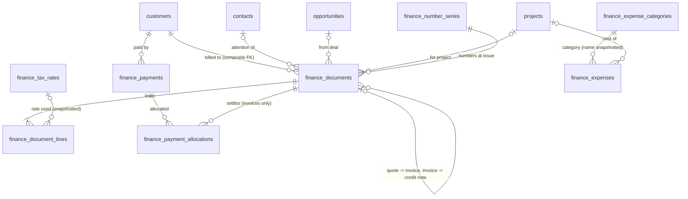

# Finance Zone data model (F1 and F2, implemented)

> Status: **F1 implemented** (Phase 6): migration `20261115000000_finance`, the finance module, and the API for quotes, invoices, credit notes and finance settings. **F2 implemented** (PR #34, awaiting audit): migration `20261116000000_finance_payments`, payments, allocations, reversals, credit applications, settlement projections, customer balances and on-demand **internal integrity** reconciliation (§18; not bank-statement reconciliation). The owner approved FD-L1, FD-L2, FD-L3, FD-T1, FD-T2 and FD-P1 (§14); every other FD-* decision is still open. F2's choices on open decisions (§18.8) are **provisional pending owner approval**, not ratified policy. §17 lists what F1 built and where it differs from the F0 design below. Expenses have tables and database guards but no services until F3.
> It follows [data-model.md](./data-model.md), [sales-data-model.md](./sales-data-model.md), [projects-data-model.md](./projects-data-model.md) and [scheduling-data-model.md](./scheduling-data-model.md): same tenancy, forced RLS, composite FKs, `<zone>:<action>` permission keys, audit and migration conventions.
> Evidence: `apps/api/tests/integration/finance-integrity.test.ts` (the F0 spike suite moved onto the migrated tables, plus new tests) and `apps/api/tests/integration/finance.test.ts` (services and API). The F0 spike (`tests/isolation/finance-spike.test.ts` and its fixture) is kept as the design-time evidence.
>
> **Not a compliance product.** This is a financial record engine. It is not a certified accounting, tax-filing or jurisdiction-compliant invoicing product, and nothing in it makes a document satisfy Australian GST, EU VAT or any other invoicing regulation. The seven-year retention baseline is a product policy, not a statement of any jurisdiction's legal requirement.

## 1. Principles

- **Industry independent.** Quotes, invoices, credit notes, manual payment records, allocations and expenses. No trade-specific fields, no payment providers, no bank feeds, no general ledger.
- **One business data model.** Finance links to the Customer Zone's own customers and contacts, the Sales Zone's opportunities and the Projects Zone's projects through tenant-scoped composite FKs. It copies nothing from them, **except** the billing details an issued document must preserve as a legal record (§3.4). That copy is deliberate, frozen at issue, and never read back into the source.
- **Money is exact and never assumes a currency or a country.** Decimal arithmetic end to end, per-currency precision, explicit rounding, taxes as snapshotted percentages. Tax, numbering and compliance rules that differ by jurisdiction are owner decisions (§14), not defaults hidden in code.
- **Financial history is append-only.** Tenant code has no DELETE on any finance table (the one exception: lines of a *draft*, §2.3). Issued documents are immutable; corrections are new records (void, credit note, reversal).
- **The database holds the money invariants.** Over-allocation, over-settlement, duplicate numbers, edits to issued records and cross-tenant links are refused by constraints and guard triggers running as `bos_app` under forced RLS, so a service bug or a race cannot break them (§5). Services still check first, to give good errors.
- **Finance permissions are separate.** Holding customer, sales or project permissions, or being a project owner or task assignee, grants no Finance access (§7).

## 2. Tables

All Finance tables have:
- `business_id` with `UNIQUE (business_id, id)`;
- indexes leading with `business_id`;
- forced RLS with the standard `tenant_isolation` policy (test T1);
- `business_id → businesses(id)` **ON DELETE RESTRICT** (not CASCADE as in other Zones: see decision FD-L3, retention);
- authorship and timestamps (`created_by_id`, `updated_by_id`, `created_at`, `updated_at`, plus `issued_by_id`, `voided_by_id`, `reversed_by_id`, `recorded_by_id` where relevant). These hold user ids **without** an FK to memberships, as in Sales, so removing a member never touches financial history. They are left out of the fixture.

### 2.1 Relationships



| From | To | Key | What it guarantees |
|---|---|---|---|
| `finance_documents.customer_id` | `customers` | `(business_id, customer_id)` | Same business. Required on every document. |
| `.contact_id`, `.opportunity_id`, `.project_id` | `contacts`, `opportunities`, `projects` | `(business_id, …)` | Same business. Optional. Consistency (contact belongs to the customer; opportunity is for the customer) is a service rule, as in Sales §2. |
| `.source_quote_id` | `finance_documents` | `(business_id, source_quote_id, source_quote_kind)` with `source_quote_kind = 'QUOTE'` (CHECK) | Only a quote of this business can be the source of an invoice (T4) |
| `.credited_invoice_id` | `finance_documents` | `(business_id, credited_invoice_id, credited_invoice_kind, currency_code, customer_id)` with `credited_invoice_kind = 'INVOICE'` | A credit note credits an invoice of the same business, customer and currency (T4) |
| `finance_document_lines.document_id` | `finance_documents` | `(business_id, document_id)` | |
| `finance_document_lines.tax_rate_id` | `finance_tax_rates` | `(business_id, tax_rate_id)` | Optional reference; the line keeps its own snapshot |
| `finance_payments.customer_id` | `customers` | `(business_id, customer_id)` | |
| `finance_payment_allocations.payment_id` | `finance_payments` | `(business_id, payment_id, customer_id, currency_code)` | The allocation's customer and currency are the payment's |
| `finance_payment_allocations.invoice_id` | `finance_documents` | `(business_id, invoice_id, invoice_kind, currency_code, customer_id)` with `invoice_kind = 'INVOICE'` | …and the invoice's. So payment and invoice share business, customer and currency, and the target is an invoice (T3, T4). |
| `finance_expenses.category_id`, `.project_id` | categories, `projects` | `(business_id, …)` | |

The kind, customer and currency columns copied into the referencing rows are pinned by CHECKs or by sharing one column between two FKs, so they cannot be spoofed (T4 includes the spoofing cases).

### 2.2 `finance_documents` (quotes, invoices, credit notes)

One table for the three kinds: one numbering, snapshot, sealing and immutability mechanism instead of three copies.

| Column | Notes |
|---|---|
| `kind` | `QUOTE`, `INVOICE`, `CREDIT_NOTE` |
| `status` | `DRAFT`, `ISSUED`, `ACCEPTED`, `DECLINED`, `EXPIRED`, `VOID`. Invoices and credit notes use only `DRAFT`, `ISSUED`, `VOID` (CHECK). "Paid", "partly paid" and "overdue" are **derived**, never stored (§4.2). |
| `customer_id`, `contact_id`, `opportunity_id`, `project_id` | Links (§2.1) |
| `source_quote_id`, `credited_invoice_id` (+ their pinned kind columns) | Conversions and credits (§2.1) |
| `currency_code`, `currency_scale` | ISO 4217 code and its minor units (0–4), fixed per document (§3) |
| `issue_date`, `due_date`, `valid_until` | Calendar dates in the business's time zone. `due_date ≥ issue_date`. |
| `number_value`, `number` | Assigned by the database at issue (§4.1). NULL exactly while unissued. `UNIQUE (business_id, kind, number_value)` and `(business_id, kind, number)`. |
| `seller_snapshot`, `bill_to_snapshot` | jsonb, required once issued (§3.4) |
| `subtotal`, `tax_total`, `total` | `numeric(18,4)`, `total = subtotal + tax_total`, rounded to `currency_scale` (CHECKs) |
| `allocated_total` | `numeric(18,4)`, `0 ≤ allocated_total ≤ total`, non-zero only for invoices. **Maintained only by the allocation triggers** (§5). |
| `content_sha256` | Hash of the canonical issued content, computed by the database at issue (§10) |
| `notes` (≤ 5000), `version` | |
| `issued_at`, `status_changed_at`, `voided_at` | **Stamped by the database** in their transition (§4.4); clients cannot set, clear or rewrite them |
| `void_reason` (≤ 500) | Accepted only in the void transition, fixed afterwards; NULL unless `VOID` (CHECK) |

### 2.3 `finance_document_lines`

`position`, `description` (1–1000), `quantity numeric(18,6) > 0`, `unit_price numeric(18,6) ≥ 0`, `discount_amount numeric(18,4) ≥ 0`, `tax_rate_id` (optional), `tax_name`, `tax_rate_percent numeric(7,4)` (0–100), `line_net`, `line_tax` (`numeric(18,4)`).

- Written, updated and **deleted** only while the document is a `DRAFT` (guard `guard_line`). Deleting a draft line is the one DELETE in Finance: a draft is not yet a financial record.
- Lines never move between documents.

### 2.4 `finance_number_series`

One row per `(business_id, kind)`: `prefix` (≤ 20), `min_digits` (1–12), `starting_value` (1 to 999 999 999 999, default 1), `next_value` (`≥ starting_value`, CHECK).

**Initial state and starting numbers** (guard `guard_number_series`, test L8):
- A series is created **unused**: `next_value = starting_value`. Creating one part-way through its numbers (any other `next_value`) is refused.
- `starting_value` is how a business that moves from another system continues its numbering (for example from 1043). It is a recorded setting, not a hidden counter value, and its change is audited (`finance.settings.changed`, old and new value).
- It can be changed **only while the series is unused** (no number committed: `next_value = starting_value`); `next_value` follows it. Once a number has been issued it is fixed, in both directions. A start change racing a first issue queues on the series row and is then refused.
- `next_value` itself never moves except from the issue trigger, by exactly +1.
- Whether the starting value needs more than `finance:manage` (for example an owner-only confirmation) is part of FD-L1.

`prefix` and `min_digits` are editable settings (`finance:manage`); an issued document keeps the number it was given. Created on first use with `INSERT … ON CONFLICT DO NOTHING`, as the Sales default pipeline is. Per-series variants (per branch, per year) are decision FD-L1.

### 2.5 `finance_tax_rates`

`name` (1–100), `rate_percent numeric(7,4)` (0–100), `archived_at`. `bos_app` may update only `name` and `archived_at`: a rate's percentage never changes. A new percentage is a new rate. Lines snapshot the name and percentage they used (L7).

### 2.6 `finance_payments` (manual payment records)

| Column | Notes |
|---|---|
| `customer_id`, `currency_code`, `currency_scale` | |
| `amount` | `> 0`, rounded to `currency_scale` |
| `received_on` | Calendar date |
| `method` | `BANK_TRANSFER`, `CASH`, `CARD`, `CHEQUE`, `OTHER`. A record of money received outside Business OS, not a payment integration. |
| `reference` (≤ 200) | Editable after recording (the only business field that is) |
| `status` | `RECORDED` → `REVERSED` (one way) |
| `allocated_total` | `0 ≤ allocated_total ≤ amount`; maintained only by the allocation triggers. `REVERSED` requires it to be 0. |
| `reversed_at` | Stamped by the database in the reversal |
| `reversal_reason` (≤ 500) | Accepted only in the reversal, fixed afterwards; NULL unless `REVERSED` (CHECK) |
| `idempotency_key`, `request_hash` | Both or neither. `UNIQUE (business_id, idempotency_key)` (§6.4). |

Unallocated money (`amount − allocated_total`) stays on the payment as customer credit, for a later allocation.

### 2.7 `finance_payment_allocations`

`payment_id`, `invoice_id`, `invoice_kind` (= `INVOICE`), `customer_id`, `currency_code`, `amount > 0`, `created_at`, `reversed_at`.

- One live allocation per `(payment, invoice)` (partial unique index): a double-submitted allocation is refused.
- `created_at` and `reversed_at` are stamped by the database (a client-supplied time is replaced).
- `bos_app` may update only `reversed_at`, and only from NULL to a time (one way). An allocation is never edited or deleted: a correction is a reversal plus a new allocation.

### 2.8 `finance_expense_categories` and `finance_expenses`

- Categories: `name` (1–100), `archived_at`. Renaming is allowed; recorded expenses keep the name they were recorded with.
- Expenses:

| Column | Notes |
|---|---|
| `status` | `DRAFT` → `RECORDED` → `VOID`; `DRAFT` → `VOID` (discarded) |
| `category_id`, `category_name` | The name is snapshotted by the database when recorded |
| `project_id` | Optional, same business |
| `description` (1–500), `supplier_name` (≤ 200) | Supplier is free text in F1; a supplier entity is decision FD-P5 |
| `incurred_on`, `currency_code`, `currency_scale`, `amount` (gross), `tax_amount` (≤ amount) | Rounded to the currency |
| `receipt_reference` (≤ 500) | An opaque reference to a receipt (an external link or, later, a file id). Business OS has no file storage yet; attachments are decision FD-P6. |
| `recorded_at`, `voided_at` | Stamped by the database in their transition |
| `void_reason` (≤ 500) | Accepted only in the void transition, fixed afterwards |
| `version` | |

A recorded expense is immutable except voiding (E1).

## 3. Money

### 3.1 Representation

- **Database:** `numeric(18,4)` for amounts (as Sales), `numeric(18,6)` for quantities and unit prices (fractional units and sub-cent unit prices), `numeric(7,4)` for tax percentages.
- **Code:** `Prisma.Decimal`, never `number`. M1 shows the failure this prevents: `1.005` rounded in floating point gives `1.00`; exact decimal arithmetic gives `1.01`.
- **API:** decimal strings matching `^\d{1,14}(\.\d{1,6})?$`, as Sales. JSON numbers are rejected.

### 3.2 Currencies and precision

- Every document, payment and expense has one currency. The precision (`currency_scale`) comes from ISO 4217 minor units via `Intl` (JPY 0, USD 2, KWD 3, as Sales §3) and is **snapshotted on the record**, so a later change in currency data never changes a stored amount.
- Every stored amount is rounded to that scale (CHECKs; M2). Allocations are checked against the payment's scale.
- Allocations, credit notes and conversions only ever join records of the same currency (composite FKs).
- **No conversion anywhere.** Totals and reports are per currency (§9). Multi-currency conversion and exchange-rate records are decision FD-A3.
- The business's own currency is the default for new documents; nothing assumes US dollars.

### 3.3 Rounding and tax

- **Per line:** `line_net = round(quantity × unit_price, scale) − discount_amount`, `line_tax = round(line_net × tax_rate_percent / 100, scale)`.
- **Per document:** `subtotal = Σ line_net`, `tax_total = Σ line_tax`, `total = subtotal + tax_total`.
- **Rounding mode:** half away from zero (PostgreSQL `round(numeric, int)`; `Decimal.ROUND_HALF_UP` for the non-negative values used here). The service computes the amounts; **the database recomputes and refuses the issue on any difference** (`23514`, M2). So a service rounding bug can never produce an issued document whose lines and totals disagree.
- **F1 scope:** tax-exclusive prices, at most one tax per line, line-level rounding. Tax-inclusive prices, document-level (per-rate) rounding, compound and multiple taxes, reverse charge, withholding and exemptions with legal wording are owner decisions (FD-T1 to FD-T4). The schema leaves room for them (a `tax_mode` on documents, a line-tax child table) without changing what exists.

### 3.4 Snapshots

At issue, the service writes and the database seals:
- `seller_snapshot`: the business's legal name, address, registration and tax ids, and payment instructions as they are at that moment;
- `bill_to_snapshot`: the customer's billing name, address and tax id (and the contact's name, if any);
- per line: description, tax name and percentage.

After that, renaming the customer, changing its address, renaming or archiving a tax rate, or renaming a category changes nothing on the document (L3, L7, E1). The live FKs stay, for navigation and reporting by customer or project, but the document's legal content comes only from its snapshots.

## 4. Lifecycles

### 4.1 Documents

```
QUOTE:        DRAFT ──issue──▶ ISSUED ──▶ ACCEPTED ──▶ VOID
                │                 ├──▶ DECLINED
                │                 ├──▶ EXPIRED
                │                 └──▶ VOID
                └──discard──▶ VOID (never numbered)

INVOICE /
CREDIT_NOTE:  DRAFT ──issue──▶ ISSUED ──void──▶ VOID
                └──discard──▶ VOID (never numbered)
```

- **Draft:** editable (header and lines), unnumbered, optimistic concurrency with `version` as in Sales. Totals stored for display; recomputed and checked at issue.
- **Issue** (one conditional `UPDATE … WHERE status = 'DRAFT'`, after locking the row): the database
  1. refuses a document with no lines, or with lines or totals that do not match the formulas (§3.3);
  2. for a credit note, requires its invoice to be `ISSUED` (taking it `FOR SHARE`);
  3. takes the next number from the series (gapless, §5.2) and formats it (`prefix` + number padded to `min_digits`; never truncated);
  4. stamps `issued_at` and computes `content_sha256`.
  Anything a client sends for the number or hash is overwritten (L1).
- **Issued:** immutable. The guard compares the whole row (as jsonb) minus an allow-list (`status`, `allocated_total`, `status_changed_at`, `voided_at`, `void_reason`, `version`), so a column added later is frozen by default. Lines are frozen too (L2).
- **Void:** an issued invoice can be voided only while nothing is allocated to it (CHECK) and no live credit note points at it (guard). It keeps its number, so the sequence has no hole. `VOID` is final. A discarded draft stays unnumbered: it cannot be given a number, hash or issue time on the way to `VOID` (L9).
- **Corrections** never edit an issued document. Before payment, void and reissue (a new number). After payment, or where the law requires it, issue a **credit note** and, if needed, a new invoice. Whether voiding is allowed at all once an invoice has been sent, or only credit notes, is jurisdiction-dependent (FD-L2).
- **Quote to invoice:** "convert" creates an invoice *draft* copying the quote's lines, with `source_quote_id`. One quote may lead to several invoices (deposits, progress billing). Whether conversion requires `ACCEPTED`, and whether a quote may be invoiced beyond its total, is FD-P3.
- **Expiry** of quotes is an explicit transition (by a user, or later a scheduled job), not a computed status, so history records when it happened.

### 4.2 Payments and settlement

```
payment: RECORDED ──reverse (after its allocations are reversed)──▶ REVERSED
allocation: live ──reverse──▶ reversed
```

- **Partial payment:** allocate less than the invoice's outstanding amount.
- **One payment, several invoices:** several allocations from one payment (P1).
- **Several payments, one invoice:** several allocations to one invoice (P1).
- **Overpayment:** the unallocated rest stays on the payment as customer credit.
- **Reversal** (a bounced cheque, a payment recorded in error): reverse its allocations, then the payment, in one unit of work. The database refuses to reverse a payment that is still allocated (P4). Nothing is deleted; reversed rows remain as history.
- **Credit notes** settle nothing by being issued. Their credit reaches an invoice only through an explicit **credit application** (F2, §18.2), with the same counters, CHECKs and lock order as allocations. **Refunds** of customer credit are not implemented (FD-A2).
- **Derived invoice state** (computed, never stored):

| Derived | Rule |
|---|---|
| Unpaid | `ISSUED` and `allocated_total + credit_applied_total = 0` |
| Partly paid | `ISSUED` and `0 < allocated_total + credit_applied_total < total` |
| Paid | `ISSUED` and `allocated_total + credit_applied_total = total` |
| Overdue | `ISSUED`, not paid, `due_date <` today in the business's time zone |

(F2: `credit_applied_total` is the credit applied to the invoice by credit applications, §18.2. Before F2 it did not exist and these rules used `allocated_total` alone.)

### 4.3 Expenses

`DRAFT` (editable) → `RECORDED` (category name snapshotted, `recorded_at` stamped, immutable) → `VOID`. A draft can be discarded (`VOID`). Payment status of expenses (bills, payables) is out of scope (FD-P5).

### 4.4 Transition metadata

When and why a record changed state is part of the financial record, so the database owns it (tests L9, P6, E2):

| Record | Stamped by the database | Given only in the transition | Outside the transition |
|---|---|---|---|
| Document | `issued_at` and `status_changed_at` (issue, accept, decline, expire, void); `voided_at` (void) | `void_reason` (void) | None of them may be set, changed or cleared |
| Payment | `reversed_at` (reversal) | `reversal_reason` (reversal) | Same |
| Allocation | `created_at` (insert), `reversed_at` (reversal) | | `created_at` is not updatable; `reversed_at` is one way |
| Expense | `recorded_at` (record), `voided_at` (void) | `void_reason` (void) | Same |

- Stamps are the **transaction time** (`now()`), so every stamp in one unit of work is the same instant, and a client-supplied value (for example a backdate) is replaced, not trusted.
- New records start with all of them empty (insert guards).
- The business dates a user legitimately chooses (`issue_date`, `due_date`, `received_on`, `incurred_on`) are separate columns: they are validated by the service and frozen with the record.
- The jsonb freeze still lists these columns as "may change after issue", because their transition changes them; the metadata guard then decides when.

## 5. Integrity invariants

Each is held by the database, as `bos_app` under forced RLS, independently of service code. "Test" names the spike test that fails if the mechanism is removed (§12.2).

| # | Invariant | Mechanism | Test |
|---|---|---|---|
| I1 | A business sees and writes only its own finance rows | Forced RLS `tenant_isolation`; scoped client | T1, T2 |
| I2 | No link crosses businesses | Composite FKs on every link | T3 |
| I3 | Allocations go only to invoices of the payment's customer and currency; credit notes credit invoices of the same customer and currency; conversions come from quotes | FKs sharing kind, customer and currency columns; kind CHECKs | T4 |
| I4 | Stored amounts respect the currency's precision; totals equal subtotal plus tax | CHECKs | M2 |
| I5 | An issued document's totals equal its lines, computed by the documented formulas | Issue guard | M1, M2 |
| I6 | Numbers are assigned by the database, unique and gapless per business and kind | Issue guard + series guard + unique keys | L1, K1, Z1 |
| I7 | Issued documents and their lines never change, except status, settlement and void fields | Document guard (deny by default), line guard | L2, K7, K7b |
| I8 | Issued documents keep their billing details | Snapshots sealed by I7 and the hash | L3 |
| I9 | No invoice is settled above its total; no payment is allocated above its amount | Counters maintained by triggers + CHECKs | P2, K2, K3 |
| I10 | Counters equal the sum of live allocations and cannot be written directly | Allocation triggers; guards on direct writes (`pg_trigger_depth`) | P3, Z1 |
| I11 | Allocations only to issued invoices, only from recorded payments | Allocation trigger | P2, P4, K5 |
| I12 | A void invoice holds no money; a settled or credited invoice cannot be voided | CHECK + guard | P2, K5, L6 |
| I13 | Reversal is explicit, one way, ordered (allocations before payment) | Trigger + CHECK + column grants | P4 |
| I14 | A repeated idempotency key never creates a second payment | Unique index | P5, K6 |
| I15 | Nothing financial is deleted by tenant code (only draft lines) | Grants | T1, L5 |
| I16 | Lifecycle transitions follow §4 | Document and expense guards | L4, L2, E1 |
| I17 | Recorded expenses are immutable, keep their category name, and are voided not deleted | Expense guard | E1 |
| I18 | A tax rate's percentage never changes | Column grants | L7 |
| I19 | A numbering series starts unused at an explicit starting value, which is fixed once a number has been issued | Series guard (insert and update) + `next_value ≥ starting_value` CHECK | L8 |
| I20 | Transition times are stamped by the database; reasons exist only through their transition; none can be fabricated, cleared or rewritten | Document, payment and expense guards; allocation stamp trigger; reason CHECKs | L9, P6, E2 |

**Error codes.** The spike uses standard SQLSTATEs: `23514` (an amount or total rule), `23503` (link), `23505` (duplicate), `55000` (wrong state), `42501` (immutable or not allowed). F1 gives each guard its own SQLSTATE in a custom class (for example `F0001`–`F0099`) and maps them to stable API error codes (`over_allocated`, `invoice_not_open`, `immutable`, …), because `42501` also means "RLS refused" and must not be confused with an integrity refusal. No database error detail is forwarded to clients.

## 6. Transactions, lock ordering and deadlocks

### 6.1 Transactions

Every Finance mutation is one `withTenant` unit of work (`READ COMMITTED`, 5 s timeout), containing the change, its audit entry and nothing else. No external calls inside a unit of work. The API never retries a mutation by itself (scheduling-data-model §10.2 applies unchanged).

### 6.2 What makes the rules hold under concurrency

- **Counters on one row.** Each allocation `UPDATE`s its payment row and its invoice row (`allocated_total = allocated_total + amount`). PostgreSQL serialises concurrent updates of a row; the second re-evaluates against the first's committed value, and the CHECK refuses whatever would exceed the limit. So of 30 concurrent 10.00 allocations to a 100.00 invoice, exactly 10 commit (K2), and the same holds for one payment allocated to 30 invoices (K3). No `SERIALIZABLE` isolation and no application-level sum is needed.
- **Numbers on one row.** The issue trigger increments the series row inside the issuing transaction. Concurrent issues queue on that row; a rolled-back issue rolls the increment back, so committed numbers have no gaps (K1: 40 concurrent issues, 10 rolled back after being numbered, 30 committed with consecutive numbers).
- **State checks on the locked row.** Allocation requires `status = 'ISSUED'` in the same `UPDATE` that increments the counter; void requires `allocated_total = 0` by CHECK. Whichever of a racing void and allocation commits first wins; the other is refused (K5, 20 races).
- **Issue vs line edits.** The issue locks the document and then reads the lines; every line write first takes the document `FOR SHARE` in its guard. A line write either commits before the issue (and is sealed into it) or waits and is refused (K7, K7b).

### 6.3 Lock order (deadlock prevention)

Liveness, not correctness: every rule above holds even if a code path takes locks in the wrong order. Such a path can deadlock (`40P01`, rolled back whole), but it cannot break an invariant (K4 demonstrates both).

**Global order.** Within one unit of work, rows are locked in this class order, and by id within a class:

1. **Payments** (`finance_payments`), sorted by id;
2. **Documents** (`finance_documents`): the document being changed first; documents it only references (a credit note's invoice) after, `FOR SHARE`; several documents changed together, sorted by id;
3. **Lines** of a draft (only after their document);
4. **Number series** (only inside the issue trigger, last);
5. Expenses, categories and tax rates are single-row writes and take no other finance locks.

Services take the locks explicitly at the start of the unit of work with `SELECT … ORDER BY id FOR NO KEY UPDATE`. They use `FOR NO KEY UPDATE`, not `FOR UPDATE`: the FK checks of concurrent inserts take `FOR KEY SHARE` on the same rows, which conflicts with `FOR UPDATE` but not with `FOR NO KEY UPDATE`.

| Operation | Locks, in order |
|---|---|
| Edit a draft (header and lines) | document; then its lines |
| Issue | document; (credit note: its invoice `FOR SHARE`); series row |
| Void / accept / decline / expire | document |
| Record payment | none (insert only; the unique key arbitrates idempotency) |
| Allocate (one payment, one or more invoices) | payment; invoices by id |
| Reverse an allocation | payment; invoice |
| Reverse a payment | payment; its allocated invoices by id |
| Record payment with allocations (F2) | the new payment; invoices by id |
| Apply a credit note / reverse an application (F2) | the credit note and the invoices together, by id |
| Record / void an expense | expense |

**Deadlock analysis.**

| Pair of operations | Without ordering | With ordering |
|---|---|---|
| Two allocations, each from a different payment to the same two invoices in opposite order | **Deadlock** (each holds one invoice and waits for the other). Reproduced deterministically in K4: exactly one `40P01`; the loser rolls back whole, the winner commits both allocations. | Both lock invoices by id: the second waits at the first invoice and then proceeds (K4, second half; K8, 120 concurrent crossed operations, no `40P01`). |
| Allocation vs reversal of another payment's allocation on a shared invoice | Possible cycle if the reversal locked the invoice before its payment | Both take payment then invoice: no cycle (K8) |
| Allocation vs void of the same invoice | Payment→invoice vs invoice only: no cycle | Same |
| Issue of a credit note vs void of its invoice | Credit note → invoice (`FOR SHARE`) vs invoice only: no cycle; the void then sees the credit note and is refused | Same |
| Two issues in one series | Each locks its own document, then the series: queue on the series, no cycle | Same |
| Draft line writes vs issue | Service locks the document first. A writer that skips it takes `FOR SHARE` in the guard; two such writers that both later update the document would deadlock on lock upgrade (`SHARE` → `NO KEY UPDATE`). That is why services lock first. | No cycle |
| Allocation inserts vs FK checks | `FOR KEY SHARE` (FK) is compatible with `FOR NO KEY UPDATE` | Same |

**Hot rows.** The series row serialises issues per business and kind for the rest of the issuing transaction, so the issue unit of work does only the issue and its audit entry. At the expected volumes (tens of documents per business per day) this is not a bottleneck; F1 measures it (FD-L1 covers per-series alternatives).

### 6.4 Idempotency

- `POST /finance/payments` **requires** an `Idempotency-Key` header. The service stores the key and a hash of the canonical request. A repeat with the same hash returns the first result (`200`, the original id); the same key with a different request is `409 idempotency_conflict`. Two racing first requests are arbitrated by the unique index (`23505` → re-read → the same answer) (P5, K6).
- Allocation requests are naturally idempotent: one live allocation per pair (`23505` → `409 already_allocated`).
- Transitions (issue, void, reverse) are conditional on state, so a repeat answers `409 invalid_state` and changes nothing.
- Keys are per business and kept with the payment (no expiry, since the payment is kept).

## 7. Permissions and API boundaries

### 7.1 Permission keys (proposed)

| Key | Covers | OWNER | ADMIN | MANAGER | MEMBER |
|---|---|:-:|:-:|:-:|:-:|
| `finance:read` | Documents, payments, allocations, expenses, settings and reports (read) | ✓ | ✓ | ✓ | |
| `finance:write` | Create and edit **drafts** (quotes, invoices, credit notes); convert a quote to a draft invoice | ✓ | ✓ | ✓ | |
| `finance:issue` | Issue, accept, decline, expire, void documents; issue credit notes | ✓ | ✓ | | |
| `finance:payments` | Record, allocate, unallocate and reverse payments | ✓ | ✓ | | |
| `finance:expenses` | Create, edit, record and void expenses | ✓ | ✓ | ✓ | |
| `finance:manage` | Numbering series, tax rates, expense categories, finance defaults | ✓ | ✓ | | |

- Code checks keys, never roles. The defaults above are a recommendation (FD-P1); a business that wants a bookkeeper role or members entering expenses changes only `ROLE_PERMISSIONS`.
- **No implicit access.** `customers:*`, `sales:*`, `projects:*` and being a project owner, task assignee or opportunity owner grant nothing here, and `finance:*` grants nothing elsewhere. Showing a linked customer's live name follows the Projects rule (joined only for `customers:read`); the document's own bill-to snapshot is part of the financial record and is shown with `finance:read`.
- Issuing and payments are separate from drafting on purpose: the person who prepares an invoice need not be the person who finalises it or records money against it (FD-P2: whether to enforce "preparer ≠ issuer").
- Customer and project tabs show finance data only to holders of `finance:read`.
- The audit log's finance entries remain `audit:read` (OWNER, ADMIN).
- F1 adds the keys to `ZONE_PERMISSIONS` and extends the permission matrix test. **F0 changes no permissions.**

### 7.2 API (F1 onward; nothing is built in F0)

All under `/api/v1/b/:slug/finance`, all `tenantRoute`, strict bodies, decimal strings, keyset pagination. Another business's id answers exactly like a missing one (`404`).

| Method and path | Permission |
|---|---|
| `GET /quotes`, `/invoices`, `/credit-notes` (filters: status, customer, project, dates, overdue), `GET …/:id` | `finance:read` |
| `POST /quotes`, `/invoices`; `PATCH …/:id` (draft, with `version` and the full line list) | `finance:write` |
| `POST /quotes/:id/convert` (creates a draft invoice); `POST /invoices/:id/credit-notes` (draft) | `finance:write` |
| `POST …/:id/issue`, `…/void`; `POST /quotes/:id/accept`, `…/decline`, `…/expire` | `finance:issue` |
| `GET /payments`, `GET /payments/:id` (with allocations) | `finance:read` |
| `POST /payments` (`Idempotency-Key` required); `POST /payments/:id/allocations`; `POST /payments/:id/allocations/:allocationId/reverse`; `POST /payments/:id/reverse` | `finance:payments` |
| `GET /expenses`, `POST /expenses`, `PATCH /expenses/:id` (draft), `POST /expenses/:id/record`, `…/void` | `finance:read`, `finance:expenses` |
| `GET/PATCH /settings`, `/tax-rates`, `/number-series`, `/expense-categories` | `finance:read`, `finance:manage` |
| `GET /reports/summary?from&to&asOf`, `GET /reports/receivables?asOf`, `GET /reports/projects/:projectId` | `finance:read` |

- **No DELETE endpoints.** Draft lines change through `PATCH` of the draft.
- Rendering documents (PDF), sending them by email, online payment links and accounting exports are later PRs (§15).
- The service validates first (state, permissions, links, archived references, contact-belongs-to-customer) and the database is the backstop.

## 8. Integration with other Zones

- **Customers.** Required on documents and payments. Archived customers cannot be newly linked (`409 archived_reference`, as elsewhere); existing documents keep their link. **Customer erasure** cannot simply scrub issued documents: billing details on issued invoices are usually subject to statutory retention. F1 must not wire Finance into erasure until FD-L4 is decided; until then erasure leaves issued finance records untouched and says so.
- **Contacts.** Optional "attention of"; the service checks the contact belongs to the document's customer (Sales rule). Moving a contact later changes no document.
- **Sales.** An invoice or quote may link the opportunity it came from. Winning an opportunity does not create an invoice, and Finance does not change opportunity amounts. Automatic conversion is a later product decision (FD-P4).
- **Projects.** Documents and expenses may link a project, which feeds the project margin report (§9). Archived projects cannot be newly linked. Project roles grant no finance access.
- **Members.** Finance stores actor ids without membership FKs, so member removal needs no Finance step (unlike Projects and Scheduling).
- **Scheduling.** No link in F1. Invoicing completed jobs is a later module that depends on both Zones.
- **Business deletion.** The fixture uses `ON DELETE RESTRICT`, so the existing purge job cannot remove a business with finance records. Retention after a business closes is FD-L3; until it is decided, F1 keeps RESTRICT and the purge job reports such businesses instead of deleting them.

## 9. Reporting semantics

All reports are **per currency** (no conversion), computed from records only (no estimates), as `bos_app` under RLS, for `finance:read` holders. Dates are calendar dates in the business's time zone; periods are half-open `[from, to)`. R1 runs these definitions against a scenario with two currencies, a void invoice, a credit note, a partial payment, a reversed payment and project expenses.

| Measure | Definition |
|---|---|
| **Invoiced revenue** (accrual) | Σ `subtotal` of `ISSUED` invoices with `issue_date` in the period, minus Σ `subtotal` of `ISSUED` credit notes with `issue_date` in the period. Excludes tax (tax is not revenue) and void documents. Quotes never count. |
| **Tax invoiced** (informational) | The same with `tax_total`. Not a tax return. |
| **Collected cash** | Σ `amount` of `RECORDED` payments with `received_on` in the period. Reversed payments are excluded (an "as known now" view). Whether a reversal should instead appear as a negative in the period it happened is FD-A1. Unallocated amounts count: cash is cash. |
| **Receivables** at date D | Σ (`total − allocated_total`) of `ISSUED` invoices issued on or before D. F1 computes this from current counters (as of now). An as-of-past-date version sums allocations with `created_at ≤ D` and not reversed by D; F1 decides whether it is needed. F2: receivables are `total − allocated_total − credit_applied_total`, so an **applied** credit note reduces them; an issued but unapplied credit note reduces revenue, not the invoice's balance, and appears as customer credit (§18.4). |
| **Overdue** at date D | Receivables of invoices with `due_date < D` |
| **Expenses** | Σ (`amount − tax_amount`) of `RECORDED` expenses with `incurred_on` in the period (net of tax). Whether tax on expenses is recoverable, and therefore whether to report gross instead, depends on registration status (FD-T5). Gross is also available. |
| **Recorded-cost project margin** | Per project and currency, over all time or a period: invoiced revenue linked to the project (invoices minus credit notes, net of tax) minus recorded expenses linked to the project (net). It is called "recorded-cost margin", never profit: it has no labour cost, overheads or unlinked costs. |

Indexes for these (`(business_id, kind, status, issue_date)`, `(business_id, received_on)`, `(business_id, incurred_on)`, project indexes) are part of F1's migration.

## 10. Audit and financial safeguards

Standard pattern (data-model §4.8): every mutation writes an `audit_events` row in the same unit of work, with ids and structured facts only. Finance metadata includes, because they are not personal data and investigators need them: document kind, number, currency, totals, payment amount, allocation amounts, from/to status. It never includes notes, descriptions, addresses or reasons as text (`hasReason` only).

| Action | Metadata |
|---|---|
| `finance.document.created`, `.updated` | kind, currency, fields (names) |
| `finance.document.issued` | kind, number, currency, subtotal, taxTotal, total, contentSha256 |
| `finance.document.voided`, `.accepted`, `.declined`, `.expired` | kind, number, hasReason |
| `finance.payment.recorded`, `.reversed` | currency, amount, method, hasReason |
| `finance.allocation.created`, `.reversed` | paymentId, invoiceId, amount, currency |
| `finance.expense.recorded`, `.voided` | categoryId, projectId, currency, amount |
| `finance.settings.changed` (series, tax rates, categories) | what changed (field names, old and new numeric values) |

Additional safeguards for financial records:
1. **No DELETE** on financial tables for any runtime role (only draft lines).
2. **Immutability in the database**, deny-by-default for new columns (§4.1).
3. **Database-assigned numbers** that clients cannot choose or reset (L1).
4. **Database-maintained counters** that clients cannot write (P3).
5. **Content hash** at issue: `sha256` of the canonical document content (header, snapshots, lines; jsonb text form, lines ordered by position). Recomputing it later proves the stored content is what was issued (L1, L3, K7). It detects accidental change by anything that bypasses the guards (a migration, an administrative fix); it is not a signature and does not prove authorship (FD-L5: whether a jurisdiction needs signed or chained hashes).
6. **Integrity reconciliation check** (Z1 is its prototype): F2 implements it as an on-demand, read-only endpoint (§18.5) over Business OS's own records, not bank statements, that compares every counter with the sum of its live links, every series with its issued numbers and every content hash with the content, and reports any difference. Scheduling it and alerting are not built (no scheduler without approval).
7. **Database-owned transition metadata** (§4.4): times stamped by the database, reasons fixed after their transition, starting numbers fixed after first use.
8. **Audit retention** for finance events must be at least the statutory retention of the records themselves (FD-L3), longer than the network-data scrubbing in data-model §7.

## 11. Migration safety and rollback (F1)

- **Additive only:** 5 enum types, 8 tables, indexes, FKs, CHECKs, 6 trigger functions and their triggers, 2 content-hash helpers, grants and policies. **No existing table changes.** The FK targets it needs already exist (`customers`, `contacts`, `opportunities`, `projects`: `UNIQUE (business_id, id)`).
- **No privileged SQL.** Unlike Scheduling, Finance needs no extension and no `SECURITY DEFINER` function: every guard is `SECURITY INVOKER` and runs as `bos_app` under RLS. `sha256()` and `gen_random_uuid()` are built in (PostgreSQL ≥ 13; production is 18).
- **Prisma:** generated columns are not used; trigger-maintained columns (`number_value`, `number`, `content_sha256`, `allocated_total`, `category_name`, `issued_at`, `recorded_at`) are ordinary columns that the services never write. `prisma migrate diff` must stay clean; triggers and CHECKs live in the migration SQL, as in earlier Zones.
- **Order:** migrate first, then deploy. Routes are behind `finance:*` keys that no role holds until the same deploy, so a migrated-but-not-deployed state exposes nothing.
- **Rollback before any issued document exists:** drop the tables, functions and types and delete the migration's `_prisma_migrations` row (as Sales §7).
- **Rollback after real use:** do **not** drop. Issued documents are legal records. Roll the *application* back (hide the routes by removing the keys), keep the data, fix forward with a new migration. A Neon recovery branch is taken before the migration as for every Zone, but restoring it would lose financial records entered since, so it is a last resort with the owner's explicit approval.
- **Changing a guard later** (for example, adding a mutable column to the allow-list) is a reviewed migration that replaces the function; the spike tests move to the real tables in F1 so such a change is tested.
- Production migration only with Regan's explicit approval in the thread, from a recovery branch, as for every Zone.

## 12. F0 evidence

### 12.1 Results

| Check | PostgreSQL 16.10 (local docker, the CI image) | PostgreSQL 18.7 (local docker, temporary container) | CI (16.10 behind PgBouncer, transaction mode) |
|---|---|---|---|
| Finance spike suite | 34/34: 6 standalone runs and 3 whole-suite runs on the final code | 34/34 (in the 3 whole-suite runs) | see the PR |
| Whole isolation suite (Phase 1b, Scheduling S0, Finance F0) | 75/75, 3 runs (direct, no pooler) | 75/75, 3 runs (direct) | see the PR |
| K4 alone (deterministic deadlock and its fix) | 10/10 | | |
| Mutation check (§12.2) | 67 mutations (62 single removals, 5 layered pairs): 57 singles fail at least one test on their own; the other 5 are deliberate backstops, and each fails when removed with the mechanism it backs | | |
| `pnpm typecheck`, `pnpm lint`, `pnpm boundaries`, `pnpm test`, `pnpm contracts:check` | pass | | |

Commands (local throwaway database, local-only credentials from `docker/init/01-roles.sql`):

```bash
# database owned by bos_owner, as business_os_spike is in docker/init
SPIKE_ADMIN_URL=postgresql://postgres:<local>@127.0.0.1:<port>/<spike db> \
SPIKE_APP_URL=postgresql://bos_app:<local>@127.0.0.1:<port>/<spike db> \
pnpm --filter @business-os/api exec vitest run --config vitest.isolation.config.ts tests/isolation/finance-spike.test.ts
# whole isolation suite: add SPIKE_OWNER_URL, SPIKE_APP_SINGLE_URL, SPIKE_JOBS_URL, as in CI
pnpm test:isolation
```

No Neon branch was used. Neon adds pooler latency (scheduling-data-model §10), which matters for liveness, not for these invariants; a Neon run under §10.1's rules is optional before F1 (FD-O1).

### 12.2 Mutation check

Each guard, CHECK, FK column, unique index and grant was removed in turn and the suite re-run (67 mutations, re-run after the audit corrections). Every removal makes at least one test fail, except five backstops that are deliberately layered behind another mechanism and fail only when removed together with it (marked below):

| Removed | Fails |
|---|---|
| `allocated_total ≤ total` / `≤ amount` | K2, P2 / K3, P2 |
| Direct-write guards on the two counters | P3, Z1 |
| Issued-document freeze / line guard status / line guard `FOR SHARE` | L2 / K7, L2 / K7b |
| Series guard / number overwrite at issue | L1 (then most tests, from duplicate numbers) / L1, Z1 |
| Draft-unnumbered guard / insert-as-draft guard | L1 |
| Line arithmetic / header totals / empty document | M2 |
| Credit note needs issued invoice / void blocked by credit notes | L6 |
| Transition table / void final | L2, L4 / L2 |
| Void requires unsettled | K5, P2 |
| Allocation needs issued invoice / recorded payment / currency precision / one-way reversal | K5, P2 / P4 / M2 / P4 |
| Kind, currency or customer column in a link FK; kind CHECKs on credit notes and conversions | T4 |
| Allocation kind CHECK | Also held by the invoice-only counter CHECK; removing both fails T4 |
| Allocation column grant | Also held by the reversal trigger; removing both fails P3, Z1 |
| One live allocation per pair / idempotency unique | P2 / K6, P5 |
| Payment freeze / reversal final / reversal needs unallocated / insert guard | P3 / P4 / P4 / P3, Z1 |
| Expense freeze / category snapshot / transitions / insert guard / draft snapshot guard | E1 |
| Tax rate column grant | L7 |
| No DELETE on documents | L5, T1 |
| Amount-precision CHECK | M2 |
| Tenant column in a composite FK (customer) | T3 |
| Series: insert must start unused / start fixed once used / `next_value` follows the start | L8 |
| Series `next_value ≥ starting_value` CHECK | Backstop behind the insert guard; removing both fails L8 |
| Document: `status_changed_at` stamp / `voided_at` stamp / void metadata only in the void transition / metadata fixed without a transition | L9 |
| Document `void_reason` only when `VOID` CHECK | Backstop; removing it with the metadata guard fails L9 |
| Void is final | L9 (a version bump on a void document) |
| Payment: `reversed_at` stamp / reversal metadata fixed | P6 |
| Payment `reversal_reason` only when `REVERSED` CHECK | Backstop; removing it with the metadata guard fails P6 |
| Allocation: `created_at` stamp / `reversed_at` stamp | P6 |
| Expense: `voided_at` stamp / void metadata fixed | E2 |

### 12.3 What the spike proves, and what it does not

**Proves**, on PostgreSQL 16.10 and 18.7 with `bos_app` under forced RLS and the repository's scoped Prisma client:
- the integrity rules of §5 hold in the database against direct and concurrent writes, including writes that bypass the service helpers;
- the lock order of §6.3 removes the deadlock that crossed settlements otherwise produce, and that a deadlock (if a path gets the order wrong) rolls back whole without breaking an invariant;
- the report definitions of §9 are well defined on a realistic scenario.

**Does not prove:**
- that F1's migration reproduces the fixture: F1 must move this suite onto the real tables;
- anything about F1's services, validation, API error mapping, idempotency replay responses or permissions (nothing is built);
- behaviour on Neon's pooler under production latency (not run; FD-O1);
- performance at volume (the series row and per-invoice counters are hot rows by design; measured in F1);
- legal adequacy of numbering, retention, tax or document content in any jurisdiction (§14).

## 13. Residual risks

1. **Trigger-depth guards** (`pg_trigger_depth() < 2`) protect the counters and the series. They rely on no other trigger on those tables updating them. F1 adds a schema test that lists every trigger on the finance tables, so a new one is a reviewed change.
2. **Guards are SECURITY INVOKER.** A future role with `UPDATE` on these tables and `BYPASSRLS`, or a superuser fix, bypasses nothing in the guards (triggers still fire), but `session_replication_role = replica` or `ALTER TABLE … DISABLE TRIGGER` by the owner would. Only administrative roles can do either; the content hash and the reconciliation job detect the result.
3. **Hot rows.** Every issue in a series and every allocation to an invoice queue on one row each. Fine at expected volumes; a very busy business with one series could see issue latency. Mitigation options (several series, numbering at a later step) are in FD-L1.
4. **Gapless means "no gaps among committed documents"**, not "no unused numbers ever": a document is numbered only when it is issued, and voided documents keep their numbers. Whether that satisfies a given jurisdiction's rules is FD-L1.
5. **Rounding rules** are fixed to line-level half-away-from-zero. A jurisdiction requiring document-level or banker's rounding needs FD-T2 before invoices are issued there.
6. **Erasure vs retention** is unresolved (FD-L4); until then, erasure does not touch issued finance records.
7. **The bill-to snapshot is personal data** retained on purpose. Its access is `finance:read`; exports include it.
8. **Reports from current counters** are "as known now"; an auditor wanting historical balances needs the as-of variant (§9).
9. **Transaction-time stamps.** `now()` is the start of the unit of work; with the 5 s timeout the difference from wall-clock commit time is bounded, but stamps are not commit order. Ordering by stamp within the same second is by id, not by commit.
10. **Time zones.** "Overdue" and report periods use the business's time zone; a business changing its zone shifts boundaries for past periods. Reports should state the zone used.

## 14. Decisions needed from the owner

Recommendations are given; none is assumed in F1 code without approval. **F1 blockers** are marked ★.

**Accounting**

| # | Decision | Recommendation |
|---|---|---|
| FD-A1 | Reversed payments in cash reports: removed (as known now) or shown as a negative in the period of reversal? | Removed in F1 reports, with the reversal visible in the payment list |
| FD-A2 | Credit notes: applied to the invoice balance (credit applications) in F2, and refunds of customer credit? | Yes, F2, same mechanism as allocations |
| FD-A3 | Multi-currency: per-currency reporting only, or exchange rates and a reporting currency later? | Per currency only until requested |
| FD-A4 | Accrual (by issue date) as the primary revenue view, with cash (by receipt) alongside? | Yes, both shown, clearly labelled |
| FD-A5 | Is Business OS a record of invoices and payments, or is a general ledger / accounting export (double entry) in scope later? | Records only; an export to accounting software later |

**Legal and compliance**

| # | Decision | Recommendation |
|---|---|---|
| FD-L1 ★ **approved** | Numbering: one gapless series per business and kind (as designed)? Per-year or per-branch series? Custom starting number when migrating from another system? | One series per kind; `starting_value` settable only while unused (as designed, I19) with `finance:manage`, audited; prefix editable; per-year series later |
| FD-L2 ★ **approved** | May an issued invoice be voided, or must every correction be a credit note? | Allow void only while unpaid and not credited (as designed); a per-business setting to require credit notes |
| FD-L3 ★ **approved (7 years, provisional)** | Retention: how long must finance records (and their audit events) be kept after issue and after a business closes? What does business deletion do? | Keep for a configurable period (default 7 years, owner to confirm); business purge skips finance until then |
| FD-L4 | Customer erasure vs retention of issued documents | Erasure leaves issued documents within retention; scrubs drafts and quotes |
| FD-L5 | Is a content hash enough, or do some jurisdictions need signed, chained or government-reported invoices (e-invoicing)? | Hash only in F1; e-invoicing as per-country modules |
| FD-L6 | Mandatory document content (seller tax id, buyer tax id, legal wording) per jurisdiction | Make the seller and bill-to snapshot fields configurable; no country rules in core |

**Tax**

| # | Decision | Recommendation |
|---|---|---|
| FD-T1 ★ **approved** | Tax-exclusive prices only in F1, or tax-inclusive too? | Exclusive only in F1 |
| FD-T2 ★ **approved** | Rounding: line level, half away from zero (as designed)? | Yes for F1 |
| FD-T3 | One tax per line, or several (compound, multiple authorities)? | One in F1 |
| FD-T4 | Reverse charge, exemptions, withholding | Later, per jurisdiction |
| FD-T5 | Expenses: report net of tax (recoverable) or gross? | Show both; net as the default where the business is tax-registered |

**Product**

| # | Decision | Recommendation |
|---|---|---|
| FD-P1 ★ **approved** | Default role grants (§7.1). Should MANAGER issue invoices or record payments? Should MEMBER enter expenses? | As in §7.1: MANAGER drafts and expenses, OWNER/ADMIN issue and payments, MEMBER none |
| FD-P2 | Enforce "preparer ≠ issuer" (four-eyes) per business? | Not in F1; possible as a setting |
| FD-P3 | Quote conversion: only from ACCEPTED? Allow invoicing beyond the quote total? | Any issued or accepted quote; no limit, but show the invoiced-vs-quoted amount |
| FD-P4 | Automatic quote or invoice from a won opportunity | Not automatic; a "create quote" action from the opportunity later |
| FD-P5 | Suppliers as entities, and bills (payables) | Free-text supplier in F1; suppliers and bills later |
| FD-P6 | Receipt files: storage provider and limits | Reference only in F1; storage as its own decision |
| FD-P7 | Payment terms defaults (e.g. 14/30 days) and reminders | Business default + per-document override; reminders later |

**Operational**

| # | Decision | Recommendation |
|---|---|---|
| FD-O1 | Run the spike on a Neon test branch (production copy, under scheduling §10.1) before F1? | Optional; useful only for latency, not for the invariants |

## 15. Roadmap

| PR | Scope |
|---|---|
| F1 | Migration (this fixture's shape, with authorship and indexes), permissions, services and API for quotes, invoices, credit notes (drafts, issue, void), settings; the spike moves to the real tables; no UI. Needs ★ decisions. |
| F2 | Payments, allocations, reversal; credit applications (refunds wait for FD-A2); on-demand reconciliation (**implemented**, §18) |
| F3 | Expenses and categories; receipt references |
| F4 | Finance UI (web and desktop): documents, payments, expenses |
| F5 | Reports (§9) and the customer and project finance tabs |
| Later | PDF rendering and email sending, online payment links, accounting export, e-invoicing modules, multi-currency conversion |

## 16. Reconciliation with open work

- Checked against `main` at `849a5dd` (Scheduling S0 merged) and PR #19 (open at `2fa7c35`, Projects Board). PR #19 changes no tables. Finance takes no locks on projects (the FK check's `FOR KEY SHARE` only), so it cannot conflict with PR #19's project-wide task ordering (`FOR SHARE` on the project, then an advisory lock).
- PR #22 (CI optimisation) changes how CI is split; the isolation suite still runs all `tests/isolation/**/*.test.ts`.
- **Repeat this check on the merged `main` immediately before F1.**

## 17. F1 implementation

### 17.1 What F1 built

- **Migration** `20261115000000_finance` (additive; no existing table, column or row changes; no privileged SQL): the eight F0 tables with authorship, timestamps and list indexes, plus `finance_settings`; 6 enum types (F0's five and `FinanceTaxMode`); 10 functions (8 trigger functions, 2 content-hash helpers), all `SECURITY INVOKER` with a fixed `search_path`; forced RLS and the `tenant_isolation` policy on every table; column grants; partial unique indexes for idempotency keys and live allocations.
- **Permissions** (`finance:*`, FD-P1 matrix exactly as §7.1), checked by key in every route.
- **Services and API** under `/api/v1/b/:slug/finance` (contracts in `packages/contracts/src/finance.ts`, snapshot in `schema/api-v1.json`):

| Endpoint | Permission |
|---|---|
| `GET/POST /quotes`, `GET/PATCH /quotes/:id` | `finance:read` / `finance:write` |
| `POST /quotes/:id/issue`, `/accept`, `/decline`, `/expire`, `/void` | `finance:issue` |
| `POST /quotes/:id/discard`, `/convert` | `finance:write` |
| `GET/POST /invoices`, `GET/PATCH /invoices/:id`, `POST /invoices/:id/discard`, `POST /invoices/:id/credit-notes` | `finance:read` / `finance:write` |
| `POST /invoices/:id/issue`, `/void` | `finance:issue` |
| `GET /credit-notes`, `GET/PATCH /credit-notes/:id`, `POST /credit-notes/:id/discard` | `finance:read` / `finance:write` |
| `POST /credit-notes/:id/issue`, `/void` | `finance:issue` |
| `GET/PATCH /settings`, `GET /number-series`, `PATCH /number-series/:kind`, `GET/POST /tax-rates`, `PATCH /tax-rates/:id` | `finance:read` / `finance:manage` |

### 17.2 Owner decisions as implemented

| Decision | Implementation |
|---|---|
| FD-L1 numbering | One series per business and kind (defaults `Q-`, `INV-`, `CN-`, 4 digits), created on first use or first save. Prefix and padding editable; `starting_value` settable only while unused, then fixed in both directions (guard, FN008); `next_value` moves only in the issue trigger, by one, in the issuing transaction; voided documents keep their numbers. Changes audited with old and new values (`finance.settings.changed`). |
| FD-L2 voiding | `POST …/void` (reason required, 1–500) on issued documents (and accepted quotes). Invoices only while `allocated_total = 0` (FN007, CHECK) and no non-void credit note points at them (FN006; a draft credit note counts as live). Number, lines, snapshots, amounts and hash are kept; `voided_at`/`status_changed_at` stamped by the database; VOID is final. No per-business "credit notes only" setting yet; the place for it is `finance_settings` and the void service. Drafts are discarded (`…/discard`, `finance:write`), never numbered. |
| FD-L3 retention | Every finance table references `businesses` `ON DELETE RESTRICT`, so deleting or purging a business with any finance row fails whole; the error names the finance constraint (the blocker), and `GET /settings` reports `hasRetainedRecords`. `finance_settings.retention_years` (≥ 7, CHECK) and `legal_hold` record the policy; nothing deletes finance records or their audit events automatically, and retention expiry is not a deletion trigger. Customer hard deletion is refused while a finance record references the customer (FD-L4 stays open). Non-finance deletion behaviour is unchanged. |
| FD-T1 tax-exclusive | `tax_mode` on documents, only `EXCLUSIVE` exists; any other mode is refused by the service (400 `unsupported_tax_mode`) and by the issue guard (FN011). One tax per line, only through a tax rate; the line guard copies the rate's name and percentage onto the line. |
| FD-T2 rounding | Exact decimals end to end (`Prisma.Decimal`, numeric columns, decimal strings in the API; JSON numbers rejected). Line-level formulas of §3.3, half away from zero at the document's snapshotted `currency_scale`; the issue guard recomputes lines and totals and refuses any difference (FN003). |
| FD-P1 roles | §7.1 matrix; unit and route-level tests; no inheritance from other Zones. |

### 17.3 Differences from the F0 design, for the audit

1. **SQLSTATEs.** Guards raise class `FN` codes (FN001–FN013, listed at the top of the migration's hand-written part), not `F0xxx` as §5 suggested: class `F0` is PostgreSQL's configuration-file class. The route wrapper maps each to one stable error; no database detail is forwarded. Deadlock, serialization failure and lock timeout map to `503 retryable`.
2. **`finance_settings`** (new table): seller legal name, address, email, phone, configurable identifiers (`[{label, value}]`, no country rules), payment instructions, optional default payment terms and quote validity, optional default tax rate, retention years and legal hold. The seller snapshot comes from here (falling back to the business's legal or trading name).
3. **Credit-note cap** (addition): the issue guard refuses a credit note that would take the issued credit notes of its invoice above the invoice total (FN012). To make that exact under concurrency, it locks the credited invoice `FOR NO KEY UPDATE` (F0: `FOR SHARE`). Lock order is unchanged (the credit note, then the invoice it references, then the series).
4. **Tax snapshot owned by the database**: the line guard copies `tax_name` and `tax_rate_percent` from the referenced rate on every line write; a line without a rate has no tax (CHECK).
5. **Date CHECKs by kind**: due dates only on invoices and required once an invoice is issued; `valid_until` only on quotes and not before the issue date.
6. **Database-owned `created_at`/`updated_at`** on documents (and the other finance tables): stamped by the guards. `created_at` is truncated to milliseconds so the `(created_at, id)` list cursor round-trips through JavaScript exactly.
7. **Identity fixed**: `id`, `business_id`, `kind`, `created_at`, `created_by_id` and the idempotency columns never change, even on a draft.
8. **Idempotent creates** (addition): `POST /quotes`, `/invoices`, `/quotes/:id/convert` and `/invoices/:id/credit-notes` accept an optional `Idempotency-Key`; a repeat with the same request returns the first draft (200), a different request is `409 idempotency_conflict`; racing duplicates are serialised by a transaction-scoped advisory lock and backed by a partial unique index.
9. **Quote conversion** (FD-P3 open): provisional rule, issued or accepted quotes only, no limit on how much of a quote is invoiced, the quote never changes. Contact and opportunity consistency with the customer are service rules, as in Sales.
10. **Issue preconditions in the service**: optimistic `version` on issue and on every transition; an invoice needs a due date from the request, the draft or the default payment terms (`400 due_date_required`, nothing is assumed).
11. **Content hash coverage** (audit F1-01): `finance_document_content()` covers every financially or legally material field: business, id, kind, number and number value, issue, due and validity dates, currency and precision, tax mode, amounts, every link (customer, contact, opportunity, project, source quote, credited invoice), both snapshots, the notes printed on the document, and every line field including position and tax rate id. It excludes lifecycle and bookkeeping fields that legitimately change or describe no content: status, `allocated_total`, void fields, version, authorship, timestamps, idempotency columns. Test L10 changes each covered field and each excluded field on a copy of the row (`jsonb_populate_record`) and each line field in a rolled-back administrative transaction with triggers disabled for that transaction only; the production guards are unchanged.
12. **Converted invoices keep their quote's customer and currency** (audit F1-02): the source-quote FK carries `(source_quote_id, source_quote_kind, currency_code, customer_id)` to the quote's link key, and the service refuses a customer change on a converted draft (`400 source_quote_customer`). Rationale: `source_quote_id` is provenance; an invoice billed to someone else while claiming to come from another customer's quote would misstate the record. Billing a different party (for example a parent company) is a new invoice; whether such cross-customer conversion should be supported is part of FD-P3. Contact, opportunity and project may still change on the draft (the contact must belong to the same customer).

### 17.4 Retention administration (audit F1-03)

- **Nothing in F1 deletes finance records, and nothing reads `retention_years` or `legal_hold` to decide anything.** They are a recorded, audited policy (`finance.settings.changed` with old and new values). Removing a legal hold or lowering retention (never below 7 years, CHECK) therefore cannot cause any deletion: the only database protection, `ON DELETE RESTRICT` from every finance table to `businesses`, does not depend on them, and tenant code has no DELETE grant on finance tables except draft lines. Test: the FD-L3 retention test lifts a hold and lowers retention, then shows the business still cannot be deleted.
- Today both settings need only `finance:manage` (OWNER, ADMIN). That is acceptable only because they authorise nothing.
- **Before any purge or retention-expiry mechanism is built**, it needs its own design and approval, including at least: who may lift a legal hold or shorten retention (for example owner-only, a second approver, or no tenant role at all); that a hold or a retention period can only be shortened prospectively and is audited with the actor; that expiry is computed from each record's own dates (issue, void, business closure) and the longest applicable period, never from the setting alone; that legal holds always win; that audit events of finance records are kept at least as long as the records; and that the purge runs as a separate, logged job role rather than `bos_app`. Retention expiry is not deletion authorisation, and no such job may be added without that review.

### 17.5 Not in F1

Payments, allocations, reversals and credit applications (F2, now §18), expenses (F3), UI (F4), reports (F5), PDF and email, and any jurisdiction's mandatory document fields or tax rules (FD-L6, FD-T3, FD-T4). Where a supported jurisdiction has mandatory invoice content (for example a tax invoice's wording, the buyer's tax id above a threshold, or registration numbers), F1 does not check it: the identifiers are configurable and snapshotted, but their presence is not enforced.

## 18. F2 implementation

### 18.1 What F2 built

- **Migration** `20261116000000_finance_payments`. Additive, and like F1 it needs no privileged SQL. It adds:
  - the `finance_credit_applications` table: forced RLS and the `tenant_isolation` policy, `ON DELETE RESTRICT` to `businesses`, two composite FKs, kind CHECKs, and a partial unique index allowing one live application per pair;
  - one database-owned counter column, `finance_documents.credit_applied_total` (default 0, so existing rows are valid);
  - CHECKs: settlement, applied credit, voided documents hold no applied credit, and a payment reversal needs a reason;
  - a trigger function `finance_apply_credit_application`, three triggers (one reuses `finance_stamp_allocation`) and a partial index for open payments.
  - It also **replaces** `finance_guard_document` (§18.6). This is the only change to an F1 object.
- **Services** (`apps/api/src/modules/finance/server/payments.ts`, `settlement.ts`, `reconciliation.ts`) and **API** under `/api/v1/b/:slug/finance`. Contracts are in `packages/contracts/src/finance.ts`; the snapshot is regenerated.

| Endpoint | Permission |
|---|---|
| `GET /payments` (filters: status, customer, currency, received-date range, unallocated, invoice; keyset on `(received_on, id)`), `GET /payments/:id` (with every allocation, live or reversed) | `finance:read` |
| `POST /payments` (**`Idempotency-Key` required**, optional `allocations` in the same unit of work) | `finance:payments` |
| `PATCH /payments/:id` (`reference` only, with `version`) | `finance:payments` |
| `POST /payments/:id/allocations` (1–50 invoices, all or nothing) | `finance:payments` |
| `POST /payments/:id/allocations/:allocationId/reverse` | `finance:payments` |
| `POST /payments/:id/reverse` (`version`, `reason` 1–500) | `finance:payments` |
| `GET /invoices/:id/settlement` | `finance:read` |
| `GET /credit-notes/:id/applications` | `finance:read` |
| `POST /credit-notes/:id/applications` (1–50 invoices, all or nothing) | `finance:payments` |
| `POST /credit-notes/:id/applications/:applicationId/reverse` | `finance:payments` |
| `GET /customer-balances` (per customer and currency; keyset on `(customer_id, currency_code)`) | `finance:read` |
| `GET /reconciliation` | `finance:read` |

Changes to existing contracts are **additive only**:
- Documents gain `creditAppliedTotal` and the derived `settlementState`.
- `GET /invoices` gains a `settlement` filter (`unpaid`, `partially_paid`, `paid`, `open`).
- `overdue=true` now counts applied credit as well as payments.
- Voiding an invoice or credit note answers `409 has_credit_applications` while credit is applied.

No permission or role changed: FD-P1 is unchanged. `finance:issue` still issues credit notes; applying their credit is settlement, so it needs `finance:payments`.

> **Provisional rules.** Wherever this section applies FD-A2, FD-A2a, FD-A2b, FD-A6, FD-A7 or FD-O2, the rule is a provisional implementation choice **pending owner approval** (§18.8), not a ratified business policy. Each is isolated in one service function or CHECK so it can be changed by a reviewed follow-up without touching recorded data.

### 18.2 Credit applications (FD-A2, provisional pending owner approval)

- An application links an **issued** credit note to an **issued** invoice. Both must have the same business, customer and currency. Two composite FKs share the customer and currency columns, so neither can be spoofed (test C2). The kinds are pinned by CHECKs.
- *Provisional (FD-A2a):* a credit note can be applied **to any invoice of its customer and currency**, not only the invoice it credits. Its unapplied remainder is customer credit, like an unallocated payment.
- Partial and repeated applications are allowed. There can be **one live application per (credit note, invoice)**; a correction is a reversal plus a new application.
- `credit_applied_total` is maintained only by the application triggers. On an invoice it is the credit received; on a credit note, the credit applied out of it. CHECKs enforce:
  - on invoices, `allocated_total + credit_applied_total ≤ total`: payments and credit together never over-settle;
  - on credit notes, `credit_applied_total ≤ total`;
  - quotes always hold 0;
  - both values are rounded to the currency's scale.
  Clients cannot write the counter: the guard refuses it with FN010.
- **Reversal** is one way (`reversed_at`, stamped by the database), never a delete (column grants: `SELECT`, `INSERT`, `UPDATE (reversed_at, reversed_by_id)`).
- **Voiding.** An invoice holding applied credit, or a credit note whose credit is applied, cannot be voided (FN014, backed by the CHECK `finance_documents_void_unapplied`); the applications are reversed first. F1's rules are unchanged: an invoice cannot be voided while it has allocations (FN007) or a live credit note (FN006), and a credit note's total never exceeds what its invoice has left (FN012).
- *Provisional (FD-A2b):* applying and reversing credit needs `finance:payments`.
- **Refunds** of customer credit (payments or credit notes) are **not implemented** (FD-A2 is not approved). No other irreversible accounting semantics are added.

### 18.3 Payments, allocations and reversals

- **Record.** The request requires `Idempotency-Key` (400 `idempotency_key_required`). The service takes a transaction-scoped advisory lock on the key and then reads it:
  - a repeat of the same canonical request returns the original payment (200) and re-applies nothing;
  - the same key with a different request is 409 `idempotency_conflict`;
  - the partial unique index is the backstop.
  Keys are per business. The customer must belong to the business and be active (409 `archived_reference`, the F1 rule for new links; *provisional, FD-A6*). The currency defaults to the business's and is validated against ISO 4217; its scale is snapshotted. The amount is exact, greater than zero and at most the currency's scale. `received_on` cannot be in the future in the business's time zone (*provisional, FD-A6*).
- **Allocate.** Lock order: the payment, then the invoices by id. On the locked rows the service checks, in order:
  - each target is an issued invoice of this business (otherwise 400 `invalid_invoice`; another business's invoice answers the same as a missing one);
  - it has the same customer and currency (400 `customer_mismatch` / `currency_mismatch`);
  - the amount fits the invoice's outstanding, meaning payments plus credit (409 `over_settlement`);
  - the batch fits the payment's unallocated amount (409 `over_allocation`);
  - there is no existing live pair (409 `already_allocated`).
  Inserts run in invoice-id order. A batch is all or nothing. The database CHECKs and the unique index hold the same rules when the service loses a race; the route maps them to the same codes.
- **Reverse an allocation.** Lock the payment, then the invoice. Set `reversed_at` (the database stamps it). A second attempt is 409 `already_reversed`. No reason is recorded (*provisional, FD-A7*): the actor and time are.
- **Reverse a payment.** Lock the payment, then its allocated invoices by id. Reverse every live allocation, then the payment (`REVERSED`, reason required by the service and by the CHECK `finance_payments_reversal_reason_required`). All of this, and every audit entry, is one unit of work: if any part fails, nothing changes (test: the audit failure leaves every allocation live). Nothing is deleted. A reversed payment is final; it cannot be allocated or edited.
- **Edit.** Only `reference` can change, with optimistic `version`, and only while `RECORDED` (the F1 guard's allow-list).
- **Audit events:** `finance.payment.recorded`, `.updated` (field names only), `.reversed` (amount, method, `reversedAllocations`, `hasReason`); `finance.allocation.created`, `.reversed`; `finance.credit_application.created`, `.reversed`. They hold ids, amounts and currency, never the reference or reason text.

### 18.4 Settlement projections (read-only, derived, never stored)

- `settlementState` on every document: for an `ISSUED` invoice, `UNPAID` / `PARTIALLY_PAID` / `PAID` from `allocated_total + credit_applied_total` against `total`; null otherwise. No paid or overdue column exists (the test checks the schema).
- `GET /invoices/:id/settlement` returns:
  - the outstanding amount, `total − allocated_total − credit_applied_total`;
  - `overdue`: issued, outstanding above 0, and `due_date` before today in the business's time zone (`asOf` says which day);
  - every allocation and credit application, live or reversed.
- `GET /customer-balances` reports, per customer and currency, from one statement:
  - `receivable` and `overdue` from issued invoices;
  - `unallocatedPayments`, the remainders of recorded payments;
  - `unappliedCredit`, the remainders of issued credit notes;
  - `creditAvailable`, the sum of the last two.
- No currency conversion. All arithmetic is exact `numeric` / `Decimal` and formatted at each currency's scale.
- **Limitation:** the `settlement` and `overdue` list filters select the matching invoice ids in one SQL predicate and then page. That is fine at the expected volumes, but it is not a keyset scan over a settlement index (F5 can add an expression index if needed).

### 18.5 Integrity reconciliation (on demand, read-only)

**Scope.** This is **internal integrity reconciliation**: it checks Business OS's own finance records against each other. It is **not bank reconciliation**. It reads no bank statement, feed or external balance, does not match recorded payments to bank transactions, and cannot show that recorded payments were actually received. Manual or imported bank-statement reconciliation is not implemented and is out of F2's scope (bank imports need separate approval). Nothing in the API or documentation should be read as bank reconciliation.

`GET /reconciliation` runs **one SELECT statement** for the current business, so every check reads the same snapshot, even under `READ COMMITTED` and concurrent writes. It writes nothing, not even an audit row (the test compares the business's payments, documents and audit count before and after). It checks:

| Check | Rule |
|---|---|
| `payment_allocated_total` | each payment's counter = the sum of its live allocations |
| `invoice_allocated_total` | each document's counter = the sum of its live allocations |
| `credit_applied_total` | each document's credit counter = the sum of its live credit applications (either side) |
| `invoice_settlement` | `allocated + credit ≤ total`; a non-issued invoice holds no settlement |
| `payment_settlement` | `allocated ≤ amount`; a reversed payment holds no allocations |
| `credit_note_settlement` | applied credit ≤ total; only issued credit notes hold it; quotes never |
| `live_link_state` | a live allocation links a recorded payment and an issued invoice; a live application links two issued documents |
| `duplicate_live_allocation`, `duplicate_live_credit_application` | at most one live link per pair |
| `credit_note_cap` | issued credit notes of an invoice ≤ its total (FN012) |
| `numbering_series` | per series, the numbered documents are exactly `starting_value … next_value − 1`, each once; no numbered document without a series |
| `content_hash` | every stored content hash equals `finance_content_hash` of the current content |

Each discrepancy names the check, the record type and id, the expected and stored values, and a fixed description (no personal data). At most 500 are listed (`truncated` says if there were more), and each check reports how many records it covered. A discrepancy means something bypassed the guards and needs a person; **nothing is repaired automatically**.

It is safe for later scheduled execution: it takes no locks beyond MVCC reads, is bounded per business and needs only `SELECT` and `EXECUTE` on `finance_content_hash`. **No scheduler, alerting or bank integration is added**; running it on a schedule (for example as a read-only job role per business) needs approval.

### 18.6 Changes to F1 objects, for the audit

1. `finance_guard_document` is replaced (`CREATE OR REPLACE`). The diff against F1 is exactly:
   - `credit_applied_total` added to `mutable_after_issue`;
   - inserts require it to be 0;
   - direct writes are refused at trigger depth < 2 (FN010), as for `allocated_total`;
   - a void is refused while it is non-zero (FN014).
   Nothing else in the function changed. Without the first item, F1's deny-by-default freeze would refuse the new counter on issued documents.
2. New CHECKs on existing tables: `finance_documents_credit_applied`, `finance_documents_settled`, `finance_documents_void_unapplied`, `finance_payments_reversal_reason_required`. Every existing row satisfies them: the counters default to 0, and no payment has been reversed outside the tests.
3. New SQLSTATEs: FN014 (document has credit applications, mapped to `409 has_credit_applications`) and FN015 (document not open for credit, `409 invalid_state`). The route also maps the F2 CHECKs and unique indexes by name to `over_settlement`, `over_allocation`, `over_application`, `already_allocated`, `already_applied` and `idempotency_conflict`.
4. Test fixture changes in `finance-integrity.test.ts`:
   - the inventories (T1, TR1–TR3) list the new table, triggers and function;
   - R1's bounced payment now gives a reason (the new CHECK).

### 18.7 Evidence

| Check | Result |
|---|---|
| `finance-integrity.test.ts` (database level, `bos_app` under forced RLS): F0/F1 suite plus **C1–C5** (credit applications, counters, voids, reversal reason) and **K9–K13** (K9: 40 concurrent mixed credit and payment settlements of one invoice, exactly 10 commit; K10: one credit note applied concurrently to 20 invoices, exactly 5 commit; K11: 120 crossed applications, allocations and reversals with ordered locks, no deadlock, counters exact; K12: void racing a credit application on 20 invoices, exactly one wins each time and no void invoice holds credit; K13: ten simultaneous reversals of one allocation and of one credit application, exactly one takes effect each), Z1 extended to credit counters | 50/50 locally (PostgreSQL 16.10, docker) |
| `finance-payments.test.ts` (real route handlers): settlement states, one-to-many and many-to-one, overpayment and unallocated credit, validation and mismatches, allocation and payment reversal (atomicity under a failing audit write), idempotency (15 racing duplicates make one payment), payment-versus-payment race (10 × 30.00 on 100.00: exactly 3), allocation-versus-reversal and reversal-versus-allocation interleavings, credit-application limits and voids, F1 credit-note guard regression, cross-tenant 404s, FD-P1 matrix and no implicit access, five simultaneous reversals of one payment racing two reversals of a credit application on a mixed-settled invoice, reconciliation detecting tampered counters, content and numbering without modifying anything | 15/15 locally |
| Whole integration suite (fresh database, all Zones) | 241/241 locally |
| The two finance suites again on the same database (`FINANCE_TEST_IP_BLOCK=82`, as CI's pooler step runs them) | 65/65 locally |
| Behind PgBouncer (transaction mode) | CI step "Finance integrity and payments suites behind the pooler" runs both suites with `bos_app` through PgBouncer 6433 (`docker/pgbouncer/pgbouncer.ini` gains a `business_os` entry). PgBouncer is not installed on the development Mac, so this runs in CI only: see the PR |
| Mutation check of the F2 mechanisms (20 mutations, each on a fresh database) | Every mutation fails at least one test, except two layered backstops: `finance_documents_void_unapplied` (behind FN014; removing both fails C4) and the trigger's precision check (behind the scale-rounding term of `finance_documents_credit_applied`). The 20 mutations were: removing the settled, credit-applied and reason CHECKs; removing the live-pair index, the stamp trigger, the column grants, RLS, the customer and currency in either FK, and the kind CHECK; and removing each guard and trigger rule separately |
| `pnpm contracts:check`, `typecheck`, `lint`, `boundaries`, `test` (unit), `db:check-migrations` | pass |

### 18.8 Open decisions: provisional pending owner approval

None of these is approved. Each row is what F2 implements **until the owner decides**; none is a ratified business policy, and the audit should treat each as open. Changing any of them is a reviewed follow-up that rewrites no recorded data.

| # | Decision (open) | Provisional implementation | Status | Where it lives |
|---|---|---|---|---|
| FD-A2 | Credit applications and refunds | Credit applications implemented (reversible); refunds **not** implemented | Provisional, pending owner approval | `settlement.ts`; table `finance_credit_applications` |
| FD-A2a | May a credit note's credit settle invoices other than the one it credits? | Yes: any issued invoice of the same customer and currency | Provisional, pending owner approval | `applyCreditNote` (a restriction to the credited invoice is one service check plus an optional CHECK) |
| FD-A2b | Who may apply credit? | `finance:payments`, not `finance:issue` | Provisional, pending owner approval | the two application routes |
| FD-A6 | Payments from archived customers; future-dated receipts | Both refused (`archived_reference`, `invalid_dates`) | Provisional, pending owner approval | `recordPayment` |
| FD-A7 | Reasons on allocation and credit-application reversals | Not recorded (actor and time only); payment reversals require a reason (brief D) | Provisional, pending owner approval | reversal services; adding reason columns would be additive |
| FD-O2 | Scheduled reconciliation and alerting | On demand only; no scheduler, no alerting | Provisional, pending owner approval | `reconciliation.ts` |
| FD-A1 | Reversed payments in cash reports | Unchanged from F1 (open; reports are F5) | Open | — |

### 18.9 Migration safety

- Additive. The FKs the migration needs already exist (`finance_documents_link_key`). It needs no privileged SQL and changes no existing row.
- It **must be applied after** `20261115000000_finance`. As of this PR that F1 migration may not be in production yet; production migrations need the owner's explicit approval and a Neon recovery branch, as for every Zone.
- **Rollback before real use:** drop `finance_credit_applications`, `finance_apply_credit_application`, the new CHECKs and indexes and the column; restore F1's `finance_guard_document`; delete the migration's `_prisma_migrations` row.
- **Rollback after real use:** do not drop. Hide the routes and fix forward.

### 18.10 Error codes of the F2 endpoints

Declared in `packages/contracts/src/finance.ts` as `FinanceSettlementErrorCode`. Every endpoint can also answer `404 not_found` (including another business's ids in the path), `403 forbidden`, `400 invalid_input` / `invalid_query` (schema), and `503 retryable` (deadlock or lock timeout, rolled back whole). 400 bodies are `{ error, message }`; 409 bodies are `{ error }`. Database backstops (a race the service check lost) answer the same code as the service check.

| Code | Status | Answered by | Meaning |
|---|---|---|---|
| `idempotency_key_required` | 400 | `POST /payments` | No `Idempotency-Key` header |
| `invalid_idempotency_key` | 400 | `POST /payments` | Key is not 1–200 visible ASCII characters |
| `idempotency_conflict` | 409 | `POST /payments` | Same key, different request (service; unique index backstop) |
| `invalid_customer` | 400 | `POST /payments` | Customer is not one of this business's |
| `archived_reference` | 409 | `POST /payments` | Customer is archived (provisional, FD-A6) |
| `invalid_currency` | 400 | `POST /payments` | Not an ISO 4217 currency, or scale above 4 |
| `invalid_amount` | 400 | `POST /payments`, allocations, applications | Zero, negative, or more decimals than the currency |
| `invalid_dates` | 400 | `POST /payments` | `receivedOn` in the future (provisional, FD-A6) |
| `invalid_invoice` | 400 | `POST /payments` (with allocations), allocations, applications | Target is not an invoice of this business |
| `customer_mismatch`, `currency_mismatch` | 400 | same | Target invoice has another customer or currency |
| `invoice_not_open` | 409 | same | Target invoice is not `ISSUED` (backstop FN013) |
| `payment_not_open` | 409 | allocations, `PATCH /payments/:id` | Payment is reversed |
| `credit_note_not_open` | 409 | `POST /credit-notes/:id/applications` | Credit note is not `ISSUED` (backstop FN015, answered as `invalid_state`) |
| `over_settlement` | 409 | allocations, applications | Payments plus credit would exceed the invoice total (backstop CHECK `finance_documents_settled`) |
| `over_allocation` | 409 | allocations | Batch exceeds the payment's unallocated amount (backstop CHECK `finance_payments_allocated`) |
| `over_application` | 409 | applications | Batch exceeds the credit note's unapplied credit (backstop CHECK `finance_documents_credit_applied`) |
| `already_allocated`, `already_applied` | 409 | allocations, applications | A live link for that pair exists (backstop: partial unique indexes) |
| `already_reversed` | 409 | allocation and application reversal | The link was already reversed |
| `invalid_state` | 409 | `POST /payments/:id/reverse` | Payment already reversed (transitions answer `invalid_state`, §6.4); also the FN015 backstop |
| `stale` | 409 | `PATCH /payments/:id`, `POST /payments/:id/reverse` | `version` is not the current one |
| `has_credit_applications` | 409 | `POST /invoices/:id/void`, `POST /credit-notes/:id/void` | Credit is applied to or from the document (FN014) |
| `invalid_cursor` | 400 | `GET /payments`, `GET /customer-balances` | Cursor not issued by that list |

Contract responses: `FinancePaymentResponse` (payment with every allocation) for record, get, patch, allocate, reverse-allocation and reverse; `CreditNoteCreditResponse` for the application endpoints; `InvoiceSettlementResponse`, `ListPaymentsResponse`, `ListCustomerBalancesResponse` and `ReconciliationResponse` for the reads. Document responses gain `creditAppliedTotal` and `settlementState`.
